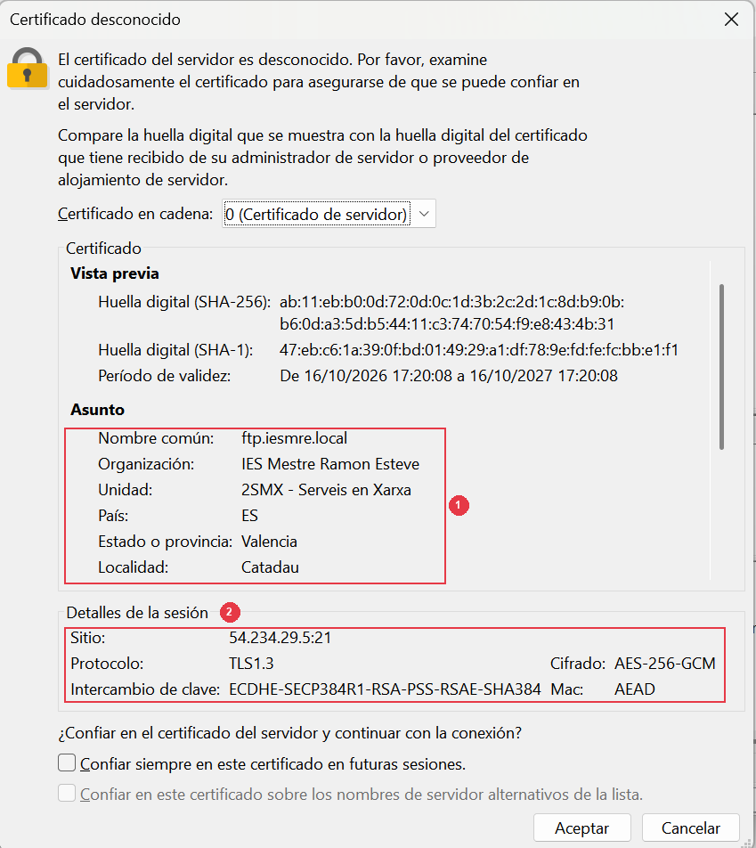
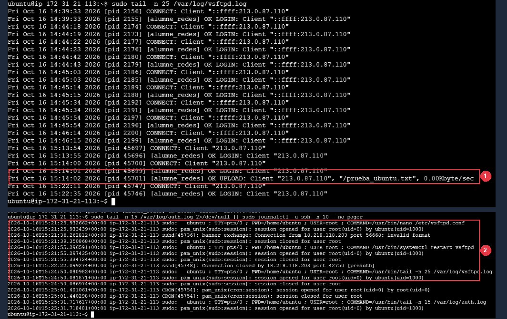

<div class="interactive-progress-tracker">
  <div class="tracker-header">
    <span>🏆 <strong>Progrés d'aquesta secció:</strong> <span class="tracker-count">0 de 4 superats (0%)</span></span>
    <span class="tracker-pts">⭐ <strong>0 punts</strong></span>
  </div>
  <div class="tracker-bar">
    <div class="tracker-fill" style="width: 0%;"></div>
  </div>
</div>

# 6.13 - [Ubuntu Server] Seguretat FTPS amb OpenSSL, claus SSH i auditoría de logs en Linux (RA3-CEf,g)

⚠️ **Obligatori seguir les normes per a la presentació de treballs escritos.**

Totes les evidències hauran d'incloure capturas de pantalla completes on es aprecie clarament el nom de l'equip, usuari i la data/hora.

En aquesta tasca asegurarem el nostre servidor **Ubuntu Server (`Ubuntu_FTPSSH`)** implementant cifrado **FTPS amb OpenSSL**, configurant l'accés **SSH per clau pública** i auditant els registres del sistema en `/var/log/`.

### 13.1 Configuració de FTPS (TLS/SSL) en Ubuntu Server amb OpenSSL i vsftpd

💡 **Retomas aquest apartat en una sessió posterior?**

- **Comprovació de IP:** Conéctate per SSH i FileZilla FTPS usant la nova IP pública de Ubuntu Server.

- **Verificació de vsftpd:** Asegúrate de que `pasv_address` en `/etc/vsftpd.conf` coincideix amb la IP pública actual de Ubuntu (Apartat 12.3) i que el servei està activo amb `sudo systemctl status vsftpd`.

1. En la consola SSH de **`Ubuntu_FTPSSH`**, generar un certificat digital autosignat X.509 RSA de `2048 bits` vàlid per 365 dies en `/etc/ssl/private/vsftpd.pem`:
   

```bash
sudo openssl req -x509 -nodes -days 365 -newkey rsa:2048 \
  -keyout /etc/ssl/private/vsftpd.pem \
  -out /etc/ssl/private/vsftpd.pem
```

1. Cumplimentar les dades identificatius del certificat quan els solicite OpenSSL:

1. **Country Name (2 letter code):** `ES`

1. **State or Province Name:** `Valencia`

1. **Locality Name:** `Catadau`

1. **Organization Name:** `IES Mestre Ramon Esteve`

1. **Organizational Unit Name:** `2SMX - Serveis en Xarxa`

1. **Common Name (FQDN):** `ftp.iesmre.local`

1. Restringir els permisos del fitxer `.pem`:
   

```bash
sudo chmod 600 /etc/ssl/private/vsftpd.pem
```

1. Editar `/etc/vsftpd.conf` (`sudo nano /etc/vsftpd.conf`) i afegir al final el bloc de cifrado SSL/TLS obligatori:
   

```bash
# Cifrado explicito FTPS (TLS/SSL) en vsftpd
ssl_enable=YES
allow_anon_ssl=NO
force_local_data_ssl=YES
force_local_logins_ssl=YES
ssl_tlsv1=YES
ssl_sslv2=NO
ssl_sslv3=NO
require_ssl_reuse=NO
ssl_ciphers=HIGH
rsa_cert_file=/etc/ssl/private/vsftpd.pem
rsa_private_key_file=/etc/ssl/private/vsftpd.pem
```



*Figura 53: Finestra emergente de certificat X.509 en FileZilla al connectar per FTPS a Ubuntu Server, validant el cifrado TLS 1.3 amb AES-256-GCM i les dades del IES Mestre Ramon Esteve (Catadau).*

📷 **Evidència 23 (inserir en el teu document Word) — Realitzar captura de pantalla** de la finestra de verificació del certificat X.509 en FileZilla mostrant les dades de l'entitat (`IES Mestre Ramon Esteve`, `Catadau`, `ftp.iesmre.local`) i la sessió TLS 1.3 amb Ubuntu Server.

### 13.2 Instal·lació de la clau pública SSH i bastionado en Ubuntu Server

1. En la sessió SSH de **Ubuntu Server** (connectat com `alumne_redes`), crear el directori `.ssh` i instal·lar la mateixa clau pública que generamos en PuTTYgen en la Tasca 10:
   

```bash
mkdir -p ~/.ssh
chmod 700 ~/.ssh
nano ~/.ssh/authorized_keys
# Pegar la clave pública ssh-rsa ... en una sola línea, guardar (Ctrl+O) y salir (Ctrl+X)
chmod 600 ~/.ssh/authorized_keys
```

1. Provar des de **PuTTY** en el vostre PC que podéis entrar a `Ubuntu_FTPSSH` amb l'usuari `alumne_redes` i el fitxer `clave_privada_smx.ppk` sense que demane contrasenya.

1. Bastionar el servidor SSH de Ubuntu editant `/etc/ssh/sshd_config`:
   

```bash
sudo nano /etc/ssh/sshd_config
```

   Assegurar les directivas `PubkeyAuthentication yes` i `PasswordAuthentication no`, i reiniciar el servei (`sudo systemctl restart ssh`).

### 13.3 Auditoría de registres en Ubuntu Server (vsftpd.log i auth.log)

1. En la consola SSH de Ubuntu Server, consultar les últimes transferències registrades per `vsftpd` (descomentant `xferlog_enable=YES` en `/etc/vsftpd.conf` si no estuviera activo):
   

```bash
sudo tail -n 25 /var/log/vsftpd.log
```

1. Consultar el registre d'autenticacions i accessos SSH del sistema:
   

```bash
sudo cat /var/log/auth.log | grep -E "sshd.*(Accepted|Failed)" | tail -n 20
```

1. Identificar en l'eixida l'adreça IP pública del client i el mètode d'autenticació empleat (`publickey` o `password`).



*Figura 54: Auditoría de seguretat en Ubuntu Server mostrant el registre de subida exitosa en /var/log/vsftpd.log (OK UPLOAD de prueba_ubuntu.txt) i el registre de comandes privilegiats i accessos en /var/log/auth.log.*

📷 **Evidència 24 (inserir en el teu document Word) — Realitzar captura de pantalla** de la terminal de Ubuntu mostrant les últimes línies del registre `/var/log/vsftpd.log` i de `/var/log/auth.log`.

ℹ️ **Què has d'afegir al teu document Word a l'acabar el Apartat 13 (Fi del Bloc Ubuntu Server)**

En el **Apartat 13** del teu document Word, inclou les **Evidències 23 i 24**:

- **Evidència 23:** Generació del certificat X.509 amb `openssl` en Ubuntu Server i validació del certificat en FileZilla al connectar per FTPS.

- **Evidència 24:** Terminal de Ubuntu mostrant les últimes línies d'auditoría en `/var/log/vsftpd.log` i `/var/log/auth.log`.


---

## 🎮 Reptes Interactius d'Autoavaluació (+100 XP)

Comprova el teu domini sobre **6.13 - [Ubuntu Server] Seguretat FTPS amb OpenSSL, claus SSH i auditoría de logs en Linux (RA3-CEf,g)** superant aquests 4 reptes gamificats (+25 punts cadascun):

<div class="interactive-mcq" data-answer="D" data-hint="Revisa els conceptes teòrics i pràctics d'aquesta secció.">
  <div class="mcq-question">🎯 <strong>Repte 1 (+25 pts):</strong> En Windows Server amb IIS FTP, quina opció de 'FTP User Isolation' permet que cada usuari entre directament a la seua carpeta LocalUser\&lt;usuari&gt; però puga accedir a carpetes virtuals si coneix la ruta?</div>
  <div class="mcq-options">
    <button type="button" class="btn-mcq-opt" data-opt="A">A) Do not isolate users. Start users in FTP root directory.</button>
    <button type="button" class="btn-mcq-opt" data-opt="B">B) Isolate users using Active Directory only.</button>
    <button type="button" class="btn-mcq-opt" data-opt="C">C) Cap de les anteriors és correcta.</button>
    <button type="button" class="btn-mcq-opt" data-opt="D">D) User name directory (disable global virtual directories).</button>
  </div>
  <div class="quiz-feedback"></div>
</div>

<div class="interactive-mcq" data-answer="C" data-hint="Comprova l'apartat corresponent de la unitat.">
  <div class="mcq-question">🎯 <strong>Repte 2 (+25 pts):</strong> Quan comparem amb Wireshark una sessió FTP tradicional amb una sessió FTPS o SFTP, què observem en capturar el trànsit de xarxa?</div>
  <div class="mcq-options">
    <button type="button" class="btn-mcq-opt" data-opt="A">A) Wireshark no pot capturar paquets TCP del port 21.</button>
    <button type="button" class="btn-mcq-opt" data-opt="B">B) Cap de les anteriors és correcta.</button>
    <button type="button" class="btn-mcq-opt" data-opt="C">C) En FTP tradicional les ordres USER i PASS es veuen en text clar, mentre que en FTPS (TLS) i SFTP (SSH) el contingut viatja completament xifrat.</button>
    <button type="button" class="btn-mcq-opt" data-opt="D">D) En tots tres protocols la contrasenya viatja en text clar.</button>
  </div>
  <div class="quiz-feedback"></div>
</div>

<div class="interactive-vf" data-answer="V" data-hint="Verifica l'afirmació amb els apunts de la unitat.">
  <div class="vf-statement">✅ <strong>Repte 3 (Vertader o Fals · +25 pts):</strong> Per a bastionar un servidor OpenSSH i impedir atacs de força bruta per contrasenya una vegada configurada la clau pública, s'estableix PasswordAuthentication no en sshd_config.</div>
  <div class="vf-buttons">
    <button type="button" class="btn-vf" data-opt="V">Vertader (V)</button>
    <button type="button" class="btn-vf" data-opt="F">Fals (F)</button>
  </div>
  <div class="quiz-feedback" style="width: 100%;"></div>
</div>

<div class="interactive-quiz" data-answer="550" data-hint="És el famós error 550.">
  <div class="quiz-question">⌨️ <strong>Repte 4 (+25 pts):</strong> Quin codi d'error numèric de 3 xifres retorna un servidor FTP quan es denega una acció sobre un fitxer per falta de permisos NTFS o POSIX (Permission denied)?</div>
  <div class="quiz-controls">
    <input type="text" class="quiz-input" placeholder="Escriu la resposta..." />
    <button type="button" class="btn-quiz-check">Comprovar</button>
  </div>
  <div class="quiz-feedback"></div>
</div>

### 📋 Llista de Comprovació i Rúbrica d'Assoliment

Marca cada criteri a mesura que completes l'estudi o la resolució pràctica d'aquesta pàgina (**6.13 - [Ubuntu Server] Seguretat FTPS amb OpenSSL, claus SSH i auditoría de logs en Linux (RA3-CEf,g)**):

- [ ] He llegit detingudament la teoria o l'enunciat d'aquesta secció i he anotat els conceptes clau.
- [ ] He revisat els esquemes, taules o blocs de codi i he verificat que sé aplicar-los a l'entorn de treball.
- [ ] He resolt correctament els **4 reptes interactius** superiors obtenint els **100 punts XP**.
- [ ] He descarregat el comprovant oficial en PDF per a adjuntar-lo a la tasca d'**Aules**.

<div class="aules-delivery-card">
  <h3>📤 Comprovant de Lliurament per a Aules</h3>
  <p>Quan hages completat els reptes interactius i la llista d'autoavaluació d'aquesta pàgina, introdueix el teu nom i descarrega el teu certificat oficial en PDF per a adjuntar-lo a la tasca d'<strong>Aules</strong>.</p>
  <div class="aules-student-field">
    <label for="aules-student-name">👤 Nom i Cognoms de l'Alumne/a:</label>
    <input type="text" id="aules-student-name" class="aules-student-name" placeholder="Ex: Joan Garcia Pérez" />
  </div>
  <div class="aules-score-badge">
    <span class="aules-score-count">0/4 reptes completats (0%) · 0 punts · 0/4 criteris d'autoavaluació</span>
  </div>
  <div class="aules-actions">
    <button type="button" class="btn-aules-dl" data-module="SEX" data-unit="UD06" data-activity="ut0613">📥 Descarregar Comprovant PDF</button>
    <button type="button" class="btn-aules-copy">📋 Copiar Resum al Porta-retalls</button>
  </div>
  <div class="aules-toast"></div>
</div>

