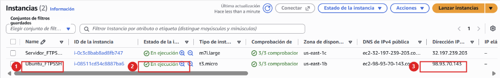
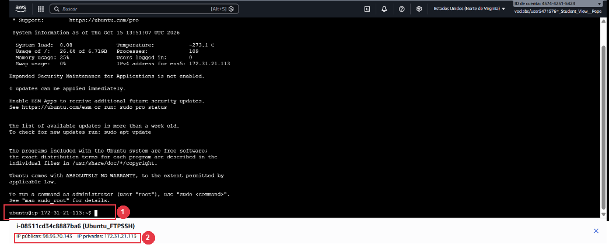
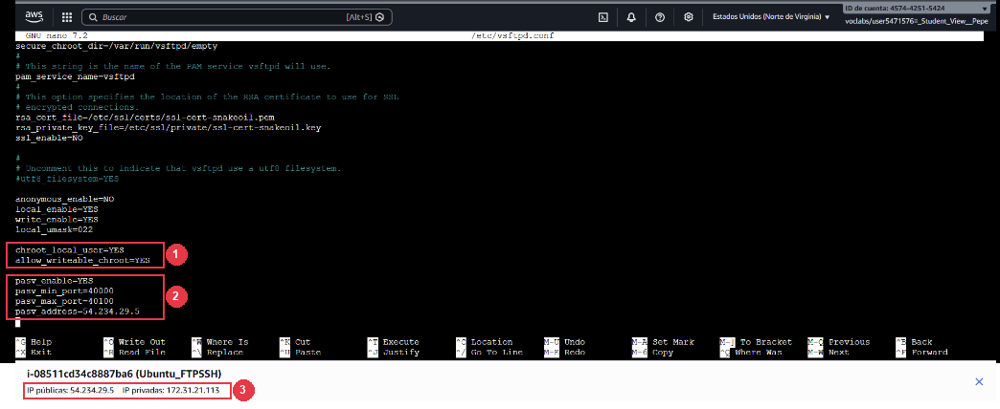
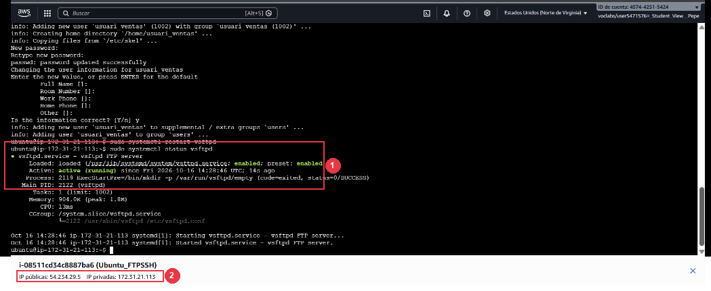
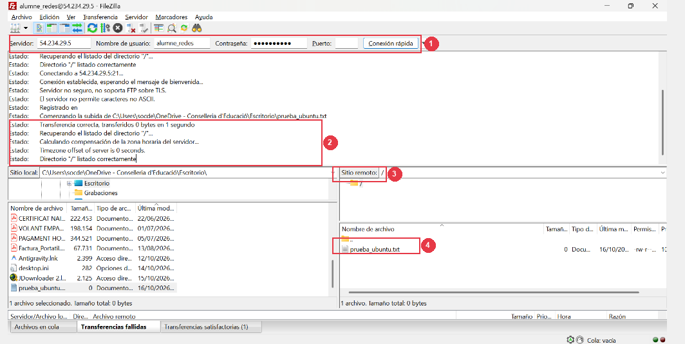

## 12 - [Ubuntu Server] Instalación de vsftpd, modo pasivo, jaula chroot y pruebas en FileZilla (RA3-CEb,c,d,e)

> ⚠️ **Obligatorio seguir las normas para la presentación de trabajos escritos.**
>
> Todas las evidencias deberán incluir capturas de pantalla completas donde se aprecie claramente el nombre del equipo, usuario y la fecha/hora.
>

Una vez completadas y verificadas todas las prácticas sobre Windows Server, pasamos al segundo bloque del laboratorio desplegando el servicio de transferencia de ficheros en **Linux (`Ubuntu Server 24.04 LTS`)** mediante el demonio **`vsftpd`**. *(Mientras trabajes exclusivamente en esta tarea y en la Tarea 13, puedes mantener detenida la máquina de Windows Server para ahorrar saldo en AWS Academy).*

---

### 12.0 Lanzamiento de la instancia EC2 de Ubuntu Server 24.04 LTS en AWS

1. En la consola de **AWS EC2** -> **Instances** -> pulsar en **Launch instances** (**Lanzar instancias**) y desplegar la segunda máquina virtual del laboratorio con las siguientes especificaciones:

| Parámetro de configuración | Valor requerido |
|---|---|
| **Name (Nombre)** | `Ubuntu_FTPSSH` |
| **Application and OS Images (AMI)** | `Ubuntu Server 24.04 LTS (HVM), SSD Volume Type` (64 bits x86) |
| **Instance type (Tipo de instancia)** | `t3.micro` (Recomendado — 2 vCPU, 1 GiB RAM, **Apto para la capa gratuita**) o `t2.micro` |
| **Key pair (login)** | `vockey` (o par de claves del laboratorio) |
| **Network settings (Security group)** | Seleccionar **Select existing security group** y elegir **`grup-servidors-ftp-ssh`** (creado en el apartado 6.1) |
| **Configure storage** | `8 GiB` o `10 GiB` gp3 (SSD) |

> 💡 **En Ubuntu Server sí utilizamos la capa gratuita (t2.micro / t3.micro)**
>
> A diferencia de Windows Server, la máquina `Ubuntu_FTPSSH` funciona exclusivamente en modo terminal consola (CLI sin entorno de escritorio) y el demonio `vsftpd` es extremadamente ligero (consume menos de 150 MiB de RAM). Por tanto, aquí sí seleccionaremos el tipo **`t2.micro`** (o `t3.micro`), que cuenta con la etiqueta verde **Apto para la capa gratuita** (*Free tier eligible*), optimizando al máximo los créditos del laboratorio.
>

2. Esperar a que la instancia pase a estado `Running` y anotar su **Dirección IPv4 pública**:


*Figura 49: Instancia Ubuntu_FTPSSH en estado En ejecución (Running) en el panel de instancias de AWS EC2 con su dirección IPv4 pública asignada.*

> 📷 **Evidencia 19 (insertar en tu documento Word) — Realizar captura de pantalla** del panel de instancias de AWS EC2 mostrando la instancia `Ubuntu_FTPSSH` en ejecución (`Running`) con el grupo de seguridad `grup-servidors-ftp-ssh` asignado.

---

### 12.1 Verificación de puertos en el Security Group de Ubuntu

1. En la consola de AWS -> **EC2** -> comprobar que el Security Group (`grup-servidors-ftp-ssh`) asociado a la instancia `Ubuntu_FTPSSH` tiene abiertos los puertos:
   * Puerto `22` TCP (SSH).
   * Puerto `21` TCP (FTP Control).
   * Rango de puertos `40000-40100` TCP (FTP Pasivo en Linux).

---

### 12.2 Instalación del servicio vsftpd

1. Conectarse a la instancia `Ubuntu_FTPSSH` por SSH utilizando AWS EC2 Instance Connect (o mediante cliente SSH / PuTTY con la clave del laboratorio):


*Figura 49b: Sesión interactiva en la terminal de Ubuntu Server abierta directamente en el navegador con EC2 Instance Connect, mostrando el prompt `ubuntu@ip-...` y la barra inferior con la instancia e IP pública asignada.*

2. Actualizar el índice de repositorios e instalar el paquete `vsftpd`:
   ```bash
   sudo apt update && sudo apt install -y vsftpd
   ```

---

<a id="actualizar-ip-ubuntu"></a>
### 12.3 Configuración de modo pasivo, NAT y jaula chroot en /etc/vsftpd.conf

1. Abrir el fichero de configuración principal del servicio:
   ```bash
   sudo nano /etc/vsftpd.conf
   ```
2. Modificar las siguientes directivas para garantizar el funcionamiento en IPv4, habilitar la escritura, el enjaulado (`chroot`) y el rango pasivo en AWS:

   * **Al principio del fichero:** Comprobar que el servicio escucha en modo IPv4 independiente y comentar la directiva de IPv6:
     ```ini
     listen=YES
     #listen_ipv6=YES
     ```
     *(Importante: En Ubuntu 24.04, si `listen_ipv6=YES` está activo, entrará en conflicto con `pasv_address` y provocará desconexiones `ECONNABORTED` al intentar transferir archivos).*

   * **Al final del fichero:** Añadir el bloque de enjaulado, modo pasivo para AWS y compatibilidad de llamadas al sistema (`seccomp_sandbox`):
     ```ini
     # Acceso de usuarios locales con permisos de escritura
     anonymous_enable=NO
     local_enable=YES
     write_enable=YES
     local_umask=022

     # Enjaulado (chroot jail) de usuarios en su directorio /home/<usuario>
     chroot_local_user=YES
     allow_writeable_chroot=YES

     # Configuración de modo pasivo para AWS Cloud
     pasv_enable=YES
     pasv_min_port=40000
     pasv_max_port=40100
     pasv_address=<TU_IP_PUBLICA_UBUNTU>
     seccomp_sandbox=NO
     ```


*Figura 50: Configuración del fichero /etc/vsftpd.conf en nano mostrando las directivas de enjaulado chroot_local_user, modo pasivo pasv_enable, rango de puertos 40000-40100 y la dirección IP pública en pasv_address.*

> 📷 **Evidencia 20 (insertar en tu documento Word) — Realizar captura de pantalla** del fichero `/etc/vsftpd.conf` editado donde se aprecien las directivas `chroot_local_user=YES`, `pasv_enable=YES`, `pasv_address` y el rango `40000-40100`.

---

### 12.4 Creación de usuarios locales y activación del servicio

1. Crear los usuarios `alumne_redes` y `usuari_ventas` en Ubuntu Server:
   ```bash
   sudo adduser alumne_redes
   # Asignar la contraseña: Smx2026..@
   sudo adduser usuari_ventas
   # Asignar la contraseña: Smx2026..@
   ```
2. Reiniciar el servicio `vsftpd` y verificar que se encuentra activo (`active (running)`):
   ```bash
   sudo systemctl restart vsftpd
   sudo systemctl status vsftpd
   ```


*Figura 51: Terminal de Ubuntu Server mostrando la ejecución de systemctl status vsftpd con el estado active (running) y el proceso principal vsftpd en ejecución.*

> 📷 **Evidencia 21 (insertar en tu documento Word) — Realizar captura de pantalla** de la terminal de Ubuntu mostrando el estado `active (running)` del servicio `vsftpd`.

---

### 12.5 Prueba de transferencia y verificación de enjaulado (chroot) desde FileZilla

> ⚠️ **¿Retomas la conexión a Ubuntu en un día diferente o tras reiniciar?**
>
> Si la máquina virtual `Ubuntu_FTPSSH` se ha detenido y vuelto a iniciar:
> * **En FileZilla:** Introduce en el campo **Servidor** la **nueva IP pública de Ubuntu** (visible en la consola de AWS EC2).
> * **Problema crítico en `vsftpd` si no actualizas la IP:** Si el fichero `/etc/vsftpd.conf` conserva la IP de un día anterior en la directiva `pasv_address`, FileZilla conectará al puerto 21 pero se congelará indefinidamente en `150 Here comes the directory listing...` y fallará por *timeout*.
> * 👉 **Solución:** Abre la terminal de Ubuntu y actualiza la directiva con:
>   ```bash
>   sudo nano /etc/vsftpd.conf
>   # Modifica la línea: pasv_address=<NUEVA_IP_PUBLICA_UBUNTU>
>   sudo systemctl restart vsftpd
>   ```
>   Consulta los detalles completos en el [Apartado 12.3: Configuración de modo pasivo en vsftpd](#actualizar-ip-ubuntu).
>

1. Abrir **FileZilla Client** en vuestro PC del aula y conectar hacia **Ubuntu Server**:
   * **Servidor:** `<IP_PUBLICA_UBUNTU>`
   * **Nombre de usuario:** `alumne_redes` (y posteriormente probar con `usuari_ventas`)
   * **Contraseña:** `Smx2026..@`
   * **Puerto:** `21`
2. Subir un archivo llamado `prueba_ubuntu.txt` y comprobar que la transferencia en modo pasivo (`40000-40100`) se completa con éxito.
3. Verificar que gracias a la directiva `chroot_local_user=YES`, el usuario aparece enjaulado en `/` (que corresponde físicamente a su directorio personal `/home/alumne_redes`), impidiendo que pueda subir de nivel hacia `/home` o `/etc`.


*Figura 52: Cliente FileZilla conectado a Ubuntu Server mostrando el inicio de sesión exitoso, la transferencia completada de prueba_ubuntu.txt y el enjaulado chroot del usuario en su directorio raíz /.*

> 📷 **Evidencia 22 (insertar en tu documento Word) — Realizar captura de pantalla** de FileZilla conectado a Ubuntu Server mostrando la subida de `prueba_ubuntu.txt` y el enjaulado del usuario en su directorio raíz `/`.

> ℹ️ **Qué debes añadir a tu documento Word al terminar el Apartado 12**
>
> En el **Apartado 12** de tu documento Word, incluye las **Evidencias 19 a 22**:
>
> * **Evidencia 19:** Instancia `Ubuntu_FTPSSH` en ejecución (`Running`) en AWS EC2.
> * **Evidencia 20:** Fichero `/etc/vsftpd.conf` con las directivas `chroot_local_user=YES`, `pasv_enable=YES`, `pasv_address` y puertos `40000-40100`.
> * **Evidencia 21:** Salida de `sudo systemctl status vsftpd` mostrando `active (running)`.
> * **Evidencia 22:** FileZilla conectado a Ubuntu Server mostrando la subida de `prueba_ubuntu.txt` y el enjaulado del usuario en `/`.
>

---
