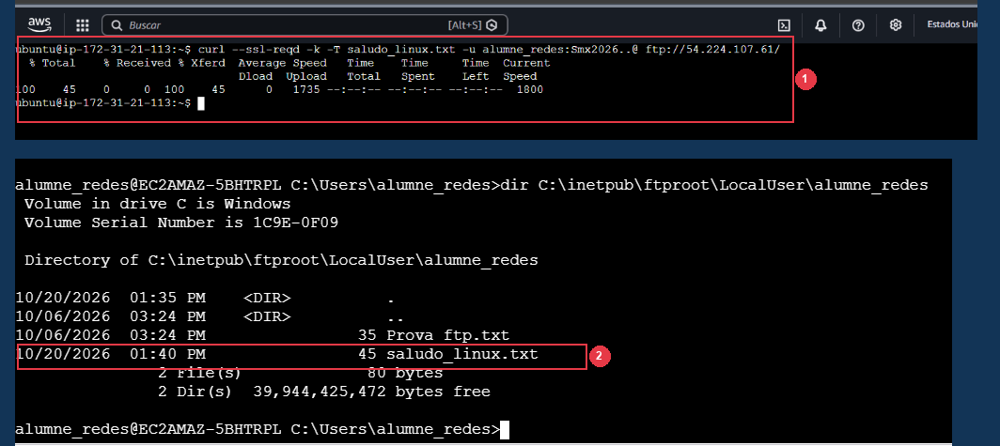
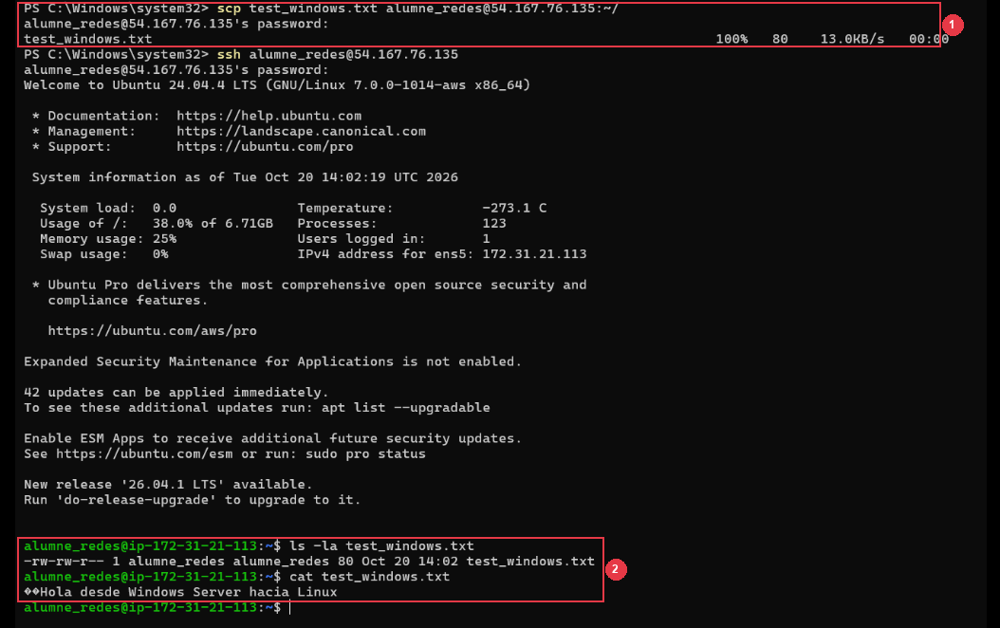

<div class="interactive-progress-tracker">
  <div class="tracker-header">
    <span>🏆 <strong>Progrés d'aquesta secció:</strong> <span class="tracker-count">0 de 4 superats (0%)</span></span>
    <span class="tracker-pts">⭐ <strong>0 punts</strong></span>
  </div>
  <div class="tracker-bar">
    <div class="tracker-fill" style="width: 0%;"></div>
  </div>
</div>

# 6.14 - [Inter-Servidors] Pruebas cruzades bidireccionals en AWS Cloud (RA3-CEe,f)

⚠️ **ATENCIÓ CRÍTICA: Totes dues màquines poden tindre IPs noves si retomas hui la pràctica!**

En aquest apartat de pruebas cruzades és on més errors ocorren si es realitza en un dia diferent, ja que **tant Windows Server com Ubuntu Server habrán cambiado d'adreça IP pública**:

**Llista de comprobacions obligatòries abans de començar:**
1. **Obri la consola de AWS EC2** i comprova que totes dues instàncies (`Servidor_FTPSSH` i `Ubuntu_FTPSSH`) estan en estat `Running`. Anota la **Adreça IPv4 pública actual** de cada una.
2. **En Windows Server:**
   * Verifica que la directiva **FTP Firewall Support** de IIS té la IP actual de Windows (Apartat 6.5) i reinicia el servei (`Restart-Service ftpsvc`).
   * Comprova que OpenSSH té temporalment habilitada l'autenticació per contrasenya (`PasswordAuthentication yes`) com es indica en el pas previo del Apartat 14.1.
3. **En Ubuntu Server:**
   * Verifica que `/etc/vsftpd.conf` té en `pasv_address` la IP pública actual de Ubuntu (Apartat 12.3).
   * Recorda haver executat el desbloqueo de contrasenyes de SSH (`PasswordAuthentication yes`) indicat en el Apartat 14.2.
4. **Sustitució en els comandes:**
   * En **14.1** (des de Ubuntu cap a Windows): Sustituye `<IP_PUBLICA_WINDOWS>` per la IP pública actual de Windows Server.
   * En **14.2** (des de Windows cap a Ubuntu): Sustituye `<IP_PUBLICA_UBUNTU>` per la IP pública actual de Ubuntu Server.

⚠️ **Obligatori seguir les normes per a la presentació de treballs escritos.**

Totes les evidències hauran d'incloure capturas de pantalla completes on es aprecie clarament el nom de l'equip, usuari i la data/hora.

En aquesta tasca comprobarem la interoperabilitat bidireccional conectant els dos servidors entre sí a través de la núvol de Amazon Web Services.

### 14.1 Connexió FTP i SSH des de Ubuntu Server cap a Windows Server

⚠️ **Comprobacions previas en Windows Server abans de realitzar les pruebas cruzades**

Perquè les connexions entrantes des de Linux cap a Windows Server funcionen correctament, verifica en Windows Server els següents punts tècnics:

1. **Autenticació per contrasenya en OpenSSH:** En el Apartat 10 habíamos bastionado el servidor OpenSSH desactivant les contrasenyes (`PasswordAuthentication no`). Perquè puguem iniciar sessió des de Ubuntu mitjançant contrasenya amb `ssh alumne_redes@<IP_WINDOWS>`, obri PowerShell en Windows Server com Administrador i permet temporalment les contrasenyes:
   

```bash
(Get-Content C:\ProgramData\ssh\sshd_config) -replace 'PasswordAuthentication no', 'PasswordAuthentication yes' | Set-Content C:\ProgramData\ssh\sshd_config
Restart-Service sshd
```

1. **Certificat FTPS activo en IIS:** En **IIS Manager** -> **Lloc FTP** (o `FTP-AULA`) -> **FTP SSL Settings**, comprova que està seleccionat `Certificado-FTPs-Aula` amb la directiva **Allow SSL connections** (o *Require*) i polsa **Apply**. Si no estuviera seleccionat, el servidor retornarà l'error `534 Local policy on server does not allow TLS secure connections`.

1. **IP pública en FTP Firewall Support:** Si has reiniciado la màquina i la IP pública de Windows ha cambiado, actualitza l'adreça en **FTP Firewall Support** i reinicia el servei (`Restart-Service ftpsvc`).

1. Des de la sessió SSH de **Ubuntu Server**, transferir un fitxer al servidor Windows Server mitjançant `curl`:
   

```bash
echo "Hola desde Linux hacia Windows Server en AWS" > saludo_linux.txt
curl --ssl-reqd -k -T saludo_linux.txt -u alumne_redes:Smx2026..@ ftp://<IP_PUBLICA_WINDOWS>/
```

   *(Nota: incluimos `--ssl-reqd -k` atès que el servidor Windows exige cifrado explícit FTPS amb certificat autosignat).*

1. Des de la mateixa consola de Ubuntu Server, iniciar una sessió remota SSH cap al servidor Windows i comprovar que el fitxer es ha rebut en el directori FTP de l'usuari:
   

```bash
ssh alumne_redes@<IP_PUBLICA_WINDOWS>
```

   *Una vegada dins del prompt remoto de Windows Server (`alumne_redes@EC2AMAZ-...>`), llistar el directori arrel FTP de l'usuari:*
   

```bash
dir C:\inetpub\ftproot\LocalUser\alumne_redes
exit
```

   *(Nota de verificació: A l'executar `dir` dins de la sessió SSH, ja estáis gestionant i inspeccionant el sistema de fitxers de Windows Server directament des de la terminal remota. Opcionalment, si tenéis l'escriptori remoto (RDP) de Windows obert, també podéis obrir el Explorador de fitxers en `C:\inetpub\ftproot\LocalUser\alumne_redes` per a verlo en la interfície gràfica).*



*Figura 55: Transferència cruzada des de Ubuntu Server cap a Windows Server mitjançant curl sota FTPS explícit (saludo_linux.txt transferido al 100%) i obertura de sessió SSH interactiva en Windows Server verificant la recepció del fitxer amb dir.*

📷 **Evidència 25 (inserir en el teu document Word) — Realitzar captura de pantalla** de la consola de Ubuntu mostrant la subida del fitxer per FTP/FTPS amb `curl` i l'obertura de sessió SSH en Windows validant la presencia del fitxer amb `dir`.

### 14.2 Connexió FTP i SSH des de Windows Server cap a Ubuntu Server

⚠️ **Desbloqueo obligatori d'autenticació per contrasenya en Ubuntu Server (AWS EC2)**

En les imatges oficials de Ubuntu en AWS EC2 (com Ubuntu 24.04 LTS), l'aprovisionament en la núvol (`cloud-init`) desactiva per defecte l'inici de sessió mitjançant contrasenya mitjançant una plantilla prioritaria en `/etc/ssh/sshd_config.d/60-cloudimg-settings.conf` amb el paràmetre `PasswordAuthentication no`.

Per aquest motiu, quan intentéis conectaros des de Windows Server mitjançant `scp` o `ssh` amb l'usuari local `alumne_redes`, el client de Windows recibirá inmediatament l'error:

```bash
alumne_redes@<IP_UBUNTU>: Permission denied (publickey).
C:\Windows\System32\OpenSSH\scp.exe: Connection closed
```

**Solució obligatòria en Ubuntu Server (executar en el seu terminal):**
Per a permetre que els usuaris locals es autentiquen amb la seua contrasenya (`Smx2026..@`), sobrescribid la directiva i reiniciad el demonio SSH:

```bash
echo "PasswordAuthentication yes" | sudo tee /etc/ssh/sshd_config.d/60-cloudimg-settings.conf
sudo systemctl restart ssh
```

*(Comprobad que no mostra cap error. A partir d'aquest moment, el servidor Ubuntu aceptará contrasenyes).*

**Procediment pas a pas des de Windows Server:**

1. Dins del vostre escriptori remoto (RDP) de **Windows Server**, abrid una finestra de **PowerShell** com Administrador.

1. Cread un fitxer de text de prova per a enviar al servidor Linux:
   

```bash
"Hola desde Windows Server hacia Linux" | Out-File -FilePath test_windows.txt -Encoding utf8
```

1. Transferid el fitxer cap a la carpeta personal de l'usuari `alumne_redes` en Ubuntu Server mitjançant **SCP** (Secure Copy Protocol):
   

```bash
scp test_windows.txt alumne_redes@<IP_PUBLICA_UBUNTU>:~/
```

   *(La primera vegada que us conectéis us preguntará si deseáis confiar en la huella ED25519 de l'host: escribid `yes` i pulsad Enter. A continuació, introducid la contrasenya `Smx2026..@`).*

1. Abrid una sessió remota interactiva **SSH** des de Windows Server cap a Ubuntu Server per a verificar que el fitxer ha llegado i comprovar el seu contingut:
   

```bash
ssh alumne_redes@<IP_PUBLICA_UBUNTU>
```

   *Una vegada dins del prompt de Ubuntu (`alumne_redes@ip-...:~$`), listad el fitxer i mostradlo en pantalla:*
   

```bash
ls -la test_windows.txt
cat test_windows.txt
exit
```

   *(Alternativa opcional amb `curl` per FTPS des de PowerShell: `curl.exe --ssl-reqd -k -T test_windows.txt -u alumne_redes:Smx2026..@ ftp://<IP_PUBLICA_UBUNTU>/`).*



*Figura 56: Consola de PowerShell en Windows Server mostrant la transferència del fitxer test_windows.txt mitjançant scp cap a Ubuntu Server i la sessió remota SSH posterior verificant el fitxer amb ls -la i cat.*

📷 **Evidència 26 (inserir en el teu document Word) — Realitzar captura de pantalla** de la consola de PowerShell en Windows Server mostrant l'enviament del fitxer amb `scp` cap a Ubuntu Server i l'obertura de sessió interactiva `ssh` validant la presencia i contingut de `test_windows.txt`.

ℹ️ **Què has d'afegir al teu document Word a l'acabar el Apartat 14**

En el **Apartat 14** del teu document Word, inclou les **Evidències 25 i 26**:

- **Evidència 25:** Consola de Ubuntu Server subent `saludo_linux.txt` per FTPS amb `curl` i abrent sessió SSH cap a Windows Server verificant el fitxer amb `dir`.

- **Evidència 26:** Consola de PowerShell en Windows Server transfirent `test_windows.txt` amb `scp` i abrent sessió interactiva `ssh` en Ubuntu Server comprobant el fitxer amb `ls -la`.


---

## 🎮 Reptes Interactius d'Autoavaluació (+100 XP)

Comprova el teu domini sobre **6.14 - [Inter-Servidors] Pruebas cruzades bidireccionals en AWS Cloud (RA3-CEe,f)** superant aquests 4 reptes gamificats (+25 punts cadascun):

<div class="interactive-mcq" data-answer="D" data-hint="Revisa els conceptes teòrics i pràctics d'aquesta secció.">
  <div class="mcq-question">🎯 <strong>Repte 1 (+25 pts):</strong> En Windows Server amb IIS FTP, quina opció de 'FTP User Isolation' permet que cada usuari entre directament a la seua carpeta LocalUser\&lt;usuari&gt; però puga accedir a carpetes virtuals si coneix la ruta?</div>
  <div class="mcq-options">
    <button type="button" class="btn-mcq-opt" data-opt="A">A) Do not isolate users. Start users in FTP root directory.</button>
    <button type="button" class="btn-mcq-opt" data-opt="B">B) Isolate users using Active Directory only.</button>
    <button type="button" class="btn-mcq-opt" data-opt="C">C) Cap de les anteriors és correcta.</button>
    <button type="button" class="btn-mcq-opt" data-opt="D">D) User name directory (disable global virtual directories).</button>
  </div>
  <div class="quiz-feedback"></div>
</div>

<div class="interactive-mcq" data-answer="C" data-hint="Comprova l'apartat corresponent de la unitat.">
  <div class="mcq-question">🎯 <strong>Repte 2 (+25 pts):</strong> Quan comparem amb Wireshark una sessió FTP tradicional amb una sessió FTPS o SFTP, què observem en capturar el trànsit de xarxa?</div>
  <div class="mcq-options">
    <button type="button" class="btn-mcq-opt" data-opt="A">A) Wireshark no pot capturar paquets TCP del port 21.</button>
    <button type="button" class="btn-mcq-opt" data-opt="B">B) Cap de les anteriors és correcta.</button>
    <button type="button" class="btn-mcq-opt" data-opt="C">C) En FTP tradicional les ordres USER i PASS es veuen en text clar, mentre que en FTPS (TLS) i SFTP (SSH) el contingut viatja completament xifrat.</button>
    <button type="button" class="btn-mcq-opt" data-opt="D">D) En tots tres protocols la contrasenya viatja en text clar.</button>
  </div>
  <div class="quiz-feedback"></div>
</div>

<div class="interactive-vf" data-answer="V" data-hint="Verifica l'afirmació amb els apunts de la unitat.">
  <div class="vf-statement">✅ <strong>Repte 3 (Vertader o Fals · +25 pts):</strong> Per a bastionar un servidor OpenSSH i impedir atacs de força bruta per contrasenya una vegada configurada la clau pública, s'estableix PasswordAuthentication no en sshd_config.</div>
  <div class="vf-buttons">
    <button type="button" class="btn-vf" data-opt="V">Vertader (V)</button>
    <button type="button" class="btn-vf" data-opt="F">Fals (F)</button>
  </div>
  <div class="quiz-feedback" style="width: 100%;"></div>
</div>

<div class="interactive-quiz" data-answer="550" data-hint="És el famós error 550.">
  <div class="quiz-question">⌨️ <strong>Repte 4 (+25 pts):</strong> Quin codi d'error numèric de 3 xifres retorna un servidor FTP quan es denega una acció sobre un fitxer per falta de permisos NTFS o POSIX (Permission denied)?</div>
  <div class="quiz-controls">
    <input type="text" class="quiz-input" placeholder="Escriu la resposta..." />
    <button type="button" class="btn-quiz-check">Comprovar</button>
  </div>
  <div class="quiz-feedback"></div>
</div>

### 📋 Llista de Comprovació i Rúbrica d'Assoliment

Marca cada criteri a mesura que completes l'estudi o la resolució pràctica d'aquesta pàgina (**6.14 - [Inter-Servidors] Pruebas cruzades bidireccionals en AWS Cloud (RA3-CEe,f)**):

- [ ] He llegit detingudament la teoria o l'enunciat d'aquesta secció i he anotat els conceptes clau.
- [ ] He revisat els esquemes, taules o blocs de codi i he verificat que sé aplicar-los a l'entorn de treball.
- [ ] He resolt correctament els **4 reptes interactius** superiors obtenint els **100 punts XP**.
- [ ] He descarregat el comprovant oficial en PDF per a adjuntar-lo a la tasca d'**Aules**.

<div class="aules-delivery-card">
  <h3>📤 Comprovant de Lliurament per a Aules</h3>
  <p>Quan hages completat els reptes interactius i la llista d'autoavaluació d'aquesta pàgina, introdueix el teu nom i descarrega el teu certificat oficial en PDF per a adjuntar-lo a la tasca d'<strong>Aules</strong>.</p>
  <div class="aules-student-field">
    <label for="aules-student-name">👤 Nom i Cognoms de l'Alumne/a:</label>
    <input type="text" id="aules-student-name" class="aules-student-name" placeholder="Ex: Joan Garcia Pérez" />
  </div>
  <div class="aules-score-badge">
    <span class="aules-score-count">0/4 reptes completats (0%) · 0 punts · 0/4 criteris d'autoavaluació</span>
  </div>
  <div class="aules-actions">
    <button type="button" class="btn-aules-dl" data-module="SEX" data-unit="UD06" data-activity="ut0614">📥 Descarregar Comprovant PDF</button>
    <button type="button" class="btn-aules-copy">📋 Copiar Resum al Porta-retalls</button>
  </div>
  <div class="aules-toast"></div>
</div>

