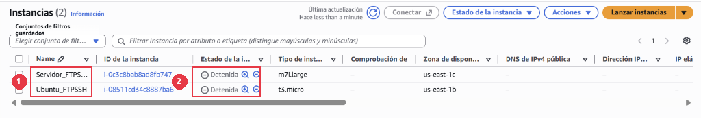

  

    🏆 <strong>Progrés d'aquesta secció:</strong> 0 de 4 superats (0%)
    ⭐ <strong>0 punts</strong>
  

  

    

  

# 6.15 - Control de costos, parada de la infraestructura en AWS i lliurament final (RA3-CEh)

⚠️ **Obligatori seguir les normes per a la presentació de treballs escritos.**

Totes les evidències hauran d'incloure capturas de pantalla completes on es aprecie clarament el nom de l'equip, usuari i la data/hora.

Una vegada completades amb èxit totes les pruebas tècniques en **Windows Server**, **Ubuntu Server** i les **pruebas cruzades d'interoperabilitat** entre tots dos sistemes operatius, el pas imprescindible en qualsevol desplegament professional en la núvol és aplicar les polítiques de **control de costos i parada controlada dels recursos** per a no consumir créditos innecesarios.

### 15.1 Tancament de sessions i parada controlada de les instàncies en AWS

⚠️ **Obligatori al finalitzar cada sessió de treball i a l'acabar la pràctica!**

Els laboratorios de AWS Academy disposen d'un crèdit limitat (\$50). Deixar les instàncies encendides consume saldo continuament i pot provocar que us quedéis sense hores de laboratorio abans de que termine el curs.

1. **Desconexión de les sessions activas:** Tancar les finestres de Escriptori Remoto (RDP), FileZilla, Wireshark i les sessions de PuTTY o PowerShell abiertas en el vostre ordinador físic.

1. **Detener les instàncies en AWS (`Stop instance`):**

1. Abrid la consola de AWS -> **EC2** -> **Instances** (**Instàncies**).

1. Seleccionad les caselles de les vostres dos màquines: **`Servidor_FTPSSH`** i **`Ubuntu_FTPSSH`**.

1. Haced clic en el desplegable superior **Instance state** -> **Stop instance** (**Detener la instància**).

1. Esperad uns segons i pulsad el botó de refrescar (⟳) fins a que en la columna **Instance state** aparega clarament **`Stopped`** (**Detenido**) en totes dues màquines.

*Figura 57: Consola de AWS EC2 mostrant les dos instàncies del laboratorio (Servidor_FTPSSH i Ubuntu_FTPSSH) en estat Stopped (Detenido) per a garantir el control de costos.*

📷 **Evidència 27 (inserir en el teu document Word) — Realitzar captura de pantalla** del panell d'instàncies de EC2 mostrant totes dues màquines (`Servidor_FTPSSH` i `Ubuntu_FTPSSH`) seleccionades i en estat `Stopped` (**Detenido**).

1. **Tancar el laboratorio:** Volved a la pestanya de **AWS Academy** (Vocareum) i pulsad en el botó roig superior **`End Lab`**.

### 15.2 Lliurament única de la Memòria Pràctica en Aules (Checklist final de les 27 Evidències)

⚠️ **Lliurament única en Aules: Memòria Pràctica Completa (RA3)**

Una vegada completats tots els apartats en el teu document de Word, verifica que inclou les **27 evidències numerades** organitzades per apartats, expórtalo a un **únic fitxer PDF** i súbelo a la tasca de **Aules**:

**Bloc I — Windows Server (`Servidor_FTPSSH`):**
1. **Evidència 1 (Ap. 6.0):** Instància `Servidor_FTPSSH` creada i en estat `Running` en AWS EC2.
2. **Evidència 2 (Ap. 6.1):** Taula de les 5 regles d'entrada del Security Group `grup-servidors-ftp-ssh`.
3. **Evidència 3 (Ap. 6.2):** Connexió per Escriptori Remoto (RDP) a Windows Server mostrant **Server Manager**.
4. **Evidència 4 (Ap. 6.4):** Usuari `alumne_redes` membre de `Administrators`, `Remote Desktop Users` i `Users`.
5. **Evidència 5 (Ap. 6.5):** Panell `FTP Firewall Support` en IIS amb rang `50000-50100` i IP pública de AWS.
6. **Evidència 6 (Ap. 6.6):** Lloc `FTP-AULA` creat i en estat `Started` en IIS Manager.
7. **Evidència 7 (Ap. 6.7):** Regla `FTP Pasivo Datos (50000-50100)` (i port `22`) en el Firewall de Windows i servei `Microsoft FTP Service` activo.
8. **Evidència 8 (Ap. 7.1):** Connexió en mode pasivo des de FileZilla i subida de `Prova_ftp.txt` a Windows Server.
9. **Evidència 9 (Ap. 8.1):** Estructura de carpetes departamentals dins de `C:\inetpub\ftproot\LocalUser`.
10. **Evidència 10 (Ap. 8.4):** FileZilla connectat com `usuari_ventas` (aislado) i com `anonymous` recibent `550 Access is denied` a l'intentar esborrar/pujar.
11. **Evidència 11 (Ap. 9.1):** Certificat autosignat `Certificado-FTPs-Aula` en **Server Certificates** de IIS.
12. **Evidència 12 (Ap. 9.3):** Validació del certificat TLS (huella SHA-256) i connexió FTPS amb candado en FileZilla.
13. **Evidència 13 (Ap. 10.2):** Parell de claus generat en PuTTYgen amb comentari `alumne_redes@ies-mre`.
14. **Evidència 14 (Ap. 10.5):** Accés automàtic sense contrasenya en PuTTY i rechazo després del bastionado (`PasswordAuthentication no`).
15. **Evidència 15 (Ap. 11.1):** Transferència per SFTP (port `22`) en FileZilla amb el candado dorado activo.
16. **Evidència 16 (Ap. 11.2):** Subida i descarrega per línia de comandes amb `scp` en PowerShell al `100%`.
17. **Evidència 17 (Ap. 11.3):** Auditoría del log W3C (`u_exAAMMDD.log`) en Notepad mostrant els codis `230`, `234`, `226` i `550`.
18. **Evidència 18 (Ap. 11.4):** Captura de trànsit en Wireshark comparant FTP plànol enfront de FTPS (`TLSv1.2`) i SFTP (`SSHv2`).

**Bloc II — Ubuntu Server (`Ubuntu_FTPSSH`):**
19. **Evidència 19 (Ap. 12.0):** Instància `Ubuntu_FTPSSH` en ejecució (`Running`) en AWS EC2.
20. **Evidència 20 (Ap. 12.3):** Fitxer `/etc/vsftpd.conf` configurado amb mode pasivo (`40000-40100`), `pasv_address` i `chroot_local_user=YES`.
21. **Evidència 21 (Ap. 12.4):** Estat `active (running)` del servei `vsftpd` en la terminal de Ubuntu.
22. **Evidència 22 (Ap. 12.5):** FileZilla connectat a Ubuntu Server subent `prueba_ubuntu.txt` amb l'usuari enjaulado en `/`.
23. **Evidència 23 (Ap. 13.1):** Generació del certificat X.509 amb `openssl` en Ubuntu i connexió FTPS en FileZilla.
24. **Evidència 24 (Ap. 13.3):** Auditoría de registres en `/var/log/vsftpd.log` i `/var/log/auth.log` en Ubuntu Server.

**Bloc III — Pruebas Cruzades de Interoperabilitat i Control de Costos en AWS:**
25. **Evidència 25 (Ap. 14.1):** Subida FTPS amb `curl` i connexió SSH des de Ubuntu Server cap a Windows Server.
26. **Evidència 26 (Ap. 14.2):** Connexió SSH/SCP des de Windows Server cap a Ubuntu Server.
27. **Evidència 27 (Ap. 15.1):** Panell d'instàncies de AWS EC2 mostrant totes dues màquines (`Servidor_FTPSSH` i `Ubuntu_FTPSSH`) en estat **`Stopped`** (**Detenido**).

- **Nom de l'únic fitxer a lliurar:** `RA3-FTP-SSH-NombreApellidos.pdf` (exemple: `RA3-FTP-SSH-JoanPerez.pdf`).

- **Lliurament:** Pujar el fitxer en format PDF a la tasca de lliurament única de la unitat en **Aules** abans de la data límit.

---

## 🎮 Reptes Interactius d'Autoavaluació (+100 XP)

Comprova el teu domini sobre **6.15 - Control de costos, parada de la infraestructura en AWS i lliurament final (RA3-CEh)** superant aquests 4 reptes gamificats (+25 punts cadascun):

  
🎯 <strong>Repte 1 (+25 pts):</strong> Per què el mode passiu (PASV) de FTP requereix una configuració especial del rang de ports i de l'adreça IP pública externa en desplegar un servidor FTP en AWS EC2?

  

    <button type="button" class="btn-mcq-opt" data-opt="A">A) Perquè en mode passiu és el client qui inicia la connexió del canal de dades cap a la IP pública i el port efímer indicats pel servidor darrere del NAT d'AWS.</button>
    <button type="button" class="btn-mcq-opt" data-opt="B">B) Perquè el mode passiu utilitza el protocol ICMP en lloc de TCP.</button>
    <button type="button" class="btn-mcq-opt" data-opt="C">C) Perquè el canal de control de FTP funciona pel port 8080 en AWS.</button>
    <button type="button" class="btn-mcq-opt" data-opt="D">D) Cap de les anteriors és correcta.</button>
  

  

  
🎯 <strong>Repte 2 (+25 pts):</strong> Quina directiva del fitxer /etc/vsftpd.conf en Ubuntu Server s'utilitza per a engabiar (aïllar) els usuaris locals dins del seu propi directori personal?

  

    <button type="button" class="btn-mcq-opt" data-opt="A">A) anonymous_enable=YES</button>
    <button type="button" class="btn-mcq-opt" data-opt="B">B) listen_ipv6=NO</button>
    <button type="button" class="btn-mcq-opt" data-opt="C">C) Cap de les anteriors és correcta.</button>
    <button type="button" class="btn-mcq-opt" data-opt="D">D) chroot_local_user=YES</button>
  

  

  
✅ <strong>Repte 3 (Vertader o Fals · +25 pts):</strong> A diferència de FTPS (que afegeix TLS al protocol FTP clàssic bicanal), SFTP utilitza un únic canal TCP segur sobre el mateix port 22 del servei SSH.

  

    <button type="button" class="btn-vf" data-opt="V">Vertader (V)</button>
    <button type="button" class="btn-vf" data-opt="F">Fals (F)</button>
  

  

  
⌨️ <strong>Repte 4 (+25 pts):</strong> Quin número de port TCP utilitza el canal de control del protocol FTP tradicional?

  

    <input type="text" class="quiz-input" placeholder="Escriu la resposta..." />
    <button type="button" class="btn-quiz-check">Comprovar</button>
  

  

### 📋 Llista de Comprovació i Rúbrica d'Assoliment

Marca cada criteri a mesura que completes l'estudi o la resolució pràctica d'aquesta pàgina (**6.15 - Control de costos, parada de la infraestructura en AWS i lliurament final (RA3-CEh)**):

- [ ] He llegit detingudament la teoria o l'enunciat d'aquesta secció i he anotat els conceptes clau.
- [ ] He revisat els esquemes, taules o blocs de codi i he verificat que sé aplicar-los a l'entorn de treball.
- [ ] He resolt correctament els **4 reptes interactius** superiors obtenint els **100 punts XP**.
- [ ] He descarregat el comprovant oficial en PDF per a adjuntar-lo a la tasca d'**Aules**.

  <h3>📤 Comprovant de Lliurament per a Aules</h3>
  
Quan hages completat els reptes interactius i la llista d'autoavaluació d'aquesta pàgina, introdueix el teu nom i descarrega el teu certificat oficial en PDF per a adjuntar-lo a la tasca d'<strong>Aules</strong>.

  

    <label for="aules-student-name">👤 Nom i Cognoms de l'Alumne/a:</label>
    <input type="text" id="aules-student-name" class="aules-student-name" placeholder="Ex: Joan Garcia Pérez" />
  

  

    0/4 reptes completats (0%) · 0 punts · 0/4 criteris d'autoavaluació
  

  

    <button type="button" class="btn-aules-dl" data-module="SEX" data-unit="UD06" data-activity="ut0615">📥 Descarregar Comprovant PDF</button>
    <button type="button" class="btn-aules-copy">📋 Copiar Resum al Porta-retalls</button>
  

  

