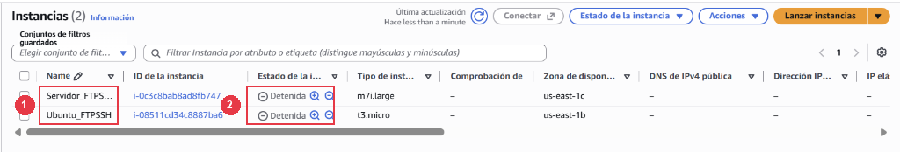

## 15 - Control de costes, parada de la infraestructura en AWS y entrega final (RA3-CEh)

> ⚠️ **Obligatorio seguir las normas para la presentación de trabajos escritos.**
>
> Todas las evidencias deberán incluir capturas de pantalla completas donde se aprecie claramente el nombre del equipo, usuario y la fecha/hora.
>

Una vez completadas con éxito todas las pruebas técnicas en **Windows Server**, **Ubuntu Server** y las **pruebas cruzadas de interoperabilidad** entre ambos sistemas operativos, el paso imprescindible en cualquier despliegue profesional en la nube es aplicar las políticas de **control de costes y parada controlada de los recursos** para no consumir créditos innecesarios.

---

### 15.1 Cierre de sesiones y parada controlada de las instancias en AWS

> ⚠️ **¡Obligatorio al finalizar cada sesión de trabajo y al terminar la práctica!**
>
> Los laboratorios de AWS Academy disponen de un crédito limitado (\$50). Dejar las instancias encendidas consume saldo continuamente y puede provocar que os quedéis sin horas de laboratorio antes de que termine el curso.
>

1. **Desconexión de las sesiones activas:** Cerrar las ventanas de Escritorio Remoto (RDP), FileZilla, Wireshark y las sesiones de PuTTY o PowerShell abiertas en vuestro ordenador físico.
2. **Detener las instancias en AWS (`Stop instance`):**
   * Abrid la consola de AWS -> **EC2** -> **Instances** (**Instancias**).
   * Seleccionad las casillas de vuestras dos máquinas: **`Servidor_FTPSSH`** y **`Ubuntu_FTPSSH`**.
   * Haced clic en el desplegable superior **Instance state** -> **Stop instance** (**Detener la instancia**).
   * Esperad unos segundos y pulsad el botón de refrescar (⟳) hasta que en la columna **Instance state** aparezca claramente **`Stopped`** (**Detenido**) en ambas máquinas.

*Figura 57: Consola de AWS EC2 mostrando las dos instancias del laboratorio (Servidor_FTPSSH y Ubuntu_FTPSSH) en estado Stopped (Detenido) para garantizar el control de costes.*

> 📷 **Evidencia 27 (insertar en tu documento Word) — Realizar captura de pantalla** del panel de instancias de EC2 mostrando ambas máquinas (`Servidor_FTPSSH` y `Ubuntu_FTPSSH`) seleccionadas y en estado `Stopped` (**Detenido**).

3. **Cerrar el laboratorio:** Volved a la pestaña de **AWS Academy** (Vocareum) y pulsad en el botón rojo superior **`End Lab`**.

---

### 15.2 Entrega única de la Memoria Práctica en Aules (Checklist final de las 27 Evidencias)

> ⚠️ **Entrega única en Aules: Memoria Práctica Completa (RA3)**
>
> Una vez completados todos los apartados en tu documento de Word, verifica que incluye las **27 evidencias numeradas** organizadas por apartados, expórtalo a un **único archivo PDF** y súbelo a la tarea de **Aules**:
>
> **Bloque I — Windows Server (`Servidor_FTPSSH`):**
> 1. **Evidencia 1 (Ap. 6.0):** Instancia `Servidor_FTPSSH` creada y en estado `Running` en AWS EC2.
> 2. **Evidencia 2 (Ap. 6.1):** Tabla de las 5 reglas de entrada del Security Group `grup-servidors-ftp-ssh`.
> 3. **Evidencia 3 (Ap. 6.2):** Conexión por Escritorio Remoto (RDP) a Windows Server mostrando **Server Manager**.
> 4. **Evidencia 4 (Ap. 6.4):** Usuario `alumne_redes` miembro de `Administrators`, `Remote Desktop Users` y `Users`.
> 5. **Evidencia 5 (Ap. 6.5):** Panel `FTP Firewall Support` en IIS con rango `50000-50100` e IP pública de AWS.
> 6. **Evidencia 6 (Ap. 6.6):** Sitio `FTP-AULA` creado y en estado `Started` en IIS Manager.
> 7. **Evidencia 7 (Ap. 6.7):** Regla `FTP Pasivo Datos (50000-50100)` (y puerto `22`) en el Firewall de Windows y servicio `Microsoft FTP Service` activo.
> 8. **Evidencia 8 (Ap. 7.1):** Conexión en modo pasivo desde FileZilla y subida de `Prova_ftp.txt` a Windows Server.
> 9. **Evidencia 9 (Ap. 8.1):** Estructura de carpetas departamentales dentro de `C:\inetpub\ftproot\LocalUser`.
> 10. **Evidencia 10 (Ap. 8.4):** FileZilla conectado como `usuari_ventas` (aislado) y como `anonymous` recibiendo `550 Access is denied` al intentar borrar/subir.
> 11. **Evidencia 11 (Ap. 9.1):** Certificado autofirmado `Certificado-FTPs-Aula` en **Server Certificates** de IIS.
> 12. **Evidencia 12 (Ap. 9.3):** Validación del certificado TLS (huella SHA-256) y conexión FTPS con candado en FileZilla.
> 13. **Evidencia 13 (Ap. 10.2):** Par de claves generado en PuTTYgen con comentario `alumne_redes@ies-mre`.
> 14. **Evidencia 14 (Ap. 10.5):** Acceso automático sin contraseña en PuTTY y rechazo tras el bastionado (`PasswordAuthentication no`).
> 15. **Evidencia 15 (Ap. 11.1):** Transferencia por SFTP (puerto `22`) en FileZilla con el candado dorado activo.
> 16. **Evidencia 16 (Ap. 11.2):** Subida y descarga por línea de comandos con `scp` en PowerShell al `100%`.
> 17. **Evidencia 17 (Ap. 11.3):** Auditoría del log W3C (`u_exAAMMDD.log`) en Notepad mostrando los códigos `230`, `234`, `226` y `550`.
> 18. **Evidencia 18 (Ap. 11.4):** Captura de tráfico en Wireshark comparando FTP plano frente a FTPS (`TLSv1.2`) y SFTP (`SSHv2`).
>
> **Bloque II — Ubuntu Server (`Ubuntu_FTPSSH`):**
> 19. **Evidencia 19 (Ap. 12.0):** Instancia `Ubuntu_FTPSSH` en ejecución (`Running`) en AWS EC2.
> 20. **Evidencia 20 (Ap. 12.3):** Fichero `/etc/vsftpd.conf` configurado con modo pasivo (`40000-40100`), `pasv_address` y `chroot_local_user=YES`.
> 21. **Evidencia 21 (Ap. 12.4):** Estado `active (running)` del servicio `vsftpd` en la terminal de Ubuntu.
> 22. **Evidencia 22 (Ap. 12.5):** FileZilla conectado a Ubuntu Server subiendo `prueba_ubuntu.txt` con el usuario enjaulado en `/`.
> 23. **Evidencia 23 (Ap. 13.1):** Generación del certificado X.509 con `openssl` en Ubuntu y conexión FTPS en FileZilla.
> 24. **Evidencia 24 (Ap. 13.3):** Auditoría de registros en `/var/log/vsftpd.log` y `/var/log/auth.log` en Ubuntu Server.
>
> **Bloque III — Pruebas Cruzadas de Interoperabilidad y Control de Costes en AWS:**
> 25. **Evidencia 25 (Ap. 14.1):** Subida FTPS con `curl` y conexión SSH desde Ubuntu Server hacia Windows Server.
> 26. **Evidencia 26 (Ap. 14.2):** Conexión SSH/SCP desde Windows Server hacia Ubuntu Server.
> 27. **Evidencia 27 (Ap. 15.1):** Panel de instancias de AWS EC2 mostrando ambas máquinas (`Servidor_FTPSSH` y `Ubuntu_FTPSSH`) en estado **`Stopped`** (**Detenido**).
>
> * **Nombre del único fichero a entregar:** `RA3-FTP-SSH-NombreApellidos.pdf` (ejemplo: `RA3-FTP-SSH-JoanPerez.pdf`).
> * **Entrega:** Subir el archivo en formato PDF a la tarea de entrega única de la unidad en **Aules** antes de la fecha límite.
>
>
