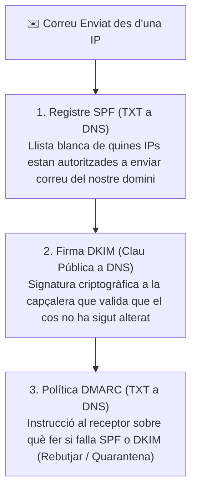

# UT07 — Serveis de Correu Electrònic (SMTP, IMAP, POP3)

El correu electrònic és un dels sistemes de comunicació més antics i utilitzats d'Internet. Funciona com un sistema distribuït de bústies i encaminament de missatges estructurat en tres capes d'agents i diversos protocols especialitzats.

---

## 📌 1. Arquitectura del Servei de Correu

L'enviament i recepció d'un correu electrònic requereix la interacció coordinada de tres components bàsics:

```mermaid
graph LR
    subgraph "ORGANITZACIÓ EMISSORA"
        MUA1["👤 Client Emissor (MUA)<br/>Outlook / Thunderbird"] -->|Envia per SMTP (Port 587)| MTA1["🖥️ Servidor Correu Emissor (MTA)<br/>Postfix / Exchange"]
    end

    MTA1 -->|Envia per SMTP (Port 25)<br/>Consulta registre MX a DNS| MTA2["🖥️ Servidor Correu Receptor (MTA)<br/>Postfix"]

    subgraph "ORGANITZACIÓ RECEPTORA"
        MTA2 -->|Lliurament intern| MDA["📬 Agent de Bústies (MDA)<br/>Dovecot"]
        MDA -->|Emmagatzema a la bústia| BOX["📁 /var/mail/ o Maildir/"]
        MUA2["👤 Client Receptor (MUA)"] -->|Consulta per IMAP/POP3 (Port 993/995)| MDA
    end
```

### Components de l'Arquitectura:
- **MUA (*Mail User Agent*):** El client de correu de l'usuari final (Mozilla Thunderbird, Microsoft Outlook o aplicacions web com Roundcube/Gmail).
- **MTA (*Mail Transfer Agent*):** El servidor que s'encarrega d'encaminar i transmetre els correus d'un servidor a un altre a través d'Internet mitjançant el protocol **SMTP** (ex.: Postfix, Sendmail, Exim).
- **MDA (*Mail Delivery Agent*):** El servidor encarregat d'agafar el correu rebut pel MTA i dipositar-lo físicament a la bústia de l'usuari al disc, així com oferir accés als clients mitjançant **IMAP o POP3** (ex.: Dovecot).

---

## 📌 2. Protocols de Transport de Correu i Ports Estàndard

| Protocol | Nom Complet | Funció Principal | Ports Estàndard |
| :--- | :--- | :--- | :---: |
| **SMTP** | *Simple Mail Transfer Protocol* | Enviament i relleu de missatges entre servidors. | **25** (servidors), **587** (enviament autenticat STARTTLS), **465** (SMTPS) |
| **POP3** | *Post Office Protocol v3* | **Descarrega els correus** al client i normalment els esborra del servidor. | **110** (clar), **995** (POP3S xifrat) |
| **IMAP** | *Internet Message Access Protocol* | **Sincronitza les bústies** i carpetes mantenint sempre els correus al servidor. Permet múltiples dispositius alhora. | **143** (clar), **993** (IMAPS xifrat) |

---

## 📌 3. Seguretat Antispam en DNS: SPF, DKIM i DMARC

Per a evitar que tercers puguen enviar correus falsificant el nostre nom de domini (*Email Spoofing*), s'incorporen tres mecanismes basats en registres DNS públics:



- **SPF (*Sender Policy Framework*):** Registre de tipus TXT que indica: `v=spf1 ip4:192.168.1.10 -all`.
- **DKIM (*DomainKeys Identified Mail*):** Signatura digital amb clau privada al servidor emissor que es verifica amb la clau pública publicada al DNS.
- **DMARC:** Informa els servidors de destí de la política estricta que han d'aplicar davant missatges sospitosos.

---

## 📌 4. Desplegament de Postfix i Dovecot en Ubuntu Server

```bash
# Instal·lar el servidor SMTP (Postfix) i el servidor IMAP/POP3 (Dovecot)
sudo apt update && sudo apt install postfix dovecot-imapd dovecot-pop3d -y
```

### Configuració bàsica de Postfix (`/etc/postfix/main.cf`):
```text
myhostname = correu.iesrafel.internal
mydomain = iesrafel.internal
myorigin = $mydomain
mydestination = $myhostname, localhost.$mydomain, localhost, $mydomain
mynetworks = 127.0.0.0/8 [::ffff:127.0.0.0]/104 192.168.1.0/24
home_mailbox = Maildir/
```

```bash
# Reiniciar els serveis
sudo systemctl restart postfix dovecot

# Verificar que els ports estan en escolta
sudo ss -tulpn | grep -E ':(25|143|993|587)'
```
