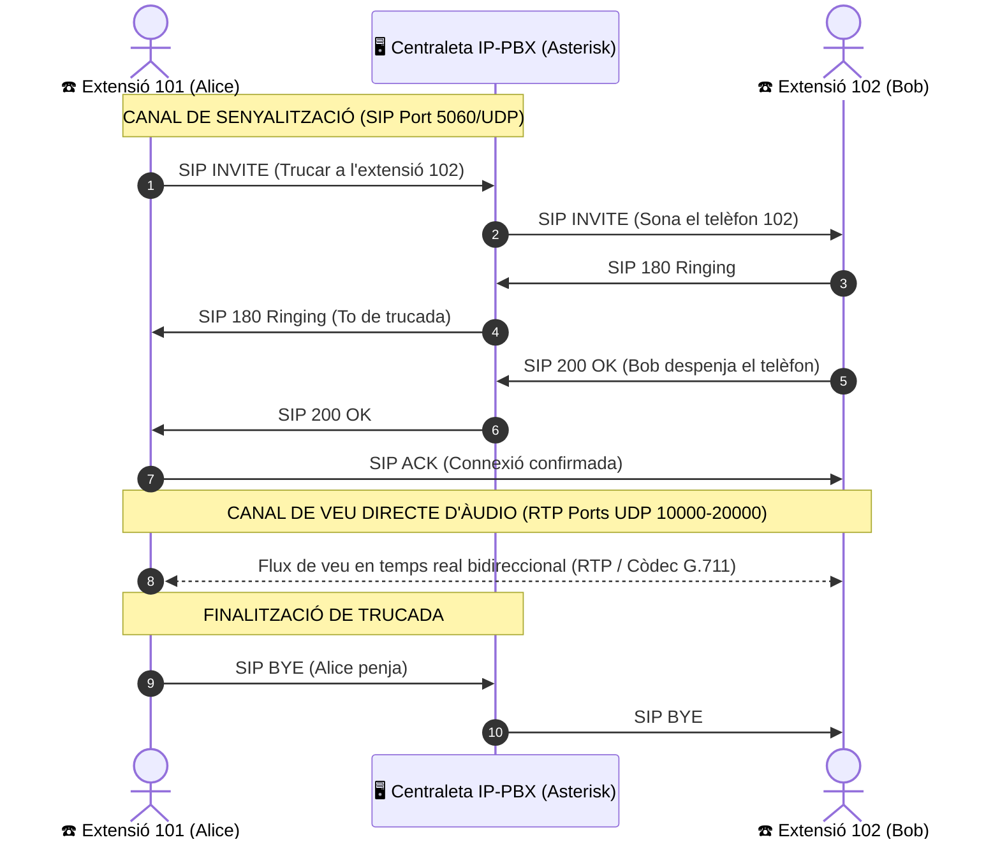

# UT08 — Serveis de Veu sobre IP (VoIP) i Telefonia IP

La **Veu sobre IP (VoIP - *Voice over Internet Protocol*)** és la tecnologia que permet transmetre la veu humana i el contingut multimèdia digitalitzats en forma de paquets de dades a través de xarxes d'àrea local i Internet, substituint les antigues línies telefòniques analògiques convencionals.

---

## 📌 1. Principis de la Digitalització de la Veu i Còdecs

Per a transmetre el so d'una conversa a través d'una xarxa informàtica, el senyal analògic continu del micròfon s'ha de transformar en un flux binari de zeros i uns:

```mermaid
flowchart LR
    A["🎤 Senyal Analògic de Veu (Ona contínua)"] -->|Mostreig (8000 cops/s)| B["📊 Quantificació (Nivells discrets)"]
    B -->|Codificació PCM| C["01101001... Flux Digital"]
    C -->|Còdec d'Àudio (G.711 / Opus)| D["📦 Paquets IP (RTP sobre UDP)"]
```

### Còdecs d'Àudio d'Ús Corporatiu:
- **G.711 (PCMA / PCMU):** L'estàndard de referència de la telefonia fixa. Mostreja a $8\text{ kHz}$ amb 8 bits per mostra, consumint **$64\text{ kbps}$**. No utilitza compressió; per tant, ofereix una excel·lent claredat de veu amb nul·la càrrega per a la CPU.
- **G.729:** Còdec altament comprimit que consumeix només **$8\text{ kbps}$** d'amplada de banda per canal. És ideal per a seus remotes amb connexions limitades.
- **Opus:** Còdec modern de codi obert amb taxa de bits adaptable dinàmicament ($6\text{ kbps}$ a $510\text{ kbps}$) utilitzat en aplicacions com WhatsApp, Discord i WebRTC.

---

## 📌 2. Protocols de Senyalització i Mitjans: SIP i RTP

En telefonia IP s'utilitzen dos protocols absolutament independents que viatgen per camins separats:



1. **Protocol SIP (*Session Initiation Protocol* - RFC 3261):** Controla la trucada (marcatge, establiment, to de trucada, canvi a bústia de veu i penjada) sobre el port **UDP 5060**.
2. **Protocol RTP (*Real-time Transport Protocol* - RFC 3550):** Transporta els paquets de veu en temps real directament entre els telèfons mitjançant datagrames UDP (ports dinàmics $10000 - 20000$).

---

## 📌 3. Elements d'una Infraestructura VoIP

- **Centraleta IP-PBX (*Private Branch Exchange*):** El cervell del sistema (com **Asterisk** o distribucions completes amb entorn web com **FreePBX** o **Issabel**). Gestiona les extensions, el registre dels usuaris, les cues d'espera i el pla de marcatge (*Dialplan*).
- **Telèfons IP de sobretaula (*Hardphones*):** Dispositius físics amb pantalla, auricular i connector Ethernet RJ-45 que s'alimenten directament pel cable de xarxa mitjançant PoE (*Power over Ethernet*).
- **Telèfons de programari (*Softphones*):** Aplicacions instal·lades en ordinadors o telèfons intel·ligents (com *Zoiper*, *MicroSIP* o *Linphone*).
- **Adaptadors ATA (*Analog Telephone Adapter*):** Petits dispositius amb port Ethernet i ports RJ-11 que permeten aprofitar telèfons analògics antics o màquines de fax convencionals en una xarxa VoIP moderna.
- **Troncal SIP (*SIP Trunk*):** Connexió virtual mitjançant Internet amb una companyia de telecomunicacions per a poder fer i rebre trucades cap a la xarxa pública de telefonia mòbil i fixa.
