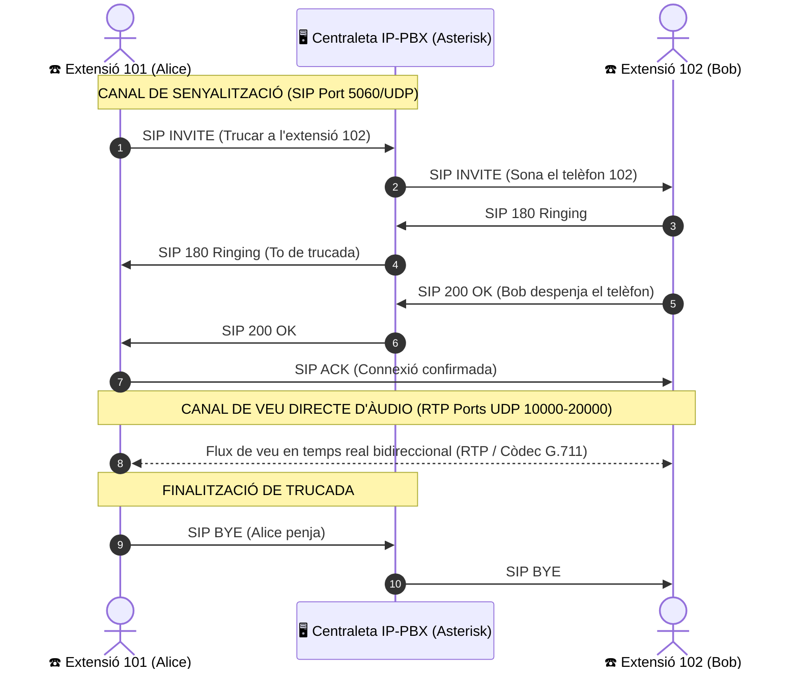

# UT08 — Serveis de Veu sobre IP (VoIP) i Telefonia IP

La **Veu sobre IP (VoIP - *Voice over Internet Protocol*)** és la tecnologia que permet transmetre la veu humana i el contingut multimèdia digitalitzats en forma de paquets de dades a través de xarxes d'àrea local i Internet, substituint les antigues línies telefòniques analògiques convencionals.

---

## 📌 1. Principis de la Digitalització de la Veu i Còdecs

Per a transmetre el so d'una conversa a través d'una xarxa informàtica, el senyal analògic continu del micròfon s'ha de transformar en un flux binari de zeros i uns:

<div style="background: linear-gradient(135deg, #0f172a 0%, #1e293b 100%); border-radius: 12px; padding: 20px; margin: 25px 0; box-shadow: 0 10px 25px -5px rgba(0, 0, 0, 0.3); border: 1px solid #334155;">
  <div style="text-align: center; margin-bottom: 15px;">
    <span style="background: #38bdf8; color: #0f172a; font-weight: 700; font-size: 0.75rem; text-transform: uppercase; letter-spacing: 0.05em; padding: 4px 10px; border-radius: 9999px;">Infografia Tècnica</span>
    <h3 style="color: #f8fafc; margin: 10px 0 5px 0; font-size: 1.25rem;">Arquitectura VoIP: Senyalització SIP vs Àudio RTP</h3>
    <p style="color: #94a3b8; font-size: 0.85rem; margin: 0;">Separació de camins entre la gestió de trucades i el transport de veu en temps real</p>
  </div>
  <svg viewBox="0 0 860 260" width="100%" height="100%" xmlns="http://www.w3.org/2000/svg" style="display: block; font-family: system-ui, -apple-system, sans-serif;">
    <defs>
      <linearGradient id="sipGrad" x1="0%" y1="0%" x2="100%" y2="100%">
        <stop offset="0%" stop-color="#0284c7" stop-opacity="0.3"/>
        <stop offset="100%" stop-color="#0369a1" stop-opacity="0.1"/>
      </linearGradient>
      <linearGradient id="rtpGrad" x1="0%" y1="0%" x2="100%" y2="100%">
        <stop offset="0%" stop-color="#10b981" stop-opacity="0.3"/>
        <stop offset="100%" stop-color="#047857" stop-opacity="0.1"/>
      </linearGradient>
    </defs>

    <!-- Terminal Alice -->
    <rect x="30" y="30" width="160" height="200" rx="8" fill="#1e293b" stroke="#38bdf8" stroke-width="1.5"/>
    <text x="110" y="60" fill="#ffffff" font-size="24" text-anchor="middle">☎️</text>
    <text x="110" y="85" fill="#38bdf8" font-size="12" font-weight="bold" text-anchor="middle">Extensió 101</text>
    <text x="110" y="102" fill="#94a3b8" font-size="10" text-anchor="middle">Alice (Softphone / IP)</text>
    <line x1="45" y1="115" x2="175" y2="115" stroke="#334155"/>
    <text x="45" y="135" fill="#cbd5e1" font-size="9.5">• Micròfon analògic</text>
    <text x="45" y="152" fill="#cbd5e1" font-size="9.5">• Còdec G.711 / Opus</text>
    <text x="45" y="170" fill="#cbd5e1" font-size="9.5">• Port SIP: 5060</text>
    <text x="45" y="188" fill="#cbd5e1" font-size="9.5">• Port RTP dinàmic</text>
    <text x="110" y="215" fill="#38bdf8" font-size="10" text-anchor="middle" font-weight="bold">IP: 192.168.1.51</text>

    <!-- Centraleta Asterisk (Mig superior) -->
    <rect x="330" y="20" width="200" height="95" rx="8" fill="url(#sipGrad)" stroke="#38bdf8" stroke-width="1.5"/>
    <text x="430" y="45" fill="#38bdf8" font-size="12" font-weight="bold" text-anchor="middle">🖥️ IP-PBX ASTERISK</text>
    <text x="430" y="62" fill="#e2e8f0" font-size="10" text-anchor="middle">Canal de Senyalització</text>
    <text x="430" y="78" fill="#94a3b8" font-size="9.5" text-anchor="middle">Port UDP 5060 / Dialplan</text>
    <text x="430" y="98" fill="#38bdf8" font-size="9.5" text-anchor="middle" font-weight="bold">INVITE / RINGING / 200 OK / BYE</text>

    <!-- Fletxes SIP -->
    <path d="M 190 70 L 330 65" stroke="#38bdf8" stroke-width="2" stroke-dasharray="3,3"/>
    <path d="M 530 65 L 670 70" stroke="#38bdf8" stroke-width="2" stroke-dasharray="3,3"/>

    <!-- Fletxa RTP Directa (Inferior) -->
    <rect x="230" y="145" width="400" height="75" rx="8" fill="url(#rtpGrad)" stroke="#34d399" stroke-width="1.5"/>
    <text x="430" y="170" fill="#34d399" font-size="12" font-weight="bold" text-anchor="middle">🔊 FLUX DE VEU DIRECTE P2P (RTP)</text>
    <text x="430" y="188" fill="#e2e8f0" font-size="10" text-anchor="middle">Ports UDP Dinàmics 10000 - 20000</text>
    <text x="430" y="205" fill="#94a3b8" font-size="9" text-anchor="middle">La veu NO passa pel servidor PBX! Comunica terminals directament</text>
    <path d="M 190 180 L 230 180" stroke="#34d399" stroke-width="3"/>
    <path d="M 630 180 L 670 180" stroke="#34d399" stroke-width="3"/>

    <!-- Terminal Bob -->
    <rect x="670" y="30" width="160" height="200" rx="8" fill="#1e293b" stroke="#34d399" stroke-width="1.5"/>
    <text x="750" y="60" fill="#ffffff" font-size="24" text-anchor="middle">☎️</text>
    <text x="750" y="85" fill="#34d399" font-size="12" font-weight="bold" text-anchor="middle">Extensió 102</text>
    <text x="750" y="102" fill="#94a3b8" font-size="10" text-anchor="middle">Bob (Telèfon IP PoE)</text>
    <line x1="685" y1="115" x2="815" y2="115" stroke="#334155"/>
    <text x="685" y="135" fill="#cbd5e1" font-size="9.5">• Altaveu / Auricular</text>
    <text x="685" y="152" fill="#cbd5e1" font-size="9.5">• Còdec G.711 / Opus</text>
    <text x="685" y="170" fill="#cbd5e1" font-size="9.5">• Port SIP: 5060</text>
    <text x="685" y="188" fill="#cbd5e1" font-size="9.5">• Port RTP dinàmic</text>
    <text x="750" y="215" fill="#34d399" font-size="10" text-anchor="middle" font-weight="bold">IP: 192.168.1.52</text>
  </svg>
</div>

### 📋 Matriu Comparativa de Còdecs d'Àudio i Paràmetres VoIP

| Còdec d'Àudio | Taxa de Bits Bruta | Amplada de Banda amb Capçaleres (IP/UDP/RTP) | Freqüència de Mostreig | Puntuació de Qualitat (MOS 1-5) | Consum de CPU i Llicència | Àmbit d'Aplicació Recomanat |
| :--- | :--- | :--- | :--- | :--- | :--- | :--- |
| **G.711 (PCMA / PCMU)** | $64\text{ kbps}$ | $\approx 87,2\text{ kbps}$ | $8\text{ kHz}$ (Banda estreta) | $4,1$ (Molt bona) | Molt baix / Codi obert lliure | Xarxes locals corporatives (LAN) i enllaços troncal SIP d'alta capacitat. |
| **G.729** | $8\text{ kbps}$ | $\approx 31,2\text{ kbps}$ | $8\text{ kHz}$ (Banda estreta) | $3,9$ (Acceptable) | Mitjà-Alt / Propietari (patents vençudes) | Connexions WAN satel·litàries o seus remotes amb amplada de banda molt reduïda. |
| **G.722** | $64\text{ kbps}$ | $\approx 87,2\text{ kbps}$ | $16\text{ kHz}$ (Àudio HD) | $4,5$ (Excel·lent HD) | Baix / Estàndard lliure ITU-T | Telefonia corporativa interna entre terminals IP amb suport d'alta fidelitat. |
| **Opus** | $6\text{ - }510\text{ kbps}$ (Adaptable) | Dinàmica segons xarxa | $8\text{ - }48\text{ kHz}$ (Banda completa) | $4,5\text{ - }4,8$ (Màxima fidelitat) | Mitjà / Codi obert (IETF RFC 6716) | WebRTC, videoconferència moderna, audioconferències i connexions mòbils 4G/5G. |

---

## 📌 2. Protocols de Senyalització i Mitjans: SIP i RTP

En telefonia IP s'utilitzen dos protocols absolutament independents que viatgen per camins separats:



1. **Protocol SIP (*Session Initiation Protocol* - RFC 3261):** Controla la trucada (marcatge, establiment, to de trucada, canvi a bústia de veu i penjada) sobre el port **UDP 5060**.
2. **Protocol RTP (*Real-time Transport Protocol* - RFC 3550):** Transporta els paquets de veu en temps real directament entre els telèfons mitjançant datagrames UDP (ports dinàmics $10000 - 20000$).

---

## 📌 3. Elements d'una Infraestructura VoIP

- **Centraleta IP-PBX (*Private Branch Exchange*):** El cervell del sistema (com **Asterisk** o distribucions completes amb entorn web com **FreePBX** o **Issabel**). Gestiona les extensions, el registre dels usuaris, les cues d'espera i el pla de marcatge (*Dialplan*).
- **Telèfons IP de sobretaula (*Hardphones*):** Dispositius físics amb pantalla, auricular i connector Ethernet RJ-45 que s'alimenten directament pel cable de xarxa mitjançant PoE (*Power over Ethernet*).
- **Telèfons de programari (*Softphones*):** Aplicacions instal·lades en ordinadors o telèfons intel·ligents (com *Zoiper*, *MicroSIP* o *Linphone*).
- **Adaptadors ATA (*Analog Telephone Adapter*):** Petits dispositius amb port Ethernet i ports RJ-11 que permeten aprofitar telèfons analògics antics o màquines de fax convencionals en una xarxa VoIP moderna.
- **Troncal SIP (*SIP Trunk*):** Connexió virtual mitjançant Internet amb una companyia de telecomunicacions per a poder fer i rebre trucades cap a la xarxa pública de telefonia mòbil i fixa.

---

## 📝 Quadern d'Activitats Pràctiques i Reptes de Laboratori

### 🎯 Bloc A: Fonaments, Dimensionament i Diagnòstic Tècnic

#### Activitat 1: Separació de Senyalització i Dades (SIP vs RTP)
1. Per què en telefonia IP s'utilitza SIP (port 5060) per a gestionar la trucada però després la veu viatja per RTP a través de ports UDP diferents entre els dos extrems sense passar obligatòriament pel servidor?
2. Quin avantatge clau té aquesta arquitectura pel que fa a la càrrega de processament de la centraleta Asterisk quan hi ha centenars de trucades simultànies en una empresa?
3. En quins escenaris és obligatori que el flux de veu RTP passe pel servidor PBX (per exemple, gravació de trucades, passarel·les NAT o transcodificació entre còdecs incompatibles)?

#### Activitat 2: Càlcul d'Amplada de Banda i Dimensionament de Troncals SIP
Una empresa de telemàrqueting té 24 línies telefòniques simultànies que comuniquen constantment amb clients a través d'Internet:
1. **Consum amb G.711:** Si s'utilitza el còdec G.711 ($64\text{ kbps}$ d'àudio brut més $23,2\text{ kbps}$ de capçaleres Ethernet/IP/UDP/RTP, totalitzant $87,2\text{ kbps}$ per canal):
   - Calculeu l'amplada de banda simètrica mínima dedicada que ha de tindre la línia de fibra òptica per a suportar les 24 trucades simultànies en megabits per segon ($1\text{ Mbps} = 1.000\text{ kbps}$).
2. **Estalvi amb Còdec G.729:** Si l'empresa canvia al còdec G.729 ($8\text{ kbps}$ d'àudio més capçaleres = $31,2\text{ kbps}$ totals per trucada):
   - Calculeu l'amplada de banda total requerida i el percentatge d'estalvi obtingut.
3. **Pèrdua de Paquets i Jitter:** Si la connexió a Internet pateix un retard (*latència*) superior a $150\text{ ms}$ o una fluctuació de retard (*jitter*) superior a $30\text{ ms}$, com afecta això la percepció de qualitat de la veu dels usuaris?

#### Activitat 3: Anàlisi de Paquets SIP i Codis de Resposta
Donada la captura de tràfic d'establiment d'una trucada entre l'extensió 101 i la 102:
1. Identifiqueu el significat dels següents codis de resposta SIP:
   - `100 Trying`
   - `180 Ringing`
   - `200 OK`
   - `401 Unauthorized`
   - `486 Busy Here`
   - `BYE`
2. Per què la resposta `401 Unauthorized` apareix normalment en el primer missatge `INVITE` d'un softphone i com respon el client per autenticar-se amb la contrasenya del servidor?

---

### 💻 Bloc B: Reptes Pràctics de Laboratori i Comandes / Taller

#### Repte 1: Configuració d'Extensions SIP en Asterisk (`pjsip.conf`)
1. En un servidor Linux Debian/Ubuntu amb Asterisk instal·lat, editeu el fitxer `/etc/asterisk/pjsip.conf` per donar d'alta dues extensions corporatives:
   ```ini
   ; Configuració del Transport UDP
   [transport-udp]
   type=transport
   protocol=udp
   bind=0.0.0.0:5060

   ; Extensió 101 (Alice)
   [101]
   type=endpoint
   context=de-intern
   disallow=all
   allow=ulaw,alaw
   auth=101-auth
   aors=101-aor

   [101-auth]
   type=auth
   auth_type=userpass
   username=101
   password=Secr3t_101!

   [101-aor]
   type=aor
   max_contacts=1

   ; Extensió 102 (Bob)
   [102]
   type=endpoint
   context=de-intern
   disallow=all
   allow=ulaw,alaw
   auth=102-auth
   aors=102-aor

   [102-auth]
   type=auth
   auth_type=userpass
   username=102
   password=Secr3t_102!

   [102-aor]
   type=aor
   max_contacts=1
   ```
2. Recarregueu la configuració del mòdul PJSIP des del terminal d'Asterisk:
   ```bash
   asterisk -rx "pjsip reload"
   asterisk -rx "pjsip show endpoints"
   ```

#### Repte 2: Configuració del Pla de Marcatge (`extensions.conf`)
1. Configureu el dialplan bàsic al fitxer `/etc/asterisk/extensions.conf`:
   ```ini
   [de-intern]
   ; Marcar l'extensió 101 fa sonar el terminal 101 durant 25 segons
   exten => 101,1,NoOp(Trucada entrant a Alice)
   same => n,Dial(PJSIP/101,25)
   same => n,Hangup()

   ; Marcar l'extensió 102 fa sonar el terminal 102 durant 25 segons
   exten => 102,1,NoOp(Trucada entrant a Bob)
   same => n,Dial(PJSIP/102,25)
   same => n,Hangup()
   ```
2. Apliqueu els canvis amb:
   ```bash
   asterisk -rx "dialplan reload"
   ```

#### Repte 3: Prova Operativa amb Softphones i Captura Wireshark
1. Instal·leu dos softphones (MicroSIP o Zoiper) en dues màquines clients connectades a la mateixa xarxa.
2. Registreu l'extensió 101 a la màquina A i la 102 a la màquina B apuntant a la IP del servidor Asterisk.
3. Inicieu Wireshark a la màquina A aplicant el filtre de captura: `sip or rtp`.
4. Marqueu el número 102 des de la màquina A, despengeu a la màquina B, manteniu una conversa de 10 segons i pengeu.
5. A Wireshark, aneu al menú **Telephony > VoIP Calls**, premeu **Flow Sequence** i analitzeu el diagrama temporal SIP/RTP obtingut verificant que coincideix amb la teoria.

---

### 📋 Bloc C: Llista de Verificació i Rúbrica d'Avaluació

| Criteri d'Avaluació | Excel·lent (9-10) | Notable (7-8) | Aprovat (5-6) | No Assolit (0-4) |
| :--- | :--- | :--- | :--- | :--- |
| **Arquitectura VoIP i Protocols SIP/RTP** | Distingeix amb solidesa la separació de camins entre senyalització SIP i veu directa RTP, calculant amplada de banda de troncals sense errades. | Explica correctament la funció de SIP i RTP i calcula l'amplada de banda amb xicotetes desviacions en les capçaleres. | Reconeix que SIP gestiona trucades i RTP transporta veu, però té dificultats per a calcular el consum en xarxa dels còdecs. | No distingeix entre senyalització i àudio ni coneix els ports bàsics de la telefonia IP. |
| **Configuració de Centraleta IP-PBX (Asterisk)** | Configura endpoints PJSIP i dialplan lliures d'errades, establint trucades entre extensions amb autenticació robusta. | Configura extensions i dialplan amb guia mínima, resolent incidències menors de registre o context. | Aconsegueix donar d'alta les extensions però comet errades en el context del dialplan que impedeixen la trucada. | Incapaç de configurar un fitxer de centraleta o registrar un client SIP. |
| **Diagnòstic i Anàlisi de Tràfic amb Wireshark** | Captura i analitza la seqüència SIP completa a Wireshark (*INVITE, 180, 200 OK, RTP, BYE*) utilitzant les eines d'anàlisi de telefonia VoIP. | Realitza la captura i identifica els missatges clau de senyalització i el flux RTP amb suport puntual. | Utilitza Wireshark però té dificultats per a filtrar tràfic SIP i interpretar el flux de trucada. | No sap com capturar ni analitzar paquets de veu sobre IP. |

