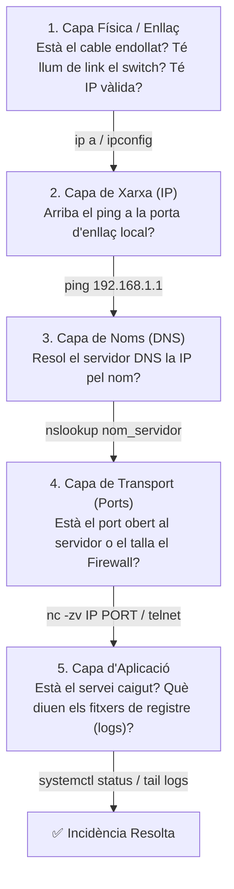

# UT09 — Projecte Integrador d'Infraestructura i Auditoria de Serveis en Xarxa

L'objectiu final del mòdul de Serveis en Xarxa és la **capacitat d'integrar de forma coherent i resilient** tots els serveis estudiats en un escenari corporatiu real, així com auditar-ne el rendiment i resoldre fallades d'interoperabilitat entre entorns Linux i Windows.

---

## 📌 1. Mapa d'Arquitectura del Projecte Integrador

En una organització interconnectada, els serveis depenen estretament els uns dels altres:

```mermaid
graph TD
    CLI["💻 Equip Client (Windows 11 / Ubuntu Desktop)"] -->|1. Demana configuració IP| DHCP["🖥️ Servidor DHCP (192.168.1.2)"]
    DHCP -->|Retorna IP, Gateway i IP del DNS| CLI
    CLI -->|2. Consulta nom 'www.iesrafel.internal'| DNS["🖥️ Servidor DNS Bind9 (192.168.1.2)"]
    DNS -->|Retorna 192.168.1.10| CLI
    CLI -->|3. Connecta per HTTPS (Port 443)| WEB["🖥️ Servidor Web Apache2 (192.168.1.10)"]
    CLI -->|4. Puja documents per SFTP (Port 22)| SFTP["🖥️ Servidor Fitxers vsftpd/SSH (192.168.1.10)"]
    ADM["👤 Administrador de Sistemes"] -->|5. Gestió remota bastinada per SSH/RDP| S1["Servidors Linux & Windows"]
```

> [!IMPORTANT]
> **Interdependència de Serveis:** Si el servei **DNS** cau o conté errors de sintaxi, els clients no podran carregar la intranet web pel seu nom, el servei de correu no sabrà a quin servidor enviar els missatges i els usuaris no es podran connectar al servidor de fitxers. Per això, el DNS i el DHCP són coneguts com a **serveis d'infraestructura bàsica**.

---

## 📌 2. Auditoria de Xarxa amb Nmap

L'eina **Nmap (*Network Mapper*)** és el programari d'auditoria de xarxa per excel·lència per a descobrir equips actius i verificar quins ports estan oberts a cada servidor:

```bash
# 1. Descobrir quins equips estan encesos a la subxarxa (Ping Sweep)
nmap -sn 192.168.1.0/24

# 2. Escanejar els 100 ports més freqüents d'un servidor
nmap 192.168.1.10

# 3. Escaneig ràpid amb detecció de versions de servei i sistema operatiu
sudo nmap -sS -sV -O 192.168.1.10

# 4. Escaneig complet de tots els 65535 ports TCP
nmap -p- 192.168.1.10

# 5. Escaneig de ports UDP d'infraestructura (DNS 53, DHCP 67, NTP 123)
sudo nmap -sU -p 53,67,123 192.168.1.2
```

### Interpretació dels Estats dels Ports segons Nmap:
- **`open`:** Hi ha un servei o dimoni escoltant en eixe port i acceptant connexions.
- **`closed`:** El paquet arriba a la màquina, però cap servei està escoltant en eixe port (retorna un TCP RST).
- **`filtered`:** Els paquets de sondeig són blocats o descartats per un tallafoc (*Firewall* / UFW) sense rebre resposta.

---

## 📌 3. Captura i Anàlisi de Paquets amb Wireshark

Per a diagnosticar problemes complexos en temps real (com saber per què un client no rep IP de DHCP o per què falla una negociació TLS), s'utilitza l'analitzador de protocols **Wireshark**:

| Servei a Analitzar | Filtre de Visualització a Wireshark | Aspecte Clau a Inspeccionar |
| :--- | :--- | :--- |
| **DHCP** | `bootp` o `dhcp` | Verificar els 4 passos de l'encaixada **DORA** (*Discover, Offer, Request, Ack*). |
| **DNS** | `dns` | Comprovar els camps *Query* (pregunta) i *Answer* (adreça IP retornada pel servidor). |
| **Web** | `http` o `tls` | Inspeccionar les capçaleres HTTP, codis d'estat (200, 404) i el certificat del servidor al *Server Hello*. |
| **Accés Remot** | `tcp.port == 22` | Confirmar que el tràfic SSH és completament inintel·ligible i xifrat. |
| **Ping / Diagnòstic** | `icmp` | Comprovar missatges d'eco *Echo Request* (Type 8) i *Echo Reply* (Type 0). |

---

## 📌 4. Protocol Metodològic de Resolució d'Incidències (*Troubleshooting*)

Quan un client comunica que «no funciona la xarxa o el servei», el tècnic de SMX ha de seguir una metodologia deductiva de baix a dalt basada en el model OSI:


