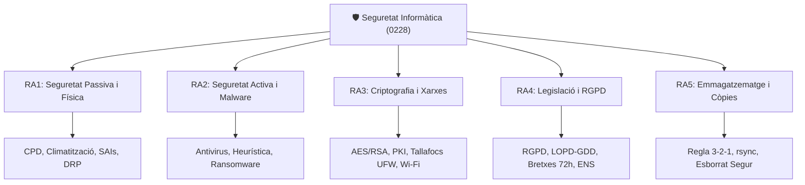

# UT01 — Presentació i Fonaments del Mòdul Professional

Benvingut/da a la **Unitat de Treball 01: Presentació i Fonaments de la Seguretat Informàtica**.

Aquesta unitat introductòria estableix les bases teòriques, normatives i metodològiques del mòdul professional, definint el rol de l'administrador de sistemes en la protecció de la informació corporativa.

---

## 📌 1. Objectius i Resultats d'Aprenentatge (RAs)

En el cicle de Sistemes Microinformàtics i Xarxes (SMX), la seguretat no és una eina aïllada, sinó una **disciplina transversal** que condiciona el muntatge d'equips, el cablejat de xarxes, la instal·lació de sistemes operatius i la configuració de serveis web.

---

## 📌 2. Perfil Professional i Hacking Ètic

Un tècnic de grau mitjà en SMX té una responsabilitat directa sobre la custòdia física i lògica dels equips dels usuaris i servidors departamentals:

> [!IMPORTANT]
> **El codi ètic del professional de ciberseguretat:**  
> Les tècniques d'escaneig de ports, anàlisi de vulnerabilitats i auditories de contrasenyes que s'estudien en aquest mòdul s'han d'aplicar **exclusivament en entorns de laboratori autoritzats**. L'ús d'aquestes eines contra sistemes de tercers sense consentiment exprés és un delicte tipificat en el Codi Penal (articles 197 i 264).

### Funcions del Tècnic de Sistemes en Ciberseguretat:
1. **Prevenció:** Instal·lació de sistemes d'alimentació ininterrompuda (SAI), protecció contra sobretensions i manteniment de les condicions ambientals de servidors.
2. **Defensa activa:** Configuració i actualització de bases de firmes antivirus, desplegament de regles de tallafocs en estacions de treball i servidors.
3. **Custòdia de dades:** Automatització i verificació de còpies de seguretat periòdiques (test de restauració).
4. **Compliment normatiu:** Aplicació dels drets de la LOPD-GDD/RGPD i protocols de confidencialitat.

---

## 📌 3. Entorn de Treball i Laboratori Virtualitzat

Totes les pràctiques d'aquest mòdul es desenvolupen en un entorn controlat per garantir que el tràfic d'auditoria no interfereixi amb la xarxa del centre educatiu:

| Element de Laboratori | Rol Didàctic | Configuració de Xarxa |
| :--- | :--- | :--- |
| **VirtualBox / VMware Workstation** | Hipervisor tipus 2 d'amfitrió | Xarxa interna (*Host-Only* o *Internal Network*) |
| **Ubuntu Server 24.04 LTS** | Servidor de fitxers, tallafoc UFW, còpies `rsync` | IP estàtica en segment de laboratori |
| **Windows Server 2022** | Controlador de domini, directives GPO de contrasenyes | Segment corporatiu aïllat |
| **Windows 10/11 Client** | Client corporatiu per a proves d'autenticació i permisos | Domini de laboratori |

---

## 📌 4. Autoavaluació de la Unitat 01

1. **Quina diferència conceptual hi ha entre la seguretat activa i la seguretat passiva?**
   - *Solució:* La seguretat activa actua de forma proactiva per prevenir o aturar atacs en temps real (antivirus, tallafocs, contrasenyes robustes), mentre que la seguretat passiva minimitza l'impacte i els danys quan l'incident ja s'ha produït o manté la continuïtat del servei (SAIs, còpies de seguretat, plans de recuperació davant desastres).
2. **Per què és imprescindible fer proves de restauració periòdiques de les còpies de seguretat?**
   - *Solució:* Perquè una còpia de seguretat no té cap valor si en el moment d'un desastre el fitxer està corromput, la clau de desencriptació no funciona o el procediment de restauració supera el temps màxim admès per l'organització (RTO).
