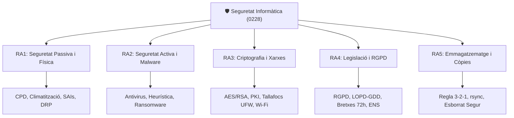

# UT01 — Presentació i Fonaments del Mòdul Professional

Benvingut/da a la **Unitat de Treball 01: Presentació i Fonaments de la Seguretat Informàtica**.

Aquesta unitat introductòria estableix les bases teòriques, normatives i metodològiques del mòdul professional, definint el rol de l'administrador de sistemes en la protecció de la informació corporativa.

---

## 📌 1. Objectius i Resultats d'Aprenentatge (RAs)

En el cicle de Sistemes Microinformàtics i Xarxes (SMX), la seguretat no és una eina aïllada, sinó una **disciplina transversal** que condiciona el muntatge d'equips, el cablejat de xarxes, la instal·lació de sistemes operatius i la configuració de serveis web.



---

## 📌 2. Perfil Professional i Hacking Ètic

Un tècnic de grau mitjà en SMX té una responsabilitat directa sobre la custòdia física i lògica dels equips dels usuaris i servidors departamentals:

> [!IMPORTANT]
> **El codi ètic del professional de ciberseguretat:**  
> Les tècniques d'escaneig de ports, anàlisi de vulnerabilitats i auditories de contrasenyes que s'estudien en aquest mòdul s'han d'aplicar **exclusivament en entorns de laboratori autoritzats**. L'ús d'aquestes eines contra sistemes de tercers sense consentiment exprés és un delicte tipificat en el Codi Penal (articles 197 i 264).

### Funcions del Tècnic de Sistemes en Ciberseguretat:
1. **Prevenció:** Instal·lació de sistemes d'alimentació ininterrompuda (SAI), protecció contra sobretensions i manteniment de les condicions ambientals de servidors.
2. **Defensa activa:** Configuració i actualització de bases de firmes antivirus, desplegament de regles de tallafocs en estacions de treball i servidors.
3. **Custòdia de dades:** Automatització i verificació de còpies de seguretat periòdiques (test de restauració).
4. **Compliment normatiu:** Aplicació dels drets de la LOPD-GDD/RGPD i protocols de confidencialitat.

---

## 📌 3. Entorn de Treball i Laboratori Virtualitzat

Totes les pràctiques d'aquest mòdul es desenvolupen en un entorn controlat per garantir que el tràfic d'auditoria no interfereixi amb la xarxa del centre educatiu:

| Element de Laboratori | Rol Didàctic | Configuració de Xarxa |
| :--- | :--- | :--- |
| **VirtualBox / VMware Workstation** | Hipervisor tipus 2 d'amfitrió | Xarxa interna (*Host-Only* o *Internal Network*) |
| **Ubuntu Server 24.04 LTS** | Servidor de fitxers, tallafoc UFW, còpies `rsync` | IP estàtica en segment de laboratori |
| **Windows Server 2022** | Controlador de domini, directives GPO de contrasenyes | Segment corporatiu aïllat |
| **Windows 10/11 Client** | Client corporatiu per a proves d'autenticació i permisos | Domini de laboratori |

---

<div style="background: linear-gradient(135deg, #0f172a 0%, #1e293b 100%); border-radius: 12px; padding: 20px; margin: 25px 0; box-shadow: 0 10px 25px -5px rgba(0, 0, 0, 0.3); border: 1px solid #334155;">
  <div style="text-align: center; margin-bottom: 15px;">
    <span style="background: #38bdf8; color: #0f172a; font-weight: 700; font-size: 0.75rem; text-transform: uppercase; letter-spacing: 0.05em; padding: 4px 10px; border-radius: 9999px;">Infografia Tècnica</span>
    <h3 style="color: #f8fafc; margin: 10px 0 5px 0; font-size: 1.25rem;">Els Quatre Quadrants de la Ciberseguretat</h3>
    <p style="color: #94a3b8; font-size: 0.85rem; margin: 0;">Classificació metodològica de les mesures de protecció en entorns corporatius</p>
  </div>
  <svg viewBox="0 0 860 300" width="100%" height="100%" xmlns="http://www.w3.org/2000/svg" style="display: block; font-family: system-ui, -apple-system, sans-serif;">
    <defs>
      <linearGradient id="activaGrad" x1="0%" y1="0%" x2="100%" y2="100%">
        <stop offset="0%" stop-color="#0284c7" stop-opacity="0.3"/>
        <stop offset="100%" stop-color="#0369a1" stop-opacity="0.1"/>
      </linearGradient>
      <linearGradient id="passivaGrad" x1="0%" y1="0%" x2="100%" y2="100%">
        <stop offset="0%" stop-color="#10b981" stop-opacity="0.3"/>
        <stop offset="100%" stop-color="#047857" stop-opacity="0.1"/>
      </linearGradient>
      <linearGradient id="fisicaGrad" x1="0%" y1="0%" x2="100%" y2="100%">
        <stop offset="0%" stop-color="#f59e0b" stop-opacity="0.3"/>
        <stop offset="100%" stop-color="#b45309" stop-opacity="0.1"/>
      </linearGradient>
      <linearGradient id="logicaGrad" x1="0%" y1="0%" x2="100%" y2="100%">
        <stop offset="0%" stop-color="#8b5cf6" stop-opacity="0.3"/>
        <stop offset="100%" stop-color="#6d28d9" stop-opacity="0.1"/>
      </linearGradient>
      <filter id="cardShadow" x="-5%" y="-5%" width="110%" height="115%">
        <feDropShadow dx="0" dy="4" stdDeviation="6" flood-color="#000000" flood-opacity="0.4"/>
      </filter>
    </defs>

    <!-- Quadrant 1: Seguretat Activa Lògica -->
    <rect x="20" y="20" width="395" height="120" rx="8" fill="url(#activaGrad)" stroke="#38bdf8" stroke-width="1.5" filter="url(#cardShadow)"/>
    <circle cx="50" cy="50" r="18" fill="#0284c7"/>
    <text x="50" y="55" fill="#ffffff" font-size="16" text-anchor="middle" font-weight="bold">⚡</text>
    <text x="80" y="46" fill="#38bdf8" font-size="14" font-weight="bold">SEGURETAT ACTIVA · LÒGICA</text>
    <text x="80" y="65" fill="#e2e8f0" font-size="11">Prevé i bloqueja amenaces de dades en temps real</text>
    <line x1="40" y1="80" x2="395" y2="80" stroke="#334155" stroke-dasharray="2,2"/>
    <text x="40" y="98" fill="#94a3b8" font-size="10">• Antivirus heurístic i EDR en endpoints</text>
    <text x="40" y="115" fill="#94a3b8" font-size="10">• Regles de tallafocs (UFW / iptables / GPO)</text>
    <text x="40" y="130" fill="#94a3b8" font-size="10">• Autenticació multifactor (MFA / 2FA)</text>

    <!-- Quadrant 2: Seguretat Activa Física -->
    <rect x="445" y="20" width="395" height="120" rx="8" fill="url(#fisicaGrad)" stroke="#fbbf24" stroke-width="1.5" filter="url(#cardShadow)"/>
    <circle cx="475" cy="50" r="18" fill="#d97706"/>
    <text x="475" y="55" fill="#ffffff" font-size="16" text-anchor="middle" font-weight="bold">🚪</text>
    <text x="505" y="46" fill="#fbbf24" font-size="14" font-weight="bold">SEGURETAT ACTIVA · FÍSICA</text>
    <text x="505" y="65" fill="#e2e8f0" font-size="11">Controla l'accés presencial a les instal·lacions</text>
    <line x1="465" y1="80" x2="820" y2="80" stroke="#334155" stroke-dasharray="2,2"/>
    <text x="465" y="98" fill="#94a3b8" font-size="10">• Control biomètric i targetes RFID d'accés</text>
    <text x="465" y="115" fill="#94a3b8" font-size="10">• Cambres de videovigilància CCTV amb gravador</text>
    <text x="465" y="130" fill="#94a3b8" font-size="10">• Guàrdies de seguretat i arcs detectors de metalls</text>

    <!-- Quadrant 3: Seguretat Passiva Lògica -->
    <rect x="20" y="160" width="395" height="120" rx="8" fill="url(#logicaGrad)" stroke="#a78bfa" stroke-width="1.5" filter="url(#cardShadow)"/>
    <circle cx="50" cy="190" r="18" fill="#7c3aed"/>
    <text x="50" y="195" fill="#ffffff" font-size="16" text-anchor="middle" font-weight="bold">💾</text>
    <text x="80" y="186" fill="#a78bfa" font-size="14" font-weight="bold">SEGURETAT PASSIVA · LÒGICA</text>
    <text x="80" y="205" fill="#e2e8f0" font-size="11">Minimitza l'impacte quan l'incident ja ha ocorregut</text>
    <line x1="40" y1="220" x2="395" y2="220" stroke="#334155" stroke-dasharray="2,2"/>
    <text x="40" y="238" fill="#94a3b8" font-size="10">• Còpies de seguretat immutables (Regla 3-2-1)</text>
    <text x="40" y="255" fill="#94a3b8" font-size="10">• Instantànies (Snapshots ZFS/LVM) i RAID</text>
    <text x="40" y="270" fill="#94a3b8" font-size="10">• Plans de recuperació davant desastres (DRP)</text>

    <!-- Quadrant 4: Seguretat Passiva Física -->
    <rect x="445" y="160" width="395" height="120" rx="8" fill="url(#passivaGrad)" stroke="#34d399" stroke-width="1.5" filter="url(#cardShadow)"/>
    <circle cx="475" cy="190" r="18" fill="#059669"/>
    <text x="475" y="195" fill="#ffffff" font-size="16" text-anchor="middle" font-weight="bold">🔋</text>
    <text x="505" y="186" fill="#34d399" font-size="14" font-weight="bold">SEGURETAT PASSIVA · FÍSICA</text>
    <text x="505" y="205" fill="#e2e8f0" font-size="11">Protegeix el maquinari davant fallades ambientals</text>
    <line x1="465" y1="220" x2="820" y2="220" stroke="#334155" stroke-dasharray="2,2"/>
    <text x="465" y="238" fill="#94a3b8" font-size="10">• Sistemes d'Alimentació Ininterrompuda (SAI/UPS)</text>
    <text x="465" y="255" fill="#94a3b8" font-size="10">• Extinció automàtica d'incendis amb gas net (Novec/Inergen)</text>
    <text x="465" y="270" fill="#94a3b8" font-size="10">• Climatització redundant i passadissos fred/calent</text>
  </svg>
</div>

---

## 📌 4. Autoavaluació de la Unitat 01

1. **Quina diferència conceptual hi ha entre la seguretat activa i la seguretat passiva?**
   - *Solució:* La seguretat activa actua de forma proactiva per prevenir o aturar atacs en temps real (antivirus, tallafocs, contrasenyes robustes), mentre que la seguretat passiva minimitza l'impacte i els danys quan l'incident ja s'ha produït o manté la continuïtat del servei (SAIs, còpies de seguretat, plans de recuperació davant desastres).
2. **Per què és imprescindible fer proves de restauració periòdiques de les còpies de seguretat?**
   - *Solució:* Perquè una còpia de seguretat no té cap valor si en el moment d'un desastre el fitxer està corromput, la clau de desencriptació no funciona o el procediment de restauració supera el temps màxim admès per l'organització (RTO).

---

## 📝 Quadern d'Activitats Pràctiques i Reptes de Laboratori

### 📋 Bloc A: Qüestions Tècniques de Classificació i Fonaments
1. **Classificació de Mesures de Seguretat:** Ubica cadascun dels següents elements en un dels quatre quadrants (Activa/Passiva i Física/Lògica):
   - Generador elèctric dièsel d'emergència en cas de tall prolongat de llum.
   - Restricció de tràfic al port 22 (SSH) mitjançant regles `iptables`.
   - Sistema de refrigeració redundant HVAC configurat a 21 °C al CPD.
   - Auditoria de canvis de permisos en Active Directory mitjançant registres SIEM.
2. **Triada CIA:** Explica mitjançant un exemple real com un atac d'alteració no autoritzada d'una comanda bancària ataca la **Integritat** sense comprometre necessàriament la **Disponibilitat**.
3. **Codi Penal Espanyol:** Revisa els articles 197 (descobriment i revelació de secrets) i 264 (danys informàtics). Quines penes de presó s'estableixen per accedir sense autorització a un sistema protegit i quines circumstàncies agreugen la pena?

### 💻 Bloc B: Repte Pràctic de Laboratori (Virtualització Segura)
En aquesta pràctica inicial configurarem l'entorn aïllat de laboratori per garantir que cap paquet d'auditoria escape cap a la xarxa externa:

1. **Pas 1: Creació del commutador virtual aïllat:**
   - A VirtualBox, ves a **Arxiu $\rightarrow$ Eines $\rightarrow$ Gestor de Xarxes Virtuals**.
   - Crea una nova xarxa de tipus **Només d'amfitrió (*Host-Only*)** amb l'adreça `192.168.56.1/24` o una xarxa **Interna (*Internal Network*)** anomenada `xarxa-lab-seguretat`.
   - Desactiva el servidor DHCP intern de VirtualBox per aprendre a configurar adreçament estàtic manual als servidors.
2. **Pas 2: Comprovació d'aïllament:**
   - Connecta la màquina Ubuntu Server de laboratori a la xarxa interna.
   - Comprova amb `ping 8.8.8.8` que la màquina no pot eixir a Internet (ha de donar error de xarxa inabastable).
   - Executa `ip a` per confirmar que la interfície té assignada la IP estàtica de laboratori `192.168.56.10/24`.

```bash
# Exemple de configuració de netplan per al laboratori aïllat (/etc/netplan/01-netcfg.yaml)
network:
  version: 2
  renderer: networkd
  ethernets:
    enp0s3:
      dhcp4: no
      addresses:
        - 192.168.56.10/24
```

### 🎯 Bloc C: Llista de Verificació i Rúbrica d'Avaluació

| Criteri d'Avaluació | Nivell Assolit (Excel·lent: 9-10) | Nivell Mitjà (Notable: 7-8) | Nivell Inicial (Aprovat: 5-6) |
| :--- | :--- | :--- | :--- |
| **Distingir mesures actives i passives** | Classifica el 100% de les mesures sense errors i justifica l'impacte en la continuïtat. | Classifica correctament la majoria de mesures amb dubtes menors en SAIs o RAID. | Confon mesures preventives amb mesures reactives o de recuperació. |
| **Coneixement legal i ètic** | Identifica els riscos penals de les auditories no autoritzades i cita els articles aplicables. | Reconeix la il·legalitat d'atacar xarxes alienes sense citar el Codi Penal. | Té una noció vaga sobre els límits legals de l'escaneig de xarxes. |
| **Configuració de xarxa aïllada** | Configura la xarxa host-only/interna i demostra l'aïllament sense filtracions a l'exterior. | Munta la màquina virtual però manté el mode NAT obert per defecte. | Requereix assistència per a configurar les interfícies de xarxa a l'hipervisor. |
