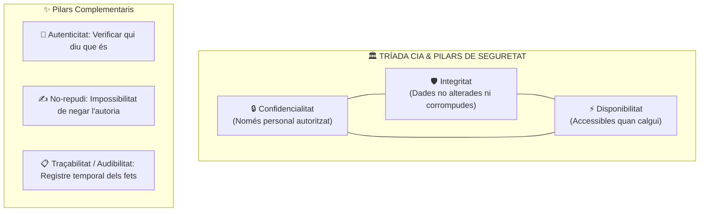
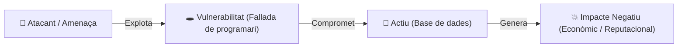
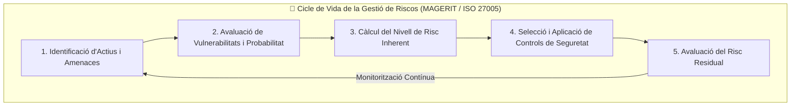

# UT02 — Principis de Seguretat i Gestió de Riscos

La seguretat informàtica no és un estat binari de «segur o insegur», sinó un **procés continu de gestió del risc**. En aquesta unitat s'estudien els pilars fonamentals de la seguretat de la informació, els tipus d'amenaces que assetgen els sistemes i com avaluar matemàticament l'exposició d'una organització.

---

## 📌 1. La Tríada CIA i els Pilars de la Ciberseguretat

El model canònic de seguretat de la informació es basa en tres principis indissolubles coneguts com la **Tríada CIA** (*Confidentiality, Integrity, Availability*):

### Definició detallada dels principis:
1. **Confidencialitat (C):** Garanteix que la informació només és accessible a persones, processos o sistemes autoritzats. Es protegeix mitjançant:
   - Xifratge de dades en repòs (*at rest*) i en trànsit (*in transit*).
   - Llistes de control d'accés (ACL) i autenticació robusta.
2. **Integritat (I):** Assegura que la informació i els mètodes de processament són exactes, complets i no han estat modificats sense autorització. Es protegeix mitjançant:
   - Funcions resum criptogràfiques (Hash: SHA-256).
   - Signatures digitals i sistemes de control de versions.
3. **Disponibilitat (A):** Assegura que els usuaris autoritzats tenen accés a la informació i als serveis associats quan ho necessiten. Es protegeix mitjançant:
   - Redundància de maquinari (RAID, fonts d'alimentació redundants).
   - Sistemes d'alimentació ininterrompuda (SAI) i còpies de seguretat.
   - Equilibradors de càrrega i protecció contra atacs de denegació de servei (DDoS).

| Principi | Amenaça Típica | Mecanisme de Defensa |
| :--- | :--- | :--- |
| **Confidencialitat** | Sniffing, fugues de dades, espionatge industrial | Xifratge AES/TLS, permisos NTFS/POSIX |
| **Integritat** | Modificació de bases de dades per injecció SQL, malware | Hashing SHA-256, signatures digitals, backups WORM |
| **Disponibilitat** | Inundacions, atacs DoS/DDoS, fallades elèctriques, Ransomware | SAIs, rèpliques al núvol, clústers en alta disponibilitat (HA) |
| **No-repudi** | Negació d'una transacció de comerç electrònic | Certificats digitals X.509 de signatura electrònica |

---

## 📌 2. Amenaces, Vulnerabilitats i Vectors d'Atac

Per a defensar eficaçment un sistema cal distingir entre el concepte d'amenaça i el de vulnerabilitat:

- **Actiu (Asset):** Tot recurs de valor per a l'empresa que cal protegir (bases de dades de clients, servidors de producció, personal, imatge de marca).
- **Vulnerabilitat (Vulnerability):** Feblesa o defecte en el disseny, implementació o configuració d'un sistema que pot ser aprofitat per un atacant (per exemple, un port SSH amb contrasenya per defecte o un sistema operatiu sense pedaçar).
- **Amenaça (Threat):** Qualsevol esdeveniment que pot causar dany als actius de l'organització mitjançant l'explotació d'una vulnerabilitat.
- **Impacte (Impact):** Mesura del dany o pèrdua produïda a l'organització si l'amenaça es materialitza.

### Classificació de les Amenaces segons l'Origen:
1. **Humanes involuntàries (accidents):** Errors de configuració per part de l'administrador, esborrats accidentals de dades o pèrdua de dispositius portàtils no xifrats. Representen més del 60% dels incidents!
2. **Humanes intencionades (atacs):** 
   - Atacs interns (*Insider threats*): Empleats descontents o subornats que utilitzen els seus privilegis legítims per a robar o sabotejar dades.
   - Atacs externs: Ciberdelinqüents, bandes de ransomware, espionatge d'alt nivell.
3. **Amenaces ambientals i naturals:** Incendis en el CPD, terratrèmols, inundacions per canonades d'aigua superiors, llamps i sobretensions atmosfèriques.
4. **Fallades tècniques:** Avaries de discs durs, sobreescalfament del processador, degradació de bateries o talls del subministrament elèctric de la xarxa pública.

---

## 📌 3. Anàlisi i Gestió de Riscos: Metodologia Quantitativa

El risc és la probabilitat que una amenaça concreta exploti una vulnerabilitat existent i provoqui un impacte mesurable sobre l'organització:

$$Risc = Probabilitat \times Impacte$$

### La Matriu de Riscos $3 \times 3$:
Classifiquem la **Probabilitat** (Baixa = 1, Mitjana = 2, Alta = 3) i l'**Impacte** (Baix = 1, Mitjà = 2, Alt = 3) per obtenir el Nivell de Risc resultant:

| Probabilitat \ Impacte | Impacte Baix (1) | Impacte Mitjà (2) | Impacte Alt (3) |
| :---: | :---: | :---: | :---: |
| **Alta (3)** | Risc Mitjà (3) | 🟡 **Risc Alt (6)** | 🔴 **Risc Crític (9)** |
| **Mitjana (2)** | Risc Baix (2) | Risc Mitjà (4) | 🟡 **Risc Alt (6)** |
| **Baixa (1)** | 🟢 **Risc Negligible (1)** | Risc Baix (2) | Risc Mitjà (3) |

### Estratègies de Tractament del Risc:
Davant d'un risc calculat, la direcció pot optar per 4 estratègies:
- **Mitigar / Reduir:** Aplicar salvaguardes (p. ex., instal·lar un tallafoc, configurar un SAI) per a reduir la probabilitat o l'impacte a un nivell tolerable.
- **Transferir:** Desplaçar el cost financer de l'impacte a un tercer mitjançant assegurances de ciberseguretat o contractant serveis al núvol amb SLA (Acord de Nivell de Servei).
- **Evitar:** Eliminar l'activitat que genera el risc (p. ex., donar de baixa un servidor obsolet que ja no rep actualitzacions).
- **Acceptar:** Assumir el **risc residual** quan el cost de la salvaguarda supera amb escreix el valor de l'actiu protegit.

---

## 📌 4. Exercici Pràctic d'Aula: Avaluació d'un Servidor Web

**Supòsit:** Una empresa comercial disposa d'un servidor web local on els clients consulten catàlegs i fan comandes. No disposa de SAI i la contrasenya del panell d'administració és `admin123`.

1. **Actius implicats:** Servidor físic, base de dades de clients, reputació de l'empresa.
2. **Vulnerabilitats identificades:** Contrasenya dèbil per defecte; absència de protecció contra talls elèctrics.
3. **Amenaces:** Atac de força bruta per Internet (Probabilitat Alta, Impacte Alt = Risc 9); Tall de subministrament elèctric (Probabilitat Mitjana, Impacte Mitjà = Risc 4).
4. **Pla de mitigació:** 
   - Canviar la contrasenya per una clau de 16 caràcters amb autenticació de doble factor (MFA).
   - Instal·lar un SAI On-line de 1500 VA amb connexió USB de gestió automàtica d'apagada.
