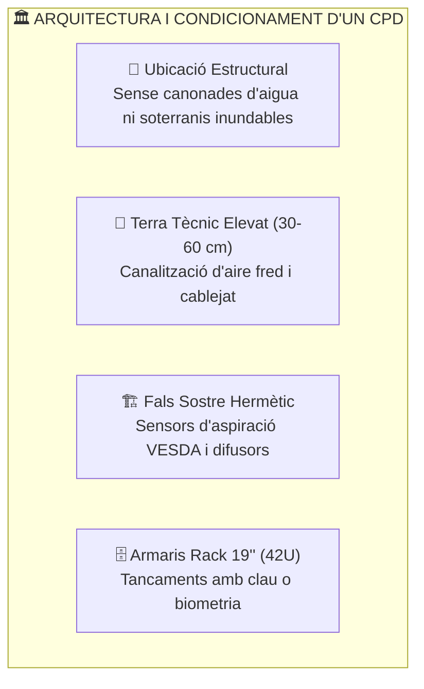
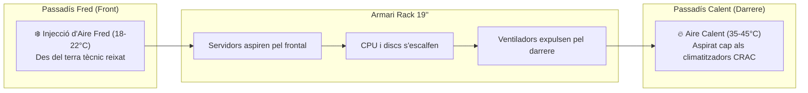
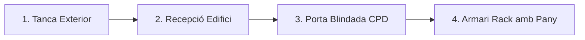

# UT03 — Seguretat Física i Protecció de les Instal·lacions

La seguretat física comprèn totes aquelles barreres, protocols i dispositius destinats a protegir els servidors, xarxes i equips de comunicacions contra danys materials, accessos no autoritzats, desastres naturals o fallades ambientals. Si un atacant té **accés físic directe** a un equip, la seguretat lògica queda completament anul·lada.

---

## 📌 1. Disseny i Ubicació del Centre de Processament de Dades (CPD)

El **Centre de Processament de Dades (CPD)** o *Data Center* és el cor tecnològic de qualsevol organització. La seua planificació requereix criteris d'enginyeria civil i arquitectònica estrictes:

### Criteris de Selecció d'Emplaçament:
- **Evitar soterranis:** Alt risc d'inundació per trencament de canonades d'aigua de l'edifici o crescudes de rius.
- **Evitar l'última planta:** Vulnerable a filtracions per goteres de cobertes i sobreescalfament per radiació solar directa.
- **Parets ignífugues:** Compartimentació amb resistència al foc de com a mínim 120 minuts (classificació EI-120 o RF-120).
- **Terra tècnic:** Rajoles desmuntables modulars amb suport metàl·lic que eleven el terra entre 30 i 60 cm. Permet distribuir el flux d'aire climatitzat i organitzar les safates de cables evitant interferències electromagnètiques (separant cablejat elèctric i cablejat de dades de fibra/UTP).

---

## 📌 2. Condicions Ambientals i Climatització (Normativa ASHRAE)

Els equips electrònics generen una gran quantitat de calor (expressada en BTUs o Watts tèrmics). Si la calor no es dissipa, els processadors pateixen *thermal throttling* i fallades catastròfiques:

| Paràmetre Ambiental | Rang Recomanat (ASHRAE TC 9.9) | Risc si és massa Baix | Risc si és massa Alt |
| :--- | :---: | :--- | :--- |
| **Temperatura d'Entrada** | **$18^\circ\text{C}$ a $27^\circ\text{C}$** | Malbaratament energètic | Sobreescalfament de CPUs i discs |
| **Humitat Relativa** | **$40\%$ a $60\%$** | Descàrregues electroestàtiques (ESD) | Condensació d'aigua i corrosió |
| **Qualitat de l'Aire** | Filtres F7 / HEPA | - | Dipòsit de pols conductora i bloqueig de ventiladors |

### Gestió de Fluxos d'Aire: Passadís Fred / Passadís Calent (*Hot/Cold Aisle*)

Per a evitar que l'aire calent expulsat per la part posterior d'un servidor siga aspirat pel servidor contigu, els racks es col·loquen en files enfrontades:

> [!TIP]
> Als espais buits dels racks on no hi ha servidors instal·lats, s'han de col·locar **panells cecs (*blanking panels*)**. Si es deixen forats buits, l'aire calent de la part posterior torna cap al frontal, creant bosses tèrmiques crítiques.

---

## 📌 3. Sistemes de Detecció i Extinció d'Incendis

Un incendi en un CPD no es pot combatre com un foc convencional d'oficina:

> [!CAUTION]
> **Prohibició de sistemes d'aigua i pols química convencional:**  
> - Els extintors de **pols química ABC** són letals per a la informàtica: la pols és corrosiva i s'introdueix dins de les fonts d'alimentació i sòcols, destruint les plaques base encara que el foc s'apague.  
> - L'aigua corrent provoca curtcircuits immediats en equips sota tensió.

### Tecnologies autoritzades en sales de servidors:
1. **Detecció precoç per aspiració (VESDA):** Una xarxa de canonades aspira aire contínuament de la sala i l'analitza mitjançant un làser òptic capaç de detectar partícules microscòpiques de combustió abans que es produïsca fum visible o flames.
2. **Extinció per gasos nets i inerts:**
   - **Gasos inerts (Inergen - IG-541):** Barreja de $52\%$ Nitrogen, $40\%$ Argó i $8\%$ $\text{CO}_2$. Desplaça l'oxigen de l'habitació del $21\%$ natural al $12-14\%$, nivell en què el foc s'extingeix per asfíxia química però permet que les persones que estiguen dins puguen respirar durant uns minuts per a evacuar.
   - **Fluids químics nets (Novec 1230 o FM-200):** S'emmagatzemen en estat líquid a pressió i s'evaporen a l'instant en descarregar-se. Absorbeixen ràpidament la calor del foc a nivell molecular sense deixar cap tipus de residu ni fer malbé els equips elèctrics.

---

## 📌 4. Control d'Accés Físic i Protecció Perimetral

El model de seguretat física es basa en **capes concèntriques de defensa** (*Defense in Depth*):

1. **Perímetre exterior:** Tancat perimetral, barreres de vehicles, sensors d'intrusió per infrarojos.
2. **Accés a l'edifici:** Recepció, torns d'accés, identificació de visites amb registre d'identitat.
3. **Accés a la sala del CPD:** Porta blindada, control d'accés biomètric o targeta de proximitat RFID / NFC de doble factor (targeta + PIN).
4. **Armaris Rack:** Panys individuals amb clau física o manetes electròniques connectades al sistema de monitorització de xarxa SNMP.

### Tecnologies d'Autenticació Física:
- **Targetes RFID / MIFARE (13.56 MHz):** Fàcils d'usar però susceptibles de clonació si no estan xifrades.
- **Biometria:** Reconeixement d'empremta dactilar, geometria de la mà, iris o reconeixement facial.
- **Sistemes anti-passback:** Impedeixen que un usuari torne a passar la mateixa targeta a un acompanyant per a entrar sense registre.
- **Portes esclusa (*Mantraps*):** Sistema de dues portes consecutives on la segona no s'obre fins que la primera està completament tancada i l'usuari ha sigut validat i pesat (per a detectar que només entra una persona).

---

## 🎨 Infografia Tècnica: Climatització i Passadís Fred / Calent

<svg viewBox="0 0 840 280" width="100%" height="auto" xmlns="http://www.w3.org/2000/svg" style="max-width: 840px; border-radius: 16px; filter: drop-shadow(0 10px 15px rgba(0,0,0,0.1)); font-family: system-ui, sans-serif;">
  <defs>
    <linearGradient id="bgCPD" x1="0%" y1="0%" x2="100%" y2="100%">
      <stop offset="0%" stop-color="#0b1329" />
      <stop offset="100%" stop-color="#1e293b" />
    </linearGradient>
    <linearGradient id="coldFlow" x1="0%" y1="100%" x2="0%" y2="0%">
      <stop offset="0%" stop-color="#0284c7" />
      <stop offset="100%" stop-color="#38bdf8" />
    </linearGradient>
    <linearGradient id="hotFlow" x1="0%" y1="0%" x2="0%" y2="100%">
      <stop offset="0%" stop-color="#ef4444" />
      <stop offset="100%" stop-color="#f97316" />
    </linearGradient>
  </defs>
  <rect width="840" height="280" rx="16" fill="url(#bgCPD)" />
  <text x="420" y="32" text-anchor="middle" fill="#f8fafc" font-size="18" font-weight="bold" letter-spacing="1">❄️ FLUX TÈRMIC EN UN CPD: PASSADÍS FRED I PASSADÍS CALENT 🔥</text>
  <text x="420" y="52" text-anchor="middle" fill="#94a3b8" font-size="12">Gestió de climatització segons la normativa ASHRAE TC 9.9 amb terra tècnic elevat</text>

  <!-- Terra Tècnic Plènum -->
  <rect x="40" y="225" width="760" height="35" rx="6" fill="#1e293b" stroke="#334155" stroke-width="2" />
  <text x="420" y="247" text-anchor="middle" fill="#38bdf8" font-size="12" font-weight="bold">PLÈNUM INFERIOR DE TERRA TÈCNIC (AIRE FRED CLIMATITZAT A PRESSIÓ 18-22°C)</text>

  <!-- Climatitzador CRAC -->
  <rect x="50" y="80" width="100" height="145" rx="8" fill="#1e3a8a" stroke="#38bdf8" stroke-width="2" />
  <text x="100" y="145" text-anchor="middle" fill="#ffffff" font-size="12" font-weight="bold">CRAC / CRAH</text>
  <text x="100" y="165" text-anchor="middle" fill="#93c5fd" font-size="10">Climatitzador</text>

  <!-- Reixeta terra fred -->
  <rect x="220" y="220" width="120" height="8" fill="#38bdf8" />
  <text x="280" y="205" text-anchor="middle" fill="#38bdf8" font-size="20">⬆️ ❄️</text>
  <text x="280" y="175" text-anchor="middle" fill="#38bdf8" font-size="11" font-weight="bold">PASSADÍS FRED</text>

  <!-- Rack 1 -->
  <rect x="360" y="80" width="100" height="145" rx="6" fill="#334155" stroke="#64748b" stroke-width="2" />
  <text x="410" y="105" text-anchor="middle" fill="#f8fafc" font-size="11" font-weight="bold">RACK A (42U)</text>
  <line x1="370" y1="120" x2="450" y2="120" stroke="#475569" stroke-width="6" />
  <line x1="370" y1="135" x2="450" y2="135" stroke="#475569" stroke-width="6" />
  <line x1="370" y1="150" x2="450" y2="150" stroke="#475569" stroke-width="6" />
  <line x1="370" y1="165" x2="450" y2="165" stroke="#475569" stroke-width="6" />
  <text x="410" y="195" text-anchor="middle" fill="#94a3b8" font-size="10">Servidors 1U/2U</text>

  <!-- Passadís Calent -->
  <text x="520" y="145" text-anchor="middle" fill="#f87171" font-size="20">🔥 ⬆️</text>
  <text x="520" y="170" text-anchor="middle" fill="#ef4444" font-size="11" font-weight="bold">PASSADÍS CALENT</text>
  <text x="520" y="185" text-anchor="middle" fill="#fca5a5" font-size="10">35°C - 45°C</text>

  <!-- Rack 2 -->
  <rect x="580" y="80" width="100" height="145" rx="6" fill="#334155" stroke="#64748b" stroke-width="2" />
  <text x="630" y="105" text-anchor="middle" fill="#f8fafc" font-size="11" font-weight="bold">RACK B (42U)</text>
  <line x1="590" y1="120" x2="670" y2="120" stroke="#475569" stroke-width="6" />
  <line x1="590" y1="135" x2="670" y2="135" stroke="#475569" stroke-width="6" />
  <line x1="590" y1="150" x2="670" y2="150" stroke="#475569" stroke-width="6" />
  <line x1="590" y1="165" x2="670" y2="165" stroke="#475569" stroke-width="6" />
  <text x="630" y="195" text-anchor="middle" fill="#94a3b8" font-size="10">Servidors 1U/2U</text>

  <!-- Retorn aire calent cap a sostre -->
  <path d="M 520 120 L 520 70 L 100 70 L 100 80" fill="none" stroke="#ef4444" stroke-width="3" stroke-dasharray="6,4" />
  <text x="310" y="65" text-anchor="middle" fill="#ef4444" font-size="10">Retorn d'aire calent cap al sostre / aspiració CRAC</text>
</svg>

---

## 📝 Quadern d'Activitats Pràctiques i Reptes de Laboratori

### Bloc A: Fonaments de Disseny de Sales de Servidors
1. **L'efecte de l'aire calent lliure:** Què passaria si deixem buits sense servidors dins d'un rack sense instal·lar panells cecs (*blanking panels*)? Com afecta això la factura elèctrica i la vida útil dels equips?
2. **Triatge d'agents d'extinció:** Per què està totalment prohibit un ruixador d'aigua convencional o un extintor de pols polivalent en una sala de servidors? Quin gas net triaries per a un CPD on treballen tècnics a l'interior?
3. **Càlcul de Climatització:** Si un armari rack consumeix $4500\text{ W}$ d'energia elèctrica de forma contínua, tota eixa potència es converteix en calor. Tenint en compte que $1\text{ W} \approx 3,412\text{ BTU/h}$, quina potència frigorífica mínima en BTU/h ha de tindre el sistema de refrigeració només per a eixe armari?

### Bloc B: Guia de Laboratori — Dimensionament d'un SAI
- Consulta l'activitat tècnica guiada [3.12 Estudi Tècnic i Dimensionament de Sistemes d'Alimentació Ininterrompuda (SAI)](./ut0312.html) per a calcular la potència aparent (VA), aplicar el factor de seguretat del $25\%$ i seleccionar un model comercial per a un armari de comunicacions.

### Bloc C: Llista d'Autoavaluació de Qualitat
- [ ] Entenc el principi físic del passadís fred i passadís calent per a l'eficiència energètica.
- [ ] Sé justificar la tria de gasos inerts (Inergen) o fluids nets (Novec 1230) davant d'incendis.
- [ ] Sé calcular la capacitat en VA necessària per a alimentar un rack d'equips durant un tall de xarxa.
