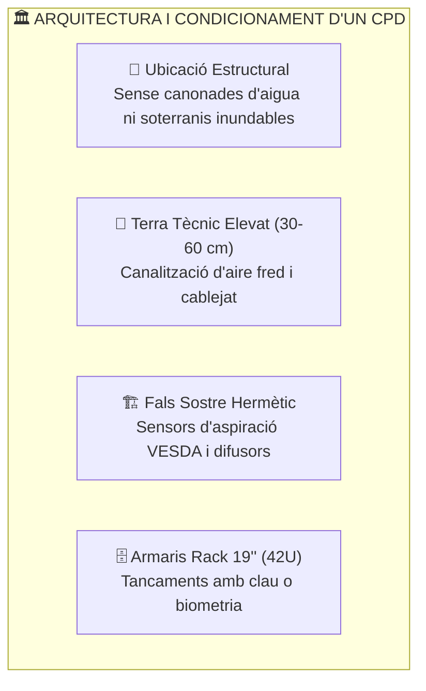
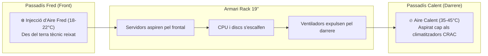
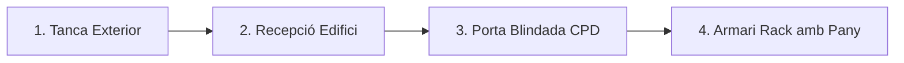

# UT03 — Seguretat Física i Protecció de les Instal·lacions

La seguretat física comprèn totes aquelles barreres, protocols i dispositius destinats a protegir els servidors, xarxes i equips de comunicacions contra danys materials, accessos no autoritzats, desastres naturals o fallades ambientals. Si un atacant té **accés físic directe** a un equip, la seguretat lògica queda completament anul·lada.

---

## 📌 1. Disseny i Ubicació del Centre de Processament de Dades (CPD)

El **Centre de Processament de Dades (CPD)** o *Data Center* és el cor tecnològic de qualsevol organització. La seua planificació requereix criteris d'enginyeria civil i arquitectònica estrictes:

### Criteris de Selecció d'Emplaçament:
- **Evitar soterranis:** Alt risc d'inundació per trencament de canonades d'aigua de l'edifici o crescudes de rius.
- **Evitar l'última planta:** Vulnerable a filtracions per goteres de cobertes i sobreescalfament per radiació solar directa.
- **Parets ignífugues:** Compartimentació amb resistència al foc de com a mínim 120 minuts (classificació EI-120 o RF-120).
- **Terra tècnic:** Rajoles desmuntables modulars amb suport metàl·lic que eleven el terra entre 30 i 60 cm. Permet distribuir el flux d'aire climatitzat i organitzar les safates de cables evitant interferències electromagnètiques (separant cablejat elèctric i cablejat de dades de fibra/UTP).

---

## 📌 2. Condicions Ambientals i Climatització (Normativa ASHRAE)

Els equips electrònics generen una gran quantitat de calor (expressada en BTUs o Watts tèrmics). Si la calor no es dissipa, els processadors pateixen *thermal throttling* i fallades catastròfiques:

| Paràmetre Ambiental | Rang Recomanat (ASHRAE TC 9.9) | Risc si és massa Baix | Risc si és massa Alt |
| :--- | :---: | :--- | :--- |
| **Temperatura d'Entrada** | **$18^\circ\text{C}$ a $27^\circ\text{C}$** | Malbaratament energètic | Sobreescalfament de CPUs i discs |
| **Humitat Relativa** | **$40\%$ a $60\%$** | Descàrregues electroestàtiques (ESD) | Condensació d'aigua i corrosió |
| **Qualitat de l'Aire** | Filtres F7 / HEPA | - | Dipòsit de pols conductora i bloqueig de ventiladors |

### Gestió de Fluxos d'Aire: Passadís Fred / Passadís Calent (*Hot/Cold Aisle*)

Per a evitar que l'aire calent expulsat per la part posterior d'un servidor siga aspirat pel servidor contigu, els racks es col·loquen en files enfrontades:

> [!TIP]
> Als espais buits dels racks on no hi ha servidors instal·lats, s'han de col·locar **panells cecs (*blanking panels*)**. Si es deixen forats buits, l'aire calent de la part posterior torna cap al frontal, creant bosses tèrmiques crítiques.

---

## 📌 3. Sistemes de Detecció i Extinció d'Incendis

Un incendi en un CPD no es pot combatre com un foc convencional d'oficina:

> [!CAUTION]
> **Prohibició de sistemes d'aigua i pols química convencional:**  
> - Els extintors de **pols química ABC** són letals per a la informàtica: la pols és corrosiva i s'introdueix dins de les fonts d'alimentació i sòcols, destruint les plaques base encara que el foc s'apague.  
> - L'aigua corrent provoca curtcircuits immediats en equips sota tensió.

### Tecnologies autoritzades en sales de servidors:
1. **Detecció precoç per aspiració (VESDA):** Una xarxa de canonades aspira aire contínuament de la sala i l'analitza mitjançant un làser òptic capaç de detectar partícules microscòpiques de combustió abans que es produïsca fum visible o flames.
2. **Extinció per gasos nets i inerts:**
   - **Gasos inerts (Inergen - IG-541):** Barreja de $52\%$ Nitrogen, $40\%$ Argó i $8\%$ $\text{CO}_2$. Desplaça l'oxigen de l'habitació del $21\%$ natural al $12-14\%$, nivell en què el foc s'extingeix per asfíxia química però permet que les persones que estiguen dins puguen respirar durant uns minuts per a evacuar.
   - **Fluids químics nets (Novec 1230 o FM-200):** S'emmagatzemen en estat líquid a pressió i s'evaporen a l'instant en descarregar-se. Absorbeixen ràpidament la calor del foc a nivell molecular sense deixar cap tipus de residu ni fer malbé els equips elèctrics.

---

## 📌 4. Control d'Accés Físic i Protecció Perimetral

El model de seguretat física es basa en **capes concèntriques de defensa** (*Defense in Depth*):

1. **Perímetre exterior:** Tancat perimetral, barreres de vehicles, sensors d'intrusió per infrarojos.
2. **Accés a l'edifici:** Recepció, torns d'accés, identificació de visites amb registre d'identitat.
3. **Accés a la sala del CPD:** Porta blindada, control d'accés biomètric o targeta de proximitat RFID / NFC de doble factor (targeta + PIN).
4. **Armaris Rack:** Panys individuals amb clau física o manetes electròniques connectades al sistema de monitorització de xarxa SNMP.

### Tecnologies d'Autenticació Física:
- **Targetes RFID / MIFARE (13.56 MHz):** Fàcils d'usar però susceptibles de clonació si no estan xifrades.
- **Biometria:** Reconeixement d'empremta dactilar, geometria de la mà, iris o reconeixement facial.
- **Sistemes anti-passback:** Impedeixen que un usuari torne a passar la mateixa targeta a un acompanyant per a entrar sense registre.
- **Portes esclusa (*Mantraps*):** Sistema de dues portes consecutives on la segona no s'obre fins que la primera està completament tancada i l'usuari ha sigut validat i pesat (per a detectar que només entra una persona).
