# 3.12 Estudi Tècnic i Dimensionament de Sistemes d'Alimentació Ininterrompuda (SAI / UPS)

La continuïtat del subministrament elèctric és la primera línia de defensa de la seguretat física en qualsevol infraestructura informàtica. Un tall sobtat d'energia o una pujada de tensió pot danyar components físics o provocar la corrupció irreversible de volums d'emmagatzematge i bases de dades.

En aquesta activitat pràctica aprendràs a classificar les tipologies de SAI del mercat i a calcular el dimensionament energètic necessari per a protegir equips informàtics i servidors.

---

## ⚡ 1. Tipologies de SAI i Comparativa Tècnica

```mermaid
flowchart TD
    subgraph Offline ["1. SAI Offline / Standby (Entorn Domèstic)"]
        InOff["Xarxa Elèctrica"] -->|Normal: Directe| OutOff["Càrrega"]
        InOff -.->|Tall: Commuta en 4-10 ms| BatOff["Bateria + Inversor"] --> OutOff
    end

    subgraph LineInt ["2. SAI Line-Interactive (Llocs d'Oficina i Pimes)"]
        InLine["Xarxa Elèctrica"] --> AVR["Regulador Automàtic (AVR)"] --> OutLine["Càrrega"]
        InLine -.->|Tall: Commuta en 2-4 ms| BatLine["Bateria + Inversor"] --> OutLine
    end

    subgraph Online ["3. SAI Online Doble Conversió (CPD i Servidors Crítics)"]
        InOn["Xarxa Elèctrica"] --> Rect["Rectificador (AC -> DC)"]
        Rect --> Inv["Inversor (DC -> AC Continu)"] --> OutOn["Càrrega (0 ms temps transferència)"]
        Rect --> BatOn["Bateria (sempre en línia)"] --> Inv
    end
```

| Criteri Tècnic | Offline / Standby | Line-Interactive | Online Doble Conversió |
| :--- | :--- | :--- | :--- |
| **Temps de transferència** | $4 - 10\text{ ms}$ (pot reiniciar servidors) | $2 - 4\text{ ms}$ (apte per a PC d'oficina) | **$0\text{ ms}$ (Commutació instantània)** |
| **Forma d'ona en bateria** | Quadrada o pseudo-sinusoïdal | Sinusoïdal pura o simulada | **Sinusoïdal pura perfecta** |
| **Filtratge de tensió** | Molt bàsic (només sobretensions) | Regulació activa per transformador AVR | **Aïllament elèctric total de la xarxa** |
| **Àmbit d'aplicació** | Rúters, monitors, PC senzills | Estacions de treball, switches, NAS | **Servidors de producció, racks de CPD** |
| **Cost relatiu** | Molt econòmic | Mitjà | Elevat (inversió crítica) |

---

## 🧮 2. Fórmules per al Dimensionament d'un SAI

Els fabricants especifiquen la capacitat dels SAI en **Voltamperes (VA)** (potència aparent), mentre que el consum dels equips informàtics se sol indicar en **Watts (W)** (potència activa). La relació entre ambdues magnituds depén del **Factor de Potència ($\cos\varphi$ o $FP$)**:

$$P_{\text{aparent}} (\text{VA}) = \frac{P_{\text{activa}} (\text{W})}{\text{Factor de Potència } (FP)}$$

> 💡 En fonts d'alimentació d'ordinadors d'alta eficiència (80 Plus amb PFC actiu), el factor de potència típic és d'aproximadament **$0,9$ a $0,95$**. En fonts estàndard o equips d'oficina convencionals se sol utilitzar **$0,7$**.

Per a garantir que el SAI no funcione mai al límit de la seua capacitat i tinga marge davant pics de càrrega o futures ampliacions, s'aplica sempre un **marge de seguretat del $25\%$**:

$$P_{\text{SAI mínim}} (\text{VA}) = P_{\text{aparent total}} \times 1,25$$

---

## 📝 3. Cas Pràctic de Taller: Dimensionament d'un Armari Rack

### Enunciat de l'exercici:
Un client ens encarrega instal·lar un SAI en un armari rack de telecomunicacions que conté els següents dispositius:
1. **1 Servidor Principal (Font redundant):** Consum mesurat de $350\text{ W}$ ($FP = 0,9$).
2. **1 Servidor de Còpies NAS:** Consum de $120\text{ W}$ ($FP = 0,85$).
3. **1 Switch PoE Gestionable (24 ports alimentant càmeres IP):** Consum de $220\text{ W}$ ($FP = 0,9$).
4. **1 Rúter de Fibra Òptica + Firewall d'empresa:** Consum de $60\text{ W}$ ($FP = 0,8$).

### Tasques a Realitzar:
1. **Calcula la potència activa total ($P_{\text{activa}}$)** sumant els watts de tots els equips.
2. **Calcula la potència aparent total ($P_{\text{aparent}}$)** en Voltamperes (VA).
3. **Aplica el marge de seguretat del $25\%$** per a determinar la potència mínima recomanada del SAI en VA.
4. **Tria de la tecnologia:** Justifica si instal·laries un SAI *Line-Interactive* o *Online Doble Conversió* per a aquest armari tenint en compte que conté servidors corporatius i el NAS de còpies.
5. **Autonomia requerida:** Si el client vol que el sistema puga mantindre's encés durant **15 minuts** davant una fallada elèctrica per a donar temps a executar scripts d'apagada ordenada (*Graceful Shutdown* mitjançant cable de gestió USB/SNMP), cerca un model comercial real (APC, Eaton o Salicru) que complisca aquests requisits i documenta la seua referència comercial.

---

## 📋 Criteris de Qualitat de la Memòria Tècnica
- [ ] Taula amb el desglossament de cada equip (W, FP, VA calculats).
- [ ] Aplicació correcta de les fórmules i del marge del 25%.
- [ ] Elecció argumentada de la tecnologia (Offline, Line-Interactive o Online).
- [ ] Model comercial real identificat amb fitxa tècnica i preu aproximat de mercat.
