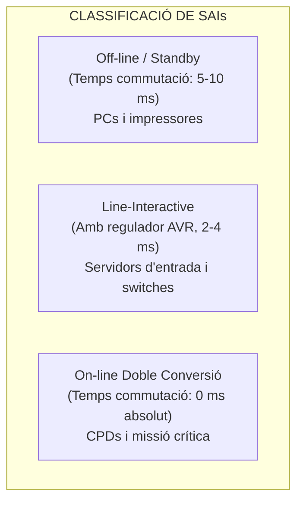
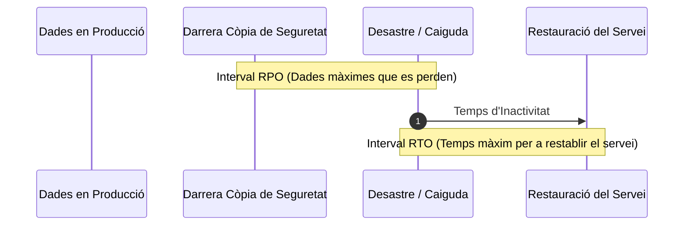

# UT04 — Protecció Elèctrica (SAI) i Plans de Continuïtat de Negoci

L'energia elèctrica és el recurs vital del qual depèn qualsevol infraestructura TIC. Una fallada elèctrica o una pertorbació a la xarxa no només pot aturar els serveis d'una empresa provocant pèrdues milionàries, sinó que pot danyar físicament els components electrònics i corrompre les particions dels servidors.

---

## 📌 1. Pertorbacions i Anomalies de la Xarxa Elèctrica

La xarxa elèctrica pública comercial rarament subministra una ona sinusoïdal pura i estable a $230\text{ V}$ i $50\text{ Hz}$. Els problemes més habituals són:

| Anomalia Elèctrica | Denominació Tècnica | Efecte sobre l'Equipament Informàtic |
| :--- | :--- | :--- |
| **Tall de Subministrament** | *Blackout* (Apagada total) | Apagada sobtada, pèrdua de dades en memòria RAM, corrupció de fitxers i sistemes RAID. |
| **Caiguda de Tensió** | *Brownout* o *Sag* ($< 80\%$ nominal) | Bloqueig de servidors, reinicis espontanis i sobreescalfament de fonts d'alimentació commutades. |
| **Sobretensió Transitòria** | *Spike* / *Surge* (pics de $> 1000\text{ V}$) | Destrucció física de condensadors, transistors i xips de la placa base (habitual per llamps). |
| **Soroll de Línia** | Interferències EMI / RFI | Errors de transmissió en targetes de xarxa, errors de lectura en memòries i bloquejos lògics. |

---

## 📌 2. Topologia i Tipus de Sistemes d'Alimentació Ininterrompuda (SAI/UPS)

Un **SAI** (*Sistema d'Alimentació Ininterrompuda* o *UPS* en anglès) és un dispositiu que conté una bateria recarregable i circuiteria electrònica per a seguir subministrant electricitat quan falla la xarxa elèctrica:

### 1. SAI Off-line (Standby):
L'equip s'alimenta directament de la xarxa. Quan la tensió cau fora dels marges de tolerància, un relé mecànic commuta cap a la bateria i l'inversor.
- **Temps de commutació:** $5\text{ ms} - 10\text{ ms}$ (durant aquest breu interval no hi ha corrent, però els condensadors de les fonts de PC solen aguantar).
- **Forma d'ona de sortida:** Ona pseudo-sinusoïdal o quadrada (pot no ser apta per a servidors amb PFC actiu).

### 2. SAI Line-Interactive:
Incorpora un autotransformador amb presa automàtica regulable (**AVR - Automatic Voltage Regulator**). Si la tensió pateix baixades o pujades moderades, l'AVR les compensa sense necessitat de consumir energia de la bateria, allargant-ne la vida útil.
- **Temps de commutació:** $2\text{ ms} - 4\text{ ms}$.

### 3. SAI On-line de Doble Conversió:
És l'estàndard professional en servidors de CPD. La càrrega **mai s'alimenta directament de la xarxa pública**:
$$\text{Xarxa elèctrica (CA)} \xrightarrow{\text{Rectificador}} \text{Corrent Continu (CC + Bateria)} \xrightarrow{\text{Inversor}} \text{Corrent Altern Net (CA pura)}$$
- **Temps de commutació:** **$0\text{ ms}$ (zero mil·lisegons)**. L'ona és sempre una sinusoide perfecta i estable.
- **Bypass estàtic integrat:** Si el SAI falla o s'ha de canviar la bateria, disposa d'un commutador automàtic sense tall per a no aturar els servidors.

---

## 📌 3. Càlcul Matemàtic i Dimensionament d'un SAI

Els fabricants especifiquen la capacitat dels SAIs en **Volt-Amperes (VA)** (potència aparent, $S$), mentre que el consum dels servidors ve expressat en **Watts (W)** (potència activa, $P$).

$$\boxed{S(\text{VA}) = \frac{P(\text{W})}{\text{FP}}}$$

On $\text{FP}$ és el **Factor de Potència** (típicament entre $0{,}8$ i $0{,}9$ per a servidors moderns).

### Marge de Seguretat Recomanat:
Per a evitar que el SAI treballe al $100\%$ de la seua capacitat (fet que n'escurça la vida útil) i per a permetre connectar nous discs o servidors en el futur, s'aplica un **factor de seguretat del $25\%$**:

$$S_{\text{recomanat}} = S_{\text{total}} \times 1{,}25$$

### Càlcul de l'Autonomia de les Bateries:
L'autonomia teòrica que pot subministrar un banc de bateries es calcula amb la fórmula:

$$\boxed{t_{\text{autonomia}}(\text{h}) = \frac{V_{\text{banc}}(\text{V}) \times C(\text{Ah}) \times \eta}{P_{\text{consum}}(\text{W})}}$$

On $\eta \approx 0{,}85$ és el rendiment de conversió de l'inversor.

### 📐 Problema d'Examen Resol Pas a Pas:
Un rack conté els següents equips que cal connectar a un SAI On-line:
- 2 Servidors de rack: $350\text{ W}$ cadascun ($700\text{ W}$ total).
- 1 Switch administrable de 48 ports: $60\text{ W}$.
- 1 Firewall perimetral: $40\text{ W}$.
- 1 Sistema d'emmagatzematge NAS: $120\text{ W}$.

1. **Calcula la potència activa total ($P_{\text{total}}$):**
   $$P_{\text{total}} = 700 + 60 + 40 + 120 = 920\text{ W}$$
2. **Calcula la potència aparent mínima ($S$) sabent que $\text{FP} = 0{,}8$:**
   $$S = \frac{920\text{ W}}{0{,}8} = 1150\text{ VA}$$
3. **Aplica el marge de seguretat del $25\%$ per a triar el SAI comercial:**
   $$S_{\text{recomanat}} = 1150 \times 1{,}25 = 1437{,}5\text{ VA}$$
   *Decisió tècnica:* Es seleccionarà un model comercial estàndard de **$1500\text{ VA}$** o **$2000\text{ VA}$**.

---

## 📌 4. Plans de Continuïtat de Negoci: RTO i RPO

Quan un incident greu inutilitza les instal·lacions, entra en joc el **Pla de Recuperació davant Desastres (*Disaster Recovery Plan - DRP*)**:

- **RPO (*Recovery Point Objective*):** Objectiu de Punt de Recuperació. És la quantitat màxima de dades (mesurada en temps) que l'empresa pot tolerar perdre. Si fem còpies cada 12 hores, el nostre $\text{RPO} = 12\text{ h}$.
- **RTO (*Recovery Time Objective*):** Objectiu de Temps de Recuperació. És el temps màxim permès per a posar en marxa de nou els sistemes després de la catàstrofe.

### Centres de Processament Alternatius:
- **Hot Site:** Centre idèntic en funcionament paral·lel permanent. Sincronització de dades en temps real. $\text{RTO} \to 0$, cost molt elevat.
- **Warm Site:** Centre amb els servidors físics preparats però cal descarregar i bolcar la darrera còpia de seguretat. $\text{RTO} \approx \text{unes poques hores}$.
- **Cold Site:** Espai físic amb alimentació i refrigeració, però sense maquinari preinstal·lat. $\text{RTO} \approx \text{dies o setmanes}$, cost reduït.

---

## 🎨 Infografia Tècnica: RPO vs RTO en Plans de Continuïtat

<svg viewBox="0 0 840 260" width="100%" height="auto" xmlns="http://www.w3.org/2000/svg" style="max-width: 840px; border-radius: 16px; filter: drop-shadow(0 10px 15px rgba(0,0,0,0.1)); font-family: system-ui, sans-serif;">
  <defs>
    <linearGradient id="bgDRP" x1="0%" y1="0%" x2="100%" y2="100%">
      <stop offset="0%" stop-color="#090d16" />
      <stop offset="100%" stop-color="#1e293b" />
    </linearGradient>
    <linearGradient id="gradRPO" x1="0%" y1="0%" x2="100%" y2="0%">
      <stop offset="0%" stop-color="#3b82f6" />
      <stop offset="100%" stop-color="#ef4444" />
    </linearGradient>
    <linearGradient id="gradRTO" x1="0%" y1="0%" x2="100%" y2="0%">
      <stop offset="0%" stop-color="#ef4444" />
      <stop offset="100%" stop-color="#10b981" />
    </linearGradient>
  </defs>
  <rect width="840" height="260" rx="16" fill="url(#bgDRP)" />
  <text x="420" y="32" text-anchor="middle" fill="#f8fafc" font-size="18" font-weight="bold" letter-spacing="1">⏱️ PLANS DE CONTINUÏTAT: METRIQUES RPO vs RTO</text>
  <text x="420" y="52" text-anchor="middle" fill="#94a3b8" font-size="12">Com mesurar la tolerància a la pèrdua de dades i el temps d'inactivitat davant un desastre</text>

  <!-- Línia temporal base -->
  <line x1="80" y1="130" x2="760" y2="130" stroke="#475569" stroke-width="4" stroke-linecap="round" />

  <!-- Punt Darrera Còpia -->
  <circle cx="220" cy="130" r="14" fill="#3b82f6" stroke="#ffffff" stroke-width="3" />
  <text x="220" y="95" text-anchor="middle" fill="#60a5fa" font-size="13" font-weight="bold">💾 DARRERA CÒPIA</text>
  <text x="220" y="112" text-anchor="middle" fill="#94a3b8" font-size="11">Backup efectuat</text>

  <!-- Zona RPO -->
  <rect x="235" y="145" width="170" height="45" rx="6" fill="#ef4444" fill-opacity="0.2" stroke="#ef4444" stroke-width="1.5" />
  <text x="320" y="165" text-anchor="middle" fill="#fca5a5" font-size="12" font-weight="bold">RPO (Dades Perdudes)</text>
  <text x="320" y="180" text-anchor="middle" fill="#f87171" font-size="10">Quantitat de dades no salvades</text>
  <line x1="225" y1="130" x2="410" y2="130" stroke="url(#gradRPO)" stroke-width="6" />

  <!-- Punt Desastre -->
  <circle cx="420" cy="130" r="18" fill="#ef4444" stroke="#ffffff" stroke-width="3" />
  <text x="420" y="137" text-anchor="middle" font-size="16" fill="#ffffff">💥</text>
  <text x="420" y="90" text-anchor="middle" fill="#f87171" font-size="14" font-weight="bold">DESASTRE / CAIGUDA</text>
  <text x="420" y="106" text-anchor="middle" fill="#fca5a5" font-size="11">Incident greu o incendi</text>

  <!-- Zona RTO -->
  <rect x="435" y="145" width="170" height="45" rx="6" fill="#10b981" fill-opacity="0.2" stroke="#10b981" stroke-width="1.5" />
  <text x="520" y="165" text-anchor="middle" fill="#6ee7b7" font-size="12" font-weight="bold">RTO (Temps d'Aturada)</text>
  <text x="520" y="180" text-anchor="middle" fill="#34d399" font-size="10">Temps fins a restablir servei</text>
  <line x1="430" y1="130" x2="615" y2="130" stroke="url(#gradRTO)" stroke-width="6" />

  <!-- Punt Recuperació -->
  <circle cx="620" cy="130" r="14" fill="#10b981" stroke="#ffffff" stroke-width="3" />
  <text x="620" y="95" text-anchor="middle" fill="#34d399" font-size="13" font-weight="bold">✅ RESTAURACIÓ</text>
  <text x="620" y="112" text-anchor="middle" fill="#94a3b8" font-size="11">Sistemes operatius de nou</text>

  <!-- Taula Resum Inferior -->
  <rect x="80" y="210" width="680" height="32" rx="6" fill="#1e293b" />
  <text x="420" y="231" text-anchor="middle" fill="#94a3b8" font-size="11">Com més propers a 0 siguin el RPO i el RTO, més alta disponibilitat i major inversió requerida (Hot Site vs Cold Site).</text>
</svg>

---

## 📝 Quadern d'Activitats Pràctiques i Reptes de Laboratori

### Bloc A: Càlculs Tècnics de Dimensionament
1. **Dimensionament de SAI per a una botiga online:**
   - La botiga disposa de 2 servidors de $400\text{ W}$ cadascun amb $\text{FP} = 0,9$, un switch de $50\text{ W}$ amb $\text{FP} = 0,8$ i un rúter de $30\text{ W}$ amb $\text{FP} = 0,7$.
   - Calcula la potència aparent total ($S_{\text{total}}$ en VA).
   - Aplica el marge de seguretat del $25\%$.
   - Quin model comercial de Salicru o APC seleccionaries (1500 VA, 2000 VA o 3000 VA)?
2. **Càlcul d'Autonomia:**
   - Si el SAI de 2000 VA conté 4 bateries de $12\text{ V}$ i $9\text{ Ah}$ connectades en sèrie ($V_{\text{banc}} = 48\text{ V}$, capacitat $= 9\text{ Ah}$), i el consum continu és de $880\text{ W}$ amb un rendiment de l'inversor $\eta = 0,85$:
   - Quants minuts d'autonomia real suportarà el sistema abans d'apagar-se?

### Bloc B: Anàlisi d'Escenari DRP
Un despatx d'advocats fa còpies de seguretat només cada diumenge a la nit. Dimecres a les 18:00h un ransomware xifra tot el servidor de fitxers.
- Quin és el RPO que ha patit el client en hores de feina perduda?
- Si el tècnic tarda 48 hores a reinstal·lar els sistemes i bolcar les dades antigues, quin és el RTO?
- Com redueix la regla 3-2-1 i les instantànies cada 2 hores aquestes xifres?

### Bloc C: Llista d'Autoavaluació de Qualitat
- [ ] Domini de les fórmules de potència aparent (VA), factor de potència i autonomia.
- [ ] Comprensió de la diferència clau entre un SAI Line-Interactive i un On-line Doble Conversió.
- [ ] Capacitat per a definir els valors de RTO i RPO en un pla de continuïtat de negoci.
