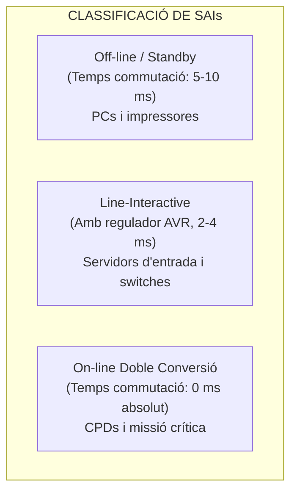
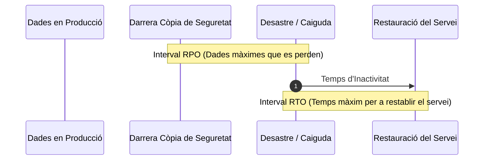

# UT04 — Protecció Elèctrica (SAI) i Plans de Continuïtat de Negoci

L'energia elèctrica és el recurs vital del qual depèn qualsevol infraestructura TIC. Una fallada elèctrica o una pertorbació a la xarxa no només pot aturar els serveis d'una empresa provocant pèrdues milionàries, sinó que pot danyar físicament els components electrònics i corrompre les particions dels servidors.

---

## 📌 1. Pertorbacions i Anomalies de la Xarxa Elèctrica

La xarxa elèctrica pública comercial rarament subministra una ona sinusoïdal pura i estable a $230\text{ V}$ i $50\text{ Hz}$. Els problemes més habituals són:

| Anomalia Elèctrica | Denominació Tècnica | Efecte sobre l'Equipament Informàtic |
| :--- | :--- | :--- |
| **Tall de Subministrament** | *Blackout* (Apagada total) | Apagada sobtada, pèrdua de dades en memòria RAM, corrupció de fitxers i sistemes RAID. |
| **Caiguda de Tensió** | *Brownout* o *Sag* ($< 80\%$ nominal) | Bloqueig de servidors, reinicis espontanis i sobreescalfament de fonts d'alimentació commutades. |
| **Sobretensió Transitòria** | *Spike* / *Surge* (pics de $> 1000\text{ V}$) | Destrucció física de condensadors, transistors i xips de la placa base (habitual per llamps). |
| **Soroll de Línia** | Interferències EMI / RFI | Errors de transmissió en targetes de xarxa, errors de lectura en memòries i bloquejos lògics. |

---

## 📌 2. Topologia i Tipus de Sistemes d'Alimentació Ininterrompuda (SAI/UPS)

Un **SAI** (*Sistema d'Alimentació Ininterrompuda* o *UPS* en anglès) és un dispositiu que conté una bateria recarregable i circuiteria electrònica per a seguir subministrant electricitat quan falla la xarxa elèctrica:

### 1. SAI Off-line (Standby):
L'equip s'alimenta directament de la xarxa. Quan la tensió cau fora dels marges de tolerància, un relé mecànic commuta cap a la bateria i l'inversor.
- **Temps de commutació:** $5\text{ ms} - 10\text{ ms}$ (durant aquest breu interval no hi ha corrent, però els condensadors de les fonts de PC solen aguantar).
- **Forma d'ona de sortida:** Ona pseudo-sinusoïdal o quadrada (pot no ser apta per a servidors amb PFC actiu).

### 2. SAI Line-Interactive:
Incorpora un autotransformador amb presa automàtica regulable (**AVR - Automatic Voltage Regulator**). Si la tensió pateix baixades o pujades moderades, l'AVR les compensa sense necessitat de consumir energia de la bateria, allargant-ne la vida útil.
- **Temps de commutació:** $2\text{ ms} - 4\text{ ms}$.

### 3. SAI On-line de Doble Conversió:
És l'estàndard professional en servidors de CPD. La càrrega **mai s'alimenta directament de la xarxa pública**:
$$\text{Xarxa elèctrica (CA)} \xrightarrow{\text{Rectificador}} \text{Corrent Continu (CC + Bateria)} \xrightarrow{\text{Inversor}} \text{Corrent Altern Net (CA pura)}$$
- **Temps de commutació:** **$0\text{ ms}$ (zero mil·lisegons)**. L'ona és sempre una sinusoide perfecta i estable.
- **Bypass estàtic integrat:** Si el SAI falla o s'ha de canviar la bateria, disposa d'un commutador automàtic sense tall per a no aturar els servidors.

---

## 📌 3. Càlcul Matemàtic i Dimensionament d'un SAI

Els fabricants especifiquen la capacitat dels SAIs en **Volt-Amperes (VA)** (potència aparent, $S$), mentre que el consum dels servidors ve expressat en **Watts (W)** (potència activa, $P$).

$$\boxed{S(\text{VA}) = \frac{P(\text{W})}{\text{FP}}}$$

On $\text{FP}$ és el **Factor de Potència** (típicament entre $0{,}8$ i $0{,}9$ per a servidors moderns).

### Marge de Seguretat Recomanat:
Per a evitar que el SAI treballe al $100\%$ de la seua capacitat (fet que n'escurça la vida útil) i per a permetre connectar nous discs o servidors en el futur, s'aplica un **factor de seguretat del $25\%$**:

$$S_{\text{recomanat}} = S_{\text{total}} \times 1{,}25$$

### Càlcul de l'Autonomia de les Bateries:
L'autonomia teòrica que pot subministrar un banc de bateries es calcula amb la fórmula:

$$\boxed{t_{\text{autonomia}}(\text{h}) = \frac{V_{\text{banc}}(\text{V}) \times C(\text{Ah}) \times \eta}{P_{\text{consum}}(\text{W})}}$$

On $\eta \approx 0{,}85$ és el rendiment de conversió de l'inversor.

### 📐 Problema d'Examen Resol Pas a Pas:
Un rack conté els següents equips que cal connectar a un SAI On-line:
- 2 Servidors de rack: $350\text{ W}$ cadascun ($700\text{ W}$ total).
- 1 Switch administrable de 48 ports: $60\text{ W}$.
- 1 Firewall perimetral: $40\text{ W}$.
- 1 Sistema d'emmagatzematge NAS: $120\text{ W}$.

1. **Calcula la potència activa total ($P_{\text{total}}$):**
   $$P_{\text{total}} = 700 + 60 + 40 + 120 = 920\text{ W}$$
2. **Calcula la potència aparent mínima ($S$) sabent que $\text{FP} = 0{,}8$:**
   $$S = \frac{920\text{ W}}{0{,}8} = 1150\text{ VA}$$
3. **Aplica el marge de seguretat del $25\%$ per a triar el SAI comercial:**
   $$S_{\text{recomanat}} = 1150 \times 1{,}25 = 1437{,}5\text{ VA}$$
   *Decisió tècnica:* Es seleccionarà un model comercial estàndard de **$1500\text{ VA}$** o **$2000\text{ VA}$**.

---

## 📌 4. Plans de Continuïtat de Negoci: RTO i RPO

Quan un incident greu inutilitza les instal·lacions, entra en joc el **Pla de Recuperació davant Desastres (*Disaster Recovery Plan - DRP*)**:

- **RPO (*Recovery Point Objective*):** Objectiu de Punt de Recuperació. És la quantitat màxima de dades (mesurada en temps) que l'empresa pot tolerar perdre. Si fem còpies cada 12 hores, el nostre $\text{RPO} = 12\text{ h}$.
- **RTO (*Recovery Time Objective*):** Objectiu de Temps de Recuperació. És el temps màxim permès per a posar en marxa de nou els sistemes després de la catàstrofe.

### Centres de Processament Alternatius:
- **Hot Site:** Centre idèntic en funcionament paral·lel permanent. Sincronització de dades en temps real. $\text{RTO} \to 0$, cost molt elevat.
- **Warm Site:** Centre amb els servidors físics preparats però cal descarregar i bolcar la darrera còpia de seguretat. $\text{RTO} \approx \text{unes poques hores}$.
- **Cold Site:** Espai físic amb alimentació i refrigeració, però sense maquinari preinstal·lat. $\text{RTO} \approx \text{dies o setmanes}$, cost reduït.
