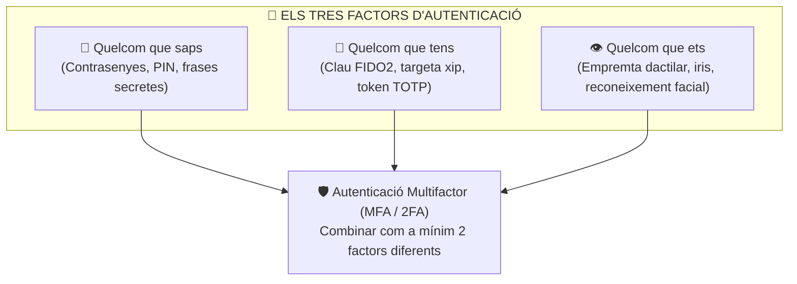

# UT05 — Autenticació, Polítiques de Contrasenyes i Control d'Accés Lògic

L'autenticació és la primera línia de defensa lògica d'un sistema operatiu. Comprova que l'usuari que intenta accedir a una xarxa, compte o base de dades és legítimament qui diu ser. Una mala gestió de credencials és responsable de més del $80\%$ de les filtracions corporatives a nivell mundial.

---

## 📌 1. Factors d'Autenticació i Seguretat Multifactor (MFA)

La seguretat moderna classifica els mètodes d'autenticació en tres grans factors independents:



> [!IMPORTANT]
> Demanar dos mètodes del mateix tipus (p. ex., una contrasenya i un PIN) **NO és doble factor**, sinó autenticació d'un sol factor duplicat. Per a ser 2FA real cal combinar dos factors de categories diferents (p. ex., contrasenya [quelcom que saps] + codi d'aplicació mòbil TOTP [quelcom que tens]).

### Algorisme TOTP (RFC 6238):
Les aplicacions com Google Authenticator o Microsoft Authenticator generen un codi de 6 dígits que canvia cada 30 segons. L'algorisme utilitza una **clau secreta compartida** ($K$) i la **marca de temps actual de la xarxa** ($T = \lfloor \text{temps} / 30 \rfloor$):

$$\text{TOTP} = \text{Truncar}(\text{HMAC-SHA1}(K, T)) \pmod{10^6}$$

---

## 📌 2. Robustesa de Contrasenyes i Càlcul d'Entropia

La resistència d'una contrasenya davant d'un atac per força bruta depèn de la seua **entropia** (mesurada en bits). Quants més caràcters i més gran siga el repertori de caràcters possibles, més combinacions haurà de provar l'atacant:

$$\boxed{E = L \cdot \log_2(R)}$$

On:
- $L$ és la longitud de la contrasenya en caràcters.
- $R$ és la mida del conjunt de caràcters possibles:
  - Només minúscules: $R = 26$
  - Lletres majúscules i minúscules: $R = 52$
  - Lletres i números: $R = 62$
  - Lletres, números i símbols ASCII imprimibles: $R = 94$

### Comparativa: Contrasenya Complexa vs Frase de Pas (*Passphrase*)

| Concepte | Exemple | Longitud ($L$) | Espai ($R$) | Entropia ($E$) | Temps de Força Bruta ($10^{10}$ claus/s) |
| :--- | :--- | :---: | :---: | :---: | :--- |
| **Dèbil típica** | `admin123` | 8 | 62 | $\approx 47{,}6\text{ bits}$ | Menys d'1 segon |
| **Complexa curta** | `P@ssw0rd!` | 9 | 94 | $\approx 59\text{ bits}$ | Pocs minuts / taules Rainbow |
| **Frase de pas llarga** | `cavall-taronja-piano-solstici` | 29 | 94 | $\approx 189\text{ bits}$ | Milions d'anys (inabastable) |

---

## 📌 3. Configuració en Windows Server mitjançant GPO

En un entorn Active Directory, les polítiques de contrasenyes i bloqueig s'implanten mitjançant la directiva de domini predeterminada (*Default Domain Policy*):

```powershell
# Comprovar la directiva de contrasenyes actual del domini per PowerShell
Get-ADDefaultDomainPasswordPolicy
```

### Paràmetres clau a la consola GPMC:
- **Historial de contrasenyes (*Enforce password history*):** Recordar almenys **24 contrasenyes** anteriors per a evitar que l'usuari alterne entre dues claus habituals.
- **Longitud mínima de la contrasenya (*Minimum password length*):** Mínim **12 caràcters** (14 o més per a comptes d'administrador).
- **La contrasenya ha de complir requisits de complexitat:** Activat (obliga a utilitzar 3 dels 4 conjunts: majúscules, minúscules, números, símbols).
- **Llindar de bloqueig de compte (*Account lockout threshold*):** **5 intents fallits**. Bloqueja temporalment el compte durant 15 minuts per a avortar atacs automatitzats de força bruta.

---

## 📌 4. Configuració en Linux mitjançant PAM (`pam_pwquality`)

En sistemes Debian i Ubuntu Server, la robustesa de les contrasenyes s'imposa a través del mòdul PAM (*Pluggable Authentication Modules*):

```bash
# 1. Instal·lar la llibreria de qualitat de contrasenyes
sudo apt update && sudo apt install libpam-pwquality -y

# 2. Configurar la directiva global a /etc/security/pwquality.conf
sudo tee /etc/security/pwquality.conf > /dev/null << 'EOF'
# Configuració de seguretat SMX
minlen = 12
dcredit = -1
ucredit = -1
lcredit = -1
ocredit = -1
difok = 3
maxrepeat = 2
EOF
```

### Significat dels paràmetres:
- `minlen = 12`: Longitud mínima de 12 caràcters.
- `dcredit = -1`: Exigeix com a mínim 1 dígit numèric.
- `ucredit = -1`: Exigeix com a mínim 1 caràcter en majúscula.
- `lcredit = -1`: Exigeix com a mínim 1 caràcter en minúscula.
- `ocredit = -1`: Exigeix com a mínim 1 símbol especial.
- `difok = 3`: Cal que almenys 3 caràcters siguen completament nous respecte a l'antiga contrasenya.

### Protecció contra Força Bruta amb `pam_faillock`:
Al fitxer `/etc/pam.d/common-auth`, afegir:
```bash
auth required pam_faillock.so preauth silent deny=5 unlock_time=900
auth [default=die] pam_faillock.so authfail deny=5 unlock_time=900
```
Això bloqueja l'usuari durant **900 segons (15 minuts)** després de 5 intents d'autenticació fallits per SSH o consola local.
