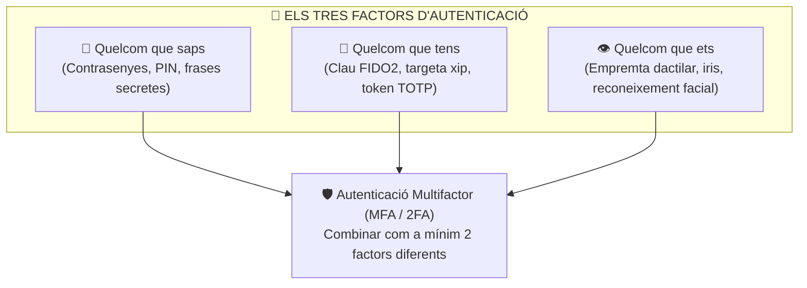

# UT05 — Autenticació, Polítiques de Contrasenyes i Control d'Accés Lògic

L'autenticació és la primera línia de defensa lògica d'un sistema operatiu. Comprova que l'usuari que intenta accedir a una xarxa, compte o base de dades és legítimament qui diu ser. Una mala gestió de credencials és responsable de més del $80\%$ de les filtracions corporatives a nivell mundial.

---

## 📌 1. Factors d'Autenticació i Seguretat Multifactor (MFA)

La seguretat moderna classifica els mètodes d'autenticació en tres grans factors independents:



> [!IMPORTANT]
> Demanar dos mètodes del mateix tipus (p. ex., una contrasenya i un PIN) **NO és doble factor**, sinó autenticació d'un sol factor duplicat. Per a ser 2FA real cal combinar dos factors de categories diferents (p. ex., contrasenya [quelcom que saps] + codi d'aplicació mòbil TOTP [quelcom que tens]).

### Algorisme TOTP (RFC 6238):
Les aplicacions com Google Authenticator o Microsoft Authenticator generen un codi de 6 dígits que canvia cada 30 segons. L'algorisme utilitza una **clau secreta compartida** ($K$) i la **marca de temps actual de la xarxa** ($T = \lfloor \text{temps} / 30 \rfloor$):

$$\text{TOTP} = \text{Truncar}(\text{HMAC-SHA1}(K, T)) \pmod{10^6}$$

---

## 📌 2. Robustesa de Contrasenyes i Càlcul d'Entropia

La resistència d'una contrasenya davant d'un atac per força bruta depèn de la seua **entropia** (mesurada en bits). Quants més caràcters i més gran siga el repertori de caràcters possibles, més combinacions haurà de provar l'atacant:

$$\boxed{E = L \cdot \log_2(R)}$$

On:
- $L$ és la longitud de la contrasenya en caràcters.
- $R$ és la mida del conjunt de caràcters possibles:
  - Només minúscules: $R = 26$
  - Lletres majúscules i minúscules: $R = 52$
  - Lletres i números: $R = 62$
  - Lletres, números i símbols ASCII imprimibles: $R = 94$

### Comparativa: Contrasenya Complexa vs Frase de Pas (*Passphrase*)

| Concepte | Exemple | Longitud ($L$) | Espai ($R$) | Entropia ($E$) | Temps de Força Bruta ($10^{10}$ claus/s) |
| :--- | :--- | :---: | :---: | :---: | :--- |
| **Dèbil típica** | `admin123` | 8 | 62 | $\approx 47{,}6\text{ bits}$ | Menys d'1 segon |
| **Complexa curta** | `P@ssw0rd!` | 9 | 94 | $\approx 59\text{ bits}$ | Pocs minuts / taules Rainbow |
| **Frase de pas llarga** | `cavall-taronja-piano-solstici` | 29 | 94 | $\approx 189\text{ bits}$ | Milions d'anys (inabastable) |

---

## 📌 3. Configuració en Windows Server mitjançant GPO

En un entorn Active Directory, les polítiques de contrasenyes i bloqueig s'implanten mitjançant la directiva de domini predeterminada (*Default Domain Policy*):

```powershell
# Comprovar la directiva de contrasenyes actual del domini per PowerShell
Get-ADDefaultDomainPasswordPolicy
```

### Paràmetres clau a la consola GPMC:
- **Historial de contrasenyes (*Enforce password history*):** Recordar almenys **24 contrasenyes** anteriors per a evitar que l'usuari alterne entre dues claus habituals.
- **Longitud mínima de la contrasenya (*Minimum password length*):** Mínim **12 caràcters** (14 o més per a comptes d'administrador).
- **La contrasenya ha de complir requisits de complexitat:** Activat (obliga a utilitzar 3 dels 4 conjunts: majúscules, minúscules, números, símbols).
- **Llindar de bloqueig de compte (*Account lockout threshold*):** **5 intents fallits**. Bloqueja temporalment el compte durant 15 minuts per a avortar atacs automatitzats de força bruta.

---

## 📌 4. Configuració en Linux mitjançant PAM (`pam_pwquality`)

En sistemes Debian i Ubuntu Server, la robustesa de les contrasenyes s'imposa a través del mòdul PAM (*Pluggable Authentication Modules*):

```bash
# 1. Instal·lar la llibreria de qualitat de contrasenyes
sudo apt update && sudo apt install libpam-pwquality -y

# 2. Configurar la directiva global a /etc/security/pwquality.conf
sudo tee /etc/security/pwquality.conf > /dev/null << 'EOF'
# Configuració de seguretat SMX
minlen = 12
dcredit = -1
ucredit = -1
lcredit = -1
ocredit = -1
difok = 3
maxrepeat = 2
EOF
```

### Significat dels paràmetres:
- `minlen = 12`: Longitud mínima de 12 caràcters.
- `dcredit = -1`: Exigeix com a mínim 1 dígit numèric.
- `ucredit = -1`: Exigeix com a mínim 1 caràcter en majúscula.
- `lcredit = -1`: Exigeix com a mínim 1 caràcter en minúscula.
- `ocredit = -1`: Exigeix com a mínim 1 símbol especial.
- `difok = 3`: Cal que almenys 3 caràcters siguen completament nous respecte a l'antiga contrasenya.

### Protecció contra Força Bruta amb `pam_faillock`:
Al fitxer `/etc/pam.d/common-auth`, afegir:
```bash
auth required pam_faillock.so preauth silent deny=5 unlock_time=900
auth [default=die] pam_faillock.so authfail deny=5 unlock_time=900
```
Això bloqueja l'usuari durant **900 segons (15 minuts)** després de 5 intents d'autenticació fallits per SSH o consola local.

---

## 🎨 Infografia Tècnica: Entropia de Contrasenyes i Força Bruta

<div style="text-align: center; margin: 25px 0;">
<svg viewBox="0 0 840 260" width="100%" height="auto" xmlns="http://www.w3.org/2000/svg" style="max-width: 840px; border-radius: 16px; filter: drop-shadow(0 10px 15px rgba(0,0,0,0.1)); font-family: system-ui, sans-serif;">
  <defs>
    <linearGradient id="bgEnt" x1="0%" y1="0%" x2="100%" y2="100%">
      <stop offset="0%" stop-color="#0f172a" />
      <stop offset="100%" stop-color="#1e1e38" />
    </linearGradient>
    <linearGradient id="cardWeak" x1="0%" y1="0%" x2="100%" y2="100%">
      <stop offset="0%" stop-color="#ef4444" />
      <stop offset="100%" stop-color="#b91c1c" />
    </linearGradient>
    <linearGradient id="cardMid" x1="0%" y1="0%" x2="100%" y2="100%">
      <stop offset="0%" stop-color="#f59e0b" />
      <stop offset="100%" stop-color="#d97706" />
    </linearGradient>
    <linearGradient id="cardStrong" x1="0%" y1="0%" x2="100%" y2="100%">
      <stop offset="0%" stop-color="#10b981" />
      <stop offset="100%" stop-color="#059669" />
    </linearGradient>
  </defs>
  <rect width="840" height="260" rx="16" fill="url(#bgEnt)" />
  <text x="420" y="32" text-anchor="middle" fill="#f8fafc" font-size="18" font-weight="bold" letter-spacing="1">🔑 ENTROPIA I RESISTÈNCIA DAVANT FORÇA BRUTA</text>
  <text x="420" y="52" text-anchor="middle" fill="#94a3b8" font-size="12">Fórmula: E = L · log₂(R) bits — Per què la longitud supera la complexitat artificial</text>

  <!-- Card 1: Dèbil -->
  <g transform="translate(30, 75)">
    <rect width="240" height="160" rx="12" fill="url(#cardWeak)" fill-opacity="0.18" stroke="#ef4444" stroke-width="2" />
    <text x="120" y="35" text-anchor="middle" font-size="22">⚠️</text>
    <text x="120" y="62" text-anchor="middle" fill="#fca5a5" font-size="15" font-weight="bold">DÈBIL COMÚ</text>
    <rect x="25" y="75" width="190" height="26" rx="4" fill="#1e293b" />
    <text x="120" y="93" text-anchor="middle" fill="#ef4444" font-family="monospace" font-size="13" font-weight="bold">admin123</text>
    <text x="120" y="120" text-anchor="middle" fill="#e2e8f0" font-size="12">L = 8 caràcters</text>
    <text x="120" y="136" text-anchor="middle" fill="#ef4444" font-size="12" font-weight="bold">E ≈ 47 bits (Instantani)</text>
    <text x="120" y="152" text-anchor="middle" fill="#94a3b8" font-size="10">Craqueig en &lt; 1 segon</text>
  </g>

  <!-- Card 2: Complexa Curta -->
  <g transform="translate(300, 75)">
    <rect width="240" height="160" rx="12" fill="url(#cardMid)" fill-opacity="0.18" stroke="#f59e0b" stroke-width="2" />
    <text x="120" y="35" text-anchor="middle" font-size="22">🔤</text>
    <text x="120" y="62" text-anchor="middle" fill="#fde68a" font-size="15" font-weight="bold">COMPLEXA CURTA</text>
    <rect x="25" y="75" width="190" height="26" rx="4" fill="#1e293b" />
    <text x="120" y="93" text-anchor="middle" fill="#fbbf24" font-family="monospace" font-size="13" font-weight="bold">P@ssw0rd!#</text>
    <text x="120" y="120" text-anchor="middle" fill="#e2e8f0" font-size="12">L = 10 caràcters</text>
    <text x="120" y="136" text-anchor="middle" fill="#fbbf24" font-size="12" font-weight="bold">E ≈ 65 bits (Vulnerable)</text>
    <text x="120" y="152" text-anchor="middle" fill="#94a3b8" font-size="10">Craqueig en hores (GPU RT)</text>
  </g>

  <!-- Card 3: Passphrase Llarga -->
  <g transform="translate(570, 75)">
    <rect width="240" height="160" rx="12" fill="url(#cardStrong)" fill-opacity="0.18" stroke="#10b981" stroke-width="2" />
    <text x="120" y="35" text-anchor="middle" font-size="22">🛡️</text>
    <text x="120" y="62" text-anchor="middle" fill="#a7f3d0" font-size="15" font-weight="bold">PASSPHRASE LLARGA</text>
    <rect x="15" y="75" width="210" height="26" rx="4" fill="#1e293b" />
    <text x="120" y="93" text-anchor="middle" fill="#34d399" font-family="monospace" font-size="11" font-weight="bold">cavall-taronja-piano</text>
    <text x="120" y="120" text-anchor="middle" fill="#e2e8f0" font-size="12">L = 20 caràcters</text>
    <text x="120" y="136" text-anchor="middle" fill="#34d399" font-size="12" font-weight="bold">E ≈ 130 bits (Infranquejable)</text>
    <text x="120" y="152" text-anchor="middle" fill="#94a3b8" font-size="10">Milions d'anys per a trencar</text>
  </g>
</svg>
</div>

---

## 📝 Quadern d'Activitats Pràctiques i Reptes de Laboratori

### Bloc A: Fonaments de Criptografia i Credencials
1. **Càlcul d'Entropia:**
   - Calcula l'entropia en bits d'un PIN bancari de 4 dígits ($L=4, R=10$).
   - Calcula l'entropia d'una contrasenya de 10 caràcters amb lletres majúscules, minúscules, números i símbols ($L=10, R=94$).
   - Quina de les dues ofereix una barrera matemàtica superior davant de força bruta?
2. **2FA Autèntic vs Fals 2FA:** Explica per què un sistema que et demana la contrasenya del compte i a continuació et demana el teu PIN de targeta NO està implementant autenticació de doble factor (2FA). Què faria falta afegir-hi?
3. **El perill del reciclatge de claus:** Per què un usuari que utilitza la mateixa contrasenya per a la botiga de sabates i per al correu de la feina posa en perill tota la infraestructura de la seua empresa?

### Bloc B: Repte Pràctic de Taller — Bastionat de PAM en Ubuntu
1. Configura a la teua màquina virtual de taller el fitxer `/etc/security/pwquality.conf` perquè rebutge qualsevol clau menor de 14 caràcters.
2. Comprova amb el comandament `passwd alumne` que en introduir claus senzilles com `123456` o `password` el sistema genera un error explicatiu i impedeix el canvi.
3. Configura `pam_faillock` a `/etc/pam.d/common-auth` amb límit de 3 intents i verifica que després de 3 intents erronis per consola el compte queda congelat.

### Bloc C: Llista d'Autoavaluació de Qualitat
- [ ] Sé calcular l'entropia matemàtica d'una clau segons el conjunt de caràcters.
- [ ] Entenc el funcionament dels tokens temporals TOTP i el secret compartit.
- [ ] Sé configurar directives de contrasenyes tant en Windows GPO com en Linux PAM.
