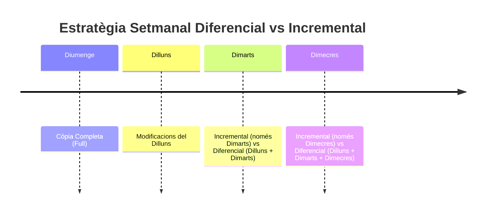
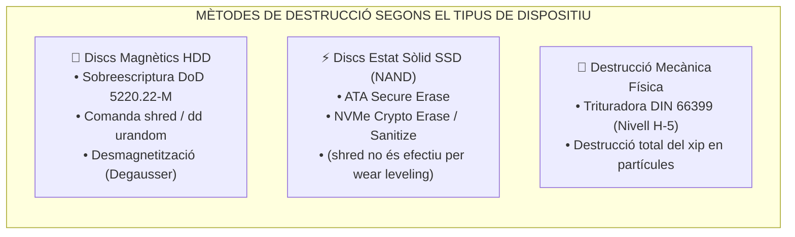

# UT06 — Emmagatzematge Segur, Còpies de Seguretat i Destrucció de Dades

Les dades són l'actiu més valuós de qualsevol organització. Si es crema un servidor o s'espatlla un disc, el maquinari es pot reemplaçar en hores comprant-ne un altre; en canvi, les dades de facturació, comptabilitat i clients perdudes sense còpia de seguretat poden significar la fallida immediata de l'empresa.

---

## 📌 1. L'Estratègia de Còpies de Seguretat: La Regla 3-2-1

El model professional per excel·lència per a garantir la resiliència de la informació és la **Regla d'Or 3-2-1**:

<div style="background: linear-gradient(135deg, #0f172a 0%, #1e293b 100%); border-radius: 12px; padding: 20px; margin: 25px 0; box-shadow: 0 10px 25px -5px rgba(0, 0, 0, 0.3); border: 1px solid #334155;">
  <div style="text-align: center; margin-bottom: 15px;">
    <span style="background: #10b981; color: #064e3b; font-weight: 700; font-size: 0.75rem; text-transform: uppercase; letter-spacing: 0.05em; padding: 4px 10px; border-radius: 9999px;">Infografia Tècnica</span>
    <h3 style="color: #f8fafc; margin: 10px 0 5px 0; font-size: 1.25rem;">L'Estratègia de Resiliència de Dades 3-2-1</h3>
    <p style="color: #94a3b8; font-size: 0.85rem; margin: 0;">Estandardització industrial per a la immutabilitat i supervivència davant Ransomware i desastres</p>
  </div>
  <svg viewBox="0 0 860 300" width="100%" height="100%" xmlns="http://www.w3.org/2000/svg" style="display: block; font-family: system-ui, -apple-system, sans-serif;">
    <defs>
      <linearGradient id="c3Grad" x1="0%" y1="0%" x2="100%" y2="100%">
        <stop offset="0%" stop-color="#0284c7" stop-opacity="0.35"/>
        <stop offset="100%" stop-color="#0369a1" stop-opacity="0.1"/>
      </linearGradient>
      <linearGradient id="c2Grad" x1="0%" y1="0%" x2="100%" y2="100%">
        <stop offset="0%" stop-color="#8b5cf6" stop-opacity="0.35"/>
        <stop offset="100%" stop-color="#6d28d9" stop-opacity="0.1"/>
      </linearGradient>
      <linearGradient id="c1Grad" x1="0%" y1="0%" x2="100%" y2="100%">
        <stop offset="0%" stop-color="#10b981" stop-opacity="0.35"/>
        <stop offset="100%" stop-color="#047857" stop-opacity="0.1"/>
      </linearGradient>
      <filter id="shadow321" x="-5%" y="-5%" width="110%" height="115%">
        <feDropShadow dx="0" dy="4" stdDeviation="6" flood-color="#000000" flood-opacity="0.4"/>
      </filter>
    </defs>

    <!-- Targeta 3: Tres Còpies -->
    <rect x="20" y="20" width="255" height="170" rx="10" fill="url(#c3Grad)" stroke="#38bdf8" stroke-width="1.5" filter="url(#shadow321)"/>
    <circle cx="55" cy="55" r="22" fill="#0284c7"/>
    <text x="55" y="63" fill="#ffffff" font-size="20" text-anchor="middle" font-weight="bold">3</text>
    <text x="90" y="50" fill="#38bdf8" font-size="15" font-weight="bold">CÒPIES TOTALS</text>
    <text x="90" y="68" fill="#e2e8f0" font-size="11">Dades originals + 2 còpies</text>
    <line x1="35" y1="88" x2="260" y2="88" stroke="#334155"/>
    <text x="35" y="110" fill="#cbd5e1" font-size="11">• 1 Còpia primària de producció</text>
    <text x="35" y="130" fill="#cbd5e1" font-size="11">• 1 Còpia local per a restauració ràpida</text>
    <text x="35" y="150" fill="#cbd5e1" font-size="11">• 1 Còpia de contingència</text>
    <text x="35" y="170" fill="#94a3b8" font-size="10">Risc de pèrdua simultània: &lt; 0.001%</text>

    <!-- Targeta 2: Dos Suports -->
    <rect x="300" y="20" width="255" height="170" rx="10" fill="url(#c2Grad)" stroke="#c084fc" stroke-width="1.5" filter="url(#shadow321)"/>
    <circle cx="335" cy="55" r="22" fill="#7c3aed"/>
    <text x="335" y="63" fill="#ffffff" font-size="20" text-anchor="middle" font-weight="bold">2</text>
    <text x="370" y="50" fill="#c084fc" font-size="15" font-weight="bold">SUPORTS DISTINTS</text>
    <text x="370" y="68" fill="#e2e8f0" font-size="11">Tecnologies independents</text>
    <line x1="315" y1="88" x2="540" y2="88" stroke="#334155"/>
    <text x="315" y="110" fill="#cbd5e1" font-size="11">• Discs durs interns SAS / NVMe</text>
    <text x="315" y="130" fill="#cbd5e1" font-size="11">• Cabina NAS extern / Cintes LTO</text>
    <text x="315" y="150" fill="#cbd5e1" font-size="11">• Evita fallades del mateix xassís/controlador</text>
    <text x="315" y="170" fill="#94a3b8" font-size="10">Immunitat a avaries de bus elèctric</text>

    <!-- Targeta 1: Una Còpia Fora -->
    <rect x="580" y="20" width="260" height="170" rx="10" fill="url(#c1Grad)" stroke="#34d399" stroke-width="1.5" filter="url(#shadow321)"/>
    <circle cx="615" cy="55" r="22" fill="#059669"/>
    <text x="615" y="63" fill="#ffffff" font-size="20" text-anchor="middle" font-weight="bold">1</text>
    <text x="650" y="50" fill="#34d399" font-size="15" font-weight="bold">FORA DE LA SEU</text>
    <text x="650" y="68" fill="#e2e8f0" font-size="11">Ubicació geogràfica externa</text>
    <line x1="595" y1="88" x2="825" y2="88" stroke="#334155"/>
    <text x="595" y="110" fill="#cbd5e1" font-size="11">• Object Storage al núvol xifrat (S3/Wasabi)</text>
    <text x="595" y="130" fill="#cbd5e1" font-size="11">• CPD de contingència a una altra ciutat</text>
    <text x="595" y="150" fill="#cbd5e1" font-size="11">• Protecció contra robatori, inundació o incendi</text>
    <text x="595" y="170" fill="#94a3b8" font-size="10">Garanteix continuïtat de negoci (BCP)</text>

    <!-- Barra Inferior: 3-2-1-1-0 -->
    <rect x="20" y="210" width="820" height="70" rx="8" fill="#1e293b" stroke="#475569" stroke-width="1"/>
    <text x="40" y="238" fill="#f59e0b" font-size="13" font-weight="bold">🛡️ MODEL AVANÇAT CONTRA RANSOMWARE (3-2-1-1-0):</text>
    <text x="40" y="260" fill="#cbd5e1" font-size="11">Afegeix <tspan fill="#38bdf8" font-weight="bold">1 Còpia Immutable (WORM / Object Lock)</tspan> desconnectada de la xarxa corporativa i <tspan fill="#10b981" font-weight="bold">0 Errors</tspan> validats mitjançant simulacres trimestrals de restauració.</text>
  </svg>
</div>

> [!TIP]
> **La regla moderna 3-2-1-1-0:** Afegeix **1 còpia immutable o desconnectada (*air-gapped*)** (perquè el ransomware que infecta la xarxa no la puga xifrar ni esborrar) i **0 errors** en proves periòdiques de restauració.

---

## 📌 2. Tipologia de Còpies de Seguretat

El sistema de fitxers utilitza un atribut denominat **Bit d'Arxiu (Archive Bit)** per a saber si un fitxer ha sigut modificat des de la darrera còpia:

| Tipus de Còpia | Què es copia exactament? | Modifica el Bit d'Arxiu? | Temps de Còpia | Espai requerit | Temps i procés de restauració |
| :--- | :--- | :---: | :---: | :---: | :--- |
| **Completa (*Full*)** | Tots els fitxers seleccionats. | Sí (es posa a 0) | Lent | Molt alt | **Molt ràpid:** Només es restaura aquest conjunt únic. |
| **Diferencial** | Fitxers modificats des de l'**última completa**. | **NO** | Mitjà | Mitjà | **Ràpid:** Es restaura la darrera completa + l'última diferencial. |
| **Incremental** | Fitxers modificats des de l'**última còpia de qualsevol tipus**. | Sí (es posa a 0) | **Molt ràpid** | **Molt baix** | **Lent i seqüencial:** Cal restaurar la completa + totes les incrementals per ordre. |



---

## 📌 3. Procediments Pràctics d'Administració

### Script d'Automatització amb `rsync` i `cron` en Linux:
L'eina `rsync` és l'estàndard industrial per a sincronització incremental en servidors Unix/Linux:

```bash
#!/bin/bash
# /opt/scripts/backup_corporatiu.sh
ORIGEN="/var/www/html/dades/"
DESTI="/mnt/nas_backup/copia_diaria/"
LOG="/var/log/backup.log"

echo "=== Inici de la còpia: $(date) ===" >> $LOG

# Paràmetres:
# -a: arxiu (conserva permisos, propietaris i enllaços simbòlics)
# -v: detallat (verbose)
# -z: comprimeix dades durant la transferència per xarxa
# --delete: esborra en el destí els fitxers eliminats en l'origen
rsync -avz --delete $ORIGEN $DESTI >> $LOG 2>&1

echo "=== Còpia finalitzada amb èxit: $(date) ===" >> $LOG
```

Per a programar la seua execució automàtica cada matinada a les **02:30 AM**, s'afegeix al `crontab`:
```bash
sudo crontab -e
# Afegir la línia:
30 2 * * * /opt/scripts/backup_corporatiu.sh
```

---

## 📌 4. Destrucció Segura de Dades i Mitjans d'Emmagatzematge

Quan un disc dur o SSD es retira per fi de vida útil, **un formatat convencional no elimina les dades**, ja que només esborra la taula d'índexs del sistema de fitxers (FAT/NTFS/ext4) i les dades reals continuen sent recuperables amb eines forenses com *Photorec* o *Autopsy*.



### Comandes d'esborrat segur en Linux:
1. **Sobreescriptura militar d'un disc complet:**
   ```bash
   # Escriure 3 passades de patrons aleatoris i una final de zeros
   sudo shred -v -z -n 3 /dev/sdb
   ```
2. **Esborrat de disc magnètic amb dades pseudoaleatòries:**
   ```bash
   sudo dd if=/dev/urandom of=/dev/sdb bs=4M status=progress
   ```
3. **Esborrat criptogràfic segur per a discs SSD NVMe:**
   ```bash
   # Comanda NVMe nativa que envia un pols elèctric i destrueix les claus de xifrat internes
   sudo nvme format /dev/nvme0n1 --namespace-id=1 --ses=2
   ```

---

## 📝 Quadern d'Activitats Pràctiques i Reptes de Laboratori

### 📋 Bloc A: Anàlisi de Dimensionament i Càlcul de Finestra de Còpia
1. **Càlcul d'Espai Setmanal de Còpies:** Una empresa compta amb un volum de dades corporatives de $800\text{ GB}$. Cada dia laboral (de dilluns a divendres) es modifiquen aproximadament $40\text{ GB}$ de dades noves o editades.
   - **Estratègia A (Completa + Incrementals):** Completa el diumenge a la nit i Incremental de dilluns a divendres. Quin és l'espai total de disc necessari en el NAS per a allotjar la setmana sencera?
   - **Estratègia B (Completa + Diferencials):** Completa el diumenge a la nit i Diferencial de dilluns a divendres. Quin espai total es consumirà al llarg de la setmana?
   - **Comparativa:** Quina diferència d'espai en gigabytes hi ha entre ambdues solucions?
2. **Escenari de Restauració davant Desastre (RTO):** El divendres a les 11:30 hores es produeix una fallada catastròfica en la matriu RAID del servidor principal:
   - Quins fitxers o conjunts de còpia s'han de restaurar si s'aplica l'Estratègia A? Quin risc comporta si la cinta/arxiu del dimecres està danyat?
   - Quins conjunts cal restaurar si s'aplica l'Estratègia B? Com afecta això al temps objectiu de recuperació (RTO)?

### 💻 Bloc B: Reptes Pràctics de Laboratori i Scripting

#### Repte 1: Script d'Automatització amb Comprovació d'Integritat (Bash)
Crea a la màquina Ubuntu de laboratori un script `/usr/local/bin/backup_diari.sh` amb les següents especificacions tècniques:
1. Ha de crear una carpeta de destí amb el format `YYYY-MM-DD` a `/var/backups/corporatiu/`.
2. Ha d'utilitzar `rsync -avz` per a copiar el contingut de `/var/www/html/` i `/etc/netplan/`.
3. Ha de calcular i desar en un fitxer `sha256sums.txt` el hash de cada fitxer sincronitzat.
4. Ha de guardar un resum de l'operació (inici, finalització i espai ocupat) al registre `/var/log/backup_auditoria.log`.

```bash
#!/bin/bash
set -euo pipefail

DATA=$(date +%Y-%m-%d_%H%M%S)
DESTI="/var/backups/corporatiu/$DATA"
ORIGEN="/var/www/html"
LOG="/var/log/backup_auditoria.log"

mkdir -p "$DESTI"
echo "[$(date)] Inici de backup a $DESTI" >> "$LOG"

rsync -a --delete "$ORIGEN/" "$DESTI/dades/"

# Generació de sumes de verificació d'integritat
cd "$DESTI/dades"
sha256sum $(find . -type f) > "$DESTI/checksums.sha256"

echo "[$(date)] Finalitzat. Mida: $(du -sh $DESTI | cut -f1)" >> "$LOG"
```

#### Repte 2: Laboratori Forense d'Esborrat Segur (`shred` vs Formatat Ràpid)
1. Crea un disc virtual d'imatge de $100\text{ MB}$ per a proves segures:
   ```bash
   dd if=/dev/zero of=/tmp/disc_prova.img bs=1M count=100
   sudo losetup /dev/loop10 /tmp/disc_prova.img
   sudo mkfs.ext4 /dev/loop10
   ```
2. Munta el disc a `/mnt/prova`, copia un fitxer de text que continga dades confidencials simulades: `echo "DADES SECRETS DE TARGETA BANCÀRIA 1234-5678" > /mnt/prova/secret.txt`.
3. Desmunta el disc (`sudo umount /mnt/prova`).
4. Executa `grep -a "DADES SECRETS" /tmp/disc_prova.img`. Comprova que el text és visible en clar malgrat no estar muntat!
5. Executa l'esborrat segur de 3 passades amb patrons pseudoaleatoris:
   ```bash
   sudo shred -v -z -n 3 /dev/loop10
   ```
6. Torna a executar el filtre `grep` o inspecciona amb `hexdump -C /tmp/disc_prova.img | head -n 30`. Documenta per què ara és completament impossible recuperar cap dada.
7. Desvincula el dispositiu loop: `sudo losetup -d /dev/loop10 && rm /tmp/disc_prova.img`.

### 🎯 Bloc C: Llista de Verificació i Rúbrica d'Avaluació

| Criteri d'Avaluació | Nivell Assolit (Excel·lent: 9-10) | Nivell Mitjà (Notable: 7-8) | Nivell Inicial (Aprovat: 5-6) |
| :--- | :--- | :--- | :--- |
| **Càlcul i dimensionament de backup** | Resol els càlculs d'espai setmanal i analitza l'impacte en RTO/RPO de forma impecable. | Calcula correctament les mides però dubta sobre la dependència d'incrementals. | Errors en el càlcul d'espai diferencial o desconeixement del bit d'arxiu. |
| **Scripting `rsync` i automatització** | L'script s'executa sense errors, empra variables, gestiona logs i genera checksums SHA-256. | L'script funciona però no genera hashes d'integritat o li manquen permisos adequats. | L'script conté errors de sintaxi o requereix intervenció manual constant. |
| **Esborrat segur i evidència forense** | Demostra mitjançant comandes d'inspecció de baix nivell que les dades s'han destruït físicament. | Executa la comanda `shred` però no verifica la persistència prèvia amb `grep`/`hexdump`. | Confon el formatat estàndard amb l'esborrat segur de dades. |
