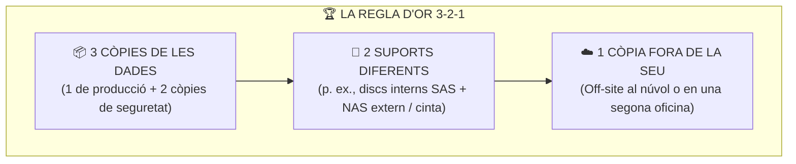
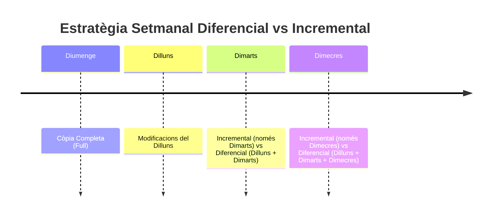
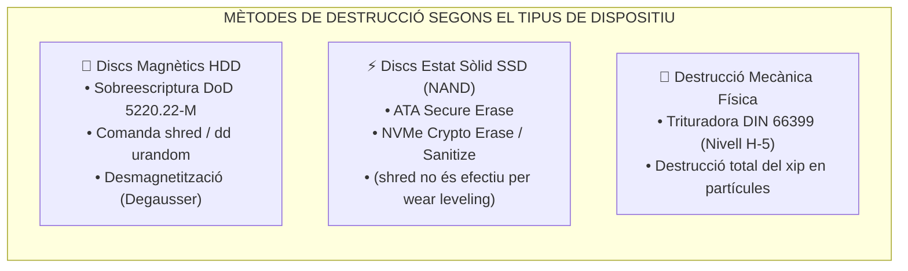

# UT06 — Emmagatzematge Segur, Còpies de Seguretat i Destrucció de Dades

Les dades són l'actiu més valuós de qualsevol organització. Si es crema un servidor o s'espatlla un disc, el maquinari es pot reemplaçar en hores comprant-ne un altre; en canvi, les dades de facturació, comptabilitat i clients perdudes sense còpia de seguretat poden significar la fallida immediata de l'empresa.

---

## 📌 1. L'Estratègia de Còpies de Seguretat: La Regla 3-2-1

El model professional per excel·lència per a garantir la resiliència de la informació és la **Regla d'Or 3-2-1**:



> [!TIP]
> **La regla moderna 3-2-1-1-0:** Afegeix **1 còpia immutable o desconnectada (*air-gapped*)** (perquè el ransomware que infecta la xarxa no la puga xifrar ni esborrar) i **0 errors** en proves periòdiques de restauració.

---

## 📌 2. Tipologia de Còpies de Seguretat

El sistema de fitxers utilitza un atribut denominat **Bit d'Arxiu (Archive Bit)** per a saber si un fitxer ha sigut modificat des de la darrera còpia:

| Tipus de Còpia | Què es copia exactament? | Modifica el Bit d'Arxiu? | Temps de Còpia | Espai requerit | Temps i procés de restauració |
| :--- | :--- | :---: | :---: | :---: | :--- |
| **Completa (*Full*)** | Tots els fitxers seleccionats. | Sí (es posa a 0) | Lent | Molt alt | **Molt ràpid:** Només es restaura aquest conjunt únic. |
| **Diferencial** | Fitxers modificats des de l'**última completa**. | **NO** | Mitjà | Mitjà | **Ràpid:** Es restaura la darrera completa + l'última diferencial. |
| **Incremental** | Fitxers modificats des de l'**última còpia de qualsevol tipus**. | Sí (es posa a 0) | **Molt ràpid** | **Molt baix** | **Lent i seqüencial:** Cal restaurar la completa + totes les incrementals per ordre. |



---

## 📌 3. Procediments Pràctics d'Administració

### Script d'Automatització amb `rsync` i `cron` en Linux:
L'eina `rsync` és l'estàndard industrial per a sincronització incremental en servidors Unix/Linux:

```bash
#!/bin/bash
# /opt/scripts/backup_corporatiu.sh
ORIGEN="/var/www/html/dades/"
DESTI="/mnt/nas_backup/copia_diaria/"
LOG="/var/log/backup.log"

echo "=== Inici de la còpia: $(date) ===" >> $LOG

# Paràmetres:
# -a: arxiu (conserva permisos, propietaris i enllaços simbòlics)
# -v: detallat (verbose)
# -z: comprimeix dades durant la transferència per xarxa
# --delete: esborra en el destí els fitxers eliminats en l'origen
rsync -avz --delete $ORIGEN $DESTI >> $LOG 2>&1

echo "=== Còpia finalitzada amb èxit: $(date) ===" >> $LOG
```

Per a programar la seua execució automàtica cada matinada a les **02:30 AM**, s'afegeix al `crontab`:
```bash
sudo crontab -e
# Afegir la línia:
30 2 * * * /opt/scripts/backup_corporatiu.sh
```

---

## 📌 4. Destrucció Segura de Dades i Mitjans d'Emmagatzematge

Quan un disc dur o SSD es retira per fi de vida útil, **un formatat convencional no elimina les dades**, ja que només esborra la taula d'índexs del sistema de fitxers (FAT/NTFS/ext4) i les dades reals continuen sent recuperables amb eines forenses com *Photorec* o *Autopsy*.



### Comandes d'esborrat segur en Linux:
1. **Sobreescriptura militar d'un disc complet:**
   ```bash
   # Escriure 3 passades de patrons aleatoris i una final de zeros
   sudo shred -v -z -n 3 /dev/sdb
   ```
2. **Esborrat de disc magnètic amb dades pseudoaleatòries:**
   ```bash
   sudo dd if=/dev/urandom of=/dev/sdb bs=4M status=progress
   ```
3. **Esborrat criptogràfic segur per a discs SSD NVMe:**
   ```bash
   # Comanda NVMe nativa que envia un pols elèctric i destrueix les claus de xifrat internes
   sudo nvme format /dev/nvme0n1 --namespace-id=1 --ses=2
   ```
