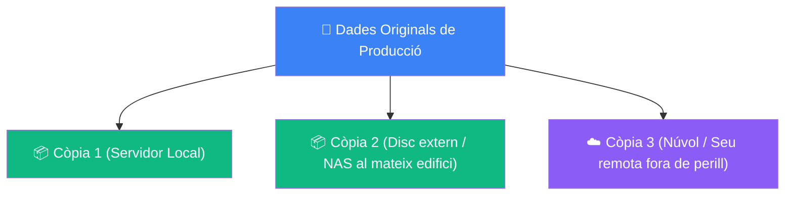

# 6.5 Laboratori Pràctic de Còpies de Seguretat i Restauració en Windows i Linux

En aquest laboratori pràctic aprendràs a desplegar mecanismes professionals de protecció de dades i recuperació davant desastres (*Disaster Recovery*) tant en entorns **Windows 10/11** com en sistemes **Linux (Ubuntu / Mint)**.

---

## 🛡️ La Regla d'Or 3-2-1 de les Còpies de Seguretat



- **3 Còpies:** Com a mínim 3 còpies de totes les dades crítiques.
- **2 Suports Diferents:** Emmagatzemades en almenys 2 tipus de dispositius físics distints (per exemple, disc dur intern de servidor i cabina NAS en xarxa).
- **1 Còpia Fora del Lloc de Treball (*Offsite*):** Almenys 1 còpia custodiada físicament fora de l'oficina (al núvol o en una segona seu) per a sobreviure a incendis, inundacions o robatoris físics.

---

## 🖥️ Pràctica 1: Protecció de Sistemes en Windows

### Exercici 1.1: Creació d'un Punt de Restauració del Sistema amb PowerShell
Els punts de restauració permeten revertir canvis en el registre del sistema operatiu, controladors i programari instal·lat sense alterar els fitxers personals de l'usuari.

1. Obre una finestra de **PowerShell com a Administrador**.
2. Assegura't que la protecció del sistema està habilitada en la unitat del sistema `C:`:
   ```powershell
   Enable-ComputerRestore -Drive "C:\"
   ```
3. Crea un nou punt de restauració amb un comentari descriptiu:
   ```powershell
   Checkpoint-Computer -Description "Previ_Actualitzacio_Laboratori" -RestorePointType "MODIFY_SETTINGS"
   ```
4. Comprova la llista de punts de restauració existents:
   ```powershell
   Get-ComputerRestorePoint | Format-Table -Property SequenceNumber, Description, CreationTime
   ```

### Exercici 1.2: Imatge Completa del Sistema Operatiu (*Bare Metal Backup*)
Una imatge del sistema captura el bloc complet del disc (incloent-hi la partició EFI, partició MSR i el volum `C:` complet).

1. Connecta una unitat d'emmagatzematge secundària o un disc USB (suposem la lletra `E:`).
2. Executa l'eina de línia de comandaments `wbAdmin` per a llançar una còpia d'imatge de sistema:
   ```powershell
   wbadmin start backup -backupTarget:E: -include:C: -allCritical -quiet
   ```
3. Verifica el contingut generat a la carpeta `E:\WindowsImageBackup`.

---

## 🐧 Pràctica 2: Còpies i Instantànies en Linux

### Exercici 2.1: Instantànies del Sistema Operatiu amb Timeshift
`Timeshift` és l'eina de referència en Linux per a crear instantànies incrementals del sistema utilitzant enllaços durs (*hardlinks*) amb `rsync` o snapshots nadius amb `btrfs`.

1. Instal·la `timeshift` si no el tens disponible:
   ```bash
   sudo apt update && sudo apt install -y timeshift
   ```
2. Crea una instantània manual del sistema abans de fer una modificació:
   ```bash
   sudo timeshift --create --comments "Copia_Previa_Taller" --tags D
   ```
3. Llista les instantànies disponibles i l'espai que ocupen:
   ```bash
   sudo timeshift --list
   ```

### Exercici 2.2: Còpia Incremental de Dades d'Usuari amb `rsync`
Mentre `timeshift` protegeix el sistema operatiu, les dades de les carpetes personals (`/home`) han de ser resguardades amb una política de sincronització incremental:

1. Crea un directori de destinació per a la còpia de seguretat en un disc de suport (ex: `/media/backup/home_users/`).
2. Executa una sincronització incremental preservant permisos, propietaris i enllaços simbòlics:
   ```bash
   rsync -avzh --delete --progress /home/ /media/backup/home_users/
   ```
3. Explica el significat dels paràmetres utilitzats:
   - `-a` (*archive*): Preserva permisos, timestamps, grups i recursivitat.
   - `-v` (*verbose*): Mostra el detall dels fitxers processats.
   - `-z` (*compress*): Comprimeix les dades durant la transferència.
   - `-h` (*human-readable*): Mostra mides en MB/GB fàcils de llegir.
   - `--delete`: Elimina a la destinació els fitxers que s'hagen esborrat a l'origen per a mantindre un mirall exacte.

---

## 📋 Quadern d'Evidències i Checklist d'Avaluació
- [ ] Captura de PowerShell mostrant el punt de restauració creat amb `Get-ComputerRestorePoint`.
- [ ] Captura del resum d'execució de `wbadmin` indicant que la còpia s'ha completat amb èxit.
- [ ] Captura de la terminal Linux mostrant la instantània de `timeshift --list`.
- [ ] Execució de l'script `rsync` documentant com actua davant un fitxer modificat i un altre afegit.
