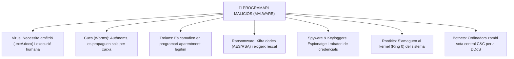
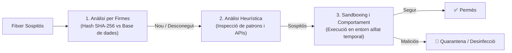

# UT07 — Seguretat Activa, Malware i Eines de Protecció Antivirus

La seguretat activa inclou totes les eines, tècniques i configuracions proactives que s'implementen per a detectar, contenir i repel·lir atacs informàtics o infeccions de codi maliciós en temps real.

---

## 📌 1. Taxonomia del Programari Maliciós (Malware)

El terme **Malware** (*Malicious Software*) engloba qualsevol programa o fragment de codi dissenyat expressament per a infiltrar-se o causar danys en un sistema sense el consentiment de l'usuari:



| Categoria | Com es propaga? | Requereix fitxer amfitrió? | Objectiu principal |
| :--- | :--- | :---: | :--- |
| **Virus** | Intercanvi de fitxers infectats, USBs | **Sí** | Destruir dades o alterar el funcionament de l'OS. |
| **Cuc (*Worm*)** | Explota vulnerabilitats de serveis de xarxa oberts | **No** | Saturar l'amplada de banda i infectar el màxim de nodes. |
| **Troià** | Descàrregues enganyoses a la web o adjunts | **No** | Crear una porta del darrere (*Backdoor*) o descarregar altre malware. |
| **Ransomware** | Correus de phishing, protocols RDP exposats | **No** | Extorsió econòmica mitjançant xifrat massiu de fitxers. |
| **Rootkit** | Instal·lat mitjançant elevació de privilegis | **No** | Ocultar processos, fitxers i connexions al mateix sistema operatiu. |

---

## 📌 2. Enginyeria Social: Vectors d'Atac Humans

Més del $90\%$ de les infeccions s'inicien enganyant a l'usuari perquè execute un arxiu o introduïsca les seues credencials:

- **Phishing tradicional:** Missatges de correu massius que imiten la imatge corporativa d'un banc, proveïdor de telefonia o servei de missatgeria amb enllaços a portals clonats.
- **Spear Phishing:** Atac dirigit i altament personalitzat contra una persona concreta d'una empresa (estudiant prèviament les seues xarxes socials i càrrec professional).
- **Whaling (*Frau del CEO*):** Engany dirigit a directors financers simulant una ordre urgent de la direcció per a realitzar una transferència monetària confidencial a un compte fraudulent.
- **Smishing i Vishing:** Atacs mitjançant missatgeria mòbil (SMS/WhatsApp) o trucades telefòniques manipulant la veu del remitent.

---

## 📌 3. Tecnologies dels Motors Antivirus Moderns

Els sistemes de defensa per a estacions de treball (*Endpoint Protection*) utilitzen tres capes analítiques complementàries:



1. **Detecció basada en firmes:** Calcula el resum criptogràfic del fitxer i el compara amb milions de firmes conegudes. És instantani però ineficaç contra atacs de dia zero (*0-day*).
2. **Anàlisi heurística:** Examina el codi executable a la recerca d'instruccions sospitoses típiques de malware (com rutines d'injecció de memòria o descompressió dinàmica).
3. **Sandboxing dinàmic:** Executa el programa en una màquina virtual efímera i monitoritza si intenta alterar el registre de Windows, injectar processos o obrir connexions cap a servidors de comandament i control externs.

---

## 📌 4. Laboratori d'Administració Antivirus

### A) Gestió de ClamAV en Linux (Consola):
ClamAV és el motor antivirus de codi obert de referència per a servidors de correu i fitxers Linux:

```bash
# 1. Instal·lar ClamAV i el dimoni d'actualització
sudo apt update && sudo apt install clamav clamav-daemon -y

# 2. Aturar el servei per a forçar l'actualització de firmes
sudo systemctl stop clamav-freshclam
sudo freshclam

# 3. Reiniciar el dimoni d'actualització en segon pla
sudo systemctl start clamav-freshclam

# 4. Escanejar recursivament el directori de descàrregues mostrant només fitxers infectats
clamscan -r -i /home/usuari/descarregues/

# 5. Escanejar i moure automàticament els fitxers infectats a una carpeta de quarantena
mkdir -p /home/usuari/quarantena
clamscan -r --move=/home/usuari/quarantena /home/usuari/descarregues/
```

### B) Gestió de Windows Defender mitjançant PowerShell:
En entorns corporatius Windows Server i Windows 11, podem automatitzar les tasques de seguretat mitjançant comandaments natius:

```powershell
# Consultar l'estat del motor i de les firmes de Defender
Get-MpComputerStatus | Select-Object AntivirusEnabled, RealTimeProtectionEnabled, AntivirusSignatureVersion

# Actualitzar la base de dades de firmes des dels servidors de Microsoft
Update-MpSignature

# Executar una anàlisi ràpida del sistema
Start-MpScan -ScanType QuickScan

# Executar una anàlisi completa del sistema
Start-MpScan -ScanType FullScan

# Consultar l'historial d'amenaces detectades
Get-MpThreatDetection
```
