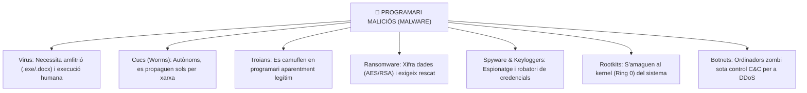

# UT07 — Seguretat Activa, Malware i Eines de Protecció Antivirus

La seguretat activa inclou totes les eines, tècniques i configuracions proactives que s'implementen per a detectar, contenir i repel·lir atacs informàtics o infeccions de codi maliciós en temps real.

---

## 📌 1. Taxonomia del Programari Maliciós (Malware)

El terme **Malware** (*Malicious Software*) engloba qualsevol programa o fragment de codi dissenyat expressament per a infiltrar-se o causar danys en un sistema sense el consentiment de l'usuari:



| Categoria | Com es propaga? | Requereix fitxer amfitrió? | Objectiu principal |
| :--- | :--- | :---: | :--- |
| **Virus** | Intercanvi de fitxers infectats, USBs | **Sí** | Destruir dades o alterar el funcionament de l'OS. |
| **Cuc (*Worm*)** | Explota vulnerabilitats de serveis de xarxa oberts | **No** | Saturar l'amplada de banda i infectar el màxim de nodes. |
| **Troià** | Descàrregues enganyoses a la web o adjunts | **No** | Crear una porta del darrere (*Backdoor*) o descarregar altre malware. |
| **Ransomware** | Correus de phishing, protocols RDP exposats | **No** | Extorsió econòmica mitjançant xifrat massiu de fitxers. |
| **Rootkit** | Instal·lat mitjançant elevació de privilegis | **No** | Ocultar processos, fitxers i connexions al mateix sistema operatiu. |

---

## 📌 2. Enginyeria Social: Vectors d'Atac Humans

Més del $90\%$ de les infeccions s'inicien enganyant a l'usuari perquè execute un arxiu o introduïsca les seues credencials:

- **Phishing tradicional:** Missatges de correu massius que imiten la imatge corporativa d'un banc, proveïdor de telefonia o servei de missatgeria amb enllaços a portals clonats.
- **Spear Phishing:** Atac dirigit i altament personalitzat contra una persona concreta d'una empresa (estudiant prèviament les seues xarxes socials i càrrec professional).
- **Whaling (*Frau del CEO*):** Engany dirigit a directors financers simulant una ordre urgent de la direcció per a realitzar una transferència monetària confidencial a un compte fraudulent.
- **Smishing i Vishing:** Atacs mitjançant missatgeria mòbil (SMS/WhatsApp) o trucades telefòniques manipulant la veu del remitent.

---

## 📌 3. Tecnologies dels Motors Antivirus Moderns

Els sistemes de defensa per a estacions de treball (*Endpoint Protection*) utilitzen tres capes analítiques complementàries:

<div style="background: linear-gradient(135deg, #0f172a 0%, #1e293b 100%); border-radius: 12px; padding: 20px; margin: 25px 0; box-shadow: 0 10px 25px -5px rgba(0, 0, 0, 0.3); border: 1px solid #334155;">
  <div style="text-align: center; margin-bottom: 15px;">
    <span style="background: #ef4444; color: #ffffff; font-weight: 700; font-size: 0.75rem; text-transform: uppercase; letter-spacing: 0.05em; padding: 4px 10px; border-radius: 9999px;">Infografia Tècnica</span>
    <h3 style="color: #f8fafc; margin: 10px 0 5px 0; font-size: 1.25rem;">Les 3 Capes d'Anàlisi d'un Motor Antivirus / EDR</h3>
    <p style="color: #94a3b8; font-size: 0.85rem; margin: 0;">Filtrat seqüencial des de la concordança de patrons fins a l'aïllament dinàmic en sandbox</p>
  </div>
  <svg viewBox="0 0 860 280" width="100%" height="100%" xmlns="http://www.w3.org/2000/svg" style="display: block; font-family: system-ui, -apple-system, sans-serif;">
    <defs>
      <linearGradient id="sigGrad" x1="0%" y1="0%" x2="100%" y2="100%">
        <stop offset="0%" stop-color="#3b82f6" stop-opacity="0.3"/>
        <stop offset="100%" stop-color="#1d4ed8" stop-opacity="0.1"/>
      </linearGradient>
      <linearGradient id="heuGrad" x1="0%" y1="0%" x2="100%" y2="100%">
        <stop offset="0%" stop-color="#f59e0b" stop-opacity="0.3"/>
        <stop offset="100%" stop-color="#b45309" stop-opacity="0.1"/>
      </linearGradient>
      <linearGradient id="boxGrad" x1="0%" y1="0%" x2="100%" y2="100%">
        <stop offset="0%" stop-color="#8b5cf6" stop-opacity="0.3"/>
        <stop offset="100%" stop-color="#6d28d9" stop-opacity="0.1"/>
      </linearGradient>
      <filter id="avShadow" x="-5%" y="-5%" width="110%" height="115%">
        <feDropShadow dx="0" dy="4" stdDeviation="6" flood-color="#000000" flood-opacity="0.4"/>
      </filter>
    </defs>

    <!-- Entrada: Fitxer Sospitós -->
    <rect x="20" y="90" width="100" height="90" rx="8" fill="#1e293b" stroke="#64748b" stroke-width="1.5"/>
    <text x="70" y="125" fill="#ffffff" font-size="20" text-anchor="middle">📦</text>
    <text x="70" y="148" fill="#e2e8f0" font-size="11" font-weight="bold" text-anchor="middle">Fitxer Binari</text>
    <text x="70" y="163" fill="#94a3b8" font-size="9" text-anchor="middle">.exe / .dll / script</text>

    <!-- Fletxa 1 -->
    <path d="M 125 135 L 155 135" stroke="#38bdf8" stroke-width="2" marker-end="url(#arrow)"/>

    <!-- Capa 1: Firmes -->
    <rect x="160" y="45" width="200" height="180" rx="8" fill="url(#sigGrad)" stroke="#38bdf8" stroke-width="1.5" filter="url(#avShadow)"/>
    <circle cx="190" cy="75" r="16" fill="#0284c7"/>
    <text x="190" y="81" fill="#ffffff" font-size="14" text-anchor="middle" font-weight="bold">1</text>
    <text x="215" y="72" fill="#38bdf8" font-size="13" font-weight="bold">FIRMÈS (Hash)</text>
    <text x="215" y="87" fill="#94a3b8" font-size="10">Concordança directa</text>
    <line x1="175" y1="102" x2="345" y2="102" stroke="#334155"/>
    <text x="175" y="122" fill="#cbd5e1" font-size="10">• Hash SHA-256 calculat</text>
    <text x="175" y="140" fill="#cbd5e1" font-size="10">• Cerca en base local/cloud</text>
    <text x="175" y="158" fill="#cbd5e1" font-size="10">• Temps: &lt; 5 ms (immediat)</text>
    <text x="175" y="185" fill="#f87171" font-size="10" font-weight="bold">⚠️ Inútil en atacs 0-day</text>

    <!-- Fletxa 2 -->
    <path d="M 365 135 L 395 135" stroke="#fbbf24" stroke-width="2"/>

    <!-- Capa 2: Heurística -->
    <rect x="400" y="45" width="200" height="180" rx="8" fill="url(#heuGrad)" stroke="#fbbf24" stroke-width="1.5" filter="url(#avShadow)"/>
    <circle cx="430" cy="75" r="16" fill="#d97706"/>
    <text x="430" y="81" fill="#ffffff" font-size="14" text-anchor="middle" font-weight="bold">2</text>
    <text x="455" y="72" fill="#fbbf24" font-size="13" font-weight="bold">HEURÍSTICA</text>
    <text x="455" y="87" fill="#94a3b8" font-size="10">Detecció de patrons</text>
    <line x1="415" y1="102" x2="585" y2="102" stroke="#334155"/>
    <text x="415" y="122" fill="#cbd5e1" font-size="10">• Desempaquetat en memòria</text>
    <text x="415" y="140" fill="#cbd5e1" font-size="10">• Cerca d'APIs de risc (VirtualAlloc)</text>
    <text x="415" y="158" fill="#cbd5e1" font-size="10">• Arbre de decisió probabilístic</text>
    <text x="415" y="185" fill="#fbbf24" font-size="10" font-weight="bold">⚠️ Risc de falsos positius</text>

    <!-- Fletxa 3 -->
    <path d="M 605 135 L 635 135" stroke="#c084fc" stroke-width="2"/>

    <!-- Capa 3: Sandboxing -->
    <rect x="640" y="45" width="200" height="180" rx="8" fill="url(#boxGrad)" stroke="#c084fc" stroke-width="1.5" filter="url(#avShadow)"/>
    <circle cx="670" cy="75" r="16" fill="#7c3aed"/>
    <text x="670" y="81" fill="#ffffff" font-size="14" text-anchor="middle" font-weight="bold">3</text>
    <text x="695" y="72" fill="#c084fc" font-size="13" font-weight="bold">SANDBOXING</text>
    <text x="695" y="87" fill="#94a3b8" font-size="10">Execució en gàbia</text>
    <line x1="655" y1="102" x2="825" y2="102" stroke="#334155"/>
    <text x="655" y="122" fill="#cbd5e1" font-size="10">• Micro màquina virtual efímera</text>
    <text x="655" y="140" fill="#cbd5e1" font-size="10">• Monitoratge del Registre/Xarxa</text>
    <text x="655" y="158" fill="#cbd5e1" font-size="10">• Detecció d'evasió i temps</text>
    <text x="655" y="185" fill="#34d399" font-size="10" font-weight="bold">✅ Màxima precisió real</text>

    <!-- Línia de Decisió Inferior -->
    <rect x="20" y="235" width="820" height="35" rx="6" fill="#1e293b" stroke="#334155"/>
    <text x="430" y="257" fill="#94a3b8" font-size="11" text-anchor="middle">Veredicte Final: <tspan fill="#34d399" font-weight="bold">Execució Permesa</tspan> | <tspan fill="#fbbf24" font-weight="bold">Avís d'Alerta</tspan> | <tspan fill="#ef4444" font-weight="bold">Bloqueig i Quarantena Immediata</tspan></text>
  </svg>
</div>

1. **Detecció basada en firmes:** Calcula el resum criptogràfic del fitxer i el compara amb milions de firmes conegudes. És instantani però ineficaç contra atacs de dia zero (*0-day*).
2. **Anàlisi heurística:** Examina el codi executable a la recerca d'instruccions sospitoses típiques de malware (com rutines d'injecció de memòria o descompressió dinàmica).
3. **Sandboxing dinàmic:** Executa el programa en una màquina virtual efímera i monitoritza si intenta alterar el registre de Windows, injectar processos o obrir connexions cap a servidors de comandament i control externs.

---

## 📌 4. Laboratori d'Administració Antivirus

### A) Gestió de ClamAV en Linux (Consola):
ClamAV és el motor antivirus de codi obert de referència per a servidors de correu i fitxers Linux:

```bash
# 1. Instal·lar ClamAV i el dimoni d'actualització
sudo apt update && sudo apt install clamav clamav-daemon -y

# 2. Aturar el servei per a forçar l'actualització de firmes
sudo systemctl stop clamav-freshclam
sudo freshclam

# 3. Reiniciar el dimoni d'actualització en segon pla
sudo systemctl start clamav-freshclam

# 4. Escanejar recursivament el directori de descàrregues mostrant només fitxers infectats
clamscan -r -i /home/usuari/descarregues/

# 5. Escanejar i moure automàticament els fitxers infectats a una carpeta de quarantena
mkdir -p /home/usuari/quarantena
clamscan -r --move=/home/usuari/quarantena /home/usuari/descarregues/
```

### B) Gestió de Windows Defender mitjançant PowerShell:
En entorns corporatius Windows Server i Windows 11, podem automatitzar les tasques de seguretat mitjançant comandaments natius:

```powershell
# Consultar l'estat del motor i de les firmes de Defender
Get-MpComputerStatus | Select-Object AntivirusEnabled, RealTimeProtectionEnabled, AntivirusSignatureVersion

# Actualitzar la base de dades de firmes des dels servidors de Microsoft
Update-MpSignature

# Executar una anàlisi ràpida del sistema
Start-MpScan -ScanType QuickScan

# Executar una anàlisi completa del sistema
Start-MpScan -ScanType FullScan

# Consultar l'historial d'amenaces detectades
Get-MpThreatDetection
```

---

## 📝 Quadern d'Activitats Pràctiques i Reptes de Laboratori

### 📋 Bloc A: Anàlisi Forense de Capçaleres i Vectors d'Enginyeria Social
1. **Auditoria Forense d'una Capçalera de Phishing:** Examina el següent extracte d'un correu rebut a la safata d'entrada corporativa:
   ```text
   Return-Path: <bounce-notice@servei-banc-validacio.ru>
   Received: from mail.servei-banc-validacio.ru (185.220.101.5)
   From: "Suport Tècnic Bancari" <avisos@bancsabadell.com>
   Subject: URGENT: El seu compte quedarà bloquejat en 24 hores
   Authentication-Results: spf=fail (sender IP 185.220.101.5 not authorized)
   Link: http://bancsabadell.com.verificacio-clients-segur.xyz/login.php
   ```
   - **Qüestió 1:** Identifica quina adreça IP real va emetre el missatge i per què el resultat de SPF és `fail`.
   - **Qüestió 2:** Quin truc de domini s'està utilitzant a l'enllaç per a confondre l'usuari? Quina diferència hi ha entre el domini real i el subdomini fals?
   - **Qüestió 3:** Quin mecanisme de seguretat activa del servidor de correu hauria d'haver enviat aquest missatge directament a la paperera o quarantena?

2. **Diferenciació de Comportament de Malware:**
   - Si un equip de l'aula comença a xifrar documents canviant l'extensió a `.locked` i demana bitcoins, davant de quina classe de malware ens trobem?
   - Si un ordinador està enviant milers de paquets SYN per segon cap a un servidor web extern sense intervenció de l'usuari, de quin tipus de programari maliciós forma part?

### 💻 Bloc B: Reptes Pràctics de Laboratori i Administració

#### Repte 1: Laboratori de Test Segur amb Cadena EICAR i ClamAV
El fitxer **EICAR** és un fragment estàndard de text inofensiu creat per l'Institut Europeu per a la Recerca d'Antivirus per a verificar el funcionament de motors antivirus sense perill real:

1. A la màquina Ubuntu Server de laboratori, crea una carpeta de proves:
   ```bash
   mkdir -p /home/alumne/lab_antivirus /home/alumne/quarantena
   chmod 700 /home/alumne/quarantena
   ```
2. Crea el fitxer de test EICAR mitjançant comanda:
   ```bash
   echo 'X5O!P%@AP[4\PZX54(P^)7CC)7}$EICAR-STANDARD-ANTIVIRUS-TEST-FILE!$H+H*' > /home/alumne/lab_antivirus/test_eicar.com
   ```
3. Executa una anàlisi amb ClamAV traslladant automàticament les amenaces a la quarantena:
   ```bash
   clamscan -r --move=/home/alumne/quarantena /home/alumne/lab_antivirus/
   ```
4. Comprova amb `ls -l /home/alumne/lab_antivirus` que el fitxer ha desaparegut de la carpeta original i que ara s'ubica a `/home/alumne/quarantena`.
5. Revisa el registre de l'escaneig a `/var/log/clamav/clamav.log` i copia la línia de detecció a la teua memòria de pràctiques.

#### Repte 2: Bastionat contra Ransomware amb PowerShell a Windows
En un equip client amb Windows 10/11 o Windows Server 2022:
1. Obre una consola de **PowerShell com a Administrador**.
2. Consulta si la protecció en temps real i la protecció al núvol estan habilitades:
   ```powershell
   Get-MpPreference | Select-Object DisableRealtimeMonitoring, MAPSReporting
   ```
3. Activa la funció **Controlled Folder Access** (Accés controlat a carpetes), la qual impedeix que programes binaris desconeguts modifiquen o xifren els documents d'eixes carpetes:
   ```powershell
   Set-MpPreference -EnableControlledFolderAccess Enabled
   ```
4. Afegeix una carpeta corporativa personalitzada a la llista de protecció:
   ```powershell
   mkdir C:\DadesEmpresa
   Add-MpPreference -ControlledFolderAccessProtectedFolders "C:\DadesEmpresa"
   ```
5. Comprova que la carpeta apareix a la llista de protecció:
   ```powershell
   (Get-MpPreference).ControlledFolderAccessProtectedFolders
   ```

### 🎯 Bloc C: Llista de Verificació i Rúbrica d'Avaluació

| Criteri d'Avaluació | Nivell Assolit (Excel·lent: 9-10) | Nivell Mitjà (Notable: 7-8) | Nivell Inicial (Aprovat: 5-6) |
| :--- | :--- | :--- | :--- |
| **Anàlisi forense d'amenaces** | Identifica el 100% dels IoC a la capçalera (IP d'enviament, fallada SPF, domini enganyós). | Identifica el caràcter fraudulent però dubta en la lectura dels registres de capçalera. | No sap interpretar les capçaleres de correu electrònic ni el domini real. |
| **Desplegament i aïllament amb ClamAV** | Configura quarantena amb permisos restrictius, executa l'escaneig EICAR i extreu logs. | Executa `clamscan` però no automatitza el trasllat a quarantena. | Requereix ajuda per a descarregar firmes o no comprèn el propòsit d'EICAR. |
| **Defensa contra Ransomware a Windows** | Habilita Controlled Folder Access per PowerShell i documenta la regla d'Event Viewer. | Activa l'opció des de la interfície gràfica però no empra PowerShell. | Desconeix el funcionament de les proteccions contra modificació massiva de fitxers. |
