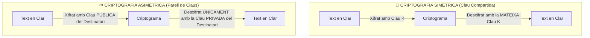
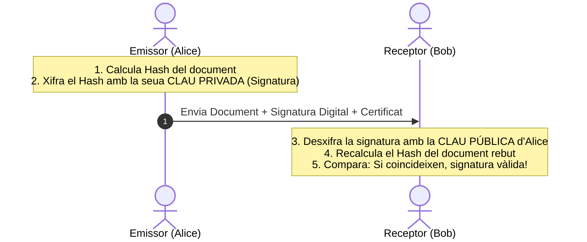
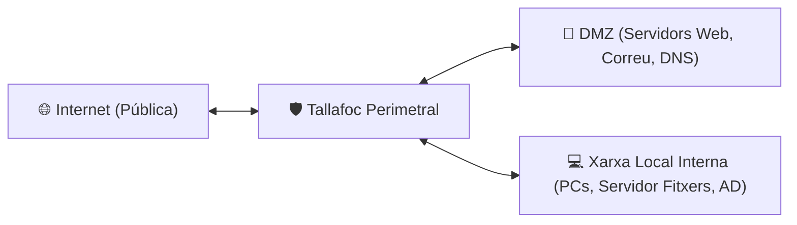

# UT08 — Seguretat en Xarxes: Criptografia, Certificats Digitals i Tallafocs

Les xarxes de dades són canals públics per naturalesa on el tràfic pot ser interceptat (*sniffing*) o manipulat (*tampering*). Per a comunicar equips amb garanties cal aplicar tècniques de xifratge matemàtic, certificació de la identitat i filtrat perimetral de paquets.

---

## 📌 1. Fonaments de Criptografia: Simètrica vs Asimètrica

La criptografia transforma la informació llegible (*text en clar*) en un text inintel·ligible (*criptograma*) mitjançant un algorisme matemàtic i una o més claus:



### Taula Comparativa:

| Característica | Criptografia Simètrica | Criptografia Asimètrica |
| :--- | :--- | :--- |
| **Nombre de claus** | 1 clau única compartida. | 2 claus matemàticament vinculades (Pública / Privada). |
| **Velocitat d'execució** | **Molt ràpida** (milions de bytes/s). | **Lenta** (requereix multiplicacions d'enters gegants). |
| **Longitud típica de clau** | $128$, $192$ o **$256\text{ bits}$** (AES). | **$2048$** o **$4096\text{ bits}$** (RSA); $256\text{ bits}$ (ECC). |
| **Algorismes estàndard** | **AES**, ChaCha20 (DES/3DES obsolets). | **RSA**, ECC (Corba El·líptica), Diffie-Hellman. |
| **Ús principal** | Xifrat de discs, bases de dades i fitxers. | Intercanvi de claus inicials en TLS i Signatura Digital. |

---

## 📌 2. Funcions Resum (Hash) i Integritat de Dades

Una funció **Hash** pren una quantitat arbitrària de dades d'entrada i genera una cadena alfanumèrica de **longitud fixa** amb les següents propietats crítiques:

1. **Unidireccional (irreversible):** És impossible deduir les dades originals a partir del resum.
2. **Resistent a col·lisions:** Dues entrades diferents no han de produir mai el mateix resultat hash.
3. **Efecte allau:** Si es modifica un sol bit del fitxer de gigabytes, el hash resultant canvia completament.

$$\text{Fitxer de 5 GB} \xrightarrow{\text{SHA-256}} \texttt{e3b0c44298fc1c149afbf4c8996fb92427ae41e4649b934ca495991b7852b855}$$

### Comandes per a validar la integritat d'una ISO descarregada:
```bash
# En Linux
sha256sum ubuntu-24.04-live-server-amd64.iso

# En Windows (PowerShell)
Get-FileHash -Algorithm SHA256 .\ubuntu-24.04-live-server-amd64.iso
```

---

## 📌 3. Signatura Digital i Certificats X.509 (PKI)

La signatura digital permet garantir simultàniament la **identitat de l'emissor (autenticitat)**, que el document **no ha sigut alterat (integritat)** i que el remitent **no pot negar haver-lo enviat (no-repudi)**:



- **Certificat Digital X.509:** Document electrònic expedit per una **Autoritat de Certificació (CA)** (p. ex., ACCV, FNMT o Let's Encrypt) que vincula una clau pública amb la identitat física d'una persona o un nom de domini web (`https://elmeudomini.cat`).

---

## 📌 4. Disseny Perimetral: Arquitectura amb DMZ i Tallafocs

Per a protegir la xarxa local corporativa d'atacs externs mentre es donen serveis a Internet, s'implementa una **Zona Desmilitaritzada (DMZ)**:



> [!IMPORTANT]
> **Regla fonamental de la DMZ:**
> - El tràfic des d'Internet **pot entrar a la DMZ** als ports específics (80, 443, 25).
> - El tràfic des de la DMZ cap a la LAN interna està **completament prohibit per defecte**. Si un servidor web és compromès, l'atacant es queda aïllat a la DMZ!

### Configuració Pràctica de Tallafocs amb UFW en Linux:
```bash
# 1. Política per defecte: denegar tot el tràfic entrant, permetre el sortint
sudo ufw default deny incoming
sudo ufw default allow outgoing

# 2. Permetre administració SSH només des d'una IP d'administració interna
sudo ufw allow from 192.168.1.50 to any port 22 proto tcp

# 3. Permetre tràfic web públic (HTTP i HTTPS)
sudo ufw allow 80/tcp
sudo ufw allow 443/tcp

# 4. Habilitar el tallafoc i comprovar les regles actives
sudo ufw enable
sudo ufw status verbose
```
