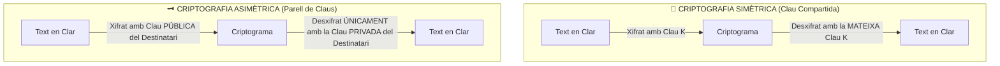
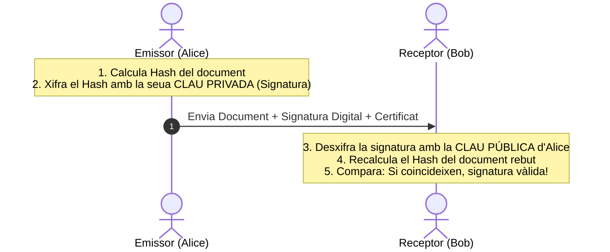
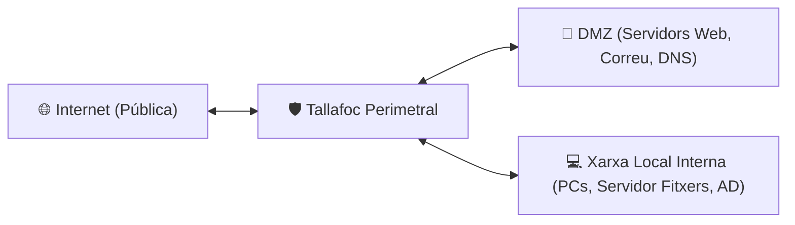

# UT08 — Seguretat en Xarxes: Criptografia, Certificats Digitals i Tallafocs

Les xarxes de dades són canals públics per naturalesa on el tràfic pot ser interceptat (*sniffing*) o manipulat (*tampering*). Per a comunicar equips amb garanties cal aplicar tècniques de xifratge matemàtic, certificació de la identitat i filtrat perimetral de paquets.

---

## 📌 1. Fonaments de Criptografia: Simètrica vs Asimètrica

La criptografia transforma la informació llegible (*text en clar*) en un text inintel·ligible (*criptograma*) mitjançant un algorisme matemàtic i una o més claus:



### Taula Comparativa:

| Característica | Criptografia Simètrica | Criptografia Asimètrica |
| :--- | :--- | :--- |
| **Nombre de claus** | 1 clau única compartida. | 2 claus matemàticament vinculades (Pública / Privada). |
| **Velocitat d'execució** | **Molt ràpida** (milions de bytes/s). | **Lenta** (requereix multiplicacions d'enters gegants). |
| **Longitud típica de clau** | $128$, $192$ o **$256\text{ bits}$** (AES). | **$2048$** o **$4096\text{ bits}$** (RSA); $256\text{ bits}$ (ECC). |
| **Algorismes estàndard** | **AES**, ChaCha20 (DES/3DES obsolets). | **RSA**, ECC (Corba El·líptica), Diffie-Hellman. |
| **Ús principal** | Xifrat de discs, bases de dades i fitxers. | Intercanvi de claus inicials en TLS i Signatura Digital. |

---

## 📌 2. Funcions Resum (Hash) i Integritat de Dades

Una funció **Hash** pren una quantitat arbitrària de dades d'entrada i genera una cadena alfanumèrica de **longitud fixa** amb les següents propietats crítiques:

1. **Unidireccional (irreversible):** És impossible deduir les dades originals a partir del resum.
2. **Resistent a col·lisions:** Dues entrades diferents no han de produir mai el mateix resultat hash.
3. **Efecte allau:** Si es modifica un sol bit del fitxer de gigabytes, el hash resultant canvia completament.

$$\text{Fitxer de 5 GB} \xrightarrow{\text{SHA-256}} \texttt{e3b0c44298fc1c149afbf4c8996fb92427ae41e4649b934ca495991b7852b855}$$

### Comandes per a validar la integritat d'una ISO descarregada:
```bash
# En Linux
sha256sum ubuntu-24.04-live-server-amd64.iso

# En Windows (PowerShell)
Get-FileHash -Algorithm SHA256 .\ubuntu-24.04-live-server-amd64.iso
```

---

## 📌 3. Signatura Digital i Certificats X.509 (PKI)

La signatura digital permet garantir simultàniament la **identitat de l'emissor (autenticitat)**, que el document **no ha sigut alterat (integritat)** i que el remitent **no pot negar haver-lo enviat (no-repudi)**:



- **Certificat Digital X.509:** Document electrònic expedit per una **Autoritat de Certificació (CA)** (p. ex., ACCV, FNMT o Let's Encrypt) que vincula una clau pública amb la identitat física d'una persona o un nom de domini web (`https://elmeudomini.cat`).

---

## 📌 4. Disseny Perimetral: Arquitectura amb DMZ i Tallafocs

Per a protegir la xarxa local corporativa d'atacs externs mentre es donen serveis a Internet, s'implementa una **Zona Desmilitaritzada (DMZ)**:



> [!IMPORTANT]
> **Regla fonamental de la DMZ:**
> - El tràfic des d'Internet **pot entrar a la DMZ** als ports específics (80, 443, 25).
> - El tràfic des de la DMZ cap a la LAN interna està **completament prohibit per defecte**. Si un servidor web és compromès, l'atacant es queda aïllat a la DMZ!

<div style="background: linear-gradient(135deg, #0f172a 0%, #1e293b 100%); border-radius: 12px; padding: 20px; margin: 25px 0; box-shadow: 0 10px 25px -5px rgba(0, 0, 0, 0.3); border: 1px solid #334155;">
  <div style="text-align: center; margin-bottom: 15px;">
    <span style="background: #3b82f6; color: #ffffff; font-weight: 700; font-size: 0.75rem; text-transform: uppercase; letter-spacing: 0.05em; padding: 4px 10px; border-radius: 9999px;">Infografia Tècnica</span>
    <h3 style="color: #f8fafc; margin: 10px 0 5px 0; font-size: 1.25rem;">Arquitectura de Xarxa Perimetral amb DMZ i Doble Tallafocs</h3>
    <p style="color: #94a3b8; font-size: 0.85rem; margin: 0;">Aïllament de serveis públics per a protegir la xarxa corporativa privada</p>
  </div>
  <svg viewBox="0 0 860 300" width="100%" height="100%" xmlns="http://www.w3.org/2000/svg" style="display: block; font-family: system-ui, -apple-system, sans-serif;">
    <defs>
      <linearGradient id="wanGrad" x1="0%" y1="0%" x2="100%" y2="100%">
        <stop offset="0%" stop-color="#ef4444" stop-opacity="0.3"/>
        <stop offset="100%" stop-color="#991b1b" stop-opacity="0.1"/>
      </linearGradient>
      <linearGradient id="dmzGrad" x1="0%" y1="0%" x2="100%" y2="100%">
        <stop offset="0%" stop-color="#f59e0b" stop-opacity="0.3"/>
        <stop offset="100%" stop-color="#b45309" stop-opacity="0.1"/>
      </linearGradient>
      <linearGradient id="lanGrad" x1="0%" y1="0%" x2="100%" y2="100%">
        <stop offset="0%" stop-color="#10b981" stop-opacity="0.3"/>
        <stop offset="100%" stop-color="#047857" stop-opacity="0.1"/>
      </linearGradient>
      <filter id="netShadow" x="-5%" y="-5%" width="110%" height="115%">
        <feDropShadow dx="0" dy="4" stdDeviation="6" flood-color="#000000" flood-opacity="0.4"/>
      </filter>
    </defs>

    <!-- Zona WAN -->
    <rect x="20" y="30" width="170" height="240" rx="10" fill="url(#wanGrad)" stroke="#ef4444" stroke-width="1.5" filter="url(#netShadow)"/>
    <text x="105" y="60" fill="#f87171" font-size="14" font-weight="bold" text-anchor="middle">🌐 INTERNET (WAN)</text>
    <text x="105" y="80" fill="#94a3b8" font-size="11" text-anchor="middle">Zona Insegura No Confiada</text>
    <line x1="35" y1="95" x2="175" y2="95" stroke="#334155"/>
    <circle cx="105" cy="140" r="28" fill="#1e293b" stroke="#ef4444" stroke-width="1.5"/>
    <text x="105" y="147" fill="#ffffff" font-size="22" text-anchor="middle">🌍</text>
    <text x="105" y="195" fill="#cbd5e1" font-size="10" text-anchor="middle">Usuaris públics i atacants</text>
    <text x="105" y="215" fill="#94a3b8" font-size="10" text-anchor="middle">IPs Públiques Globals</text>

    <!-- Fletxa WAN a DMZ -->
    <path d="M 195 130 L 255 130" stroke="#10b981" stroke-width="3"/>
    <polygon points="255,130 245,124 245,136" fill="#10b981"/>
    <text x="225" y="120" fill="#10b981" font-size="9" text-anchor="middle" font-weight="bold">80, 443</text>

    <!-- Fletxa WAN a LAN Bloquejada -->
    <path d="M 195 230 L 595 230" stroke="#ef4444" stroke-width="2" stroke-dasharray="4,4"/>
    <text x="395" y="222" fill="#ef4444" font-size="10" text-anchor="middle" font-weight="bold">🚫 ACCÉS DIRECTE TOTALMENT DENEGAT</text>

    <!-- Zona DMZ -->
    <rect x="260" y="30" width="270" height="170" rx="10" fill="url(#dmzGrad)" stroke="#f59e0b" stroke-width="1.5" filter="url(#netShadow)"/>
    <text x="395" y="60" fill="#fbbf24" font-size="14" font-weight="bold" text-anchor="middle">🏢 DMZ (DESMILITARITZADA)</text>
    <text x="395" y="80" fill="#94a3b8" font-size="11" text-anchor="middle">Segment Semi-Protegit (172.16.0.0/24)</text>
    <line x1="275" y1="95" x2="515" y2="95" stroke="#334155"/>
    <rect x="280" y="110" width="105" height="70" rx="6" fill="#1e293b" stroke="#f59e0b" stroke-width="1"/>
    <text x="332" y="132" fill="#e2e8f0" font-size="10" text-anchor="middle" font-weight="bold">🖥️ Servidor Web</text>
    <text x="332" y="150" fill="#38bdf8" font-size="9" text-anchor="middle">Nginx / Apache</text>
    <text x="332" y="166" fill="#94a3b8" font-size="9" text-anchor="middle">Ports: 80, 443</text>

    <rect x="410" y="110" width="105" height="70" rx="6" fill="#1e293b" stroke="#f59e0b" stroke-width="1"/>
    <text x="462" y="132" fill="#e2e8f0" font-size="10" text-anchor="middle" font-weight="bold">✉️ Correu / DNS</text>
    <text x="462" y="150" fill="#38bdf8" font-size="9" text-anchor="middle">Postfix / Bind9</text>
    <text x="462" y="166" fill="#94a3b8" font-size="9" text-anchor="middle">Ports: 25, 53</text>

    <!-- Fletxa DMZ a LAN -->
    <path d="M 535 130 L 595 130" stroke="#f59e0b" stroke-width="2"/>
    <polygon points="595,130 585,124 585,136" fill="#f59e0b"/>
    <text x="565" y="120" fill="#fbbf24" font-size="8" text-anchor="middle" font-weight="bold">SQL 3306</text>

    <!-- Zona LAN Corporativa -->
    <rect x="600" y="30" width="240" height="240" rx="10" fill="url(#lanGrad)" stroke="#10b981" stroke-width="1.5" filter="url(#netShadow)"/>
    <text x="720" y="60" fill="#34d399" font-size="14" font-weight="bold" text-anchor="middle">🔒 LAN PRIVADA</text>
    <text x="720" y="80" fill="#94a3b8" font-size="11" text-anchor="middle">Zona Confiada (192.168.1.0/24)</text>
    <line x1="615" y1="95" x2="825" y2="95" stroke="#334155"/>
    <text x="620" y="125" fill="#e2e8f0" font-size="11">• 🖥️ Servidor BD MySQL (privat)</text>
    <text x="620" y="150" fill="#e2e8f0" font-size="11">• 🛡️ Controlador Active Directory</text>
    <text x="620" y="175" fill="#e2e8f0" font-size="11">• 📁 Servidor de Fitxers NAS</text>
    <text x="620" y="200" fill="#e2e8f0" font-size="11">• 💻 Ordinadors de l'Alumnat / ERP</text>
    <text x="720" y="240" fill="#10b981" font-size="10" text-anchor="middle" font-weight="bold">Aïllada totalment d'Internet</text>
  </svg>
</div>

### Configuració Pràctica de Tallafocs amb UFW en Linux:
```bash
# 1. Política per defecte: denegar tot el tràfic entrant, permetre el sortint
sudo ufw default deny incoming
sudo ufw default allow outgoing

# 2. Permetre administració SSH només des d'una IP d'administració interna
sudo ufw allow from 192.168.1.50 to any port 22 proto tcp

# 3. Permetre tràfic web públic (HTTP i HTTPS)
sudo ufw allow 80/tcp
sudo ufw allow 443/tcp

# 4. Habilitar el tallafoc i comprovar les regles actives
sudo ufw enable
sudo ufw status verbose
```

---

## 📝 Quadern d'Activitats Pràctiques i Reptes de Laboratori

### 📋 Bloc A: Principis Criptogràfics i Auditoria de Seguretat
1. **Càlcul d'Entropia i Força Bruta:**
   - Si una clau de xifratge simètric té una longitud de $128\text{ bits}$ (AES-128), quantes combinacions possibles existeixen ($2^{128}$)?
   - Si un supercomputador pot provar $10^{15}$ claus per segon, quants anys necessitaria per a provar la meitat de l'espai de claus?
   - Per què la criptografia asimètrica necessita claus de $2048$ o $4096\text{ bits}$ (RSA) per a oferir una seguretat equivalent a una clau AES de $128$ o $256\text{ bits}$?
2. **Validació d'Integritat:** Explica la diferència entre xifrar un fitxer per confidencialitat i calcular el seu resum SHA-256. En quin cas cal utilitzar totes dues operacions alhora?

### 💻 Bloc B: Reptes Pràctics de Laboratori i Configuració

#### Repte 1: Generació de Parells de Claus i Xifratge Asimètric amb OpenSSL
1. A la màquina Ubuntu Server de laboratori, crea una carpeta de treball:
   ```bash
   mkdir -p /home/alumne/cripto_lab && cd /home/alumne/cripto_lab
   ```
2. Genera una clau privada RSA de $2048\text{ bits}$:
   ```bash
   openssl genrsa -out clau_privada.pem 2048
   ```
3. Extreu la clau pública associada a partir de la clau privada:
   ```bash
   openssl rsa -in clau_privada.pem -pubout -out clau_publica.pem
   ```
4. Crea un document confidencial de text:
   ```bash
   echo "DOCUMENT INTERN CONFIDENCIAL: CLAUS DEL SERVIDOR DE PRODUCCIÓ" > secret.txt
   ```
5. Xifra el fitxer amb la **clau pública** (simulant que una altra persona ens envia dades segures):
   ```bash
   openssl pkeyutl -encrypt -in secret.txt -pubin -inkey clau_publica.pem -out secret.enc
   ```
6. Intenta llegir `secret.enc` amb `cat`. Comprova que el contingut és completament inintel·ligible.
7. Desxifra el fitxer utilitzant la **clau privada**:
   ```bash
   openssl pkeyutl -decrypt -in secret.enc -inkey clau_privada.pem -out desxifrat.txt
   cat desxifrat.txt
   ```

#### Repte 2: Configuració del Tallafocs UFW en Entorn DMZ
En una màquina que actua com a passarel·la / servidor web:
1. Restableix UFW a l'estat per defecte:
   ```bash
   sudo ufw --force reset
   sudo ufw default deny incoming
   sudo ufw default allow outgoing
   ```
2. Permet el tràfic SSH exclusivament des de la subxarxa d'administració (`192.168.1.0/24`):
   ```bash
   sudo ufw allow from 192.168.1.0/24 to any port 22 proto tcp comment "SSH Administracio"
   ```
3. Permet tràfic web lliure per als ports estàndard:
   ```bash
   sudo ufw allow 80/tcp comment "HTTP Públic"
   sudo ufw allow 443/tcp comment "HTTPS Públic"
   ```
4. Activa el tallafoc i visualitza les regles numerades:
   ```bash
   sudo ufw enable
   sudo ufw status numbered
   ```
5. Des d'un equip client de la xarxa, prova a connectar amb `curl -I http://IP_SERVIDOR` i comprova que respon, mentre que una connexió SSH des d'una IP no autoritzada és completament rebutjada.

### 🎯 Bloc C: Llista de Verificació i Rúbrica d'Avaluació

| Criteri d'Avaluació | Nivell Assolit (Excel·lent: 9-10) | Nivell Mitjà (Notable: 7-8) | Nivell Inicial (Aprovat: 5-6) |
| :--- | :--- | :--- | :--- |
| **Conceptes criptogràfics** | Explica amb precisió la diferència de rols entre clau pública/privada i calcula claus. | Comprèn el xifratge asimètric però confon signatura amb confidencialitat. | Desconeix la diferència entre criptografia simètrica i asimètrica. |
| **Operativa amb OpenSSL** | Genera claus, xifra i desxifra documents sense errors i valida el format PEM. | Genera les claus però s'equivoca a l'hora de triar la clau pública o privada. | Requereix instruccions detallades per a executar les comandes openssl. |
| **Configuració de tallafocs UFW** | Implementa la política restrictiva per defecte i restringeix SSH per IP d'origen. | Habilita UFW però deixa el port 22 obert a qualsevol origen global. | Manté la política per defecte permissiva (allow incoming). |
