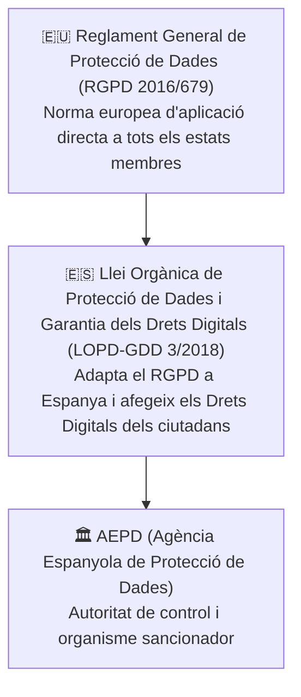

# UT09 — Legislació, Protecció de Dades (RGPD) i Gestió d'Incidents

La ciberseguretat no és només una qüestió tècnica de servidors i tallafocs; està fortament regulada per un **marc legal estricte**. Els tècnics informàtics han de conèixer les seues obligacions legals per a evitar sancions econòmiques greus i delictes contra la intimitat.

---

## 📌 1. Marc Normatiu: El RGPD i la LOPD-GDD

A l'Estat espanyol conflueixen dues normes fonamentals en matèria de privadesa digital:



### Principis Fonamentals del Tractament (Article 5 RGPD):
- **Licitud, lleialtat i transparència:** Cal tindre base jurídica (consentiment, contracte, obligació legal) i informar clarament l'usuari.
- **Limitació de la finalitat:** Les dades només es poden recopilar per a fins explícits determinats i no usar-se per a res més.
- **Minimització de dades:** Només cal demanar les dades estrictament necessàries per al servei (*Principi de necessitat*).
- **Exactitud:** Les dades han d'estar actualitzades i ser veraces.
- **Limitació del termini de conservació:** Cal esborrar o anonimitzar les dades un cop s'ha complert la finalitat.
- **Integritat i confidencialitat:** Obligació d'aplicar mesures tècniques (xifratge, còpies de seguretat, control d'accés) per a evitar accessos no autoritzats.

---

## 📌 2. Drets dels Ciutadans davant les Dades (Drets RGPD / ARSOL)

Els ciutadans tenen dret a controlar les seues dades personals en tot moment:

| Dret | Significat Pràctic | Termini de Resposta de l'Empresa |
| :--- | :--- | :---: |
| **Accés** | Conèixer quines dades nostres té l'empresa i amb quina finalitat les tracta. | 1 mes (prorrogable a 2) |
| **Rectificació** | Corregir informació errònia, desactualitzada o incompleta. | 1 mes |
| **Supressió (*Dret a l'Oblit*)** | Exigir la destrucció de les dades personals quan ja no siguen necessàries. | 1 mes |
| **Oposició** | Negar-se al tractament per motius personals o fins publicitaris. | 1 mes |
| **Limitació del Tractament** | Sol·licitar que les dades es congelen i no s'utilitzen mentre es tramita una queixa. | 1 mes |
| **Portabilitat** | Rebre les pròpies dades en un format estructurat i interoperable (JSON, CSV, XML) per a traspassar-les a un altre proveïdor. | 1 mes |

---

## 📌 3. Protocols d'Actuació davant Bretxes de Seguretat

Una **bretxa de dades (*Data Breach*)** es produeix quan es produeix un incident que ocasiona la destrucció, pèrdua, alteració o accés no autoritzat a dades personals (p. ex., un atac de ransomware que xifra una base de dades mèdica o la pèrdua d'un portàtil d'empresa no xifrat).

<div style="background: linear-gradient(135deg, #0f172a 0%, #1e293b 100%); border-radius: 12px; padding: 20px; margin: 25px 0; box-shadow: 0 10px 25px -5px rgba(0, 0, 0, 0.3); border: 1px solid #334155;">
  <div style="text-align: center; margin-bottom: 15px;">
    <span style="background: #ef4444; color: #ffffff; font-weight: 700; font-size: 0.75rem; text-transform: uppercase; letter-spacing: 0.05em; padding: 4px 10px; border-radius: 9999px;">Infografia Tècnica</span>
    <h3 style="color: #f8fafc; margin: 10px 0 5px 0; font-size: 1.25rem;">Protocol d'Actuació davant una Bretxa de Dades (RGPD 72h)</h3>
    <p style="color: #94a3b8; font-size: 0.85rem; margin: 0;">Finestra temporal legal i passos d'urgència des de la detecció fins a la notificació</p>
  </div>
  <svg viewBox="0 0 860 260" width="100%" height="100%" xmlns="http://www.w3.org/2000/svg" style="display: block; font-family: system-ui, -apple-system, sans-serif;">
    <defs>
      <linearGradient id="step1" x1="0%" y1="0%" x2="100%" y2="100%">
        <stop offset="0%" stop-color="#ef4444" stop-opacity="0.3"/>
        <stop offset="100%" stop-color="#991b1b" stop-opacity="0.1"/>
      </linearGradient>
      <linearGradient id="step2" x1="0%" y1="0%" x2="100%" y2="100%">
        <stop offset="0%" stop-color="#f59e0b" stop-opacity="0.3"/>
        <stop offset="100%" stop-color="#b45309" stop-opacity="0.1"/>
      </linearGradient>
      <linearGradient id="step3" x1="0%" y1="0%" x2="100%" y2="100%">
        <stop offset="0%" stop-color="#3b82f6" stop-opacity="0.3"/>
        <stop offset="100%" stop-color="#1d4ed8" stop-opacity="0.1"/>
      </linearGradient>
      <linearGradient id="step4" x1="0%" y1="0%" x2="100%" y2="100%">
        <stop offset="0%" stop-color="#10b981" stop-opacity="0.3"/>
        <stop offset="100%" stop-color="#047857" stop-opacity="0.1"/>
      </linearGradient>
    </defs>

    <!-- Pas 1 -->
    <rect x="20" y="30" width="190" height="150" rx="8" fill="url(#step1)" stroke="#ef4444" stroke-width="1.5"/>
    <circle cx="50" cy="60" r="14" fill="#dc2626"/>
    <text x="50" y="65" fill="#ffffff" font-size="12" text-anchor="middle" font-weight="bold">1</text>
    <text x="75" y="58" fill="#f87171" font-size="12" font-weight="bold">DETECSIÓ (T=0h)</text>
    <text x="75" y="73" fill="#94a3b8" font-size="9">Incident identificat</text>
    <line x1="35" y1="88" x2="195" y2="88" stroke="#334155"/>
    <text x="35" y="108" fill="#cbd5e1" font-size="9.5">• Aïllar equips de xarxa</text>
    <text x="35" y="124" fill="#cbd5e1" font-size="9.5">• Revocar claus de pas</text>
    <text x="35" y="140" fill="#cbd5e1" font-size="9.5">• Preservar logs forenses</text>
    <text x="35" y="160" fill="#ef4444" font-size="9.5" font-weight="bold">⏰ S'inicia compte enrere</text>

    <!-- Fletxa 1-2 -->
    <path d="M 215 105 L 235 105" stroke="#64748b" stroke-width="2"/>

    <!-- Pas 2 -->
    <rect x="240" y="30" width="190" height="150" rx="8" fill="url(#step2)" stroke="#f59e0b" stroke-width="1.5"/>
    <circle cx="270" cy="60" r="14" fill="#d97706"/>
    <text x="270" y="65" fill="#ffffff" font-size="12" text-anchor="middle" font-weight="bold">2</text>
    <text x="295" y="58" fill="#fbbf24" font-size="12" font-weight="bold">AVALUACIÓ (&lt;24h)</text>
    <text x="295" y="73" fill="#94a3b8" font-size="9">Classificació de risc</text>
    <line x1="255" y1="88" x2="415" y2="88" stroke="#334155"/>
    <text x="255" y="108" fill="#cbd5e1" font-size="9.5">• Quines dades s'han filtrat?</text>
    <text x="255" y="124" fill="#cbd5e1" font-size="9.5">• Nombre d'afectats</text>
    <text x="255" y="140" fill="#cbd5e1" font-size="9.5">• Estaven xifrades (AES)?</text>
    <text x="255" y="160" fill="#fbbf24" font-size="9.5" font-weight="bold">📊 Determinació del risc</text>

    <!-- Fletxa 2-3 -->
    <path d="M 435 105 L 455 105" stroke="#64748b" stroke-width="2"/>

    <!-- Pas 3 -->
    <rect x="460" y="30" width="180" height="150" rx="8" fill="url(#step3)" stroke="#38bdf8" stroke-width="1.5"/>
    <circle cx="490" cy="60" r="14" fill="#0284c7"/>
    <text x="490" y="65" fill="#ffffff" font-size="12" text-anchor="middle" font-weight="bold">3</text>
    <text x="515" y="58" fill="#38bdf8" font-size="12" font-weight="bold">AVÍS AEPD (&lt;72h)</text>
    <text x="515" y="73" fill="#94a3b8" font-size="9">Notificació formal</text>
    <line x1="475" y1="88" x2="625" y2="88" stroke="#334155"/>
    <text x="475" y="108" fill="#cbd5e1" font-size="9.5">• Formulari seu electrònica</text>
    <text x="475" y="124" fill="#cbd5e1" font-size="9.5">• Mesures de contenció</text>
    <text x="475" y="140" fill="#cbd5e1" font-size="9.5">• Dades de contacte DPO</text>
    <text x="475" y="160" fill="#38bdf8" font-size="9.5" font-weight="bold">🏛️ Obligatòria per llei</text>

    <!-- Fletxa 3-4 -->
    <path d="M 645 105 L 665 105" stroke="#64748b" stroke-width="2"/>

    <!-- Pas 4 -->
    <rect x="670" y="30" width="170" height="150" rx="8" fill="url(#step4)" stroke="#34d399" stroke-width="1.5"/>
    <circle cx="700" cy="60" r="14" fill="#059669"/>
    <text x="700" y="65" fill="#ffffff" font-size="12" text-anchor="middle" font-weight="bold">4</text>
    <text x="725" y="58" fill="#34d399" font-size="12" font-weight="bold">AFECTATS</text>
    <text x="725" y="73" fill="#94a3b8" font-size="9">Si hi ha alt risc</text>
    <line x1="685" y1="88" x2="825" y2="88" stroke="#334155"/>
    <text x="685" y="108" fill="#cbd5e1" font-size="9.5">• Correu / SMS directe</text>
    <text x="685" y="124" fill="#cbd5e1" font-size="9.5">• Llenguatge clar i entenedor</text>
    <text x="685" y="140" fill="#cbd5e1" font-size="9.5">• Instruccions preventives</text>
    <text x="685" y="160" fill="#34d399" font-size="9.5" font-weight="bold">🛡️ Transparència total</text>

    <!-- Franja d'Advertència Sancionadora -->
    <rect x="20" y="195" width="820" height="45" rx="6" fill="#1e293b" stroke="#ef4444" stroke-width="1"/>
    <text x="40" y="222" fill="#ef4444" font-size="11" font-weight="bold">⚠️ RÈGIM SANCIONADOR DE L'AEPD:</text>
    <text x="250" y="222" fill="#e2e8f0" font-size="11">L'incompliment del termini o l'ocultació de la bretxa comporta multes de fins a <tspan fill="#f87171" font-weight="bold">20 milions d'euros o el 4% del volum de negoci mundial anual</tspan>.</text>
  </svg>
</div>

> [!CAUTION]
> **El límit estricte de 72 hores:**  
> L'article 33 del RGPD obliga el responsable del tractament a notificar qualsevol bretxa de seguretat a l'**Agència Espanyola de Protecció de Dades (AEPD)** en un termini màxim de **72 hores** des que se'n té constància. No fer-ho comporta sancions que poden arribar als **20 milions d'euros o el 4% de la facturació global anual de l'empresa**.

---

## 📌 4. Normatives Tècniques de Seguretat: ENS i ISO 27001

A banda de la legislació de privadesa, existeixen marcs d'estàndards per a estructurar la seguretat en entorns corporatius i administratius:

- **Esquema Nacional de Seguretat (ENS - RD 311/2022):** Marc normatiu espanyol d'obligat compliment per a totes les Administracions Públiques (ajuntaments, hospitals, instituts) i els seus proveïdors TIC. Estableix principis bàsics de seguretat, mesures d'implantació i auditories de conformitat en tres categories: *Bàsica*, *Mitjana* i *Alta*.
- **Família ISO/IEC 27000 (especialment ISO 27001):** Estàndard internacional que defineix els requisits per a implantar un **Sistema de Gestió de la Seguretat de la Informació (SGSI)**. Aplica un cicle de millora contínua PDCA (*Plan-Do-Check-Act*) sobre els actius de l'empresa.
- **LSSI-CE (Llei 34/2002):** Regula les obligacions per a llocs web comercials, incloent l'obligatorietat de l'Avís Legal, identificació fiscal (CIF/NIF), polítiques de privacitat i consentiment previ per a la instal·lació de cookies de seguiment.

---

## 📝 Quadern d'Activitats Pràctiques i Reptes de Laboratori

### 📋 Bloc A: Anàlisi Jurídica i Casos Reals de Compliment
1. **Cas Pràctic de Bretxa de Dades (Ransomware en Clínica Mèdica):**
   - Una clínica dental amb 4.000 pacients pateix un atac de ransomware el divendres a les 18:00 h. L'atacant ha tingut accés a historials mèdics, NIFs i números de compte corrent.
   - **Qüestió 1:** Quin és el termini límit exacte per a notificar la bretxa a l'AEPD? (Dia i hora màxims).
   - **Qüestió 2:** Cal comunicar-ho als pacients afectats de forma individualitzada? Justifica la resposta segons el nivell de risc dels historials clínics.
   - **Qüestió 3:** Si la base de dades haguera estat xifrada amb AES-256 i la clau s'haguera mantingut aïllada en un mòdul HSM extern, continuaria sent obligatòria la notificació pública als pacients?
2. **Drets ARSOL-P:** Un client sol·licita formalment exercir el seu **Dret a la Portabilitat**. En quin termini està obligada l'empresa a respondre i en quin format de fitxer (PDF tancat o formats estructurats com JSON/CSV) s'han de lliurar les dades?

### 💻 Bloc B: Reptes Pràctics de Simulacre i Laboratori

#### Repte 1: Redacció d'un Formulari de Notificació d'Incident a l'AEPD
Redacta el document tècnic de notificació formal simulant la seu electrònica de l'AEPD seguint els apartats preceptius:
1. **Dades del Responsable del Tractament:** Nom de l'empresa, CIF i dades de contacte del Delegat de Protecció de Dades (DPO).
2. **Descripció dels fets:** Naturalesa de la bretxa (exfiltració, xifratge maliciós, pèrdua de dispositiu).
3. **Categories i volum de dades:** Nombre aproximat d'afectats i tipologia de dades (dades bàsiques, dades de salut, dades econòmiques).
4. **Mesures tècniques de contenció aplicades:** Explicació de les actuacions immediates (desconnexió de la VLAN afectada, tancament de ports a UFW, restauració des de còpia de seguretat immutable).

#### Repte 2: Procediment Tècnic d'Anonimització i Dret a l'Oblit en SQL
Quan un client exerceix el dret de supressió però l'empresa ha de conservar les factures durant 5 anys per obligació fiscal amb Hisenda, les dades d'identificació personal s'han d'anonimitzar a la base de dades:
1. Executa a la màquina MariaDB/MySQL de laboratori el següent procediment d'anonimització irreversible:

```sql
-- Creació de la taula de clients de laboratori
CREATE DATABASE IF NOT EXISTS lab_rgpd;
USE lab_rgpd;

CREATE TABLE clients (
    id INT AUTO_INCREMENT PRIMARY KEY,
    nom VARCHAR(50),
    cognoms VARCHAR(100),
    email VARCHAR(100),
    telefon VARCHAR(15),
    saldo DECIMAL(10,2)
);

INSERT INTO clients (nom, cognoms, email, telefon, saldo) VALUES
('Joan', 'Garcia Vidal', 'joan.garcia@correu.cat', '600112233', 150.00),
('Maria', 'Perez Soler', 'maria.perez@correu.cat', '611445566', 320.50);

-- Exercici del Dret a l'Oblit (Supressió / Anonimització de Joan Garcia, id = 1)
UPDATE clients
SET 
    nom = 'ANONIMITZAT',
    cognoms = 'ANONIMITZAT',
    email = CONCAT('anonimitzat_', id, '@rgpd.invalid'),
    telefon = '000000000'
WHERE id = 1;

-- Comprovació del resultat
SELECT * FROM clients;
```

#### Repte 3: Auditoria LSSI-CE d'un Lloc Web Comercial
Selecciona un lloc de comerç electrònic o botiga en línia i completa la següent llista de verificació legal:
- [ ] **Avís Legal accessible:** Mostra clarament la raó social, CIF, domicili social i dades registrals.
- [ ] **Política de Privadesa:** Detalla la base jurídica del tractament, el termini de conservació i el procediment per exercir drets.
- [ ] **Banner de Cookies:** Permet rebutjar totes les galetes no tècniques amb la mateixa facilitat que acceptar-les (botó "Rebutjar tot" visible en la primera capa).

### 🎯 Bloc C: Llista de Verificació i Rúbrica d'Avaluació

| Criteri d'Avaluació | Nivell Assolit (Excel·lent: 9-10) | Nivell Mitjà (Notable: 7-8) | Nivell Inicial (Aprovat: 5-6) |
| :--- | :--- | :--- | :--- |
| **Coneixement del protocol 72h** | Determina els terminis exactes, els supòsits de comunicació als ciutadans i les sancions. | Coneix el límit de 72 hores però dubta en la diferenciació entre bretxa de risc i alt risc. | Desconeix el termini legal de notificació o l'organisme competent (AEPD). |
| **Notificació i documentació tècnica** | Redacta l'informe de bretxa amb precisió tècnica, detallant mesures de contenció i IoC. | Redacta l'informe amb omissions en les categories de dades o mesures de contenció. | Text incomplet o sense rigor terminològic legal/tècnic. |
| **Operativa tècnica d'anonimització** | Aplica sentències SQL d'anonimització preservant la coherència de claus i dades comptables. | Anonimitza esborrant tot el registre sense tindre en compte obligacions fiscals. | No sap executar consultes SQL d'actualització o modificació de dades. |
