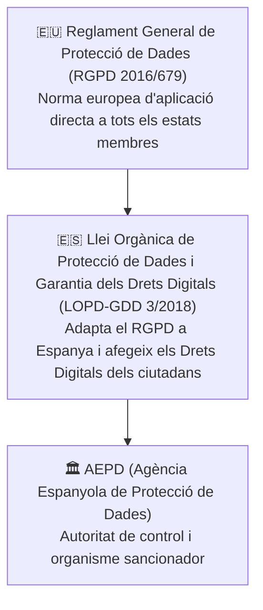
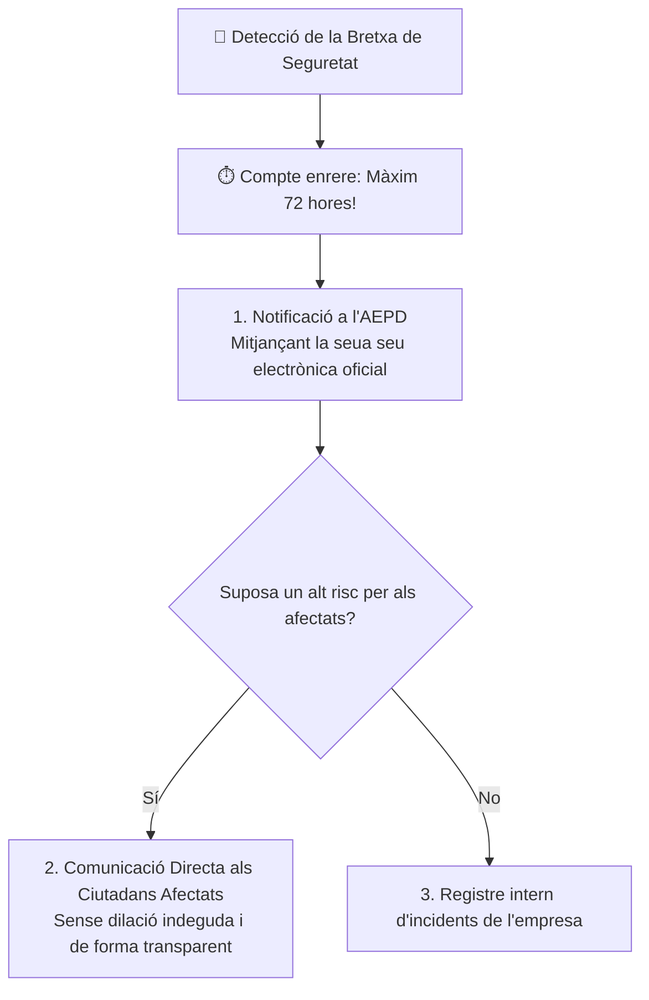

# UT09 — Legislació, Protecció de Dades (RGPD) i Gestió d'Incidents

La ciberseguretat no és només una qüestió tècnica de servidors i tallafocs; està fortament regulada per un **marc legal estricte**. Els tècnics informàtics han de conèixer les seues obligacions legals per a evitar sancions econòmiques greus i delictes contra la intimitat.

---

## 📌 1. Marc Normatiu: El RGPD i la LOPD-GDD

A l'Estat espanyol conflueixen dues normes fonamentals en matèria de privadesa digital:

### Principis Fonamentals del Tractament (Article 5 RGPD):
- **Licitud, lleialtat i transparència:** Cal tindre base jurídica (consentiment, contracte, obligació legal) i informar clarament l'usuari.
- **Limitació de la finalitat:** Les dades només es poden recopilar per a fins explícits determinats i no usar-se per a res més.
- **Minimització de dades:** Només cal demanar les dades estrictament necessàries per al servei (*Principi de necessitat*).
- **Exactitud:** Les dades han d'estar actualitzades i ser veraces.
- **Limitació del termini de conservació:** Cal esborrar o anonimitzar les dades un cop s'ha complert la finalitat.
- **Integritat i confidencialitat:** Obligació d'aplicar mesures tècniques (xifratge, còpies de seguretat, control d'accés) per a evitar accessos no autoritzats.

---

## 📌 2. Drets dels Ciutadans davant les Dades (Drets RGPD / ARSOL)

Els ciutadans tenen dret a controlar les seues dades personals en tot moment:

| Dret | Significat Pràctic | Termini de Resposta de l'Empresa |
| :--- | :--- | :---: |
| **Accés** | Conèixer quines dades nostres té l'empresa i amb quina finalitat les tracta. | 1 mes (prorrogable a 2) |
| **Rectificació** | Corregir informació errònia, desactualitzada o incompleta. | 1 mes |
| **Supressió (*Dret a l'Oblit*)** | Exigir la destrucció de les dades personals quan ja no siguen necessàries. | 1 mes |
| **Oposició** | Negar-se al tractament per motius personals o fins publicitaris. | 1 mes |
| **Limitació del Tractament** | Sol·licitar que les dades es congelen i no s'utilitzen mentre es tramita una queixa. | 1 mes |
| **Portabilitat** | Rebre les pròpies dades en un format estructurat i interoperable (JSON, CSV, XML) per a traspassar-les a un altre proveïdor. | 1 mes |

---

## 📌 3. Protocols d'Actuació davant Bretxes de Seguretat

Una **bretxa de dades (*Data Breach*)** es produeix quan es produeix un incident que ocasiona la destrucció, pèrdua, alteració o accés no autoritzat a dades personals (p. ex., un atac de ransomware que xifra una base de dades mèdica o la pèrdua d'un portàtil d'empresa no xifrat).

> [!CAUTION]
> **El límit estricte de 72 hores:**  
> L'article 33 del RGPD obliga el responsable del tractament a notificar qualsevol bretxa de seguretat a l'**Agència Espanyola de Protecció de Dades (AEPD)** en un termini màxim de **72 hores** des que se'n té constància. No fer-ho comporta sancions que poden arribar als **20 milions d'euros o el 4% de la facturació global anual de l'empresa**.

---

## 📌 4. Normatives Tècniques de Seguretat: ENS i ISO 27001

A banda de la legislació de privadesa, existeixen marcs d'estàndards per a estructurar la seguretat en entorns corporatius i administratius:

- **Esquema Nacional de Seguretat (ENS - RD 311/2022):** Marc normatiu espanyol d'obligat compliment per a totes les Administracions Públiques (ajuntaments, hospitals, instituts) i els seus proveïdors TIC. Estableix principis bàsics de seguretat, mesures d'implantació i auditories de conformitat en tres categories: *Bàsica*, *Mitjana* i *Alta*.
- **Família ISO/IEC 27000 (especialment ISO 27001):** Estàndard internacional que defineix els requisits per a implantar un **Sistema de Gestió de la Seguretat de la Informació (SGSI)**. Aplica un cicle de millora contínua PDCA (*Plan-Do-Check-Act*) sobre els actius de l'empresa.
- **LSSI-CE (Llei 34/2002):** Regula les obligacions per a llocs web comercials, incloent l'obligatorietat de l'Avís Legal, identificació fiscal (CIF/NIF), polítiques de privacitat i consentiment previ per a la instal·lació de cookies de seguiment.
