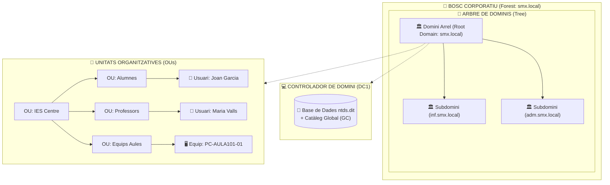

# 📘 UD2 — Administració i Gestió de Dominis (Active Directory i Serveis de Directori)

La **Unitat Didàctica 2** aborda la pedra angular de l'administració de xarxes corporatives: els **serveis de directori**. En compte de gestionar usuaris i contrasenyes de forma aïllada en cada màquina local (*model Workgroup / Grup de treball*), s'estableix una base de dades jeràrquica centralitzada que permet l'administració global de seguretat, recursos i autenticació (*model Domain / Domini*).

---

## 🏛️ Jerarquia de l'Active Directory (AD DS)

Microsoft **Active Directory Domain Services (AD DS)** estructura els elements de la xarxa en una jerarquia d'abstracció:



### 🔍 Conceptes Fonamentals de l'Arquitectura:
1. **Bosc (*Forest*):** El contenidor de màxim nivell. Comparteix un únic **esquema lògic comú** (definició de classes i atributs), una única configuració global i un **Catàleg Global (GC)** compartit entre tots els dominis.
2. **Arbre (*Tree*):** Conjunt d'un o més dominis que comparteixen un mateix espai de noms contigu (ex: `inf.smx.local` és un domini fill de `smx.local`).
3. **Domini (*Domain*):** El límit administratiu i de seguretat fonamental. Tots els equips i usuaris del domini comparteixen la mateixa base de dades centralitzada (`C:\Windows\NTDS\ntds.dit`).
4. **Unitat Organitzativa (OU - *Organizational Unit*):** Un contenidor lògic dins d'un domini que permet organitzar usuaris, grups i equips reflectint l'estructura física o funcional de l'empresa.
   > [!IMPORTANT]
   > Les **Unitats Organitzatives són els únics contenidors sobre els quals es poden vincular Directrius de Grup (GPO - Group Policy Objects)** per a aplicar polítiques automàtiques (com fons de pantalla comú, restricció de pendrives o mapeig de discos de xarxa).
5. **Controlador de Domini (DC - *Domain Controller*):** El servidor que executa el rol AD DS, emmagatzema la còpia de la base de dades i autentica els inicis de sessió dels usuaris mitjançant el protocol **Kerberos v5**.

---

## ⚡ Promoció a Controlador de Domini amb PowerShell

En Windows Server 2022, el procés d'instal·lació del rol i promoció d'un nou bosc es pot automatitzar completament:

```powershell
# 1. Instal·lar les eines i binaris d'Active Directory
Install-WindowsFeature -Name AD-Domain-Services -IncludeManagementTools

# 2. Promoure el servidor creant un nou bosc arrel anomenat 'smx.local'
Install-ADDSForest `
    -DomainName "smx.local" `
    -DomainNetbiosName "SMX" `
    -ForestMode "WinThreshold" `
    -DomainMode "WinThreshold" `
    -InstallDns:$true `
    -CreateDnsDelegation:$false `
    -DatabasePath "C:\Windows\NTDS" `
    -LogPath "C:\Windows\NTDS" `
    -SysvolPath "C:\Windows\SYSVOL" `
    -SafeModeAdministratorPassword (ConvertTo-SecureString "DSRM2024!" -AsPlainText -Force) `
    -Force:$true
```

---

## 💻 El Protocol d'Unió d'un Client al Domini

Perquè un ordinador amb Windows 10 o Windows 11 puga unir-se al domini:
1. **Requisit de DNS crític:** El client ha de tindre com a **servidor DNS primari la IP del Controlador de Domini (`192.168.100.10`)**.
   - El client consulta els registres especials **SRV** del DNS (`_ldap._tcp.dc._msdcs.smx.local`) per trobar quin servidor és el DC.
2. Executar la comanda d'unió a PowerShell com a administrador:
   ```powershell
   Add-Computer -DomainName "smx.local" -Credential (Get-Credential) -Restart
   ```
3. Introduir les credencials de l'administrador del domini (`SMX\Administrator`).
4. Després del reinici, l'equip ja mostrarà la pantalla d'inici de sessió amb l'opció: `Inicia la sessió a: SMX`.

---

## 📑 Continguts i Apartats de la Unitat

| Apartat | Títol | Descripció |
| :---: | :--- | :--- |
| **[2.2](./ut0202.md)** | **Serveis de Directori i Nomenclatura** | Estàndards X.500, LDAP v3, noms distingits (DN, CN, OU, DC). |
| **[2.4](./ut0204.md)** | **Estructura i Tipus de Dominis** | Relacions de confiança transitives, Catàleg Global i rols FSMO. |
| **[2.5](./ut0205.md)** | **Instal·lació d'Active Directory i OpenLDAP** | Desplegament pas a pas en entorns Windows Server i Linux. |
| **[2.7](./ut0207.md)** | **Unió de Clients al Domini** | Protocol d'adhesió, resolució de problemes DNS i verificació de seguretat. |
| **[2.8](./ut0208.md)** | **Eines d'Administració de Domini** | Ús del Centre d'Administració de l'Active Directory (ADAC) i comandes `Get-ADUser`. |
