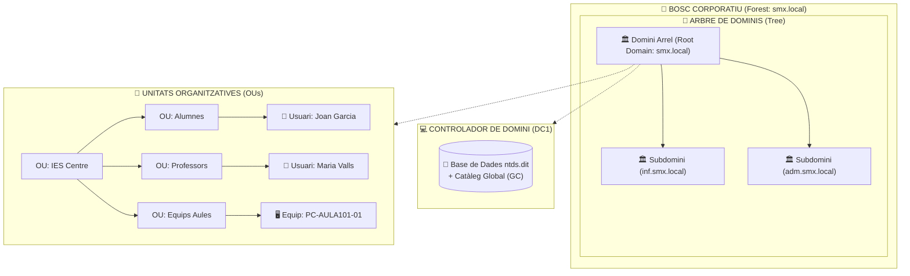

# 📘 UD2 — Administració i Gestió de Dominis (Active Directory i Serveis de Directori)

La **Unitat Didàctica 2** aborda la pedra angular de l'administració de xarxes corporatives: els **serveis de directori**. En compte de gestionar usuaris i contrasenyes de forma aïllada en cada màquina local (*model Workgroup / Grup de treball*), s'estableix una base de dades jeràrquica centralitzada que permet l'administració global de seguretat, recursos i autenticació (*model Domain / Domini*).

---

## 🏛️ Jerarquia de l'Active Directory (AD DS)

<div style="background: linear-gradient(135deg, #0f172a 0%, #1e293b 100%); border-radius: 12px; padding: 20px; margin: 25px 0; box-shadow: 0 10px 25px -5px rgba(0, 0, 0, 0.3); border: 1px solid #334155;">
  <div style="text-align: center; margin-bottom: 15px;">
    <span style="background: #38bdf8; color: #0f172a; font-weight: 700; font-size: 0.75rem; text-transform: uppercase; letter-spacing: 0.05em; padding: 4px 10px; border-radius: 9999px;">Infografia Tècnica</span>
    <h3 style="color: #f8fafc; margin: 10px 0 5px 0; font-size: 1.25rem;">Jerarquia d'Active Directory: Bosc, Domini, OUs i Directrius GPO</h3>
    <p style="color: #94a3b8; font-size: 0.85rem; margin: 0;">Arquitectura lògica d'administració centralitzada, base de dades ntds.dit i resolució DNS SRV</p>
  </div>
  <svg viewBox="0 0 860 300" width="100%" height="100%" xmlns="http://www.w3.org/2000/svg" style="display: block; font-family: system-ui, -apple-system, sans-serif;">
    <defs>
      <linearGradient id="adForestGrad" x1="0%" y1="0%" x2="100%" y2="100%">
        <stop offset="0%" stop-color="#3b82f6" stop-opacity="0.25"/>
        <stop offset="100%" stop-color="#1d4ed8" stop-opacity="0.1"/>
      </linearGradient>
      <linearGradient id="adDcGrad" x1="0%" y1="0%" x2="100%" y2="100%">
        <stop offset="0%" stop-color="#8b5cf6" stop-opacity="0.25"/>
        <stop offset="100%" stop-color="#6d28d9" stop-opacity="0.1"/>
      </linearGradient>
      <linearGradient id="adOuGrad" x1="0%" y1="0%" x2="100%" y2="100%">
        <stop offset="0%" stop-color="#10b981" stop-opacity="0.25"/>
        <stop offset="100%" stop-color="#047857" stop-opacity="0.1"/>
      </linearGradient>
      <linearGradient id="adClientGrad" x1="0%" y1="0%" x2="100%" y2="100%">
        <stop offset="0%" stop-color="#f59e0b" stop-opacity="0.25"/>
        <stop offset="100%" stop-color="#b45309" stop-opacity="0.1"/>
      </linearGradient>
    </defs>

    <!-- Bloc 1: Bosc i Domini -->
    <rect x="20" y="20" width="190" height="215" rx="8" fill="url(#adForestGrad)" stroke="#38bdf8" stroke-width="1.5"/>
    <text x="115" y="45" fill="#38bdf8" font-size="11" font-weight="bold" text-anchor="middle">🌳 BOSC CORPORATIU</text>
    <text x="115" y="62" fill="#94a3b8" font-size="9.5" text-anchor="middle">Forest: smx.local</text>
    <line x1="30" y1="73" x2="200" y2="73" stroke="#334155"/>
    <text x="32" y="93" fill="#cbd5e1" font-size="9.5">• <tspan fill="#38bdf8" font-weight="bold">Esquema Únic:</tspan> Classes/Atributs</text>
    <text x="32" y="113" fill="#cbd5e1" font-size="9.5">• <tspan fill="#cbd5e1">Catàleg Global (GC)</tspan></text>
    <text x="32" y="133" fill="#cbd5e1" font-size="9.5">• <tspan fill="#38bdf8" font-weight="bold">Arbre Principal:</tspan></text>
    <text x="45" y="150" fill="#94a3b8" font-size="9">smx.local (Arrel)</text>
    <text x="32" y="170" fill="#cbd5e1" font-size="9.5">• <tspan fill="#38bdf8" font-weight="bold">Subdominis:</tspan></text>
    <text x="45" y="187" fill="#94a3b8" font-size="9">inf.smx.local / adm.smx.local</text>
    <text x="115" y="222" fill="#38bdf8" font-size="9" text-anchor="middle" font-weight="bold">Límit de Seguretat Global</text>

    <!-- Fletxa 1 a 2 -->
    <path d="M 210 115 L 230 115" stroke="#38bdf8" stroke-width="2"/>

    <!-- Bloc 2: Controlador de Domini -->
    <rect x="235" y="20" width="200" height="215" rx="8" fill="url(#adDcGrad)" stroke="#c084fc" stroke-width="1.5"/>
    <text x="335" y="45" fill="#c084fc" font-size="11" font-weight="bold" text-anchor="middle">🏛️ CONTROLADOR (DC1)</text>
    <text x="335" y="62" fill="#94a3b8" font-size="9.5" text-anchor="middle">IP: 192.168.100.10</text>
    <line x1="245" y1="73" x2="425" y2="73" stroke="#334155"/>
    <text x="248" y="93" fill="#cbd5e1" font-size="9.5">• <tspan fill="#c084fc" font-weight="bold">BD:</tspan> C:\Windows\NTDS\ntds.dit</text>
    <text x="248" y="113" fill="#cbd5e1" font-size="9.5">• <tspan fill="#34d399" font-weight="bold">Sysvol:</tspan> Replicació scripts/GPOs</text>
    <text x="248" y="133" fill="#cbd5e1" font-size="9.5">• <tspan fill="#c084fc" font-weight="bold">Kerberos v5:</tspan> Port TCP/UDP 88</text>
    <text x="248" y="153" fill="#cbd5e1" font-size="9.5">• <tspan fill="#38bdf8" font-weight="bold">LDAP/LDAPS:</tspan> Ports 389 / 636</text>
    <text x="248" y="173" fill="#cbd5e1" font-size="9.5">• <tspan fill="#f59e0b" font-weight="bold">DNS Integrat:</tspan> Zones i SRV</text>
    <text x="335" y="222" fill="#c084fc" font-size="9" text-anchor="middle" font-weight="bold">Autenticació Centralitzada</text>

    <!-- Fletxa 2 a 3 -->
    <path d="M 435 115 L 455 115" stroke="#c084fc" stroke-width="2"/>

    <!-- Bloc 3: Unitats Organitzatives & GPOs -->
    <rect x="460" y="20" width="190" height="215" rx="8" fill="url(#adOuGrad)" stroke="#34d399" stroke-width="1.5"/>
    <text x="555" y="45" fill="#34d399" font-size="11" font-weight="bold" text-anchor="middle">📂 UNITATS ORG. (OUs)</text>
    <text x="555" y="62" fill="#94a3b8" font-size="9.5" text-anchor="middle">Contenidors Jeràrquics</text>
    <line x1="470" y1="73" x2="640" y2="73" stroke="#334155"/>
    <text x="472" y="93" fill="#cbd5e1" font-size="9.5">• <tspan fill="#34d399" font-weight="bold">OU=Alumnes</tspan> (Usuaris SMX)</text>
    <text x="472" y="113" fill="#cbd5e1" font-size="9.5">• <tspan fill="#34d399" font-weight="bold">OU=Professors</tspan> (Docents)</text>
    <text x="472" y="133" fill="#cbd5e1" font-size="9.5">• <tspan fill="#34d399" font-weight="bold">OU=Equips</tspan> (PCs Aules)</text>
    <text x="472" y="153" fill="#cbd5e1" font-size="9.5">• <tspan fill="#f59e0b" font-weight="bold">Vincles de GPO:</tspan></text>
    <text x="485" y="170" fill="#94a3b8" font-size="9">  ↳ GPO_Fons_Corporatiu</text>
    <text x="485" y="187" fill="#94a3b8" font-size="9">  ↳ GPO_Bloqueig_USB</text>
    <text x="555" y="222" fill="#34d399" font-size="9" text-anchor="middle" font-weight="bold">Aplicació de Polítiques</text>

    <!-- Fletxa 3 a 4 -->
    <path d="M 650 115 L 670 115" stroke="#34d399" stroke-width="2"/>

    <!-- Bloc 4: Clients de Domini -->
    <rect x="675" y="20" width="165" height="215" rx="8" fill="url(#adClientGrad)" stroke="#f59e0b" stroke-width="1.5"/>
    <text x="757" y="45" fill="#f59e0b" font-size="11" font-weight="bold" text-anchor="middle">💻 CLIENTS (WORKSTATION)</text>
    <text x="757" y="62" fill="#94a3b8" font-size="9.5" text-anchor="middle">Windows 10 / 11 Pro</text>
    <line x1="685" y1="73" x2="830" y2="73" stroke="#334155"/>
    <text x="687" y="93" fill="#cbd5e1" font-size="9.5">• <tspan fill="#f59e0b" font-weight="bold">DNS:</tspan> 192.168.100.10</text>
    <text x="687" y="113" fill="#cbd5e1" font-size="9.5">• <tspan fill="#cbd5e1">Consulta registre SRV:</tspan></text>
    <text x="695" y="130" fill="#94a3b8" font-size="8.5">_ldap._tcp.dc._msdcs</text>
    <text x="687" y="150" fill="#cbd5e1" font-size="9.5">• <tspan fill="#34d399" font-weight="bold">Add-Computer</tspan></text>
    <text x="687" y="170" fill="#cbd5e1" font-size="9.5">• <tspan fill="#38bdf8" font-weight="bold">Inici Sessió:</tspan> SMX\usuari</text>
    <text x="687" y="190" fill="#cbd5e1" font-size="9.5">• <tspan fill="#cbd5e1">Descàrrega GPO local</tspan></text>
    <text x="757" y="222" fill="#f59e0b" font-size="9" text-anchor="middle" font-weight="bold">Sessió Unificada</text>

    <!-- Peu informatiu -->
    <rect x="20" y="245" width="820" height="42" rx="6" fill="#1e293b" stroke="#334155"/>
    <text x="430" y="265" fill="#cbd5e1" font-size="10" text-anchor="middle">Regla d'Or GPO: <tspan fill="#f59e0b" font-weight="bold">Les GPO NOMÉS es poden vincular a OUs, Dominis o Llocs.</tspan> Mai als contenidors per defecte CN=Users o CN=Computers.</text>
    <text x="430" y="280" fill="#94a3b8" font-size="9" text-anchor="middle">Per això sempre es creen OUs personalitzades per a organitzar el centre educatiu o empresa.</text>
  </svg>
</div>

Microsoft **Active Directory Domain Services (AD DS)** estructura els elements de la xarxa en una jerarquia d'abstracció:



### 🔍 Conceptes Fonamentals de l'Arquitectura:
1. **Bosc (*Forest*):** El contenidor de màxim nivell. Comparteix un únic **esquema lògic comú** (definició de classes i atributs), una única configuració global i un **Catàleg Global (GC)** compartit entre tots els dominis.
2. **Arbre (*Tree*):** Conjunt d'un o més dominis que comparteixen un mateix espai de noms contigu (ex: `inf.smx.local` és un domini fill de `smx.local`).
3. **Domini (*Domain*):** El límit administratiu i de seguretat fonamental. Tots els equips i usuaris del domini comparteixen la mateixa base de dades centralitzada (`C:\Windows\NTDS\ntds.dit`).
4. **Unitat Organitzativa (OU - *Organizational Unit*):** Un contenidor lògic dins d'un domini que permet organitzar usuaris, grups i equips reflectint l'estructura física o funcional de l'empresa.
   > [!IMPORTANT]
   > Les **Unitats Organitzatives són els únics contenidors sobre els quals es poden vincular Directrius de Grup (GPO - Group Policy Objects)** per a aplicar polítiques automàtiques (com fons de pantalla comú, restricció de pendrives o mapeig de discos de xarxa).
5. **Controlador de Domini (DC - *Domain Controller*):** El servidor que executa el rol AD DS, emmagatzema la còpia de la base de dades i autentica els inicis de sessió dels usuaris mitjançant el protocol **Kerberos v5**.

---

## ⚡ Promoció a Controlador de Domini amb PowerShell

En Windows Server 2022, el procés d'instal·lació del rol i promoció d'un nou bosc es pot automatitzar completament:

```powershell
# 1. Instal·lar les eines i binaris d'Active Directory
Install-WindowsFeature -Name AD-Domain-Services -IncludeManagementTools

# 2. Promoure el servidor creant un nou bosc arrel anomenat 'smx.local'
Install-ADDSForest `
    -DomainName "smx.local" `
    -DomainNetbiosName "SMX" `
    -ForestMode "WinThreshold" `
    -DomainMode "WinThreshold" `
    -InstallDns:$true `
    -CreateDnsDelegation:$false `
    -DatabasePath "C:\Windows\NTDS" `
    -LogPath "C:\Windows\NTDS" `
    -SysvolPath "C:\Windows\SYSVOL" `
    -SafeModeAdministratorPassword (ConvertTo-SecureString "DSRM2024!" -AsPlainText -Force) `
    -Force:$true
```

---

## 💻 El Protocol d'Unió d'un Client al Domini

Perquè un ordinador amb Windows 10 o Windows 11 puga unir-se al domini:
1. **Requisit de DNS crític:** El client ha de tindre com a **servidor DNS primari la IP del Controlador de Domini (`192.168.100.10`)**.
   - El client consulta els registres especials **SRV** del DNS (`_ldap._tcp.dc._msdcs.smx.local`) per trobar quin servidor és el DC.
2. Executar la comanda d'unió a PowerShell com a administrador:
   ```powershell
   Add-Computer -DomainName "smx.local" -Credential (Get-Credential) -Restart
   ```
3. Introduir les credencials de l'administrador del domini (`SMX\Administrator`).
4. Després del reinici, l'equip ja mostrarà la pantalla d'inici de sessió amb l'opció: `Inicia la sessió a: SMX`.

---

## 📑 Continguts i Apartats de la Unitat

| Apartat | Títol | Descripció |
| :---: | :--- | :--- |
| **[2.2](./ut0202.md)** | **Serveis de Directori i Nomenclatura** | Estàndards X.500, LDAP v3, noms distingits (DN, CN, OU, DC). |
| **[2.4](./ut0204.md)** | **Estructura i Tipus de Dominis** | Relacions de confiança transitives, Catàleg Global i rols FSMO. |
| **[2.5](./ut0205.md)** | **Instal·lació d'Active Directory i OpenLDAP** | Desplegament pas a pas en entorns Windows Server i Linux. |
| **[2.7](./ut0207.md)** | **Unió de Clients al Domini** | Protocol d'adhesió, resolució de problemes DNS i verificació de seguretat. |
| **[2.8](./ut0208.md)** | **Eines d'Administració de Domini** | Ús del Centre d'Administració de l'Active Directory (ADAC) i comandes `Get-ADUser`. |

---

## 📝 Quadern d'Activitats Pràctiques i Reptes de Laboratori

### 📋 Bloc A: Fonaments, Estructura i Diagnòstic de Domini
1. **El Catàleg Global (GC) i l'Esquema de Bosc:**
   - Quina funció crítica té el Catàleg Global en un entorn amb múltiples dominis (com `inf.smx.local` i `adm.smx.local`) quan un usuari inicia sessió amb el seu nom d'usuari universal (UPN)?
   - On s'emmagatzema físicament la base de dades d'Active Directory i quin és el propòsit del fitxer `SYSVOL` compartit a la xarxa?
2. **Diagnòstic de Resolució DNS per a Serveis de Directori:**
   - Un tècnic intenta unir una màquina client amb Windows 10 al domini `smx.local`, però rep l'error: *"No s'ha pogut contactar amb un controlador de domini de l'Active Directory per al domini smx.local"*.
   - Si la comanda `ping 192.168.100.10` respon correctament des del client, quin és el motiu pel qual l'assistent d'unió falla?
   - Quin paper tenen els registres de recurs DNS de tipus **SRV** (`_ldap._tcp.dc._msdcs.smx.local`) en el procés de localització de servidors?
3. **Jerarquia d'Objectes i Aplicació de GPO:**
   - Per què Microsoft no permet vincular Directrius de Grup (GPO) directament al contenidor per defecte `CN=Users` o `CN=Computers`?
   - Quina diferència estructural i funcional hi ha entre un contenidor del sistema (`CN`) i una Unitat Organitzativa (`OU`)?

### 💻 Bloc B: Reptes Pràctics de Laboratori i Comandes

#### Repte 1: Verificació de la Promoció i Consulta dels Rols FSMO amb PowerShell
1. Al servidor Windows Server 2022 (`DC1`), obre PowerShell com a administrador.
2. Consulta l'estat del Controlador de Domini i verifica que els serveis d'AD DS estan actius:
   ```powershell
   Get-ADDomainController -Identity DC1 | Select-Object Name, IPv4Address, OperatingSystem, Forest, Domain
   ```
3. Comprova quins servidors tenen assignats els 5 rols mestres d'operació única (FSMO):
   ```powershell
   netdom query fsmo
   ```
4. Identifica quin controlador té el rol de **PDC Emulator** (emulador de PDC) i verifica la sincronització del servei d'hora del domini (`w32tm /query /status`).

#### Repte 2: Comprovació dels Registres SRV al Servidor DNS
1. Des de la màquina client (Windows 10/11) abans d'unir-la al domini, verifica que pot resoldre el registre SRV del controlador:
   ```powershell
   nslookup -type=srv _ldap._tcp.dc._msdcs.smx.local 192.168.100.10
   ```
2. Analitza la resposta: comprova que el port retornat és el **389** (LDAP) i que el nom de servidor amfitrió retornat és `dc1.smx.local`.

#### Repte 3: Creació d'Estructura d'Unitats Organitzatives (OUs) amb PowerShell
1. Al servidor `DC1`, crea l'estructura departamental del centre educatiu amb protecció contra eliminació accidental habilitada:
   ```powershell
   # OU Arrel del Centre
   New-ADOrganizationalUnit -Name "IES_SMX" -Path "DC=smx,DC=local" -ProtectedFromAccidentalDeletion $true

   # Sub-OUs per a organitzar usuaris i equips
   New-ADOrganizationalUnit -Name "Alumnes" -Path "OU=IES_SMX,DC=smx,DC=local" -ProtectedFromAccidentalDeletion $true
   New-ADOrganizationalUnit -Name "Professors" -Path "OU=IES_SMX,DC=smx,DC=local" -ProtectedFromAccidentalDeletion $true
   New-ADOrganizationalUnit -Name "Equips_Aules" -Path "OU=IES_SMX,DC=smx,DC=local" -ProtectedFromAccidentalDeletion $true
   ```
2. Llista totes les OUs creades al domini per verificar la jerarquia:
   ```powershell
   Get-ADOrganizationalUnit -Filter * | Select-Object Name, DistinguishedName
   ```

#### Repte 4: Unió de la Màquina Client al Domini i Reubicació d'OU
1. A la màquina client, executa la comanda d'adhesió indicant credencials del domini:
   ```powershell
   Add-Computer -DomainName "smx.local" -Credential (Get-Credential) -Restart
   ```
2. Un cop reiniciat el client, torna al servidor `DC1` i verifica que l'equip apareix a l'Active Directory:
   ```powershell
   Get-ADComputer -Identity "CLI-WIN10" | Select-Object Name, DistinguishedName, Enabled
   ```
3. Mou l'equip des del contenidor per defecte `CN=Computers` a la seua OU corresponent per tal que puga rebre les GPOs d'aula:
   ```powershell
   Move-ADObject -Identity (Get-ADComputer "CLI-WIN10").DistinguishedName -TargetPath "OU=Equips_Aules,OU=IES_SMX,DC=smx,DC=local"
   ```

### 🎯 Bloc C: Llista de Verificació i Rúbrica d'Avaluació

| Criteri d'Avaluació | Nivell Assolit (Excel·lent: 9-10) | Nivell Mitjà (Notable: 7-8) | Nivell Inicial (Aprovat: 5-6) |
| :--- | :--- | :--- | :--- |
| **Jerarquia d'Active Directory i FSMO** | Distingeix amb precisió Bosc, Domini, Catàleg Global i els 5 rols FSMO, explicant la seua incidència en el servei. | Comprèn el concepte de domini però confon el rol dels FSMO o el paper de l'esquema únic. | Desconeix com s'estructura un bosc o confon un grup de treball amb un domini. |
| **Resolució DNS SRV i Unió de Clients** | Diagnostica incidències d'unió mitjançant `nslookup -type=srv`, verificant connectivitat TCP 389 i 88. | Uneix l'equip amb èxit si tot funciona, però no sap diagnosticar errors quan falla el DNS. | Falla la unió per utilitzar servidors DNS externs o no sap com assignar credencials d'administrador. |
| **Administració d'OUs i Automatització PowerShell** | Crea jerarquies d'OUs protegides i reubica objectes d'equip emprant comandes PowerShell avançades. | Crea OUs des de l'assistent gràfic però depèn totalment del ratolí i oblida la protecció accidental. | No comprèn per què s'han d'organitzar els equips en OUs per a l'aplicació de polítiques GPO. |
