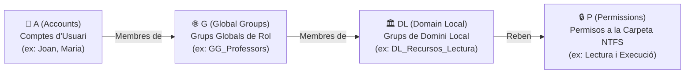

# 📘 UD3 — Administració i Gestió d'Usuaris, Grups i Perfils

La **Unitat Didàctica 3** aprofundeix en el cicle de vida de les identitats digitals corporatives: la creació de comptes d'usuari i màquina, l'estratègia professional de jerarquia de grups mitjançant la metodologia **AGDLP**, i la configuració de **perfils mòbils** i carpetes d'inici per garantir que l'alumnat i el professorat disposen dels seus documents en qualsevol ordinador del centre.

---

## 🛡️ La Regla d'Or de l'Assignació de Permisos: Metodologia AGDLP

<div style="background: linear-gradient(135deg, #0f172a 0%, #1e293b 100%); border-radius: 12px; padding: 20px; margin: 25px 0; box-shadow: 0 10px 25px -5px rgba(0, 0, 0, 0.3); border: 1px solid #334155;">
  <div style="text-align: center; margin-bottom: 15px;">
    <span style="background: #38bdf8; color: #0f172a; font-weight: 700; font-size: 0.75rem; text-transform: uppercase; letter-spacing: 0.05em; padding: 4px 10px; border-radius: 9999px;">Infografia Tècnica</span>
    <h3 style="color: #f8fafc; margin: 10px 0 5px 0; font-size: 1.25rem;">La Regla d'Or AGDLP i el Cicle d'Identitats Corporatives</h3>
    <p style="color: #94a3b8; font-size: 0.85rem; margin: 0;">Estratègia de grups en capes, delegació segura i gestió centralitzada de permisos NTFS</p>
  </div>
  <svg viewBox="0 0 860 280" width="100%" height="100%" xmlns="http://www.w3.org/2000/svg" style="display: block; font-family: system-ui, -apple-system, sans-serif;">
    <defs>
      <linearGradient id="agdlpA" x1="0%" y1="0%" x2="100%" y2="100%">
        <stop offset="0%" stop-color="#3b82f6" stop-opacity="0.25"/>
        <stop offset="100%" stop-color="#1d4ed8" stop-opacity="0.1"/>
      </linearGradient>
      <linearGradient id="agdlpG" x1="0%" y1="0%" x2="100%" y2="100%">
        <stop offset="0%" stop-color="#8b5cf6" stop-opacity="0.25"/>
        <stop offset="100%" stop-color="#6d28d9" stop-opacity="0.1"/>
      </linearGradient>
      <linearGradient id="agdlpDL" x1="0%" y1="0%" x2="100%" y2="100%">
        <stop offset="0%" stop-color="#f59e0b" stop-opacity="0.25"/>
        <stop offset="100%" stop-color="#b45309" stop-opacity="0.1"/>
      </linearGradient>
      <linearGradient id="agdlpP" x1="0%" y1="0%" x2="100%" y2="100%">
        <stop offset="0%" stop-color="#10b981" stop-opacity="0.25"/>
        <stop offset="100%" stop-color="#047857" stop-opacity="0.1"/>
      </linearGradient>
    </defs>

    <!-- Bloc 1: A (Accounts) -->
    <rect x="20" y="20" width="180" height="195" rx="8" fill="url(#agdlpA)" stroke="#38bdf8" stroke-width="1.5"/>
    <text x="110" y="45" fill="#38bdf8" font-size="11" font-weight="bold" text-anchor="middle">👤 A: ACCOUNTS</text>
    <text x="110" y="62" fill="#94a3b8" font-size="9.5" text-anchor="middle">Comptes d'Usuari</text>
    <line x1="30" y1="73" x2="190" y2="73" stroke="#334155"/>
    <text x="32" y="95" fill="#cbd5e1" font-size="9.5">• <tspan fill="#38bdf8" font-weight="bold">joan.garcia</tspan></text>
    <text x="32" y="115" fill="#cbd5e1" font-size="9.5">• <tspan fill="#38bdf8" font-weight="bold">maria.valls</tspan></text>
    <text x="32" y="135" fill="#cbd5e1" font-size="9.5">• <tspan fill="#38bdf8" font-weight="bold">carles.perez</tspan></text>
    <text x="32" y="155" fill="#94a3b8" font-size="9">Ubicació: OU=Usuaris</text>
    <text x="110" y="195" fill="#38bdf8" font-size="9" text-anchor="middle" font-weight="bold">Identitats Individuals</text>

    <!-- Fletxa A -> G -->
    <path d="M 200 115 L 230 115" stroke="#38bdf8" stroke-width="2"/>
    <text x="215" y="105" fill="#38bdf8" font-size="8" text-anchor="middle">Membres</text>

    <!-- Bloc 2: G (Global Groups) -->
    <rect x="235" y="20" width="185" height="195" rx="8" fill="url(#agdlpG)" stroke="#c084fc" stroke-width="1.5"/>
    <text x="327" y="45" fill="#c084fc" font-size="11" font-weight="bold" text-anchor="middle">🌐 G: GLOBAL GROUPS</text>
    <text x="327" y="62" fill="#94a3b8" font-size="9.5" text-anchor="middle">Grups de Rol / Funció</text>
    <line x1="245" y1="73" x2="410" y2="73" stroke="#334155"/>
    <text x="248" y="95" fill="#cbd5e1" font-size="9.5">• <tspan fill="#c084fc" font-weight="bold">GG_Professors_SMX</tspan></text>
    <text x="248" y="115" fill="#cbd5e1" font-size="9.5">• <tspan fill="#c084fc" font-weight="bold">GG_Alumnes_2SMX</tspan></text>
    <text x="248" y="135" fill="#cbd5e1" font-size="9.5">• <tspan fill="#c084fc" font-weight="bold">GG_Administratius</tspan></text>
    <text x="248" y="155" fill="#94a3b8" font-size="9">Àmbit: Global</text>
    <text x="327" y="195" fill="#c084fc" font-size="9" text-anchor="middle" font-weight="bold">Funció de l'Usuari</text>

    <!-- Fletxa G -> DL -->
    <path d="M 420 115 L 450 115" stroke="#c084fc" stroke-width="2"/>
    <text x="435" y="105" fill="#c084fc" font-size="8" text-anchor="middle">Membres</text>

    <!-- Bloc 3: DL (Domain Local) -->
    <rect x="455" y="20" width="185" height="195" rx="8" fill="url(#agdlpDL)" stroke="#f59e0b" stroke-width="1.5"/>
    <text x="547" y="45" fill="#f59e0b" font-size="11" font-weight="bold" text-anchor="middle">🏛️ DL: DOMAIN LOCAL</text>
    <text x="547" y="62" fill="#94a3b8" font-size="9.5" text-anchor="middle">Grups de Recurs</text>
    <line x1="465" y1="73" x2="630" y2="73" stroke="#334155"/>
    <text x="468" y="95" fill="#cbd5e1" font-size="9.5">• <tspan fill="#f59e0b" font-weight="bold">DL_Projectes_M</tspan> (Mod.)</text>
    <text x="468" y="115" fill="#cbd5e1" font-size="9.5">• <tspan fill="#f59e0b" font-weight="bold">DL_Projectes_L</tspan> (Lect.)</text>
    <text x="468" y="135" fill="#cbd5e1" font-size="9.5">• <tspan fill="#f59e0b" font-weight="bold">DL_Avaluacio_R</tspan> (Read)</text>
    <text x="468" y="155" fill="#94a3b8" font-size="9">Àmbit: Domini Local</text>
    <text x="547" y="195" fill="#f59e0b" font-size="9" text-anchor="middle" font-weight="bold">Tipus d'Accés al Recurs</text>

    <!-- Fletxa DL -> P -->
    <path d="M 640 115 L 670 115" stroke="#f59e0b" stroke-width="2"/>
    <text x="655" y="105" fill="#f59e0b" font-size="8" text-anchor="middle">Assigna</text>

    <!-- Bloc 4: P (Permissions) -->
    <rect x="675" y="20" width="165" height="195" rx="8" fill="url(#agdlpP)" stroke="#34d399" stroke-width="1.5"/>
    <text x="757" y="45" fill="#34d399" font-size="11" font-weight="bold" text-anchor="middle">🔒 P: PERMISSIONS</text>
    <text x="757" y="62" fill="#94a3b8" font-size="9.5" text-anchor="middle">Permisos NTFS al Disc</text>
    <line x1="685" y1="73" x2="830" y2="73" stroke="#334155"/>
    <text x="687" y="95" fill="#cbd5e1" font-size="9.5">• <tspan fill="#34d399" font-weight="bold">D:\Dades\Projectes</tspan></text>
    <text x="687" y="115" fill="#94a3b8" font-size="9">  DL_Projectes_M ➔ Modificar</text>
    <text x="687" y="135" fill="#94a3b8" font-size="9">  DL_Projectes_L ➔ Lectura</text>
    <text x="687" y="155" fill="#cbd5e1" font-size="9.5">• <tspan fill="#34d399" font-weight="bold">D:\Dades\Avaluacio</tspan></text>
    <text x="757" y="195" fill="#34d399" font-size="9" text-anchor="middle" font-weight="bold">Control d'Accés NTFS</text>

    <!-- Peu informatiu -->
    <rect x="20" y="228" width="820" height="40" rx="6" fill="#1e293b" stroke="#334155"/>
    <text x="430" y="247" fill="#cbd5e1" font-size="10" text-anchor="middle">Regla d'Or: <tspan fill="#38bdf8" font-weight="bold">MAI s'assignen permisos directament a un usuari individual.</tspan> Si un empleat canvia de rol,</text>
    <text x="430" y="261" fill="#94a3b8" font-size="9" text-anchor="middle">només cal canviar-lo de Grup Global (G), sense tocar mai les Llistes de Control d'Accés (ACLs) del disc.</text>
  </svg>
</div>

Microsoft recomana formalment **no assignar mai permisos directament a comptes d'usuari individuals**. En compte d'això, s'aplica l'estratègia d'encapsulament en capes coneguda com a **AGDLP**:



### 🔍 Significat de cada lletra en la cadena AGDLP:
1. **A (*Accounts*):** Els comptes d'usuari del directori.
2. **G (*Global Groups*):** Els usuaris s'agrupen segons la seua **funció laboral o acadèmica** (ex: `GG_Alumnes_SMX1`, `GG_Professors_Informatica`). Tenen àmbit Global.
3. **DL (*Domain Local Groups*):** Es creen grups locals de domini específics per a cada **recurs i nivell d'accés** (ex: `DL_Avaluacions_Modificar`, `DL_Avaluacions_Lectura`).
4. **P (*Permissions*):** Els permisos NTFS a la carpeta compartida del disc s'assignen **única i exclusivament al Grup de Domini Local (DL)**.

*Benefici clau:* Quan s'incorpora un professor nou al centre, només cal afegir-lo al grup global `GG_Professors`. Automàticament heretarà els centenars de carpetes i permisos assignats a aquest rol sense haver de tocar cap carpeta de disc!

---

## 🚀 Creació Massiva d'Usuaris amb PowerShell des de fitxer CSV

En centres educatius i grans empreses, crear usuaris un a un amb ratolí és inviable. Els tècnics utilitzen scripts d'automatització:

### Contingut del fitxer `alumnes.csv`:
```csv
Nom,Cognoms,SamAccountName,OU,Contrasenya
Carles,Perez Navarro,carles.perez,"OU=Alumnes,DC=smx,DC=local",Alumne2024!
Laura,Gomis Marti,laura.gomis,"OU=Alumnes,DC=smx,DC=local",Alumne2024!
```

### Script de creació automàtica:
```powershell
Import-Csv -Path "C:\Scripts\alumnes.csv" -Encoding UTF8 | ForEach-Object {
    $PasswordSecure = ConvertTo-SecureString $_.Contrasenya -AsPlainText -Force
    New-ADUser `
        -Name "$($_.Nom) $($_.Cognoms)" `
        -GivenName $_.Nom `
        -Surname $_.Cognoms `
        -SamAccountName $_.SamAccountName `
        -UserPrincipalName "$($_.SamAccountName)@smx.local" `
        -Path $_.OU `
        -AccountPassword $PasswordSecure `
        -Enabled $true `
        -ChangePasswordAtLogon $true
    Write-Host "Usuari $($_.SamAccountName) creat amb èxit!" -ForegroundColor Green
}
```

---

## 🎒 Perfils d'Usuari: Locals, Mòbils i Obligatoris

1. **Perfil Local (*Local Profile*):**
   - El perfil complet (Escriptori, Documents, Baixades, claus de registre `NTUSER.DAT`) s'allotja únicament al disc dur local de la màquina client (`C:\Users\nom_usuari`). Si l'alumne canvia d'aula o de taula, no té cap accés als seus fitxers locals anteriors.
2. **Perfil Mòbil (*Roaming Profile*):**
   - La carpeta de perfil s'allotja a un recurs compartit del servidor (`\\DC1\Perfils$\%username%`).
   - En iniciar sessió, el perfil es descarrega a la màquina client. En tancar sessió, tots els canvis es sincronitzen de tornada al servidor.
3. **Perfil Obligatori (*Mandatory Profile*):**
   - Un perfil mòbil de només lectura on el fitxer de registre es reanomena de `NTUSER.DAT` a **`NTUSER.MAN`**. Qualsevol canvi estètic realitzat per l'alumne s'esborra automàticament en tancar la sessió.

---

## 📑 Continguts i Apartats de la Unitat

| Apartat | Títol | Descripció |
| :---: | :--- | :--- |
| **[3.2](./ut0302.md)** | **Gestió de Comptes d'Usuari** | Propietats de compte, UPN, caducitat, horaris d'inici de sessió permès. |
| **[3.4](./ut0304.md)** | **Grups: Tipus i Àmbits** | Seguretat vs Distribució; Àmbits Global, Domini Local i Universal. |
| **[3.7](./ut0307.md)** | **Perfils Mòbils i Redirecció de Carpetes** | Configuració de recursos ocults (`$`), quotes de disc i sincronització. |
| **[3.20](./ut0320.md)** | **Automatització i Scripts amb PowerShell** | Creació massiva des de CSV, bloquejos de comptes i auditories de seguretat. |

---

## 📝 Quadern d'Activitats Pràctiques i Reptes de Laboratori

### 📋 Bloc A: Fonaments, Tipus de Grups i Perfils
1. **Anàlisi Comparativa d'Àmbits de Grup:**
   - Quina diferència hi ha entre un **Grup Global**, un **Grup de Domini Local** i un **Grup Universal** pel que fa a:
     - Els tipus de membres que poden contindre.
     - Els llocs on poden tindre permisos assignats.
     - La replicació de membres al Catàleg Global (GC).
   - Per què la metodologia AGDLP prohibeix assignar permisos NTFS directament a un Grup Global?
2. **Coll d'Ampolla del Perfil Mòbil vs Redirecció de Carpetes:**
   - Un alumne acumula $12\text{ GB}$ de vídeos i màquines virtuals a la seua carpeta de *Baixades* i *Escriptori*.
   - Si utilitza un **Perfil Mòbil convencional**, què succeirà cada vegada que inicie sessió o tanque sessió a través d'una targeta de xarxa de $100\text{ Mbps}$ o $1\text{ Gbps}$? Quant de temps estimat trigarà a transferir-se?
   - Com soluciona la **Redirecció de Carpetes (*Folder Redirection*)** aquest problema sense deixar de tindre les dades al servidor?
3. **Mecanisme del Perfil Obligatori (*Mandatory*):**
   - Com actua el sistema operatiu quan el fitxer del registre del perfil passa de denominar-se `NTUSER.DAT` a `NTUSER.MAN`?
   - Si un alumne canvia la resolució de pantalla, el fons d'escriptori i crea un fitxer a l'escriptori, què passarà exactament en el moment en què tanque la sessió?

### 💻 Bloc B: Reptes Pràctics de Laboratori i Comandes

#### Repte 1: Implementació de la Cadena AGDLP amb PowerShell
1. Al servidor `DC1`, obre PowerShell com a administrador i crea els grups necessaris per a gestionar l'accés al departament d'informàtica:
   ```powershell
   # 1. Crear el Grup Global de funció
   New-ADGroup -Name "GG_Professors_Informatica" `
       -GroupScope Global `
       -GroupCategory Security `
       -Path "OU=Professors,OU=IES_SMX,DC=smx,DC=local"

   # 2. Crear els Grups Locals de Domini per al recurs compartit
   New-ADGroup -Name "DL_DadesIT_Modificar" `
       -GroupScope DomainLocal `
       -GroupCategory Security `
       -Path "OU=Professors,OU=IES_SMX,DC=smx,DC=local"

   New-ADGroup -Name "DL_DadesIT_Lectura" `
       -GroupScope DomainLocal `
       -GroupCategory Security `
       -Path "OU=Professors,OU=IES_SMX,DC=smx,DC=local"

   # 3. Animar el Grup Global dins del Grup de Domini Local
   Add-ADGroupMember -Identity "DL_DadesIT_Modificar" -Members "GG_Professors_Informatica"
   ```
2. Comprova la pertinença amb: `Get-ADGroupMember -Identity "DL_DadesIT_Modificar"`.

#### Repte 2: Creació Massiva d'Usuaris Alumnes des de Fitxer CSV
1. Crea un fitxer CSV de prova a `C:\Scripts\alumnes_2smx.csv` amb el contingut següent:
   ```csv
   Nom,Cognoms,SamAccountName,OU,Contrasenya
   Ferran,Marti Soler,ferran.marti,"OU=Alumnes,OU=IES_SMX,DC=smx,DC=local",P@ssword2026!
   Aida,Navarro Roca,aida.navarro,"OU=Alumnes,OU=IES_SMX,DC=smx,DC=local",P@ssword2026!
   ```
2. Executa l'script de creació i afegeix els nous usuaris automàticament al grup `GG_Alumnes_2SMX`:
   ```powershell
   Import-Csv -Path "C:\Scripts\alumnes_2smx.csv" -Encoding UTF8 | ForEach-Object {
       $Pass = ConvertTo-SecureString $_.Contrasenya -AsPlainText -Force
       New-ADUser `
           -Name "$($_.Nom) $($_.Cognoms)" `
           -GivenName $_.Nom `
           -Surname $_.Cognoms `
           -SamAccountName $_.SamAccountName `
           -UserPrincipalName "$($_.SamAccountName)@smx.local" `
           -Path $_.OU `
           -AccountPassword $Pass `
           -Enabled $true `
           -ChangePasswordAtLogon $false

       Add-ADGroupMember -Identity "GG_Alumnes_2SMX" -Members $_.SamAccountName
       Write-Host "Creat i afegit al grup: $($_.SamAccountName)" -ForegroundColor Cyan
   }
   ```

#### Repte 3: Configuració de Recurs Compartit Ocult per a Perfils Mòbils
1. Crea la carpeta física al disc `C:\Perfils`:
   ```powershell
   New-Item -Path "C:\Perfils" -ItemType Directory -Force
   ```
2. Crea el recurs compartit amb el símbol `$` al final per ocultar-lo del veïnatge de xarxa:
   ```powershell
   New-SmbShare -Name "Perfils$" -Path "C:\Perfils" -FullAccess "Authenticated Users"
   ```
3. Configura la ruta de perfil mòbil per a l'usuari `ferran.marti`:
   ```powershell
   Set-ADUser -Identity "ferran.marti" -ProfilePath "\\DC1\Perfils$\ferran.marti"
   ```
4. Inicia sessió al client Windows 10 amb `ferran.marti` i comprova que es crea la carpeta `ferran.marti.V6` (o `.V5`) al servidor.

#### Repte 4: Auditoria de Comptes Bloquejats i Desbloqueig Automàtic
1. Simula l'intent d'inici de sessió erroni 5 vegades consecutives amb l'usuari `aida.navarro` per bloquejar el compte.
2. Des del servidor, consulta els comptes bloquejats actualment:
   ```powershell
   Search-ADAccount -LockedOut | Select-Object Name, SamAccountName, LastBadPasswordAttempt
   ```
3. Desbloqueja el compte amb una sola comanda:
   ```powershell
   Unlock-ADAccount -Identity "aida.navarro"
   ```

### 🎯 Bloc C: Llista de Verificació i Rúbrica d'Avaluació

| Criteri d'Avaluació | Nivell Assolit (Excel·lent: 9-10) | Nivell Mitjà (Notable: 7-8) | Nivell Inicial (Aprovat: 5-6) |
| :--- | :--- | :--- | :--- |
| **Metodologia AGDLP i Jerarquia de Grups** | Aplica sense fissures el flux A-G-DL-P justificant els àmbits Global i Domini Local i evitant permisos directes a usuaris. | Crea els grups però assigna permisos NTFS directament al Grup Global o s'embolica amb la pertinença. | Assigna permisos NTFS directament a usuaris individuals sense utilitzar cap grup. |
| **Automatització i Creació Massiva** | Crea i depura scripts PowerShell per importar usuaris des de fitxers CSV amb gestió de contrasenyes segures i UPN. | Executa l'script facilitat però no sap modificar-lo per afegir atributs o adaptar-lo a noves columnes CSV. | Crea tots els usuaris manualment mitjançant l'entorn gràfic per incapacitat d'usar la consola. |
| **Perfils Mòbils i Seguretat de Recursos** | Configura recursos ocults (`$`), permisos especials de perfil i distingeix clarament entre perfil mòbil, obligatori i redirecció. | Configura el perfil mòbil bàsic però oblida el recurs ocult o no sap què significa l'extensió `.V6`. | Confon el perfil d'usuari local amb la carpeta compartida o no sap on es desen les dades de sessió. |
