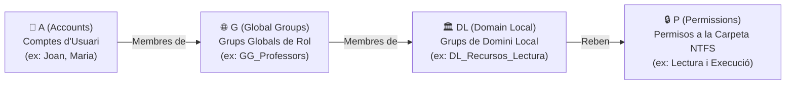

# 📘 UD3 — Administració i Gestió d'Usuaris, Grups i Perfils

La **Unitat Didàctica 3** aprofundeix en el cicle de vida de les identitats digitals corporatives: la creació de comptes d'usuari i màquina, l'estratègia professional de jerarquia de grups mitjançant la metodologia **AGDLP**, i la configuració de **perfils mòbils** i carpetes d'inici per garantir que l'alumnat i el professorat disposen dels seus documents en qualsevol ordinador del centre.

---

## 🛡️ La Regla d'Or de l'Assignació de Permisos: Metodologia AGDLP

Microsoft recomana formalment **no assignar mai permisos directament a comptes d'usuari individuals**. En compte d'això, s'aplica l'estratègia d'encapsulament en capes coneguda com a **AGDLP**:



### 🔍 Significat de cada lletra en la cadena AGDLP:
1. **A (*Accounts*):** Els comptes d'usuari del directori.
2. **G (*Global Groups*):** Els usuaris s'agrupen segons la seua **funció laboral o acadèmica** (ex: `GG_Alumnes_SMX1`, `GG_Professors_Informatica`). Tenen àmbit Global.
3. **DL (*Domain Local Groups*):** Es creen grups locals de domini específics per a cada **recurs i nivell d'accés** (ex: `DL_Avaluacions_Modificar`, `DL_Avaluacions_Lectura`).
4. **P (*Permissions*):** Els permisos NTFS a la carpeta compartida del disc s'assignen **única i exclusivament al Grup de Domini Local (DL)**.

*Benefici clau:* Quan s'incorpora un professor nou al centre, només cal afegir-lo al grup global `GG_Professors`. Automàticament heretarà els centenars de carpetes i permisos assignats a aquest rol sense haver de tocar cap carpeta de disc!

---

## 🚀 Creació Massiva d'Usuaris amb PowerShell des de fitxer CSV

En centres educatius i grans empreses, crear usuaris un a un amb ratolí és inviable. Els tècnics utilitzen scripts d'automatització:

### Contingut del fitxer `alumnes.csv`:
```csv
Nom,Cognoms,SamAccountName,OU,Contrasenya
Carles,Perez Navarro,carles.perez,"OU=Alumnes,DC=smx,DC=local",Alumne2024!
Laura,Gomis Marti,laura.gomis,"OU=Alumnes,DC=smx,DC=local",Alumne2024!
```

### Script de creació automàtica:
```powershell
Import-Csv -Path "C:\Scripts\alumnes.csv" -Encoding UTF8 | ForEach-Object {
    $PasswordSecure = ConvertTo-SecureString $_.Contrasenya -AsPlainText -Force
    New-ADUser `
        -Name "$($_.Nom) $($_.Cognoms)" `
        -GivenName $_.Nom `
        -Surname $_.Cognoms `
        -SamAccountName $_.SamAccountName `
        -UserPrincipalName "$($_.SamAccountName)@smx.local" `
        -Path $_.OU `
        -AccountPassword $PasswordSecure `
        -Enabled $true `
        -ChangePasswordAtLogon $true
    Write-Host "Usuari $($_.SamAccountName) creat amb èxit!" -ForegroundColor Green
}
```

---

## 🎒 Perfils d'Usuari: Locals, Mòbils i Obligatoris

1. **Perfil Local (*Local Profile*):**
   - El perfil complet (Escriptori, Documents, Baixades, claus de registre `NTUSER.DAT`) s'allotja únicament al disc dur local de la màquina client (`C:\Users\nom_usuari`). Si l'alumne canvia d'aula o de taula, no té cap accés als seus fitxers locals anteriors.
2. **Perfil Mòbil (*Roaming Profile*):**
   - La carpeta de perfil s'allotja a un recurs compartit del servidor (`\\DC1\Perfils$\%username%`).
   - En iniciar sessió, el perfil es descarrega a la màquina client. En tancar sessió, tots els canvis es sincronitzen de tornada al servidor.
3. **Perfil Obligatori (*Mandatory Profile*):**
   - Un perfil mòbil de només lectura on el fitxer de registre es reanomena de `NTUSER.DAT` a **`NTUSER.MAN`**. Qualsevol canvi estètic realitzat per l'alumne s'esborra automàticament en tancar la sessió.

---

## 📑 Continguts i Apartats de la Unitat

| Apartat | Títol | Descripció |
| :---: | :--- | :--- |
| **[3.2](./ut0302.md)** | **Gestió de Comptes d'Usuari** | Propietats de compte, UPN, caducitat, horaris d'inici de sessió permès. |
| **[3.4](./ut0304.md)** | **Grups: Tipus i Àmbits** | Seguretat vs Distribució; Àmbits Global, Domini Local i Universal. |
| **[3.7](./ut0307.md)** | **Perfils Mòbils i Redirecció de Carpetes** | Configuració de recursos ocults (`$`), quotes de disc i sincronització. |
| **[3.20](./ut0320.md)** | **Automatització i Scripts amb PowerShell** | Creació massiva des de CSV, bloquejos de comptes i auditories de seguretat. |
