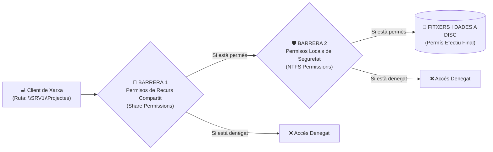

# 📘 UD4 — Gestió i Protecció de Recursos Compartits a la Xarxa

La **Unitat Didàctica 4** tracta un dels serveis essencials en qualsevol xarxa d'àrea local: la compartició de fitxers, carpetes i cues d'impressió mitjançant el protocol **SMB / CIFS** (*Server Message Block* sobre el port TCP **445**).

---

## 🔒 La Doble Barrera de Seguretat: Permisos Compartits vs Permisos NTFS

Quan un usuari accedeix a una carpeta a través de la xarxa mitjançant una ruta UNC (com `\\SRV1\Projectes`), el sistema operatiu avalua **dues capes de seguretat independents**:



---

## 🧮 Càlcul del Permís Efectiu (*Effective Permissions*)

Per determinar amb precisió què pot fer un usuari sobre un fitxer, el nucli del sistema aplica dues regles matemàtiques universals:

### Regla 1: Acumulació per pertinença a múltiples grups (Unió)
Si un usuari pertany a dos grups que tenen permisos concedits a la mateixa carpeta, els permisos **se sumen**:
- Grup *Alumnes* té permís de **Lectura**.
- Grup *Delegats* té permís d'**Escriptura**.
- Un alumne que és delegat tindrà permís de: **Lectura + Escriptura**.

### Regla 2: La Denegació Explícita sempre guanya (*Deny overrides Allow*)
Si en qualsevol grup o usuari s'ha marcat una casella de **Denegar (*Deny*)**, aquesta denegació té prioritat absoluta sobre qualsevol altra concessió de permís heretat o directe.

### Regla 3: El filtre més restrictiu entre Compartició i NTFS
Quan s'accedeix per xarxa, el resultat final és **la intersecció més restrictiva** d'ambdues barreres:

$$\text{Permís Efectiu en Xarxa} = \min(\text{Permís de Recurs Compartit}, \; \text{Permís NTFS})$$

#### Taula d'Exemples de Càlcul:

| Permís de Recurs Compartit | Permís NTFS Local | Permís Efectiu Accedint per Xarxa | Permís si l'usuari s'asseu físicament al Servidor |
| :---: | :---: | :---: | :---: |
| **Lectura** | **Control Total** | **Només Lectura** | Control Total (el permís de recurs no aplica localment) |
| **Canvi (Lectura+Escriure)**| **Només Lectura** | **Només Lectura** | Només Lectura |
| **Control Total** | **Modificar** | **Modificar** | Modificar |
| **Control Total** | **Denegar Accés** | **Accés Denegat** | Accés Denegat |

> [!TIP]
> **Bona Pràctica de Disseny Professional:**
> A la capa de **Recurs Compartit**, assigna sempre el permís de **Control Total a Tothom (*Everyone*)**, i gestiona tota la seguretat fina de carpetes i usuaris exclusivament mitjançant la capa de **Permisos NTFS**. Així evitaràs conflictes i confusions de càlcul!

---

## 🐧 Compartició amb Samba en Ubuntu Server (`/etc/samba/smb.conf`)

En entorns GNU/Linux, el servei que proporciona compatibilitat nativa SMB amb clients Windows és **Samba**:

```ini
# /etc/samba/smb.conf
[Departament_IT]
   comment = Carpeta Compartida d'Informatica
   path = /srv/samba/it
   browseable = yes
   read only = no
   valid users = @departament_it
   create mask = 0770
   directory mask = 0770
```

---

## 📑 Continguts i Apartats de la Unitat

| Apartat | Títol | Descripció |
| :---: | :--- | :--- |
| **[4.2](./ut0402.md)** | **Permisos i Drets d'Accés** | Llistes de control d'accés (DACL/SACL), herència i permisos efectius. |
| **[4.3](./ut0403.md)** | **Recursos del Sistema Compartits** | Rutes UNC, recursos ocults administratius (`C$`, `ADMIN$`, `IPC$`). |
| **[4.4](./ut0404.md)** | **Compartició de Recursos en Windows Server** | Creació d'usos compartits SMB, quotes de disc FSRM i còpies instantànies VSS. |
| **[4.5](./ut0405.md)** | **Compartició de Recursos en Ubuntu Server (Samba)** | Instal·lació de Samba, configuració de `smb.conf` i gestió de `smbpasswd`. |
| **[4.6](./ut0406.md)** | **Serveis d'Impressió en Xarxa** | Spooler d'impressió, servidors CUPS a Linux i cues compartides a Windows Server. |
