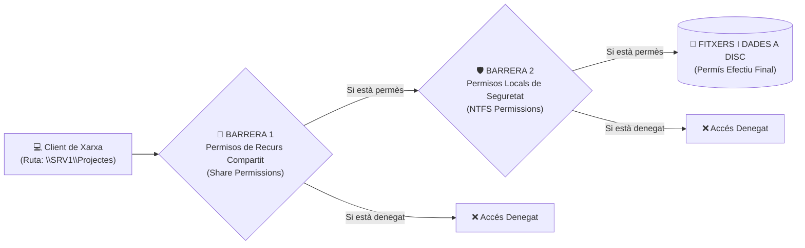

# 📘 UD4 — Gestió i Protecció de Recursos Compartits a la Xarxa

La **Unitat Didàctica 4** tracta un dels serveis essencials en qualsevol xarxa d'àrea local: la compartició de fitxers, carpetes i cues d'impressió mitjançant el protocol **SMB / CIFS** (*Server Message Block* sobre el port TCP **445**).

---

## 🔒 La Doble Barrera de Seguretat: Permisos Compartits vs Permisos NTFS

<div style="background: linear-gradient(135deg, #0f172a 0%, #1e293b 100%); border-radius: 12px; padding: 20px; margin: 25px 0; box-shadow: 0 10px 25px -5px rgba(0, 0, 0, 0.3); border: 1px solid #334155;">
  <div style="text-align: center; margin-bottom: 15px;">
    <span style="background: #38bdf8; color: #0f172a; font-weight: 700; font-size: 0.75rem; text-transform: uppercase; letter-spacing: 0.05em; padding: 4px 10px; border-radius: 9999px;">Infografia Tècnica</span>
    <h3 style="color: #f8fafc; margin: 10px 0 5px 0; font-size: 1.25rem;">Doble Barrera: Permisos de Recurs Compartit SMB vs Permisos Locals NTFS</h3>
    <p style="color: #94a3b8; font-size: 0.85rem; margin: 0;">Filtratge en dues fases, avaluació d'herència i càlcul matemàtic del permís efectiu</p>
  </div>
  <svg viewBox="0 0 860 300" width="100%" height="100%" xmlns="http://www.w3.org/2000/svg" style="display: block; font-family: system-ui, -apple-system, sans-serif;">
    <defs>
      <linearGradient id="smbClientGrad" x1="0%" y1="0%" x2="100%" y2="100%">
        <stop offset="0%" stop-color="#3b82f6" stop-opacity="0.25"/>
        <stop offset="100%" stop-color="#1d4ed8" stop-opacity="0.1"/>
      </linearGradient>
      <linearGradient id="smbShareGrad" x1="0%" y1="0%" x2="100%" y2="100%">
        <stop offset="0%" stop-color="#f59e0b" stop-opacity="0.25"/>
        <stop offset="100%" stop-color="#b45309" stop-opacity="0.1"/>
      </linearGradient>
      <linearGradient id="smbNtfsGrad" x1="0%" y1="0%" x2="100%" y2="100%">
        <stop offset="0%" stop-color="#8b5cf6" stop-opacity="0.25"/>
        <stop offset="100%" stop-color="#6d28d9" stop-opacity="0.1"/>
      </linearGradient>
      <linearGradient id="smbEffGrad" x1="0%" y1="0%" x2="100%" y2="100%">
        <stop offset="0%" stop-color="#10b981" stop-opacity="0.25"/>
        <stop offset="100%" stop-color="#047857" stop-opacity="0.1"/>
      </linearGradient>
    </defs>

    <!-- Bloc 1: Client de Xarxa -->
    <rect x="20" y="20" width="175" height="210" rx="8" fill="url(#smbClientGrad)" stroke="#38bdf8" stroke-width="1.5"/>
    <text x="107" y="45" fill="#38bdf8" font-size="11" font-weight="bold" text-anchor="middle">💻 ACCÉS PER XARXA</text>
    <text x="107" y="62" fill="#94a3b8" font-size="9.5" text-anchor="middle">Protocol SMB (Port 445)</text>
    <line x1="30" y1="73" x2="185" y2="73" stroke="#334155"/>
    <text x="32" y="95" fill="#cbd5e1" font-size="9.5">• Ruta UNC:</text>
    <text x="40" y="112" fill="#38bdf8" font-size="9" font-family="monospace">\\DC1\Projectes</text>
    <text x="32" y="135" fill="#cbd5e1" font-size="9.5">• Usuari autenticat:</text>
    <text x="40" y="152" fill="#cbd5e1" font-size="9">SMX\joan.garcia</text>
    <text x="32" y="175" fill="#94a3b8" font-size="9">Peticions de lectura,</text>
    <text x="32" y="190" fill="#94a3b8" font-size="9">escriptura o esborrat</text>
    <text x="107" y="218" fill="#38bdf8" font-size="9" text-anchor="middle" font-weight="bold">Client SMB Remot</text>

    <!-- Fletxa 1 -> Barrera 1 -->
    <path d="M 195 115 L 225 115" stroke="#38bdf8" stroke-width="2"/>
    <text x="210" y="105" fill="#38bdf8" font-size="8" text-anchor="middle">TCP 445</text>

    <!-- Bloc 2: Barrera 1 (Share Permissions) -->
    <rect x="230" y="20" width="190" height="210" rx="8" fill="url(#smbShareGrad)" stroke="#f59e0b" stroke-width="1.5"/>
    <text x="325" y="45" fill="#f59e0b" font-size="11" font-weight="bold" text-anchor="middle">🚪 BARRERA 1: COMPARTIT</text>
    <text x="325" y="62" fill="#94a3b8" font-size="9.5" text-anchor="middle">Share Permissions</text>
    <line x1="240" y1="73" x2="410" y2="73" stroke="#334155"/>
    <text x="242" y="93" fill="#cbd5e1" font-size="9.5">• Només aplica per xarxa</text>
    <text x="242" y="113" fill="#cbd5e1" font-size="9.5">• Opcions:</text>
    <text x="252" y="130" fill="#cbd5e1" font-size="9">  - Control Total</text>
    <text x="252" y="145" fill="#cbd5e1" font-size="9">  - Canviar (Change)</text>
    <text x="252" y="160" fill="#cbd5e1" font-size="9">  - Lectura (Read)</text>
    <text x="242" y="180" fill="#34d399" font-size="9.5" font-weight="bold">★ Recomanació:</text>
    <text x="252" y="195" fill="#34d399" font-size="9">Tothom ➔ Control Total</text>
    <text x="325" y="218" fill="#f59e0b" font-size="9" text-anchor="middle" font-weight="bold">Primer Filtre d'Accés</text>

    <!-- Fletxa Barrera 1 -> Barrera 2 -->
    <path d="M 420 115 L 450 115" stroke="#f59e0b" stroke-width="2"/>
    <text x="435" y="105" fill="#f59e0b" font-size="8" text-anchor="middle">Passa</text>

    <!-- Bloc 3: Barrera 2 (NTFS Permissions) -->
    <rect x="455" y="20" width="195" height="210" rx="8" fill="url(#smbNtfsGrad)" stroke="#c084fc" stroke-width="1.5"/>
    <text x="552" y="45" fill="#c084fc" font-size="11" font-weight="bold" text-anchor="middle">🛡️ BARRERA 2: NTFS LOCAL</text>
    <text x="552" y="62" fill="#94a3b8" font-size="9.5" text-anchor="middle">Security ACL (DACL)</text>
    <line x1="465" y1="73" x2="640" y2="73" stroke="#334155"/>
    <text x="468" y="93" fill="#cbd5e1" font-size="9.5">• Aplica per xarxa I local</text>
    <text x="468" y="113" fill="#cbd5e1" font-size="9.5">• Granularitat màxima:</text>
    <text x="478" y="130" fill="#cbd5e1" font-size="9">  - Modificar (Modify)</text>
    <text x="478" y="145" fill="#cbd5e1" font-size="9">  - Lectura i Execució</text>
    <text x="478" y="160" fill="#cbd5e1" font-size="9">  - Escriptura / Llistar</text>
    <text x="468" y="180" fill="#ef4444" font-size="9.5" font-weight="bold">⛔ Deny overrides Allow:</text>
    <text x="478" y="195" fill="#ef4444" font-size="9">Una denegació guanya tot</text>
    <text x="552" y="218" fill="#c084fc" font-size="9" text-anchor="middle" font-weight="bold">Segona Capa de Seguretat</text>

    <!-- Fletxa Barrera 2 -> Efectiu -->
    <path d="M 650 115 L 675 115" stroke="#c084fc" stroke-width="2"/>
    <text x="662" y="105" fill="#c084fc" font-size="8" text-anchor="middle">min()</text>

    <!-- Bloc 4: Resultat Final (Permís Efectiu) -->
    <rect x="680" y="20" width="160" height="210" rx="8" fill="url(#smbEffGrad)" stroke="#34d399" stroke-width="1.5"/>
    <text x="760" y="45" fill="#34d399" font-size="11" font-weight="bold" text-anchor="middle">🎯 PERMÍS EFECTIU</text>
    <text x="760" y="62" fill="#94a3b8" font-size="9.5" text-anchor="middle">Accés Final Concedit</text>
    <line x1="690" y1="73" x2="830" y2="73" stroke="#334155"/>
    <text x="692" y="100" fill="#cbd5e1" font-size="9.5">Fórmula Matemàtica:</text>
    <text x="692" y="125" fill="#34d399" font-size="10" font-weight="bold">min(Share, NTFS)</text>
    <text x="692" y="150" fill="#94a3b8" font-size="9">• Si Share = Lectura</text>
    <text x="692" y="165" fill="#94a3b8" font-size="9">  i NTFS = Control Total</text>
    <text x="692" y="180" fill="#38bdf8" font-size="9.5" font-weight="bold">➔ Resultat = Lectura!</text>
    <text x="760" y="218" fill="#34d399" font-size="9" text-anchor="middle" font-weight="bold">Operació permesa a disc</text>

    <!-- Peu informatiu -->
    <rect x="20" y="242" width="820" height="42" rx="6" fill="#1e293b" stroke="#334155"/>
    <text x="430" y="261" fill="#cbd5e1" font-size="10" text-anchor="middle">Regla d'Or Professional: <tspan fill="#f59e0b" font-weight="bold">Assigna Control Total a "Tothom" en la pestanya d'Ús Compartit,</tspan></text>
    <text x="430" y="275" fill="#94a3b8" font-size="9" text-anchor="middle">i gestiona tota la seguretat fina a la pestanya Seguretat (NTFS). Així s'eviten bloquejos creuats accidentals.</text>
  </svg>
</div>

Quan un usuari accedeix a una carpeta a través de la xarxa mitjançant una ruta UNC (com `\\SRV1\Projectes`), el sistema operatiu avalua **dues capes de seguretat independents**:



---

## 🧮 Càlcul del Permís Efectiu (*Effective Permissions*)

Per determinar amb precisió què pot fer un usuari sobre un fitxer, el nucli del sistema aplica dues regles matemàtiques universals:

### Regla 1: Acumulació per pertinença a múltiples grups (Unió)
Si un usuari pertany a dos grups que tenen permisos concedits a la mateixa carpeta, els permisos **se sumen**:
- Grup *Alumnes* té permís de **Lectura**.
- Grup *Delegats* té permís d'**Escriptura**.
- Un alumne que és delegat tindrà permís de: **Lectura + Escriptura**.

### Regla 2: La Denegació Explícita sempre guanya (*Deny overrides Allow*)
Si en qualsevol grup o usuari s'ha marcat una casella de **Denegar (*Deny*)**, aquesta denegació té prioritat absoluta sobre qualsevol altra concessió de permís heretat o directe.

### Regla 3: El filtre més restrictiu entre Compartició i NTFS
Quan s'accedeix per xarxa, el resultat final és **la intersecció més restrictiva** d'ambdues barreres:

$$\text{Permís Efectiu en Xarxa} = \min(\text{Permís de Recurs Compartit}, \; \text{Permís NTFS})$$

#### Taula d'Exemples de Càlcul:

| Permís de Recurs Compartit | Permís NTFS Local | Permís Efectiu Accedint per Xarxa | Permís si l'usuari s'asseu físicament al Servidor |
| :---: | :---: | :---: | :---: |
| **Lectura** | **Control Total** | **Només Lectura** | Control Total (el permís de recurs no aplica localment) |
| **Canvi (Lectura+Escriure)**| **Només Lectura** | **Només Lectura** | Només Lectura |
| **Control Total** | **Modificar** | **Modificar** | Modificar |
| **Control Total** | **Denegar Accés** | **Accés Denegat** | Accés Denegat |

> [!TIP]
> **Bona Pràctica de Disseny Professional:**
> A la capa de **Recurs Compartit**, assigna sempre el permís de **Control Total a Tothom (*Everyone*)**, i gestiona tota la seguretat fina de carpetes i usuaris exclusivament mitjançant la capa de **Permisos NTFS**. Així evitaràs conflictes i confusions de càlcul!

---

## 🐧 Compartició amb Samba en Ubuntu Server (`/etc/samba/smb.conf`)

En entorns GNU/Linux, el servei que proporciona compatibilitat nativa SMB amb clients Windows és **Samba**:

```ini
# /etc/samba/smb.conf
[Departament_IT]
   comment = Carpeta Compartida d'Informatica
   path = /srv/samba/it
   browseable = yes
   read only = no
   valid users = @departament_it
   create mask = 0770
   directory mask = 0770
```

---

## 📑 Continguts i Apartats de la Unitat

| Apartat | Títol | Descripció |
| :---: | :--- | :--- |
| **[4.2](./ut0402.md)** | **Permisos i Drets d'Accés** | Llistes de control d'accés (DACL/SACL), herència i permisos efectius. |
| **[4.3](./ut0403.md)** | **Recursos del Sistema Compartits** | Rutes UNC, recursos ocults administratius (`C$`, `ADMIN$`, `IPC$`). |
| **[4.4](./ut0404.md)** | **Compartició de Recursos en Windows Server** | Creació d'usos compartits SMB, quotes de disc FSRM i còpies instantànies VSS. |
| **[4.5](./ut0405.md)** | **Compartició de Recursos en Ubuntu Server (Samba)** | Instal·lació de Samba, configuració de `smb.conf` i gestió de `smbpasswd`. |
| **[4.6](./ut0406.md)** | **Serveis d'Impressió en Xarxa** | Spooler d'impressió, servidors CUPS a Linux i cues compartides a Windows Server. |

---

## 📝 Quadern d'Activitats Pràctiques i Reptes de Laboratori

### 📋 Bloc A: Fonaments, Matriu de Permisos i Diagnòstic SMB
1. **Resolució de la Matriu de Permisos Efectius:**
   - Donada la carpeta de xarxa `\\DC1\Departaments\Comptabilitat`, determina el permís efectiu per a cada situació:
     - *Cas 1:* Permís de recurs: **Lectura**. Permís NTFS: **Control Total**. Accés per xarxa. Quin és el permís final?
     - *Cas 2:* Permís de recurs: **Control Total**. Permís NTFS: **Modificar**. Accés per xarxa. Pot l'usuari eliminar un fitxer? Pot canviar els permisos NTFS de la carpeta?
     - *Cas 3:* L'usuari pertany al grup *Comptabilitat* (Lectura concedida a NTFS) i al grup *Becaris* (Escriptura denegada explícitament a NTFS). Quin accés tindrà en intentar desar un balanç?
     - *Cas 4:* L'usuari s'asseu físicament a la consola del servidor (inici de sessió local) i obre `D:\Departaments\Comptabilitat`. Quins permisos apliquen: els de recurs compartit o els NTFS?
2. **Recursos Ocults Administratius (`C$`, `ADMIN$`, `IPC$`):**
   - Què tenen en comú tots els recursos administratius creats automàticament per Windows Server?
   - Qui té dret a connectar-se a `\\DC1\C$` i per què un usuari estàndard rep un error d'accés denegat encara que sàpiga la ruta?
   - Quina comanda de consola permet visualitzar tots els recursos compartits actius al servidor local, inclosos els ocults?
3. **Còpies Instantànies de Volum (VSS - *Volume Shadow Copy*):**
   - Com ajuden les còpies instantànies a reduir la càrrega de treball del departament de suport tècnic quan un treballador esborra per error un document d'Excel compartit fa dues hores?

### 💻 Bloc B: Reptes Pràctics de Laboratori i Comandes

#### Repte 1: Creació de Recurs Compartit SMB amb PowerShell
1. Al servidor `DC1`, crea l'estructura de directoris per al mòdul de projectes:
   ```powershell
   New-Item -Path "D:\Recursos\Projectes" -ItemType Directory -Force
   ```
2. Publica la carpeta com a recurs compartit a la xarxa concedint Control Total a la capa de compartició:
   ```powershell
   New-SmbShare -Name "Projectes" -Path "D:\Recursos\Projectes" -FullAccess "Everyone" -Description "Carpeta de Projectes SMX"
   ```
3. Comprova que el recurs està actiu i escoltant peticions SMB:
   ```powershell
   Get-SmbShare -Name "Projectes"
   ```

#### Repte 2: Gestió Quirúrgica de Permisos NTFS amb `icacls`
1. Desactiva l'herència de permisos sobre `D:\Recursos\Projectes` i converteix els permisos heretats en explícits:
   ```cmd
   icacls "D:\Recursos\Projectes" /inheritance:d
   ```
2. Elimina el grup "Usuaris" locals per evitar accessos no desitjats:
   ```cmd
   icacls "D:\Recursos\Projectes" /remove "Users"
   ```
3. Concedeix permís de Modificar al grup de domini local `DL_Projectes_M` i permís de Lectura i Execució a `DL_Projectes_L`:
   ```cmd
   icacls "D:\Recursos\Projectes" /grant "SMX\DL_Projectes_M":(OI)(CI)M
   icacls "D:\Recursos\Projectes" /grant "SMX\DL_Projectes_L":(OI)(CI)RX
   ```
   *(Nota: `(OI)` significa Object Inherit i `(CI)` Container Inherit per a propagar a fitxers i subcarpetes).*

#### Repte 3: Desplegament de Servidor de Fitxers Samba en Ubuntu Server
1. Al servidor Ubuntu Server (`192.168.100.20`), instal·la el paquet del servei Samba:
   ```bash
   sudo apt update && sudo apt install samba smbclient -y
   ```
2. Crea la carpeta física i estableix permisos de grup:
   ```bash
   sudo mkdir -p /srv/samba/public
   sudo chmod -R 0775 /srv/samba/public
   sudo chown -R nobody:nogroup /srv/samba/public
   ```
3. Afegeix la definició del recurs al final de `/etc/samba/smb.conf`:
   ```ini
   [Public_SMX]
      comment = Recursos Publics del Cicle
      path = /srv/samba/public
      browseable = yes
      read only = no
      guest ok = yes
      create mask = 0664
      directory mask = 0775
   ```
4. Valida la sintaxi del fitxer de configuració i reinicia el dimoni:
   ```bash
   testparm
   sudo systemctl restart smbd
   ```
5. Des del client Windows, prem `Win + R` i accedeix a `\\192.168.100.20\Public_SMX`. Crea un document de text per verificar l'accés d'escriptura.

#### Repte 4: Auditoria de Connexions SMB Actives des de PowerShell
1. Des del client, obre diversos fitxers del recurs compartit `Projectes`.
2. Al servidor `DC1`, executa les comandes de diagnòstic en temps real:
   ```powershell
   # Veure sessions d'usuaris connectats per SMB
   Get-SmbSession | Select-Object ClientComputerName, ClientUserName, NumOpens

   # Veure quins fitxers estan oberts i bloquejats en aquest instant
   Get-SmbOpenFile | Select-Object FileId, Path, ClientUserName
   ```

### 🎯 Bloc C: Llista de Verificació i Rúbrica d'Avaluació

| Criteri d'Avaluació | Nivell Assolit (Excel·lent: 9-10) | Nivell Mitjà (Notable: 7-8) | Nivell Inicial (Aprovat: 5-6) |
| :--- | :--- | :--- | :--- |
| **Càlcul de Permisos Efectius i Doble Barrera** | Aplica amb exactitud la regla de la intersecció mínima, herència i prioritat de la denegació en qualsevol supòsit. | Resol casos senzills però dubta en escenaris amb herència desactivada o denegacions d'un dels grups. | No distingeix entre el permís del recurs compartit i el permís NTFS local. |
| **Administració de Recursos SMB i `icacls`** | Publica recursos i configura llistes DACL mitjançant `icacls` amb propagació `(OI)(CI)` impecable des de la consola. | Publica el recurs amb PowerShell però necessita l'entorn gràfic per canviar permisos de seguretat NTFS. | Obre els recursos amb permisos laxos o comet errors de sintaxi que bloquegen l'accés legítim. |
| **Interoperabilitat Samba a Linux** | Configura `/etc/samba/smb.conf`, valida amb `testparm`, gestiona usuaris `smbpasswd` i connecta des de Windows. | Configura el fitxer de Samba però oblida establir els permisos POSIX de carpeta (`chmod`/`chown`). | No aconsegueix iniciar el servei Samba o comet fallades de sintaxi que bloquegen el dimoni `smbd`. |
