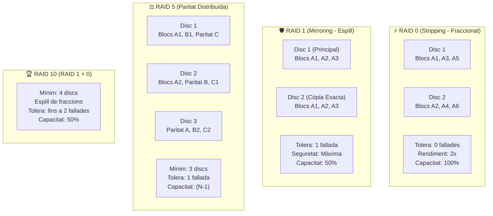

# 📘 UD5 — Monitorització de Sistemes en Xarxa i Sistemes d'Emmagatzematge RAID

La **Unitat Didàctica 5** se centra en dues àrees crítiques per a la continuïtat de negoci d'una infraestructura corporativa: la **monitorització proactiva** de recursos i auditories de seguretat, i la configuració de subsistemes d'emmagatzematge tolerant a fallades mitjançant **matrius redundants de discs independents (RAID)**.

---

## 💽 Arquitectura i Fórmules Matemàtiques dels Nivells RAID

Un sistema RAID combina múltiples unitats físiques de disc en una única unitat lògica reconeguda pel sistema operatiu, amb l'objectiu de millorar el rendiment, la tolerància a fallades o ambdues coses:



---

## 📐 Taula Comparativa i Càlcul de Capacitat Útil de RAID

Suposant $N$ discs idèntics de capacitat unitària $C$:

| Nivell RAID | Nom Tècnic | Discs Mínims | Discs que poden Fallar sense pèrdua | Capacitat Útil Reial | Eficiència d'Espai | Velocitat Lectura / Escriptura |
| :---: | :--- | :---: | :---: | :---: | :---: | :---: |
| **RAID 0** | Fraccionament (*Striping*) | 2 | **0** (si cau un disc, es perd tot) | $$N \times C$$ | **100%** | Molt Alta / Molt Alta |
| **RAID 1** | Espill (*Mirroring*) | 2 | **$N - 1$** (1 en un conjunt de 2) | $$1 \times C$$ | **50%** (per a 2 discs) | Alta (paral·lela) / Estàndard |
| **RAID 5** | Fraccionament amb Paritat Distribuïda | 3 | **1 disc** | $$(N - 1) \times C$$ | $$\frac{N - 1}{N}$$ | Molt Alta / Mitjana (càlcul de paritat XOR) |
| **RAID 6** | Doble Paritat Distribuïda | 4 | **2 discs** simultanis | $$(N - 2) \times C$$ | $$\frac{N - 2}{N}$$ | Molt Alta / Menor (càlcul doble XOR) |
| **RAID 10**| Matriu d'Espills Fraccionats (1+0) | 4 | **Fins a 1 disc per cada parell espill** | $$\frac{N}{2} \times C$$ | **50%** | Molt Alta / Molt Alta |

### 🧮 Exemple Pràctic de Càlcul per a Taller:
Tenim un servidor corporatiu amb **4 discs durs de 2 TB cadascun** ($N = 4, C = 2\text{ TB}$, total físic = 8 TB):
- En **RAID 0:** $4 \times 2 = \mathbf{8 \text{ TB}}$ útils (0 tolerància).
- En **RAID 1:** $1 \times 2 = \mathbf{2 \text{ TB}}$ útils.
- En **RAID 5:** $(4 - 1) \times 2 = \mathbf{6 \text{ TB}}$ útils (se sacrifica 1 disc per guardar paritat).
- En **RAID 6:** $(4 - 2) \times 2 = \mathbf{4 \text{ TB}}$ útils (se sacrifiquen 2 discs per a doble paritat).
- En **RAID 10:** $\frac{4}{2} \times 2 = \mathbf{4 \text{ TB}}$ útils (combina màxima velocitat i tolerància).

---

## 🔍 Monitorització de Servidors i Registres d'Auditoria

### 1. En Microsoft Windows Server:
- **Visor d'Esdeveniments (*Event Viewer* - `eventvwr.msc`):**
  - **Aplicació (*Application*):** Errors i advertències dels programes (SQL Server, Exchange, etc.).
  - **Seguretat (*Security*):** Auditoria d'inicis de sessió reeixits (Event ID 4624) i fallits per contrasenya incorrecta (Event ID 4625).
  - **Sistema (*System*):** Incidències de maquinari, discs, xarxa i controladors del nucli.
- **Monitor de Rendiment (*Performance Monitor* - `perfmon.msc`):** Seguiment en temps real de comptadors clau (temps de CPU `% Processor Time`, memòria disponible `Available MBytes`, cua de disc `Current Disk Queue Length`).

### 2. En GNU/Linux:
- **Eines de temps real:** `htop`, `iotop` (E/S de disc), `nload` o `iftop` (trànsit de xarxa per targeta).
- **Inspecció de registres del sistema:**
  ```bash
  # Seguir els registres del nucli en directe
  sudo journalctl -xe -f

  # Consultar intents d'accés fallits per SSH
  sudo grep "Failed password" /var/log/auth.log
  ```

---

## 📑 Continguts i Apartats de la Unitat

| Apartat | Títol | Descripció |
| :---: | :--- | :--- |
| **[5.2](./ut0502.md)** | **Programes de Monitorització de Servidors** | Mètriques de CPU, memòria, emmagatzematge i xarxa. |
| **[5.3](./ut0503.md)** | **Traçabilitat i Registres d'Esdeveniments** | Gestió de logs a Windows Server (`eventvwr`) i Linux (`journalctl` / `rsyslog`). |
| **[5.5](./ut0505.md)** | **Problemes de Rendiment i Sistemes RAID** | Configuració de matrius RAID per maquinari i programari (`mdadm`). |
| **[5.7](./ut0507.md)** | **Manteniment Preventiu i Automatització** | Alertes per correu electrònic i scripts de neteja periòdica. |
