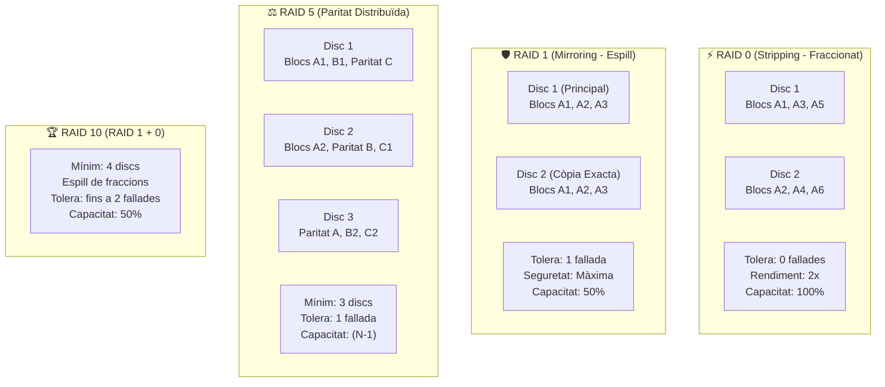

# 📘 UD5 — Monitorització de Sistemes en Xarxa i Sistemes d'Emmagatzematge RAID

La **Unitat Didàctica 5** se centra en dues àrees crítiques per a la continuïtat de negoci d'una infraestructura corporativa: la **monitorització proactiva** de recursos i auditories de seguretat, i la configuració de subsistemes d'emmagatzematge tolerant a fallades mitjançant **matrius redundants de discs independents (RAID)**.

---

## 💽 Arquitectura i Fórmules Matemàtiques dels Nivells RAID

<div style="background: linear-gradient(135deg, #0f172a 0%, #1e293b 100%); border-radius: 12px; padding: 20px; margin: 25px 0; box-shadow: 0 10px 25px -5px rgba(0, 0, 0, 0.3); border: 1px solid #334155;">
  <div style="text-align: center; margin-bottom: 15px;">
    <span style="background: #38bdf8; color: #0f172a; font-weight: 700; font-size: 0.75rem; text-transform: uppercase; letter-spacing: 0.05em; padding: 4px 10px; border-radius: 9999px;">Infografia Tècnica</span>
    <h3 style="color: #f8fafc; margin: 10px 0 5px 0; font-size: 1.25rem;">Matrius Redundants de Discs: RAID 0, 1, 5, 6, 10 i Càlcul de Capacitat Útil</h3>
    <p style="color: #94a3b8; font-size: 0.85rem; margin: 0;">Comparativa de tolerància a fallades, reconstrucció de paritat XOR i eficiència d'emmagatzematge</p>
  </div>
  <svg viewBox="0 0 860 300" width="100%" height="100%" xmlns="http://www.w3.org/2000/svg" style="display: block; font-family: system-ui, -apple-system, sans-serif;">
    <defs>
      <linearGradient id="raid0Grad" x1="0%" y1="0%" x2="100%" y2="100%">
        <stop offset="0%" stop-color="#ef4444" stop-opacity="0.25"/>
        <stop offset="100%" stop-color="#991b1b" stop-opacity="0.1"/>
      </linearGradient>
      <linearGradient id="raid1Grad" x1="0%" y1="0%" x2="100%" y2="100%">
        <stop offset="0%" stop-color="#3b82f6" stop-opacity="0.25"/>
        <stop offset="100%" stop-color="#1d4ed8" stop-opacity="0.1"/>
      </linearGradient>
      <linearGradient id="raid5Grad" x1="0%" y1="0%" x2="100%" y2="100%">
        <stop offset="0%" stop-color="#8b5cf6" stop-opacity="0.25"/>
        <stop offset="100%" stop-color="#6d28d9" stop-opacity="0.1"/>
      </linearGradient>
      <linearGradient id="raid10Grad" x1="0%" y1="0%" x2="100%" y2="100%">
        <stop offset="0%" stop-color="#10b981" stop-opacity="0.25"/>
        <stop offset="100%" stop-color="#047857" stop-opacity="0.1"/>
      </linearGradient>
    </defs>

    <!-- Bloc 1: RAID 0 -->
    <rect x="20" y="20" width="190" height="210" rx="8" fill="url(#raid0Grad)" stroke="#f87171" stroke-width="1.5"/>
    <text x="115" y="45" fill="#f87171" font-size="11" font-weight="bold" text-anchor="middle">⚡ RAID 0 (STRIPING)</text>
    <text x="115" y="62" fill="#94a3b8" font-size="9.5" text-anchor="middle">Fraccionament sense seguretat</text>
    <line x1="30" y1="73" x2="200" y2="73" stroke="#334155"/>
    <text x="32" y="93" fill="#cbd5e1" font-size="9.5">• Discs mínims: <tspan fill="#f87171" font-weight="bold">2 unitats</tspan></text>
    <text x="32" y="113" fill="#cbd5e1" font-size="9.5">• Capacitat: <tspan fill="#38bdf8" font-weight="bold">N × C (100%)</tspan></text>
    <text x="32" y="133" fill="#cbd5e1" font-size="9.5">• Tolerància a fallades:</text>
    <text x="42" y="150" fill="#ef4444" font-size="9.5" font-weight="bold">❌ 0 discs (Pèrdua total)</text>
    <text x="32" y="170" fill="#cbd5e1" font-size="9.5">• Velocitat: <tspan fill="#34d399">Molt Alta (Lect/Escr)</tspan></text>
    <text x="32" y="190" fill="#94a3b8" font-size="9">Ús: Renderització, temporal</text>
    <text x="115" y="218" fill="#f87171" font-size="9" text-anchor="middle" font-weight="bold">Zero Redundància</text>

    <!-- Bloc 2: RAID 1 -->
    <rect x="230" y="20" width="190" height="210" rx="8" fill="url(#raid1Grad)" stroke="#38bdf8" stroke-width="1.5"/>
    <text x="325" y="45" fill="#38bdf8" font-size="11" font-weight="bold" text-anchor="middle">🛡️ RAID 1 (MIRRORING)</text>
    <text x="325" y="62" fill="#94a3b8" font-size="9.5" text-anchor="middle">Espill idèntic en paral·lel</text>
    <line x1="240" y1="73" x2="410" y2="73" stroke="#334155"/>
    <text x="242" y="93" fill="#cbd5e1" font-size="9.5">• Discs mínims: <tspan fill="#38bdf8" font-weight="bold">2 unitats</tspan></text>
    <text x="242" y="113" fill="#cbd5e1" font-size="9.5">• Capacitat: <tspan fill="#f59e0b" font-weight="bold">1 × C (50%)</tspan></text>
    <text x="242" y="133" fill="#cbd5e1" font-size="9.5">• Tolerància a fallades:</text>
    <text x="252" y="150" fill="#34d399" font-size="9.5" font-weight="bold">✅ 1 disc de cada parella</text>
    <text x="242" y="170" fill="#cbd5e1" font-size="9.5">• Velocitat: <tspan fill="#34d399">Lectura 2x</tspan> / Escr normal</text>
    <text x="242" y="190" fill="#94a3b8" font-size="9">Ús: Disc de SO i arrencada</text>
    <text x="325" y="218" fill="#38bdf8" font-size="9" text-anchor="middle" font-weight="bold">Màxima Simplicitat</text>

    <!-- Bloc 3: RAID 5 -->
    <rect x="440" y="20" width="195" height="210" rx="8" fill="url(#raid5Grad)" stroke="#c084fc" stroke-width="1.5"/>
    <text x="537" y="45" fill="#c084fc" font-size="11" font-weight="bold" text-anchor="middle">⚖️ RAID 5 (PARITAT)</text>
    <text x="537" y="62" fill="#94a3b8" font-size="9.5" text-anchor="middle">Paritat XOR Distribuïda</text>
    <line x1="450" y1="73" x2="625" y2="73" stroke="#334155"/>
    <text x="452" y="93" fill="#cbd5e1" font-size="9.5">• Discs mínims: <tspan fill="#c084fc" font-weight="bold">3 unitats</tspan></text>
    <text x="452" y="113" fill="#cbd5e1" font-size="9.5">• Capacitat: <tspan fill="#34d399" font-weight="bold">(N - 1) × C</tspan></text>
    <text x="452" y="133" fill="#cbd5e1" font-size="9.5">• Tolerància a fallades:</text>
    <text x="462" y="150" fill="#34d399" font-size="9.5" font-weight="bold">✅ 1 disc qualsevol</text>
    <text x="452" y="170" fill="#cbd5e1" font-size="9.5">• Reconstrucció: <tspan fill="#f59e0b">Càlcul XOR</tspan></text>
    <text x="452" y="190" fill="#94a3b8" font-size="9">Ús: Servidors de fitxers generals</text>
    <text x="537" y="218" fill="#c084fc" font-size="9" text-anchor="middle" font-weight="bold">Equilibri Cost / Capacitat</text>

    <!-- Bloc 4: RAID 10 -->
    <rect x="655" y="20" width="185" height="210" rx="8" fill="url(#raid10Grad)" stroke="#34d399" stroke-width="1.5"/>
    <text x="747" y="45" fill="#34d399" font-size="11" font-weight="bold" text-anchor="middle">🏆 RAID 10 (1+0)</text>
    <text x="747" y="62" fill="#94a3b8" font-size="9.5" text-anchor="middle">Espill fraccionat corporatiu</text>
    <line x1="665" y1="73" x2="830" y2="73" stroke="#334155"/>
    <text x="667" y="93" fill="#cbd5e1" font-size="9.5">• Discs mínims: <tspan fill="#34d399" font-weight="bold">4 unitats (parells)</tspan></text>
    <text x="667" y="113" fill="#cbd5e1" font-size="9.5">• Capacitat: <tspan fill="#f59e0b" font-weight="bold">(N / 2) × C (50%)</tspan></text>
    <text x="667" y="133" fill="#cbd5e1" font-size="9.5">• Tolerància a fallades:</text>
    <text x="677" y="150" fill="#34d399" font-size="9.5" font-weight="bold">✅ Fins a 2 discs (1 per parella)</text>
    <text x="667" y="170" fill="#cbd5e1" font-size="9.5">• Velocitat: <tspan fill="#34d399">Màxima E/S i Lectura</tspan></text>
    <text x="667" y="190" fill="#94a3b8" font-size="9">Ús: Bases de dades (SQL, ERP)</text>
    <text x="747" y="218" fill="#34d399" font-size="9" text-anchor="middle" font-weight="bold">Rendiment Enterprise</text>

    <!-- Peu informatiu -->
    <rect x="20" y="242" width="820" height="42" rx="6" fill="#1e293b" stroke="#334155"/>
    <text x="430" y="261" fill="#cbd5e1" font-size="10" text-anchor="middle">Mecanisme de Paritat RAID 5: <tspan fill="#c084fc" font-weight="bold">Paritat = D1 ⊕ D2 ⊕ D3.</tspan> Si cau D2, es recupera amb <tspan fill="#34d399" font-weight="bold">D2 = D1 ⊕ D3 ⊕ Paritat.</tspan></text>
    <text x="430" y="275" fill="#94a3b8" font-size="9" text-anchor="middle">Un disc de recanvi en calent (Hot-Spare) inicia la reconstrucció de manera autònoma sense apagar el servidor.</text>
  </svg>
</div>

Un sistema RAID combina múltiples unitats físiques de disc en una única unitat lògica reconeguda pel sistema operatiu, amb l'objectiu de millorar el rendiment, la tolerància a fallades o ambdues coses:



---

## 📐 Taula Comparativa i Càlcul de Capacitat Útil de RAID

Suposant $N$ discs idèntics de capacitat unitària $C$:

| Nivell RAID | Nom Tècnic | Discs Mínims | Discs que poden Fallar sense pèrdua | Capacitat Útil Reial | Eficiència d'Espai | Velocitat Lectura / Escriptura |
| :---: | :--- | :---: | :---: | :---: | :---: | :---: |
| **RAID 0** | Fraccionament (*Striping*) | 2 | **0** (si cau un disc, es perd tot) | $$N \times C$$ | **100%** | Molt Alta / Molt Alta |
| **RAID 1** | Espill (*Mirroring*) | 2 | **$N - 1$** (1 en un conjunt de 2) | $$1 \times C$$ | **50%** (per a 2 discs) | Alta (paral·lela) / Estàndard |
| **RAID 5** | Fraccionament amb Paritat Distribuïda | 3 | **1 disc** | $$(N - 1) \times C$$ | $$\frac{N - 1}{N}$$ | Molt Alta / Mitjana (càlcul de paritat XOR) |
| **RAID 6** | Doble Paritat Distribuïda | 4 | **2 discs** simultanis | $$(N - 2) \times C$$ | $$\frac{N - 2}{N}$$ | Molt Alta / Menor (càlcul doble XOR) |
| **RAID 10**| Matriu d'Espills Fraccionats (1+0) | 4 | **Fins a 1 disc per cada parell espill** | $$\frac{N}{2} \times C$$ | **50%** | Molt Alta / Molt Alta |

### 🧮 Exemple Pràctic de Càlcul per a Taller:
Tenim un servidor corporatiu amb **4 discs durs de 2 TB cadascun** ($N = 4, C = 2\text{ TB}$, total físic = 8 TB):
- En **RAID 0:** $4 \times 2 = \mathbf{8 \text{ TB}}$ útils (0 tolerància).
- En **RAID 1:** $1 \times 2 = \mathbf{2 \text{ TB}}$ útils.
- En **RAID 5:** $(4 - 1) \times 2 = \mathbf{6 \text{ TB}}$ útils (se sacrifica 1 disc per guardar paritat).
- En **RAID 6:** $(4 - 2) \times 2 = \mathbf{4 \text{ TB}}$ útils (se sacrifiquen 2 discs per a doble paritat).
- En **RAID 10:** $\frac{4}{2} \times 2 = \mathbf{4 \text{ TB}}$ útils (combina màxima velocitat i tolerància).

---

## 🔍 Monitorització de Servidors i Registres d'Auditoria

### 1. En Microsoft Windows Server:
- **Visor d'Esdeveniments (*Event Viewer* - `eventvwr.msc`):**
  - **Aplicació (*Application*):** Errors i advertències dels programes (SQL Server, Exchange, etc.).
  - **Seguretat (*Security*):** Auditoria d'inicis de sessió reeixits (Event ID 4624) i fallits per contrasenya incorrecta (Event ID 4625).
  - **Sistema (*System*):** Incidències de maquinari, discs, xarxa i controladors del nucli.
- **Monitor de Rendiment (*Performance Monitor* - `perfmon.msc`):** Seguiment en temps real de comptadors clau (temps de CPU `% Processor Time`, memòria disponible `Available MBytes`, cua de disc `Current Disk Queue Length`).

### 2. En GNU/Linux:
- **Eines de temps real:** `htop`, `iotop` (E/S de disc), `nload` o `iftop` (trànsit de xarxa per targeta).
- **Inspecció de registres del sistema:**
  ```bash
  # Seguir els registres del nucli en directe
  sudo journalctl -xe -f

  # Consultar intents d'accés fallits per SSH
  sudo grep "Failed password" /var/log/auth.log
  ```

---

## 📑 Continguts i Apartats de la Unitat

| Apartat | Títol | Descripció |
| :---: | :--- | :--- |
| **[5.2](./ut0502.md)** | **Programes de Monitorització de Servidors** | Mètriques de CPU, memòria, emmagatzematge i xarxa. |
| **[5.3](./ut0503.md)** | **Traçabilitat i Registres d'Esdeveniments** | Gestió de logs a Windows Server (`eventvwr`) i Linux (`journalctl` / `rsyslog`). |
| **[5.5](./ut0505.md)** | **Problemes de Rendiment i Sistemes RAID** | Configuració de matrius RAID per maquinari i programari (`mdadm`). |
| **[5.7](./ut0507.md)** | **Manteniment Preventiu i Automatització** | Alertes per correu electrònic i scripts de neteja periòdica. |

---

## 📝 Quadern d'Activitats Pràctiques i Reptes de Laboratori

### 📋 Bloc A: Fórmules Matemàtiques de RAID i Diagnòstic de Fallades
1. **Exercici de Dimensionament i Càlcul de Matrius:**
   - Un servidor de base de dades disposa de **6 discs durs SAS de $4\text{ TB}$ cadascun** ($N = 6, C = 4\text{ TB}$, capacitat bruta = $24\text{ TB}$).
   - Calcula detalladament per a cada configuració:
     - **RAID 0:** Capacitat útil total i quants discs poden fallar sense provocar pèrdua de dades.
     - **RAID 1 (amb 2 discs):** Capacitat útil i percentatge d'eficiència d'espai.
     - **RAID 5:** Capacitat útil total i eficiència percentual: $\frac{N-1}{N} \times 100$.
     - **RAID 6:** Capacitat útil total i nombre de fallades simultànies que pot suportar.
     - **RAID 10:** Capacitat útil total i per què ofereix millor rendiment d'escriptura que un RAID 5 o RAID 6.
2. **Matemàtica de la Paritat XOR:**
   - Suposa una matriu RAID 5 de 3 discs amb els següents blocs binaris de dades:
     - Bloc Disc 1 ($D_1$): `1100 1010`
     - Bloc Disc 2 ($D_2$): `1010 1100`
   - Calcula el bloc de paritat que es gravarà al Disc 3: $P = D_1 \oplus D_2$.
   - Si el Disc 1 pateix una fallada mecànica total, demostra com el controlador reconstrueix les dades perdudes calculant: $D_1 = D_2 \oplus P$.
3. **RAID per Maquinari vs RAID per Programari:**
   - Què és una controladora RAID dedicada (*Hardware RAID Controller*) amb memòria cau protegida per bateria (BBU / Flash-Backed Write Cache)?
   - Què passa amb les dades que estaven a la memòria cau d'escriptura si hi ha un tall sobtat de corrent al CPD i la controladora no té bateria?

### 💻 Bloc B: Reptes Pràctics de Laboratori i Comandes

#### Repte 1: Creació d'un Espai d'Emmagatzematge en Espill (RAID 1) a Windows Server
1. Afegeix dos discs durs virtuals de $10\text{ GB}$ a la màquina virtual de Windows Server.
2. Obre PowerShell com a administrador i obté els discs sense inicialitzar:
   ```powershell
   Get-Disk | Where-Object PartitionStyle -Eq "RAW"
   ```
3. Crea un nou grup d'emmagatzematge (*Storage Pool*) amb els dos discs:
   ```powershell
   $Discs = Get-PhysicalDisk -CanPool $True
   New-StoragePool -FriendlyName "Pool_Laboratori" -StorageSubsystemFriendlyName "Windows Storage*" -PhysicalDisks $Discs
   ```
4. Crea un disc virtual en espill (*Mirror*) de tipus RAID 1 i dóna-li format NTFS:
   ```powershell
   New-VirtualDisk -StoragePoolFriendlyName "Pool_Laboratori" -FriendlyName "Disc_Mirror" -ResiliencySettingName Mirror -UseMaximumSize
   Initialize-Disk -VirtualDisk (Get-VirtualDisk -FriendlyName "Disc_Mirror") -PartitionStyle GPT -PassThru | New-Partition -DriveLetter "R" -UseMaximumSize | Format-Volume -FileSystem NTFS -NewFileSystemLabel "Dades_Segures"
   ```

#### Repte 2: Creació d'una Matriu RAID 5 amb `mdadm` a Ubuntu Server
1. Afegeix tres discs virtuals de $5\text{ GB}$ a la màquina Ubuntu Server (`/dev/sdb`, `/dev/sdc`, `/dev/sdd`).
2. Instal·la la utilitat d'administració de matrius per programari:
   ```bash
   sudo apt update && sudo apt install mdadm -y
   ```
3. Crea la matriu RAID 5 distribuïda:
   ```bash
   sudo mdadm --create /dev/md0 --level=5 --raid-devices=3 /dev/sdb /dev/sdc /dev/sdd
   ```
4. Comprova l'estat i el progrés de sincronització de la matriu en temps real:
   ```bash
   cat /proc/mdstat
   sudo mdadm --detail /dev/md0
   ```
5. Dona format i munta la unitat a `/mnt/dades_raid`:
   ```bash
   sudo mkfs.ext4 /dev/md0
   sudo mkdir -p /mnt/dades_raid
   sudo mount /dev/md0 /mnt/dades_raid
   ```

#### Repte 3: Simulació de Fallada en Calent i Reconstrucció amb Hot-Spare
1. Crea un fitxer de prova a la matriu: `echo "Dades ultra confidencials" | sudo tee /mnt/dades_raid/secret.txt`.
2. Simula una fallada mecànica sobtada al disc `/dev/sdb`:
   ```bash
   sudo mdadm --manage /dev/md0 --fail /dev/sdb
   ```
3. Comprova que la matriu passa a estat `degraded` però el fitxer continua accessible i intacte:
   ```bash
   cat /mnt/dades_raid/secret.txt
   cat /proc/mdstat
   ```
4. Retira el disc avariat i insereix una nova unitat de recanvi (`/dev/sde`):
   ```bash
   sudo mdadm --manage /dev/md0 --remove /dev/sdb
   sudo mdadm --manage /dev/md0 --add /dev/sde
   ```
5. Observa com s'inicia automàticament la reconstrucció (*rebuilding*) de la paritat: `watch -n 1 cat /proc/mdstat`.

#### Repte 4: Auditoria d'Intents d'Accés Fallits amb PowerShell
1. Consulta al registre de Seguretat de Windows els últims 10 esdeveniments d'inici de sessió fallit (**Event ID 4625**):
   ```powershell
   Get-WinEvent -FilterHashtable @{LogName='Security'; Id=4625} -MaxEvents 10 | Format-Table TimeCreated, Id, Message -Wrap
   ```
2. Monitoritza els comptadors de disc en temps real amb Performance Monitor per detectar cues d'espera excessives:
   ```powershell
   Get-Counter -Counter "\PhysicalDisk(_Total)\Current Disk Queue Length" -Continuous
   ```

### 🎯 Bloc C: Llista de Verificació i Rúbrica d'Avaluació

| Criteri d'Avaluació | Nivell Assolit (Excel·lent: 9-10) | Nivell Mitjà (Notable: 7-8) | Nivell Inicial (Aprovat: 5-6) |
| :--- | :--- | :--- | :--- |
| **Càlcul Matemàtic de RAID i Tolerància** | Calcula amb exactitud capacitats útils, eficiències percentuals i opera amb la paritat XOR sense dubtes. | Calcula RAID 0 i 1 correctament però comet errors de càlcul en RAID 5 o RAID 6. | No sap calcular la capacitat d'una matriu o confon RAID 0 amb un sistema tolerant a fallades. |
| **Desplegament de Matrius per Programari** | Desplega matrius RAID 1 i RAID 5 des de terminal (`Storage Spaces` i `mdadm`), documentant cada paràmetre. | Desplega la matriu mitjançant GUI però es bloqueja a la consola o oblida fer permanent el muntatge. | Incapaç de crear la matriu o confon la inicialització del disc amb el format de fitxers. |
| **Simulació de Fallades i Diagnòstic de Logs** | Provoca una fallada simulada, comprova l'estat degradat, afegeix un disc de recanvi i analitza els registres d'auditoria. | Detecta que el disc ha fallat però no sap com procedir a la substitució en calent ni com veure els logs. | Apaga el servidor davant una fallada de disc en compte de gestionar el recanvi o perd les dades. |
