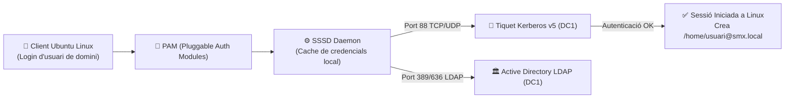

# 📘 UD6 — Integració de Sistemes Operatius Lliures i Propietaris

La **Unitat Didàctica 6** conclou el temari de Sistemes Operatius en Xarxa abordant l'escenari més habitual en el món laboral real: els **entorns de xarxa heterogenis**, on conviuen servidors d'infraestructura Microsoft Windows Server amb estacions de treball o servidors de desenvolupament GNU/Linux.

---

## 🔄 El Repte de la Interoperabilitat Heterogènia

En una infraestructura moderna:
1. Els usuaris, equips i credencials corporatives estan centralitzats a l'**Active Directory (Windows Server)**.
2. Molts departaments tècnics, aules de programació o servidors web utilitzen **Ubuntu o Debian GNU/Linux**.
3. **Objectiu tècnic:** Aconseguir que un usuari del domini (com `joan.garcia@smx.local`) puga seure davant d'un ordinador amb Ubuntu Linux, introduir la seua contrasenya corporativa i iniciar sessió amb èxit, creant automàticament la seua carpeta d'inici `/home/joan.garcia@smx.local`.

---

## 🛠️ La Pila Tecnològica d'Integració: `realmd` + `sssd` + Kerberos

<div style="background: linear-gradient(135deg, #0f172a 0%, #1e293b 100%); border-radius: 12px; padding: 20px; margin: 25px 0; box-shadow: 0 10px 25px -5px rgba(0, 0, 0, 0.3); border: 1px solid #334155;">
  <div style="text-align: center; margin-bottom: 15px;">
    <span style="background: #38bdf8; color: #0f172a; font-weight: 700; font-size: 0.75rem; text-transform: uppercase; letter-spacing: 0.05em; padding: 4px 10px; border-radius: 9999px;">Infografia Tècnica</span>
    <h3 style="color: #f8fafc; margin: 10px 0 5px 0; font-size: 1.25rem;">Interoperabilitat Linux en Active Directory: realmd + sssd + Kerberos + Samba</h3>
    <p style="color: #94a3b8; font-size: 0.85rem; margin: 0;">Arquitectura d'autenticació creuada, mòduls PAM i integració de sistemes de fitxers CIFS</p>
  </div>
  <svg viewBox="0 0 860 300" width="100%" height="100%" xmlns="http://www.w3.org/2000/svg" style="display: block; font-family: system-ui, -apple-system, sans-serif;">
    <defs>
      <linearGradient id="linClientGrad" x1="0%" y1="0%" x2="100%" y2="100%">
        <stop offset="0%" stop-color="#f59e0b" stop-opacity="0.25"/>
        <stop offset="100%" stop-color="#b45309" stop-opacity="0.1"/>
      </linearGradient>
      <linearGradient id="linPamGrad" x1="0%" y1="0%" x2="100%" y2="100%">
        <stop offset="0%" stop-color="#3b82f6" stop-opacity="0.25"/>
        <stop offset="100%" stop-color="#1d4ed8" stop-opacity="0.1"/>
      </linearGradient>
      <linearGradient id="linDcGrad" x1="0%" y1="0%" x2="100%" y2="100%">
        <stop offset="0%" stop-color="#8b5cf6" stop-opacity="0.25"/>
        <stop offset="100%" stop-color="#6d28d9" stop-opacity="0.1"/>
      </linearGradient>
      <linearGradient id="linHomeGrad" x1="0%" y1="0%" x2="100%" y2="100%">
        <stop offset="0%" stop-color="#10b981" stop-opacity="0.25"/>
        <stop offset="100%" stop-color="#047857" stop-opacity="0.1"/>
      </linearGradient>
    </defs>

    <!-- Bloc 1: Client Ubuntu -->
    <rect x="20" y="20" width="185" height="210" rx="8" fill="url(#linClientGrad)" stroke="#f59e0b" stroke-width="1.5"/>
    <text x="112" y="45" fill="#f59e0b" font-size="11" font-weight="bold" text-anchor="middle">🐧 CLIENT UBUNTU</text>
    <text x="112" y="62" fill="#94a3b8" font-size="9.5" text-anchor="middle">Estació de Treball Linux</text>
    <line x1="30" y1="73" x2="195" y2="73" stroke="#334155"/>
    <text x="32" y="93" fill="#cbd5e1" font-size="9.5">• Login de Domini:</text>
    <text x="40" y="110" fill="#f59e0b" font-size="9" font-family="monospace">usuari@smx.local</text>
    <text x="32" y="130" fill="#cbd5e1" font-size="9.5">• Eina d'unió:</text>
    <text x="40" y="147" fill="#38bdf8" font-size="9" font-family="monospace">realm join smx.local</text>
    <text x="32" y="170" fill="#cbd5e1" font-size="9.5">• Resolució DNS cap al DC:</text>
    <text x="40" y="187" fill="#cbd5e1" font-size="9">nameserver 192.168.100.10</text>
    <text x="112" y="218" fill="#f59e0b" font-size="9" text-anchor="middle" font-weight="bold">Inici de Sessió GDM</text>

    <!-- Fletxa 1 -> 2 -->
    <path d="M 205 115 L 230 115" stroke="#f59e0b" stroke-width="2"/>
    <text x="218" y="105" fill="#f59e0b" font-size="8" text-anchor="middle">Login</text>

    <!-- Bloc 2: Pila PAM & SSSD -->
    <rect x="235" y="20" width="195" height="210" rx="8" fill="url(#linPamGrad)" stroke="#38bdf8" stroke-width="1.5"/>
    <text x="332" y="45" fill="#38bdf8" font-size="11" font-weight="bold" text-anchor="middle">⚙️ PAM &amp; SSSD DAEMON</text>
    <text x="332" y="62" fill="#94a3b8" font-size="9.5" text-anchor="middle">Nucli d'Identitat de Linux</text>
    <line x1="245" y1="73" x2="420" y2="73" stroke="#334155"/>
    <text x="248" y="93" fill="#cbd5e1" font-size="9.5">• <tspan fill="#38bdf8" font-weight="bold">SSSD:</tspan> /etc/sssd/sssd.conf</text>
    <text x="248" y="113" fill="#cbd5e1" font-size="9.5">• <tspan fill="#34d399" font-weight="bold">Cache Offline:</tspan> Permet login</text>
    <text x="258" y="128" fill="#94a3b8" font-size="9">sense xarxa (portàtils)</text>
    <text x="248" y="148" fill="#cbd5e1" font-size="9.5">• <tspan fill="#38bdf8" font-weight="bold">pam_mkhomedir.so:</tspan></text>
    <text x="258" y="165" fill="#cbd5e1" font-size="9">Crea la carpeta home al vol</text>
    <text x="248" y="188" fill="#cbd5e1" font-size="9.5">• <tspan fill="#c084fc" font-weight="bold">Mapatge UID/GID</tspan> automàtic</text>
    <text x="332" y="218" fill="#38bdf8" font-size="9" text-anchor="middle" font-weight="bold">Intermediari Local</text>

    <!-- Fletxa 2 -> 3 -->
    <path d="M 430 115 L 455 115" stroke="#38bdf8" stroke-width="2"/>
    <text x="442" y="105" fill="#38bdf8" font-size="8" text-anchor="middle">Auth</text>

    <!-- Bloc 3: DC Windows Server -->
    <rect x="460" y="20" width="190" height="210" rx="8" fill="url(#linDcGrad)" stroke="#c084fc" stroke-width="1.5"/>
    <text x="555" y="45" fill="#c084fc" font-size="11" font-weight="bold" text-anchor="middle">🏛️ CONTROLADOR (DC1)</text>
    <text x="555" y="62" fill="#94a3b8" font-size="9.5" text-anchor="middle">Windows Server 2022</text>
    <line x1="470" y1="73" x2="640" y2="73" stroke="#334155"/>
    <text x="472" y="93" fill="#cbd5e1" font-size="9.5">• <tspan fill="#c084fc" font-weight="bold">Kerberos v5 (TCP 88):</tspan></text>
    <text x="482" y="110" fill="#94a3b8" font-size="9">Emissió de tiquet TGT</text>
    <text x="472" y="130" fill="#cbd5e1" font-size="9.5">• <tspan fill="#38bdf8" font-weight="bold">LDAP (TCP 389/636):</tspan></text>
    <text x="482" y="147" fill="#94a3b8" font-size="9">Consulta grups i atributs</text>
    <text x="472" y="170" fill="#cbd5e1" font-size="9.5">• <tspan fill="#34d399" font-weight="bold">SMB (TCP 445):</tspan></text>
    <text x="482" y="187" fill="#94a3b8" font-size="9">Compartició de recursos</text>
    <text x="555" y="218" fill="#c084fc" font-size="9" text-anchor="middle" font-weight="bold">Proveïdor d'Identitat</text>

    <!-- Fletxa 3 -> 4 -->
    <path d="M 650 115 L 675 115" stroke="#c084fc" stroke-width="2"/>
    <text x="662" y="105" fill="#c084fc" font-size="8" text-anchor="middle">OK</text>

    <!-- Bloc 4: Resultat en Linux -->
    <rect x="680" y="20" width="160" height="210" rx="8" fill="url(#linHomeGrad)" stroke="#34d399" stroke-width="1.5"/>
    <text x="760" y="45" fill="#34d399" font-size="11" font-weight="bold" text-anchor="middle">📁 SESSIÓ ACTIVA</text>
    <text x="760" y="62" fill="#94a3b8" font-size="9.5" text-anchor="middle">Integració Transparent</text>
    <line x1="690" y1="73" x2="830" y2="73" stroke="#334155"/>
    <text x="692" y="93" fill="#cbd5e1" font-size="9.5">• Carpeta generada:</text>
    <text x="695" y="110" fill="#34d399" font-size="8.5" font-family="monospace">/home/joan.garcia@smx</text>
    <text x="692" y="130" fill="#cbd5e1" font-size="9.5">• Permisos POSIX: <tspan fill="#38bdf8">0700</tspan></text>
    <text x="692" y="150" fill="#cbd5e1" font-size="9.5">• Accés a recurs SMB:</text>
    <text x="695" y="167" fill="#f59e0b" font-size="8.5">/mnt/projectes (cifs)</text>
    <text x="692" y="190" fill="#34d399" font-size="9.5" font-weight="bold">Single Sign-On (SSO)</text>
    <text x="760" y="218" fill="#34d399" font-size="9" text-anchor="middle" font-weight="bold">Entorn Integrat</text>

    <!-- Peu informatiu -->
    <rect x="20" y="242" width="820" height="42" rx="6" fill="#1e293b" stroke="#334155"/>
    <text x="430" y="261" fill="#cbd5e1" font-size="10" text-anchor="middle">Pila Enterprise: <tspan fill="#38bdf8" font-weight="bold">realmd descobreix el domini automàticament via DNS SRV,</tspan> genera la configuració de sssd,</text>
    <text x="430" y="275" fill="#94a3b8" font-size="9" text-anchor="middle">i crea el compte de màquina a l'Active Directory amb una sola instrucció sense requerir configuracions complexes.</text>
  </svg>
</div>



---

## 📑 Continguts i Apartats de la Unitat

| Apartat | Títol | Descripció |
| :---: | :--- | :--- |
| **[6.2](./ut0602.md)** | **Recursos en Xarxa entre Sistemes Heterogenis** | Protocols de compatibilitat multiplataforma (SMBv3, NFSv4, CIFS). |
| **[6.3](./ut0603.md)** | **Serveis per a Compartir Recursos** | Servidors Samba i clients `smbclient` per a accés bidireccional. |
| **[6.4](./ut0604.md)** | **Integració d'Ubuntu en Domini Windows Server** | Unió automatitzada mitjançant `realmd`, `sssd` i creació automàtica de home. |

---

## 📝 Quadern d'Activitats Pràctiques i Reptes de Laboratori

### 📋 Bloc A: Fonaments d'Interoperabilitat Heterogènia i Protocols
1. **El paper del mòdul PAM (`pam_mkhomedir.so`):**
   - Què és la infraestructura PAM (*Pluggable Authentication Modules*) en sistemes Linux i quin paper té en el cicle d'inici de sessió?
   - Si un usuari corporatiu d'Active Directory (`joan.garcia@smx.local`) aconsegueix autenticar-se satisfactòriament a través de Kerberos però el mòdul `pam_mkhomedir.so` no està habilitat, quin error es trobarà l'usuari en entrar a l'entorn d'escriptori?
2. **Resiliència amb SSSD (*System Security Services Daemon*):**
   - Què és la memòria cau de credencials (*credential cache*) de SSSD?
   - Explica com permet SSSD que un professor o empleat que treballa amb un portàtil Ubuntu puga iniciar sessió a la seua màquina a casa seua, fins i tot estant completament desconnectat de la xarxa corporativa i sense accés al Controlador de Domini.
3. **Mapatge d'identitats UID/GID en entorns mixtes:**
   - A Windows Server, cada usuari i grup s'identifica mitjançant un SID (*Security Identifier*) com `S-1-5-21-...-1002`. En canvi, el nucli Linux requereix identificadors numèrics enters (*UID* per a l'usuari i *GID* per al grup).
   - Com tradueix SSSD els SIDs d'Active Directory a UIDs de Linux sense provocar col·lisions amb els usuaris locals del sistema (com `root:0` o l'usuari local estàndard `1000`)?

### 💻 Bloc B: Reptes Pràctics de Laboratori i Comandes

#### Repte 1: Descobriment del Domini i Instal·lació de la Pila d'Integració a Ubuntu Server
1. A la màquina Ubuntu Server (`192.168.100.20`), instal·la els paquets necessaris per a la integració amb Active Directory:
   ```bash
   sudo apt update && sudo apt install realmd sssd sssd-tools libnss-sss libpam-sss adcli samba-common-bin -y
   ```
2. Assegura't que el servidor DNS d'Ubuntu apunta al Controlador de Domini (`192.168.100.10`).
3. Comprova que `realmd` detecta el domini corporatiu `smx.local` automàticament a través de la xarxa:
   ```bash
   realm discover smx.local
   ```
4. Analitza l'eixida: verifica que reconeix el tipus de servidor com `kerberos` i el programari de directori com `active-directory`.

#### Repte 2: Unió del Servidor Linux al Domini d'Active Directory
1. Uneix la màquina Linux al domini emprant les credencials de l'administrador corporatiu:
   ```bash
   sudo realm join -U Administrator smx.local
   ```
2. Introdueix la contrasenya del compte `Administrator`.
3. Comprova que la màquina està unida correctament i consulta els detalls de la integració:
   ```bash
   realm list
   ```
4. Ves a la consola de Windows Server 2022 (`DC1`) i comprova amb PowerShell que s'ha creat automàticament l'objecte d'ordinador per a la màquina Linux:
   ```powershell
   Get-ADComputer -Filter "Name -like '*ubuntu*'" | Select-Object Name, DNSHostName, OperatingSystem
   ```

#### Repte 3: Configuració de la Creació Automàtica de la Carpeta d'Inici (`/home`)
1. Habilita el mòdul PAM per a crear les carpetes d'inici en el primer inici de sessió:
   ```bash
   sudo pam-auth-update --enable mkhomedir
   ```
2. Comprova la resolució de comptes de domini des de la consola de Linux:
   ```bash
   id joan.garcia@smx.local
   getent passwd joan.garcia@smx.local
   ```
3. Obre una sessió local com a usuari de domini per validar el procés:
   ```bash
   su - joan.garcia@smx.local
   ```
4. Comprova la ruta actual (`pwd`) i els permisos de la carpeta (`ls -ld ~`). Haurà de mostrar `/home/joan.garcia@smx.local` amb permisos `drwx------` (`0700`).

#### Repte 4: Muntatge Automàtic de Recurs Compartit SMB de Windows a Linux amb `/etc/fstab`
1. Instal·la les utilitats del sistema de fitxers CIFS:
   ```bash
   sudo apt install cifs-utils -y
   ```
2. Crea un fitxer protegit de credencials a `/etc/smbcredentials`:
   ```bash
   sudo tee /etc/smbcredentials << EOF
   username=joan.garcia
   password=Alumne2024!
   domain=smx.local
   EOF
   sudo chmod 600 /etc/smbcredentials
   ```
3. Crea el punt de muntatge: `sudo mkdir -p /mnt/projectes_dc1`.
4. Afegeix la línia de muntatge a `/etc/fstab`:
   ```ini
   //192.168.100.10/Projectes /mnt/projectes_dc1 cifs credentials=/etc/smbcredentials,iocharset=utf8,nofail 0 0
   ```
5. Munta el recurs i verifica que els fitxers del servidor Windows són accessibles:
   ```bash
   sudo mount -a
   ls -la /mnt/projectes_dc1
   ```

### 🎯 Bloc C: Llista de Verificació i Rúbrica d'Avaluació

| Criteri d'Avaluació | Nivell Assolit (Excel·lent: 9-10) | Nivell Mitjà (Notable: 7-8) | Nivell Inicial (Aprovat: 5-6) |
| :--- | :--- | :--- | :--- |
| **Unió de Clients Linux a Active Directory** | Executa `realm discover` i `realm join`, verificant la creació del compte de màquina a l'AD i el funcionament de Kerberos. | Uneix l'equip al domini però oblida comprovar el DNS o desconeix la funció del paquet `sssd`. | No aconsegueix unir la màquina per errors de DNS o credencials i no sap consultar els logs d'error. |
| **Mòduls PAM i Creació de Homes** | Activa `pam_mkhomedir.so`, comprova la generació automàtica del directori home i valida els permisos `0700`. | Configura la unió però els usuaris no tenen directori d'inici i han d'entrar a `/` sense permisos. | Desconeix el propòsit de PAM o assigna permisos laxos (`777`) a la carpeta d'inici de l'usuari. |
| **Muntatge CIFS i Seguretat de Credencials** | Munta recursos SMB mitjançant `/etc/fstab` emprant un fitxer de credencials amb permisos restringits `600`. | Munta el recurs manualment amb `mount -t cifs` però escriu la contrasenya en clar al fitxer `/etc/fstab`. | Incapaç de muntar el recurs de xarxa per manca de paquets `cifs-utils` o errors en la ruta UNC. |
