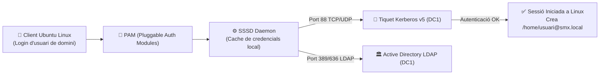

# 📘 UD6 — Integració de Sistemes Operatius Lliures i Propietaris

La **Unitat Didàctica 6** conclou el temari de Sistemes Operatius en Xarxa abordant l'escenari més habitual en el món laboral real: els **entorns de xarxa heterogenis**, on conviuen servidors d'infraestructura Microsoft Windows Server amb estacions de treball o servidors de desenvolupament GNU/Linux.

---

## 🔄 El Repte de la Interoperabilitat Heterogènia

En una infraestructura moderna:
1. Els usuaris, equips i credencials corporatives estan centralitzats a l'**Active Directory (Windows Server)**.
2. Molts departaments tècnics, aules de programació o servidors web utilitzen **Ubuntu o Debian GNU/Linux**.
3. **Objectiu tècnic:** Aconseguir que un usuari del domini (com `joan.garcia@smx.local`) puga seure davant d'un ordinador amb Ubuntu Linux, introduir la seua contrasenya corporativa i iniciar sessió amb èxit, creant automàticament la seua carpeta d'inici `/home/joan.garcia@smx.local`.

---

## 🛠️ La Pila Tecnològica d'Integració: `realmd` + `sssd` + Kerberos

---

## 📑 Continguts i Apartats de la Unitat

| Apartat | Títol | Descripció |
| :---: | :--- | :--- |
| **[6.2](./ut0602.md)** | **Recursos en Xarxa entre Sistemes Heterogenis** | Protocols de compatibilitat multiplataforma (SMBv3, NFSv4, CIFS). |
| **[6.3](./ut0603.md)** | **Serveis per a Compartir Recursos** | Servidors Samba i clients `smbclient` per a accés bidireccional. |
| **[6.4](./ut0604.md)** | **Integració d'Ubuntu en Domini Windows Server** | Unió automatitzada mitjançant `realmd`, `sssd` i creació automàtica de home. |
