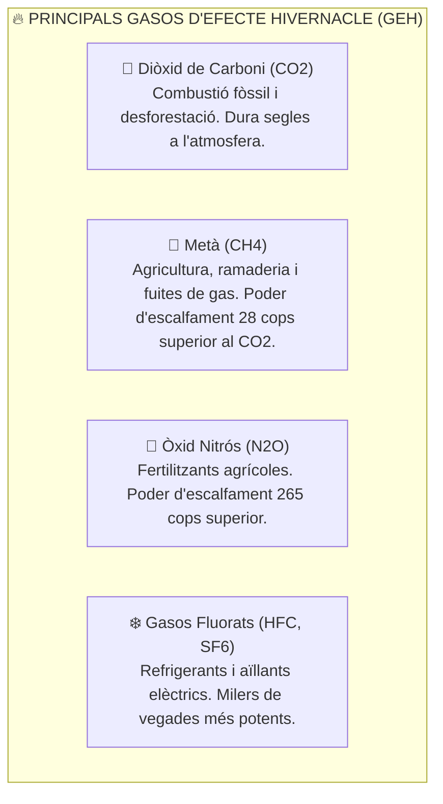
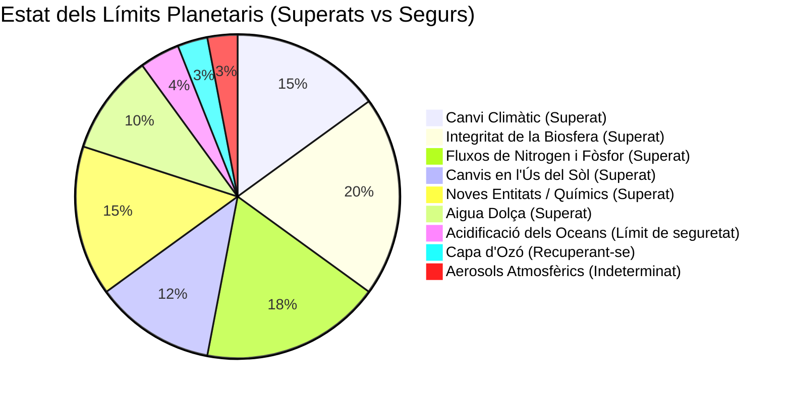

# UT01 — Desafiaments Ecosocials Globals i Límits Planetaris

Vivim en una era geològica definida com a **Antropocè**, on les activitats industrials humanes s'han convertit en la força predominant que altera els cicles biogeoquímics de la Terra. Comprendre la magnitud d'aquesta crisi és el primer pas per a redissenyar els processos tecnològics des d'un paradigma de sostenibilitat.

---

## 📌 1. Canvi Climàtic i Gasos d'Efecte Hivernacle (GEH)

L'escalfament del planeta està impulsat per l'emissió massiva de gasos d'efecte hivernacle derivada de la crema de combustibles fòssils (carbó, petroli, gas natural) per a la generació elèctrica, transport i processos industrials:

### L'Acord de París i l'Objectiu dels $+1{,}5^\circ\text{C}$:
La comunitat científica internacional (a través dels informes de l'IPCC) alerta que superar un augment de **$+1{,}5^\circ\text{C}$** respecte a l'era preindustrial desencadenarà punts d'inflexió climàtics irreversibles (*tipping points*), com el desglaç del permafrost siberià o el col·lapse dels esculls de corall.

---

## 📌 2. El Marc dels 9 Límits Planetaris

Investigadors del *Stockholm Resilience Centre* liderats per Johan Rockström van definir l'any 2009 els **9 processos biofísics** que regulen l'estabilitat de la Terra i que defineixen l'espai operatiu segur per a la humanitat:

1. **Canvi climàtic:** Concentració de $\text{CO}_2$ que supera les $420\text{ ppm}$ (límit segur: $350\text{ ppm}$).
2. **Integritat de la biosfera:** Taxa d'extinció d'espècies entre 100 i 1000 vegades superior a la taxa natural de fons.
3. **Fluxos biogeoquímics:** Ús excessiu de nitrogen i fòsfor que provoca eutrofització i zones mortes en mars i llacs.
4. **Noves entitats químiques:** Contaminació generalitzada per plàstics, disruptors endocrins i residus tòxics que mai havien existit a la natura.

---

## 📌 3. Mètriques Científiques de Sostenibilitat

Per a avaluar l'impacte d'una societat o empresa s'utilitzen tres petjades ecològiques complementàries:

### 1. La Petjada Ecològica (*Ecological Footprint*):
Mesura la superfície de terra i aigua biològicament productiva (expressada en **hectàrees globals - gha**) necessària per a subministrar els recursos consumits i assimilar els residus generats.
- **Dia de la Sobrecàrrega de la Terra (*Earth Overshoot Day*):** Data de l'any en què la humanitat ha consumit tots els recursos naturals que la Terra és capaç de regenerar en aqueix any natural. Actualment se situa a finals de juliol (vivim a crèdit ecològic consumint recursos equivalents a **$1{,}7$ planetes Terra**!).

### 2. La Petjada de Carboni (*Carbon Footprint*):
Mesura la massa total d'emissions de gasos d'efecte hivernacle expressada en **tones de diòxid de carboni equivalent ($\text{tCO}_2\text{e}$)**. Segons el Protocol GHG es divideix en 3 abastos:
- **Abast 1 (Emissions directes):** Combustió en calderes pròpies, vehicles d'empresa o fuites de gasos refrigerants.
- **Abast 2 (Emissions indirectes per electricitat):** Consum elèctric de la xarxa per a alimentar servidors i ordinadors.
- **Abast 3 (Altres emissions indirectes de la cadena de valor):** Viatges d'empleats, fabricació dels components comprats a tercers i tractament final del producte venut.

### 3. La Petjada Hídrica (*Water Footprint*):
Avalua el volum total d'aigua dolça utilitzat, desglossat en **Aigua Verda** (aigua de pluja emmagatzemada al sòl), **Aigua Blava** (aigua superficial o subterrània) i **Aigua Grisa** (volum d'aigua dolça necessari per a assimilar la càrrega de contaminants fins a complir els estàndards de qualitat).

---

## 📌 4. El Concepte de Desenvolupament Sostenible

La definició canònica la va establir l'ONU a l'**Informe Brundtland (1987)**:
> *«El desenvolupament sostenible és aquell que satisfà les necessitats de la generació present sense comprometre la capacitat de les generacions futures per a satisfer les seues pròpies necessitats.»*

Requereix equilibrar simultàniament tres dimensions indissolubles:
- **Viabilitat Ambiental:** Respectar la capacitat de càrrega i regeneració dels ecosistemes.
- **Justícia Social:** Garantir drets humans laborals, reducció de desigualtats i salut per a tothom.
- **Eficiència Econòmica:** Prosperitat sostenible sense basar-se en l'extracció destructiva de recursos no renovables.
