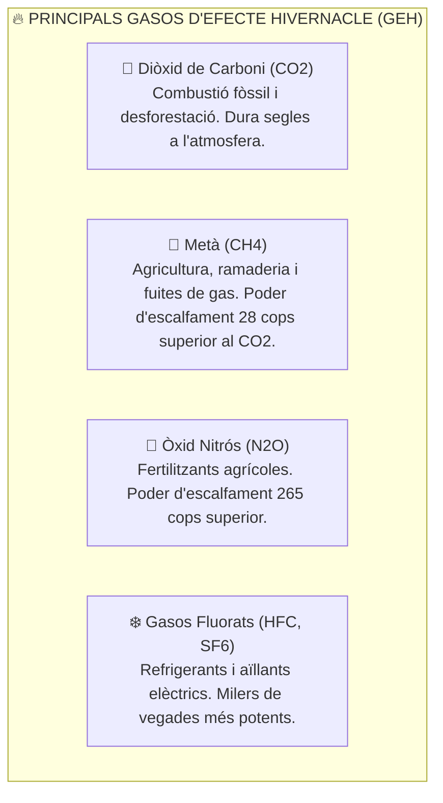
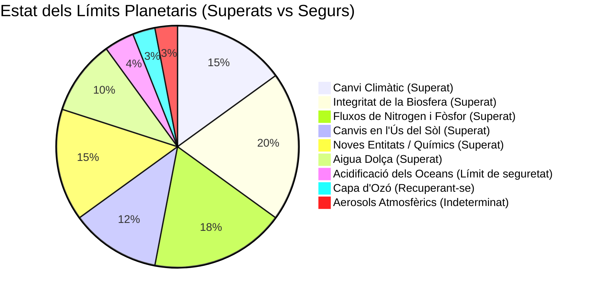

# UT01 — Desafiaments Ecosocials Globals i Límits Planetaris

Vivim en una era geològica definida com a **Antropocè**, on les activitats industrials humanes s'han convertit en la força predominant que altera els cicles biogeoquímics de la Terra. Comprendre la magnitud d'aquesta crisi és el primer pas per a redissenyar els processos tecnològics des d'un paradigma de sostenibilitat.

---

## 📌 1. Canvi Climàtic i Gasos d'Efecte Hivernacle (GEH)

L'escalfament del planeta està impulsat per l'emissió massiva de gasos d'efecte hivernacle derivada de la crema de combustibles fòssils (carbó, petroli, gas natural) per a la generació elèctrica, transport i processos industrials:



### L'Acord de París i l'Objectiu dels $+1{,}5^\circ\text{C}$:
La comunitat científica internacional (a través dels informes de l'IPCC) alerta que superar un augment de **$+1{,}5^\circ\text{C}$** respecte a l'era preindustrial desencadenarà punts d'inflexió climàtics irreversibles (*tipping points*), com el desglaç del permafrost siberià o el col·lapse dels esculls de corall.

---

## 📌 2. El Marc dels 9 Límits Planetaris

Investigadors del *Stockholm Resilience Centre* liderats per Johan Rockström van definir l'any 2009 els **9 processos biofísics** que regulen l'estabilitat de la Terra i que defineixen l'espai operatiu segur per a la humanitat:

<div style="background: linear-gradient(135deg, #0f172a 0%, #1e293b 100%); border-radius: 12px; padding: 20px; margin: 25px 0; box-shadow: 0 10px 25px -5px rgba(0, 0, 0, 0.3); border: 1px solid #334155;">
  <div style="text-align: center; margin-bottom: 15px;">
    <span style="background: #ef4444; color: #f8fafc; font-weight: 700; font-size: 0.75rem; text-transform: uppercase; letter-spacing: 0.05em; padding: 4px 10px; border-radius: 9999px;">Infografia Científica</span>
    <h3 style="color: #f8fafc; margin: 10px 0 5px 0; font-size: 1.25rem;">Els 9 Límits Planetaris i els Abastos de Carboni (GHG Protocol)</h3>
    <p style="color: #94a3b8; font-size: 0.85rem; margin: 0;">Marc d'avaluació biofísica de la Terra i classificació corporativa d'emissions de gasos d'efecte hivernacle</p>
  </div>
  <svg viewBox="0 0 860 280" width="100%" height="100%" xmlns="http://www.w3.org/2000/svg" style="display: block; font-family: system-ui, -apple-system, sans-serif;">
    <defs>
      <linearGradient id="limCritGrad" x1="0%" y1="0%" x2="100%" y2="100%">
        <stop offset="0%" stop-color="#ef4444" stop-opacity="0.3"/>
        <stop offset="100%" stop-color="#991b1b" stop-opacity="0.15"/>
      </linearGradient>
      <linearGradient id="limWarnGrad" x1="0%" y1="0%" x2="100%" y2="100%">
        <stop offset="0%" stop-color="#f59e0b" stop-opacity="0.3"/>
        <stop offset="100%" stop-color="#b45309" stop-opacity="0.15"/>
      </linearGradient>
      <linearGradient id="limSafeGrad" x1="0%" y1="0%" x2="100%" y2="100%">
        <stop offset="0%" stop-color="#10b981" stop-opacity="0.3"/>
        <stop offset="100%" stop-color="#047857" stop-opacity="0.15"/>
      </linearGradient>
    </defs>

    <!-- Bloc 1: Límits Sobrepassats (Zona Roja) -->
    <rect x="20" y="25" width="260" height="200" rx="8" fill="url(#limCritGrad)" stroke="#ef4444" stroke-width="1.5"/>
    <text x="150" y="52" fill="#ef4444" font-size="12" font-weight="bold" text-anchor="middle">🚨 LÍMITS SUPERATS (6 de 9)</text>
    <text x="150" y="70" fill="#fca5a5" font-size="10" text-anchor="middle">Zona d'Alt Risc Ecològic</text>
    <line x1="35" y1="85" x2="265" y2="85" stroke="#334155"/>
    <text x="35" y="108" fill="#cbd5e1" font-size="10.5">• <tspan fill="#f87171" font-weight="bold">Canvi Climàtic:</tspan> &gt; 420 ppm CO2</text>
    <text x="35" y="128" fill="#cbd5e1" font-size="10.5">• <tspan fill="#f87171" font-weight="bold">Integritat Biosfera:</tspan> Extinció espècies</text>
    <text x="35" y="148" fill="#cbd5e1" font-size="10.5">• <tspan fill="#cbd5e1">Fluxos biogeoquímics: N i P</tspan></text>
    <text x="35" y="168" fill="#cbd5e1" font-size="10.5">• <tspan fill="#cbd5e1">Canvis d'ús de terra i Aigua dolça</tspan></text>
    <text x="35" y="188" fill="#cbd5e1" font-size="10.5">• <tspan fill="#f59e0b" font-weight="bold">Noves Entitats:</tspan> Plàstics / RAEE</text>
    <text x="150" y="215" fill="#ef4444" font-size="9.5" text-anchor="middle" font-weight="bold">Desestabilització del sistema Terra</text>

    <!-- Bloc 2: Abastos de Carboni -->
    <rect x="300" y="25" width="270" height="200" rx="8" fill="url(#limWarnGrad)" stroke="#f59e0b" stroke-width="1.5"/>
    <text x="435" y="52" fill="#f59e0b" font-size="12" font-weight="bold" text-anchor="middle">🏭 PROTOCOL GHG (ABASTOS)</text>
    <text x="435" y="70" fill="#fde68a" font-size="10" text-anchor="middle">Mesura d'Emissions Corporatives</text>
    <line x1="315" y1="85" x2="555" y2="85" stroke="#334155"/>
    <text x="315" y="108" fill="#cbd5e1" font-size="10.5">• <tspan fill="#f59e0b" font-weight="bold">Abast 1 (Directes):</tspan> Combustió pròpia</text>
    <text x="315" y="128" fill="#cbd5e1" font-size="10.5">• <tspan fill="#38bdf8" font-weight="bold">Abast 2 (Electricitat):</tspan> Consum xarxa</text>
    <text x="315" y="148" fill="#cbd5e1" font-size="10.5">• <tspan fill="#c084fc" font-weight="bold">Abast 3 (Cadena valor):</tspan> Fabricació xips,</text>
    <text x="330" y="165" fill="#94a3b8" font-size="10">transport global i tractament RAEE</text>
    <text x="315" y="188" fill="#cbd5e1" font-size="10.5">• Unitat: <tspan fill="#f59e0b" font-weight="bold">tCO2e (tones de CO2 equiv.)</tspan></text>
    <text x="435" y="215" fill="#f59e0b" font-size="9.5" text-anchor="middle" font-weight="bold">Abast 3 sol representar &gt; 80% en TIC!</text>

    <!-- Bloc 3: Espai Segur (Dona de Raworth) -->
    <rect x="590" y="25" width="250" height="200" rx="8" fill="url(#limSafeGrad)" stroke="#10b981" stroke-width="1.5"/>
    <text x="715" y="52" fill="#10b981" font-size="12" font-weight="bold" text-anchor="middle">🌍 ESPAI OPERATIU SEGUR</text>
    <text x="715" y="70" fill="#a7f3d0" font-size="10" text-anchor="middle">Sostre Ecològic i Terra Social</text>
    <line x1="605" y1="85" x2="825" y2="85" stroke="#334155"/>
    <text x="605" y="108" fill="#cbd5e1" font-size="10.5">• <tspan fill="#34d399" font-weight="bold">Capa d'Ozó:</tspan> En recuperació</text>
    <text x="605" y="128" fill="#cbd5e1" font-size="10.5">• <tspan fill="#34d399" font-weight="bold">Acidificació:</tspan> Prop del llindar</text>
    <text x="605" y="148" fill="#cbd5e1" font-size="10.5">• <tspan fill="#cbd5e1">Aerosols atmosfèrics</tspan></text>
    <text x="605" y="168" fill="#cbd5e1" font-size="10.5">• <tspan fill="#38bdf8" font-weight="bold">Terra Social:</tspan> Educació, salut, treball</text>
    <text x="605" y="188" fill="#cbd5e1" font-size="10.5">• <tspan fill="#34d399" font-weight="bold">Economia del Donut (Raworth)</tspan></text>
    <text x="715" y="215" fill="#10b981" font-size="9.5" text-anchor="middle" font-weight="bold">Prosperitat dins dels límits de la Terra</text>

    <!-- Peu informatiu -->
    <rect x="20" y="235" width="820" height="35" rx="6" fill="#1e293b" stroke="#334155"/>
    <text x="430" y="257" fill="#cbd5e1" font-size="10.5" text-anchor="middle">Dia de la Sobrecàrrega: <tspan fill="#f59e0b" font-weight="bold">A escala global consumim recursos equivalents a 1,7 planetes Terra cada any natural.</tspan></text>
  </svg>
</div>



1. **Canvi climàtic:** Concentració de $\text{CO}_2$ que supera les $420\text{ ppm}$ (límit segur: $350\text{ ppm}$).
2. **Integritat de la biosfera:** Taxa d'extinció d'espècies entre 100 i 1000 vegades superior a la taxa natural de fons.
3. **Fluxos biogeoquímics:** Ús excessiu de nitrogen i fòsfor que provoca eutrofització i zones mortes en mars i llacs.
4. **Noves entitats químiques:** Contaminació generalitzada per plàstics, disruptors endocrins i residus tòxics que mai havien existit a la natura.

---

## 📌 3. Mètriques Científiques de Sostenibilitat

Per a avaluar l'impacte d'una societat o empresa s'utilitzen tres petjades ecològiques complementàries:

### 1. La Petjada Ecològica (*Ecological Footprint*):
Mesura la superfície de terra i aigua biològicament productiva (expressada en **hectàrees globals - gha**) necessària per a subministrar els recursos consumits i assimilar els residus generats.
- **Dia de la Sobrecàrrega de la Terra (*Earth Overshoot Day*):** Data de l'any en què la humanitat ha consumit tots els recursos naturals que la Terra és capaç de regenerar en aqueix any natural. Actualment se situa a finals de juliol (vivim a crèdit ecològic consumint recursos equivalents a **$1{,}7$ planetes Terra**!).

### 2. La Petjada de Carboni (*Carbon Footprint*):
Mesura la massa total d'emissions de gasos d'efecte hivernacle expressada en **tones de diòxid de carboni equivalent ($\text{tCO}_2\text{e}$)**. Segons el Protocol GHG es divideix en 3 abastos:
- **Abast 1 (Emissions directes):** Combustió en calderes pròpies, vehicles d'empresa o fuites de gasos refrigerants.
- **Abast 2 (Emissions indirectes per electricitat):** Consum elèctric de la xarxa per a alimentar servidors i ordinadors.
- **Abast 3 (Altres emissions indirectes de la cadena de valor):** Viatges d'empleats, fabricació dels components comprats a tercers i tractament final del producte venut.

### 3. La Petjada Hídrica (*Water Footprint*):
Avalua el volum total d'aigua dolça utilitzat, desglossat en **Aigua Verda** (aigua de pluja emmagatzemada al sòl), **Aigua Blava** (aigua superficial o subterrània) i **Aigua Grisa** (volum d'aigua dolça necessari per a assimilar la càrrega de contaminants fins a complir els estàndards de qualitat).

---

## 📌 4. El Concepte de Desenvolupament Sostenible

La definició canònica la va establir l'ONU a l'**Informe Brundtland (1987)**:
> *«El desenvolupament sostenible és aquell que satisfà les necessitats de la generació present sense comprometre la capacitat de les generacions futures per a satisfer les seues pròpies necessitats.»*

Requereix equilibrar simultàniament tres dimensions indissolubles:
- **Viabilitat Ambiental:** Respectar la capacitat de càrrega i regeneració dels ecosistemes.
- **Justícia Social:** Garantir drets humans laborals, reducció de desigualtats i salut per a tothom.
- **Eficiència Econòmica:** Prosperitat sostenible sense basar-se en l'extracció destructiva de recursos no renovables.

---

## 📝 Quadern d'Activitats Pràctiques i Reptes de Laboratori

### 🔵 Bloc A: Fonaments i Càlculs Ecosocials

1. **Càlcul d'emissions elèctriques (Abast 2):** Un taller d'informàtica disposa de 24 ordinadors de sobretaula i 1 servidor. Cada PC consumeix una mitjana de $120\text{ W}$ i el servidor $250\text{ W}$.
   - Si estan encesos 6 hores al dia durant els 175 dies lectius d'un curs escolar:
     $$\text{Consum Total} = (24 \times 120\text{ W} + 250\text{ W}) \times 6\text{ h/dia} \times 175\text{ dies} = ?\text{ kWh}$$
   - Si el factor d'emissió del mix elèctric peninsular és de $0{,}25\text{ kg CO}_2\text{e/kWh}$, quants quilograms de $\text{CO}_2\text{e}$ s'emeten a l'atmosfera?
2. **Classificació segons el Protocol GHG:** Classifica cadascuna de les següents accions d'una empresa tecnològica en Abast 1, Abast 2 o Abast 3:
   - Emissió de gas refrigerant R-410A per una fuita a l'aire condicionat del CPD.
   - Factura mensual d'electricitat dels racks de servidors a la seu central.
   - Emissions de carboni derivades de la fabricació dels xips de silici d'un lot de 50 portàtils a Taiwan.
   - Combustible dièsel de la furgoneta del tècnic de reparacions a domicili.
3. **L'Acord de París i els punts d'inflexió:** Per què l'objectiu climàtic internacional s'ha fixat estrictament en no superar els $+1{,}5^\circ\text{C}$ d'escalfament mitjà respecte a l'era preindustrial? Què és un *Tipping Point* o punt d'inflexió climàtic irreversible?
4. **Desglossament de la petjada hídrica:** Explica la diferència entre Aigua Verda, Aigua Blava i Aigua Grisa posant un exemple de cadascuna vinculat a la cadena industrial dels components tecnològics.
5. **Dia de la Sobrecàrrega (*Earth Overshoot Day*):** Si el Dia de la Sobrecàrrega global cau el 28 de juliol, quants planetes equivalents consumeix la humanitat? Si el dia d'un país concret com Espanya cau el 20 de maig, què significa en termes de consum per càpita?
6. **Els 9 Límits Planetaris:** Quins són els dos límits planetaris que presenten un risc més greu d'extinció i col·lapse en l'actualitat segons les dades del *Stockholm Resilience Centre*?
7. **Noves entitats químiques en el sector TIC:** Quins compostos químics sintètics utilitzats en la indústria de la informàtica (retardants de flama bromats, PFAS, gasos fluorats SF6) es classifiquen dins del límit de noves entitats? Per què la natura no és capaç de degradar-los?
8. **Fluxos biogeoquímics de nitrogen i fòsfor:** Com contribueix la ruptura del cicle del nitrogen i fòsfor a la creació de «zones mortes» anòxiques en mars com el Mar Menor o el Golf de Mèxic?
9. **L'Antropocè com a època geològica:** Quins marcadors estratigràfics (radionúclids de proves nuclears, microplàstics, cendres de carbó fòssil) justifiquen que la comunitat geològica propose una nova època que substitueixi l'Holocè?
10. **La Dona de Raworth (*Doughnut Economics*):** En què consisteix el model econòmic del Donut proposat per Kate Raworth? Quina relació estableix entre el sostre ecològic planetari i la base social de drets humans?

---

### 🟢 Bloc B: Reptes de Recerca, Anàlisi i Diagnòstic de Sostenibilitat

#### 🛠️ Repte 1: Auditoria Energètica Real de l'Aula de Taller
Realitza la mesura del consum real d'un lloc de treball de l'aula de pràctiques:
1. Connecta un mesurador de consum elèctric digital (vatímetre de presa) entre l'endoll de paret i la regleta de l'ordinador (incloent la torre i el monitor).
2. Mesura la potència instantània en tres estats d'ús diferents durant 5 minuts cadascun:
   - **Estat Repòs (*Idle*):** Escriptori encès sense cap programa obert.
   - **Estat Treball Ofimàtic:** Navegador web amb 5 pestanyes obertes i reproducció de vídeo HD.
   - **Estat Estrès de CPU:** Execució d'una tasca pesant o simulació de càrrega.
3. Registra els valors obtinguts i calcula el cost econòmic mensual suposant un preu mitjà de l'electricitat de $0{,}18\text{ €/kWh}$.

#### 🛠️ Repte 2: Mesura del Consum de la CPU a Linux amb `powertop`
En una màquina o màquina virtual amb GNU/Linux, analitza el perfil de consum del maquinari:
```bash
# Instal·lar eines de diagnòstic d'energia
sudo apt update && sudo apt install powertop -y

# Executar una sessió de calibratge i monitorització
sudo powertop
```
Navega per la pestanya *Overview* per identificar quins processos de programari generen més interrupcions per segon (*wakeups*) i comprova a la pestanya *Tunables* quins dispositius USB o controladors SATA no tenen activat l'estalvi d'energia automàtic.

#### 🛠️ Repte 3: Investigació del Dia de la Sobrecàrrega per Països
Accedeix al portal oficial de dades de la *Global Footprint Network* (`overshootday.org`) i respon:
1. En quina data concreta cauria el Dia de la Sobrecàrrega si tota la població del món visqués amb l'estil de consum mitjà d'Espanya?
2. Quins països del món superen el seu pressupost ecològic abans del mes de març? Quins països viuen encara dins dels seus límits biofísics?
3. Redacta una breu reflexió tècnica (10 línies) sobre com la digitalització pot contribuir a reduir o a empitjorar aquest dèficit biofísic.

#### 🛠️ Repte 4: Càlcul de la Petjada de Carboni del Cicle de Vida d'un Portàtil
Un fabricant internacional publica en la seua memòria ambiental (*Product Carbon Footprint*) que un portàtil de gamma professional genera un total de $280\text{ kg CO}_2\text{e}$ durant tot el seu cicle de vida:
- Fase de fabricació i extracció de minerals: $75\%$
- Fase de transport logístic internacional: $5\%$
- Fase d'ús durant 4 anys: $19\%$
- Fase de reciclatge i fi de vida útil: $1\%$
*Pregunta d'anàlisi crítica:* Quants quilograms de $\text{CO}_2\text{e}$ es produeixen abans fins i tot que l'usuari encenga l'ordinador per primera vegada a la seua taula? Per què allargar la vida útil de l'equip de 4 a 8 anys redueix dràsticament l'impacte anualitzat?

#### 🛠️ Repte 5: Proposta de Pla d'Acció de Descarbonització del Centre
Dissenya una proposta concreta de 4 mesures tècniques per a reduir les emissions de l'aula d'informàtica:
1. Política d'apagada automàtica nocturna de terminals mitjançant tasques programades o scripts bash (`cron` / `shutdown`).
2. Configuració de modes de suspensió avançada (ACPI S3) a la BIOS/UEFI de les estacions de treball.
3. Ús de regletes amb interruptor intel·ligent o tall de consum vampir (*Standby*).
4. Sol·licitud a la direcció del centre d'un contracte de subministrament elèctric amb Garanties d'Origen Renovable (GdO 100%).

---

### 🔴 Bloc C: Rúbrica d'Avaluació Competencial per Nivells

| Criteri d'Avaluació | Insuficient (1 - 4) | Suficient (5 - 6) | Notable (7 - 8) | Excel·lent (9 - 10) |
| :--- | :--- | :--- | :--- | :--- |
| **Càlcul i Anàlisi d'Emissions (GHG)** | No sap aplicar fórmules de potència a energia ni calcular emissions de $\text{CO}_2$. | Realitza el càlcul bàsic de consum en kWh però comet errors en aplicar factors d'emissió. | Calcula correctament les emissions d'Abast 2 i classifica els 3 abastos amb precisió. | Domina el càlcul avançat de cicle de vida, compara mixos elèctrics i proposa solucions de reducció. |
| **Comprensió dels Límits Biofísics** | Confon el canvi climàtic amb el forat d'ozó o desconeix el concepte de límit planetari. | Identifica els límits més populars (clima, aigua) sense aprofundir en els processos biofísics. | Explica els 9 límits planetaris, distingint entre zones segures, d'incertesa i d'alt risc. | Relaciona de forma crítica els límits biofísics amb la indústria extractiva i electrònica mundial. |
| **Auditoria Pràctica de Consum de Maquinari** | Incapaç d'utilitzar un vatímetre o no sap interpretar les dades de potència (Watts vs Joules). | Mesura el consum bàsic de l'equip en un sol estat sense contrastar càrregues de treball. | Realitza mesures comparatives completes en repòs i càrrega i utilitza eines com `powertop`. | Audita energèticament l'aula, identifica consums residuals i calcula l'estalvi anualitzat d'ajustos. |
| **Pensament Sistèmic i Ecodisseny** | Proposa mesures testimonials sense cap impacte real (apagar un llum 5 minuts). | Proposa mesures convencionals d'estalvi energètic centrades només en la fase d'ús. | Proposa mesures tècniques argumentades que aborden tant la fase d'ús com l'allargament de vida. | Dissenya un pla integral de transició ecològica d'infraestructura microinformàtica viable i mesurable. |

