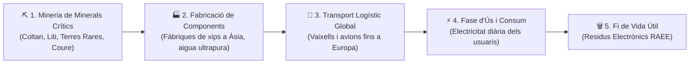
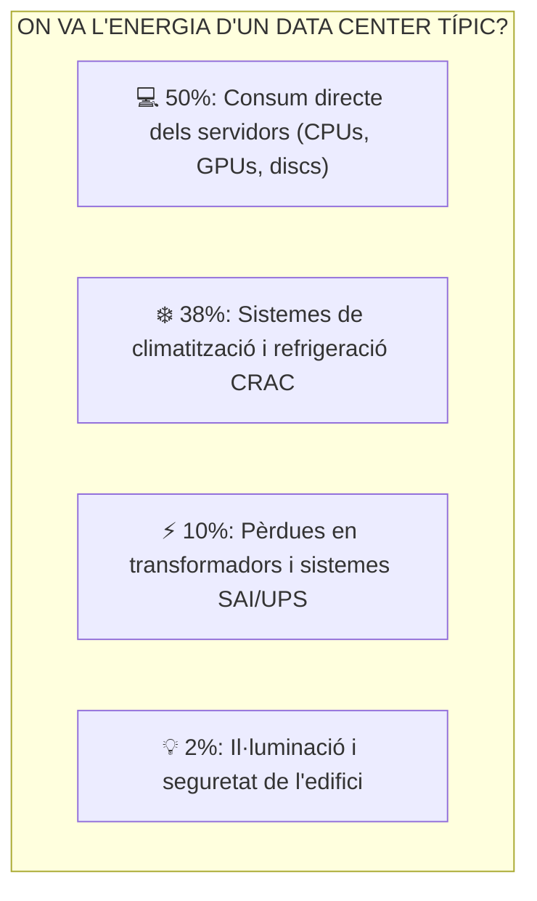

# UT02 — Impacte Ambiental i Social del Sector TIC

Sovint es percep la tecnologia com quelcom «virtual» o «immaterial» que substitueix el paper i estalvia viatges. Tanmateix, el sector de les Tecnologies de la Informació i la Comunicació (TIC) depèn d'una **gegantina cadena industrial extractiva, logística i energètica** que genera un impacte ambiental superior al de tot el sector de l'aviació comercial mundial.

---

## 📌 1. El Cicle de Vida d'un Dispositiu Electrònic

Fabricar un ordinador portàtil de només $2\text{ kg}$ requereix extreure més de **$1200\text{ kg}$ de matèries primeres** i utilitzar més de **$1500\text{ litres}$ d'aigua**:

### Minerals Crítics i Impacte Social:
- **Coltan (Tàntal i Niobi):** Essencial per a fabricar els condensadors microscòpics de les plaques base i telèfons. Més del $60\%$ de les reserves conegudes es troben a la República Democràtica del Congo, on l'extracció s'ha vinculat a conflictes bèl·lics, treball infantil i destrucció d'hàbitats de primats.
- **Liti i Cobalt:** Ingredients fonamentals de les bateries recarregables d'ions de liti de portàtils i servidors.
- **Terres Rares (Neodimi, Disprosi):** Utilitzades per a crear els potents imants dels capçals dels discs durs mecànics (HDD) i dels altaveus. La seua separació química genera milers de tones de residus radioactius i àcids.

---

## 📌 2. La Petjada Elèctrica dels Centres de Dades (CPDs)

Els servidors d'Internet, les xarxes 5G i els clústers de càlcul d'Intel·ligència Artificial consumeixen actualment més de **$200\text{ TWh}$ anuals**, el que representa aproximadament el **$2\%$ de tota l'electricitat generada al planeta**:

> [!IMPORTANT]
> **El cost ecològic de la Intel·ligència Artificial:**  
> Entrenar un sol model d'aprenentatge profund (*Deep Learning*) pot consumir tanta electricitat com 100 famílies durant tot un any i requerir milers de tones d'aigua per a refrigerar les granges de servidors d'acceleració per GPU.

---

## 📌 3. Obsolescència Programada i el «Dret a Reparar»

L'**obsolescència programada** és la determinació o planificació intencionada de la fi de la vida útil d'un producte per part del fabricant per a incentivar la compra d'un model nou:

| Tipus d'Obsolescència | Com es manifesta tècnicament? | Exemple en el sector TIC |
| :--- | :--- | :--- |
| **Funcional / Maquinari** | Ús de components febles o dissenys impossibles de desmuntar sense trencar. | Bateries enganxades amb coles industrials o memòria RAM soldada a la placa base. |
| **Programari (*Software*)** | Deixar de publicar actualitzacions de seguretat o forçar caigudes de rendiment. | Sistemes operatius mòbils que bloquegen aplicacions bancàries en terminals de 4 anys. |
| **Psicològica / Social** | Campanyes de publicitat agressives que fan percebre l'equip com a «vell» o passat de moda. | Llançament anual del mateix model amb canvis estètics mínims. |

### La Nova Normativa Europea del «Dret a Reparar» (Directiva 2024/1799/UE):
Per a combatre el malbaratament electrònic, la Unió Europea obliga els fabricants a:
1. Subministrar **peces de recanvi oficials durant com a mínim 10 anys** després de retirar el producte del mercat.
2. Posar a disposició pública els esquemes i manuals de reparació tècnica.
3. Prohibir les tècniques de programari que bloquegen components canviats per tallers independents (com les alertes per peces no originals de pantalla o bateria).
