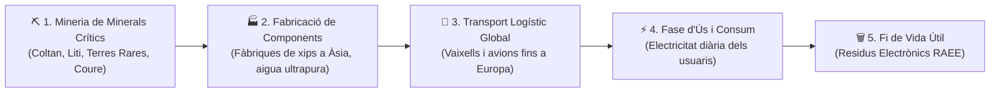
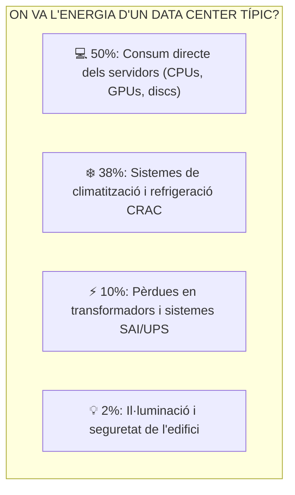

# UT02 — Impacte Ambiental i Social del Sector TIC

Sovint es percep la tecnologia com quelcom «virtual» o «immaterial» que substitueix el paper i estalvia viatges. Tanmateix, el sector de les Tecnologies de la Informació i la Comunicació (TIC) depèn d'una **gegantina cadena industrial extractiva, logística i energètica** que genera un impacte ambiental superior al de tot el sector de l'aviació comercial mundial.

---

## 📌 1. El Cicle de Vida d'un Dispositiu Electrònic

Fabricar un ordinador portàtil de només $2\text{ kg}$ requereix extreure més de **$1200\text{ kg}$ de matèries primeres** i utilitzar més de **$1500\text{ litres}$ d'aigua**:

<div style="background: linear-gradient(135deg, #0f172a 0%, #1e293b 100%); border-radius: 12px; padding: 20px; margin: 25px 0; box-shadow: 0 10px 25px -5px rgba(0, 0, 0, 0.3); border: 1px solid #334155;">
  <div style="text-align: center; margin-bottom: 15px;">
    <span style="background: #38bdf8; color: #0f172a; font-weight: 700; font-size: 0.75rem; text-transform: uppercase; letter-spacing: 0.05em; padding: 4px 10px; border-radius: 9999px;">Infografia Tècnica</span>
    <h3 style="color: #f8fafc; margin: 10px 0 5px 0; font-size: 1.25rem;">La Motxilla Ecològica i el Cicle de Vida del Maquinari TIC</h3>
    <p style="color: #94a3b8; font-size: 0.85rem; margin: 0;">De la mineria de minerals de conflicte a la fabricació avançada, consum energètic i dret a reparar</p>
  </div>
  <svg viewBox="0 0 860 280" width="100%" height="100%" xmlns="http://www.w3.org/2000/svg" style="display: block; font-family: system-ui, -apple-system, sans-serif;">
    <defs>
      <linearGradient id="ticMineGrad" x1="0%" y1="0%" x2="100%" y2="100%">
        <stop offset="0%" stop-color="#f59e0b" stop-opacity="0.25"/>
        <stop offset="100%" stop-color="#b45309" stop-opacity="0.1"/>
      </linearGradient>
      <linearGradient id="ticFabGrad" x1="0%" y1="0%" x2="100%" y2="100%">
        <stop offset="0%" stop-color="#ef4444" stop-opacity="0.25"/>
        <stop offset="100%" stop-color="#991b1b" stop-opacity="0.1"/>
      </linearGradient>
      <linearGradient id="ticRepGrad" x1="0%" y1="0%" x2="100%" y2="100%">
        <stop offset="0%" stop-color="#10b981" stop-opacity="0.25"/>
        <stop offset="100%" stop-color="#047857" stop-opacity="0.1"/>
      </linearGradient>
    </defs>

    <!-- Bloc 1: Mineria i Extracció -->
    <rect x="20" y="25" width="250" height="200" rx="8" fill="url(#ticMineGrad)" stroke="#f59e0b" stroke-width="1.5"/>
    <text x="145" y="52" fill="#f59e0b" font-size="12" font-weight="bold" text-anchor="middle">⛏️ MINERIA EXTRACTIVA</text>
    <text x="145" y="70" fill="#fde68a" font-size="10" text-anchor="middle">Minerals de Conflicte (3TG)</text>
    <line x1="35" y1="85" x2="255" y2="85" stroke="#334155"/>
    <text x="35" y="108" fill="#cbd5e1" font-size="10.5">• <tspan fill="#f59e0b" font-weight="bold">Coltan (Tàntal):</tspan> Condensadors (RDC)</text>
    <text x="35" y="128" fill="#cbd5e1" font-size="10.5">• <tspan fill="#cbd5e1">Liti i Cobalt: Bateries Li-ió</tspan></text>
    <text x="35" y="148" fill="#cbd5e1" font-size="10.5">• <tspan fill="#cbd5e1">Terres Rares: Imants de motors/HDD</tspan></text>
    <text x="35" y="168" fill="#cbd5e1" font-size="10.5">• <tspan fill="#f87171" font-weight="bold">Ràtio:</tspan> 1.200 kg terra per 2 kg PC</text>
    <text x="145" y="205" fill="#f59e0b" font-size="10" text-anchor="middle" font-weight="bold">Impacte humà i ambiental crític</text>

    <!-- Fletxa 1 a 2 -->
    <path d="M 275 110 L 305 110" stroke="#f59e0b" stroke-width="2"/>
    <text x="290" y="100" fill="#f59e0b" font-size="8" text-anchor="middle">Minerals</text>
    <path d="M 305 130 L 275 130" stroke="#ef4444" stroke-width="2"/>
    <text x="290" y="145" fill="#ef4444" font-size="8" text-anchor="middle">Logística</text>

    <!-- Bloc 2: Fabricació de Xips -->
    <rect x="310" y="25" width="250" height="200" rx="8" fill="url(#ticFabGrad)" stroke="#ef4444" stroke-width="1.5"/>
    <text x="435" y="52" fill="#ef4444" font-size="12" font-weight="bold" text-anchor="middle">🏭 FABRICACIÓ AVANÇADA</text>
    <text x="435" y="70" fill="#fca5a5" font-size="10" text-anchor="middle">Fàbriques de Silici (Cleanrooms)</text>
    <line x1="325" y1="85" x2="545" y2="85" stroke="#334155"/>
    <text x="325" y="108" fill="#cbd5e1" font-size="10.5">• <tspan fill="#ef4444" font-weight="bold">Aigua Ultrapura:</tspan> &gt; 1.500 L per PC</text>
    <text x="325" y="128" fill="#cbd5e1" font-size="10.5">• <tspan fill="#cbd5e1">Consum extrem d'energia elèctrica</tspan></text>
    <text x="325" y="148" fill="#cbd5e1" font-size="10.5">• <tspan fill="#cbd5e1">Gasos fluorats: Gravat d'oblies</tspan></text>
    <text x="325" y="168" fill="#cbd5e1" font-size="10.5">• <tspan fill="#f59e0b" font-weight="bold">Emissions:</tspan> 75-80% del total de vida</text>
    <text x="435" y="205" fill="#ef4444" font-size="10" text-anchor="middle" font-weight="bold">La fabricació supera la fase d'ús!</text>

    <!-- Fletxa 2 a 3 -->
    <path d="M 565 110 L 595 110" stroke="#ef4444" stroke-width="2"/>
    <text x="580" y="100" fill="#ef4444" font-size="8" text-anchor="middle">Venda</text>
    <path d="M 595 130 L 565 130" stroke="#34d399" stroke-width="2"/>
    <text x="580" y="145" fill="#34d399" font-size="8" text-anchor="middle">Circular</text>

    <!-- Bloc 3: Dret a Reparar i Ús -->
    <rect x="600" y="25" width="240" height="200" rx="8" fill="url(#ticRepGrad)" stroke="#34d399" stroke-width="1.5"/>
    <text x="720" y="52" fill="#34d399" font-size="12" font-weight="bold" text-anchor="middle">🛠️ DRET A REPARAR (UE)</text>
    <text x="720" y="70" fill="#a7f3d0" font-size="10" text-anchor="middle">Directiva 2024/1799/UE</text>
    <line x1="615" y1="85" x2="825" y2="85" stroke="#334155"/>
    <text x="615" y="108" fill="#cbd5e1" font-size="10.5">• <tspan fill="#34d399" font-weight="bold">Recanvis:</tspan> Mínim 10 anys oficials</text>
    <text x="615" y="128" fill="#cbd5e1" font-size="10.5">• <tspan fill="#cbd5e1">Accés públic a esquemes tècnics</tspan></text>
    <text x="615" y="148" fill="#cbd5e1" font-size="10.5">• <tspan fill="#34d399" font-weight="bold">Antiserialització:</tspan> Peces lliures</text>
    <text x="615" y="168" fill="#cbd5e1" font-size="10.5">• <tspan fill="#cbd5e1">Bateries i RAM desmuntables</tspan></text>
    <text x="720" y="205" fill="#34d399" font-size="10" text-anchor="middle" font-weight="bold">Allargar la vida és la solució #1</text>

    <!-- Peu informatiu -->
    <rect x="20" y="235" width="820" height="35" rx="6" fill="#1e293b" stroke="#334155"/>
    <text x="430" y="257" fill="#cbd5e1" font-size="10.5" text-anchor="middle">La Regla d'Or del Maquinari Sostenible: <tspan fill="#f59e0b" font-weight="bold">Duplicar la vida útil d'un ordinador de 4 a 8 anys redueix automàticament a la meitat el seu impacte ambiental global.</tspan></text>
  </svg>
</div>



### Minerals Crítics i Impacte Social:
- **Coltan (Tàntal i Niobi):** Essencial per a fabricar els condensadors microscòpics de les plaques base i telèfons. Més del $60\%$ de les reserves conegudes es troben a la República Democràtica del Congo, on l'extracció s'ha vinculat a conflictes bèl·lics, treball infantil i destrucció d'hàbitats de primats.
- **Liti i Cobalt:** Ingredients fonamentals de les bateries recarregables d'ions de liti de portàtils i servidors.
- **Terres Rares (Neodimi, Disprosi):** Utilitzades per a crear els potents imants dels capçals dels discs durs mecànics (HDD) i dels altaveus. La seua separació química genera milers de tones de residus radioactius i àcids.

---

## 📌 2. La Petjada Elèctrica dels Centres de Dades (CPDs)

Els servidors d'Internet, les xarxes 5G i els clústers de càlcul d'Intel·ligència Artificial consumeixen actualment més de **$200\text{ TWh}$ anuals**, el que representa aproximadament el **$2\%$ de tota l'electricitat generada al planeta**:



> [!IMPORTANT]
> **El cost ecològic de la Intel·ligència Artificial:**  
> Entrenar un sol model d'aprenentatge profund (*Deep Learning*) pot consumir tanta electricitat com 100 famílies durant tot un any i requerir milers de tones d'aigua per a refrigerar les granges de servidors d'acceleració per GPU.

---

## 📌 3. Obsolescència Programada i el «Dret a Reparar»

L'**obsolescència programada** és la determinació o planificació intencionada de la fi de la vida útil d'un producte per part del fabricant per a incentivar la compra d'un model nou:

| Tipus d'Obsolescència | Com es manifesta tècnicament? | Exemple en el sector TIC |
| :--- | :--- | :--- |
| **Funcional / Maquinari** | Ús de components febles o dissenys impossibles de desmuntar sense trencar. | Bateries enganxades amb coles industrials o memòria RAM soldada a la placa base. |
| **Programari (*Software*)** | Deixar de publicar actualitzacions de seguretat o forçar caigudes de rendiment. | Sistemes operatius mòbils que bloquegen aplicacions bancàries en terminals de 4 anys. |
| **Psicològica / Social** | Campanyes de publicitat agressives que fan percebre l'equip com a «vell» o passat de moda. | Llançament anual del mateix model amb canvis estètics mínims. |

### La Nova Normativa Europea del «Dret a Reparar» (Directiva 2024/1799/UE):
Per a combatre el malbaratament electrònic, la Unió Europea obliga els fabricants a:
1. Subministrar **peces de recanvi oficials durant com a mínim 10 anys** després de retirar el producte del mercat.
2. Posar a disposició pública els esquemes i manuals de reparació tècnica.
3. Prohibir les tècniques de programari que bloquegen components canviats per tallers independents (com les alertes per peces no originals de pantalla o bateria).

---

## 📝 Quadern d'Activitats Pràctiques i Reptes de Laboratori

### 🔵 Bloc A: Fonaments i Diagnòstic Tècnic

1. **La motxilla ecològica (*Ecological Rucksack*):** Defineix què és la motxilla ecològica d'un producte. Per quina raó tècnica un microxip de silici que pesa només 2 grams pot tindre una motxilla de més de 30 kg de recursos naturals consumits?
2. **Minerals de conflicte 3TG:** Quins són els quatre minerals coneguts com 3TG (Tàntal, Estany/Tin, Tungstè i Or/Gold)? Per quins motius humanitaris i geopolítics la legislació europea exigeix que les empreses verifiquen la traçabilitat de les seues cadenes de subministrament?
3. **Aigua ultrapura en la indústria de semiconductors:** Per què les foneries de xips (*fabs*) com TSMC o Intel necessiten milions de litres d'aigua ultrapura (UPW) cada dia? Quins problemes ambientals genera la seua extracció en regions que pateixen sequera crònica?
4. **Terres rares en emmagatzematge:** Quin paper juguen el neodimi i el disprosi en els discos durs magnètics (HDD) i per què la seua mineria i refinament químic genera greus problemes de contaminació per residus radioactius de tori i urani?
5. **Tipus d'obsolescència:** Posa un exemple real d'obsolescència funcional per maquinari, un d'obsolescència per programari (*software*) i un d'obsolescència perceptiva o psicològica viscut en el mercat de la telefonia o la informàtica.
6. **L'Índex de Reparabilitat oficial:** Quins són els 5 criteris tècnics utilitzats per a puntuar un ordinador d'1 a 10 (disponibilitat de documentació tècnica, facilitat de desmuntatge, disponibilitat de peces de recanvi, preu de les peces de recanvi i criteris específics)?
7. **La serialització de peces (*Parts Pairing*):** En què consisteix la pràctica d'alguns fabricants de vincular criptogràficament el número de sèrie de la pantalla o bateria a la placa base? Com afecta aquesta mesura als tallers locals de reparació i a l'economia circular?
8. **Consum hídric i elèctric dels CPDs d'Intel·ligència Artificial:** Per quina raó els clústers de servidors amb acceleradores GPU per a IA consumeixen entre 3 i 5 vegades més potència per rack ($40-100\text{ kW}$) que els servidors convencionals? Com afecta aquest consum d'energia a les necessitats de refrigeració per evaporació d'aigua?
9. **Impacte social de l'extracció de cobalt:** Quines condicions de treball s'han denunciat històricament en les mines artesanals de cobalt a la regió de Katanga (República Democràtica del Congo) vinculades a la cadena de fabricació de bateries?
10. **Modularitat en el disseny:** Compara el disseny d'un ordinador portàtil modular (amb memòria RAM en sòcols SO-DIMM, disc NVMe M.2 estàndard i bateria amb cargols) amb un model ultracompacte amb tot soldat a la placa base. Què passa en cas d'avaria d'un sol xip de RAM en cadascun?

---

### 🟢 Bloc B: Reptes de Recerca, Anàlisi i Diagnòstic de Sostenibilitat

#### 🛠️ Repte 1: Càlcul de l'Índex de Reparabilitat d'un Dispositiu
Selecciona un model d'ordinador portàtil o telèfon intel·ligent del taller o del teu ús personal:
1. Accedeix a un repositori oficial d'índexs de reparabilitat o a la web d'especejament especialitzada *iFixit* (`ifixit.com/teardowns`).
2. Avalua els següents aspectes en una escala de l'1 al 10:
   - **Eines necessàries:** Calen tornavisos especials patentats (Pentalobe, Tri-wing) o s'obre amb tornavís estàndard Philips?
   - **Presència de cola:** La bateria es pot extreure sense aplicar calor ni dissolvents químics?
   - **Accés als components crítics:** Quants passos calen per arribar al disc dur o a la memòria RAM?
3. Emets una qualificació final argumentada per a l'equip i redacta una recomanació de compra per al departament de compres del centre.

#### 🛠️ Repte 2: Auditoria de Maquinari Soldat vs Modular al Taller
Obre la tapa inferior d'una estació de treball o portàtil de pràctiques donat de baixa al taller i realitza la inspecció següent:
1. Identifica i fotografia els components que són reemplaçables mitjançant sòcol:
   - Mòduls de memòria RAM (SO-DIMM).
   - Disc dur o SSD (SATA de 2.5" o M.2 NVMe).
   - Targeta de xarxa sense fil Wi-Fi (sòcol M.2 Key E).
   - Pila de suport de la BIOS/UEFI (CR2032).
2. Identifica quins components estan soldats directament a la placa mare:
   - Processador central (CPU en sòcol BGA soldat).
   - Condensadors de filtratge i circuits integrats de potència VRM.
3. Redacta una fitxa tècnica detallant si l'equip és apte per a ser actualitzat (*Upgrade*) per a allargar la seua vida 4 anys més.

#### 🛠️ Repte 3: Investigació sobre Minerals de Conflicte a Memòries ESG
Cerca a Internet la darrera memòria oficial de sostenibilitat o informe de minerals de conflicte (*Conflict Minerals Report SEC Form SD*) d'un gran fabricant del sector TIC (per exemple: Dell, HP, Lenovo o Apple):
1. Quins procediments apliquen per auditar que l'or o el tàntal dels seus components procedeixen de refineries auditades per la iniciativa *Responsible Minerals Initiative (RMI)*?
2. Quin percentatge de cobalt reciclat utilitzen en les seues noves línies de bateries?
3. Redacta un resum d'1 pàgina amb les teues conclusions sobre el compromís real de l'empresa analitzada.

#### 🛠️ Repte 4: Mesura de la Petjada Energètica del Vídeo per Streaming
Utilitzant una estació de treball del laboratori connectada a la xarxa:
1. Executa un monitor de rendiment i consum de dades de xarxa per consola bash:
   ```bash
   # Monitoritzar el trànsit en temps real
   sudo apt install iftop -y
   sudo iftop
   ```
2. Reprodueix el mateix vídeo de 5 minuts a través d'una plataforma web en tres qualitats diferents:
   - Resolució baixa: 480p.
   - Resolució estàndard: 1080p Full HD.
   - Resolució ultra alta: 4K (2160p).
3. Comprova la taxa de transferència de dades consumida (en MB) per a cada resolució i calcula l'estalvi d'amplada de banda i energia en servidors de la plataforma que suposa utilitzar resolucions racionals.

#### 🛠️ Repte 5: Proposta de Reacondicionament de Parcs d'Ordinadors Vells
Un institut té 30 ordinadors de fa 7 anys que funcionen molt lents amb sistemes operatius moderns propietaris i tenen discs mecànics antics (HDD de 500 GB):
1. **Pla d'allargament de vida:** Dissenya una intervenció de baix cost pressupostant la substitució dels HDD per discs SSD SATA de 240 GB (cost aproximat: 18 € per unitat).
2. **Tri de programari lliure lleuger:** Proposa una distribució de GNU/Linux educativa (com LliureX versió escriptori lleuger o Xubuntu) per a maximitzar la velocitat de resposta sense necessitat de comprar nous equips.
3. **Càlcul d'estalvi econòmic i ecològic:** Compara el cost de comprar 30 equips nous (a 500 € cadascun = 15.000 €) amb el cost de l'actualització ($30 \times 18\text{ €} = 540\text{ €}$) i estima la reducció de petjada de carboni associada.

---

### 🔴 Bloc C: Rúbrica d'Avaluació Competencial per Nivells

| Criteri d'Avaluació | Insuficient (1 - 4) | Suficient (5 - 6) | Notable (7 - 8) | Excel·lent (9 - 10) |
| :--- | :--- | :--- | :--- | :--- |
| **Anàlisi del Cicle de Vida del Maquinari** | Desconeix l'impacte de la fabricació creient que només contamina el consum d'energia diari. | Reconeix les fases del cicle de vida però no identifica la magnitud de la petjada extractiva. | Explica amb rigor la motxilla ecològica, la mineria de 3TG i la fase de fabricació de xips. | Quantifica l'impacte en cada fase, analitza la petjada d'aigua ultrapura i justifica la durabilitat. |
| **Avaluació de l'Índex de Reparabilitat** | No sap interpretar l'índex de reparabilitat o confon garantia comercial amb reparabilitat. | Utilitza eines bàsiques per a avaluar un equip guiat per instruccions pas a pas. | Avalua autònomament equips reals seguint els criteris de disponibilitat de peces i desmuntatge. | Analitza pràctiques d'antiserialització, redacta auditories de reparabilitat i proposa millores. |
| **Diagnòstic de Maquinari i Modularitat** | No sap diferenciar entre components soldats i mòduls en sòcol a la placa base. | Identifica la memòria RAM i el disc dur però desconeix altres sòcols com Wi-Fi o CPU. | Desmunta equips amb seguretat, identifica tots els elements reemplaçables i avalua el dany. | Dissenya plans complets de modernització (*Upgrade*) per allargar la vida útil d'equips corporatius. |
| **Propostes de Reacondicionament Sostenible** | Proposa substituir equips funcionals per nous models sense cap intent de diagnòstic o reparació. | Proposa canvis de peces bàsics sense considerar la compatibilitat ni la relació cost-benefici. | Dissenya projectes de reacondicionament amb equips reals, instal·lant SSDs i sistemes lliures. | Construeix una memòria econòmica i ecològica completa que demostra la viabilitat de la circularitat. |

