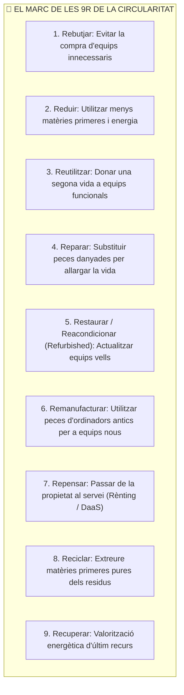
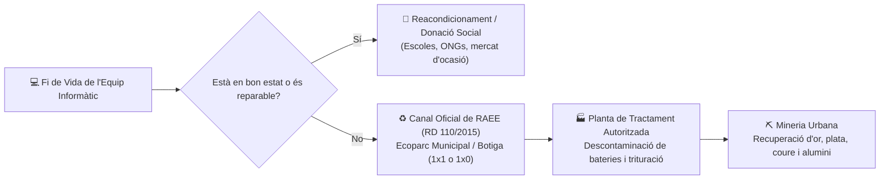

# UT03 — Economia Circular, Ecodisseny i Gestió de Residus RAEE

Davant l'esgotament de les reserves minerals del planeta i la proliferació d'abocadors electrònics, el model industrial del segle XXI ha de transitar obligatòriament d'un sistema lineal d'«extreure, fabricar, usar i llençar» cap a un model d'**Economia Circular**.

---

## 📌 1. L'Economia Circular i la Jerarquia de les 9R

L'objectiu de l'economia circular és mantindre el valor econòmic dels materials i components electrònics dins del sistema durant el màxim de temps possible:

> [!TIP]
> **Prioritat ambiental:** Com més amunt estem en l'escala de les R, major és l'estalvi ecològic! **Reparar o reutilitzar un ordinador és entre 10 i 20 vegades més ecològic que reciclar-lo**, ja que reciclar requereix fondre els metalls gastant una enorme quantitat d'energia.

---

## 📌 2. Principis d'Ecodisseny en Maquinari (ISO 14006)

L'**Ecodisseny** consisteix a integrar criteris ambientals en la fase de disseny i desenvolupament d'un equip informàtic abans de fabricar-lo:

1. **Modularitat i Fàcil Desmuntatge:** Utilització de xassís amb cargols estàndard (Philips o Torx) en lloc de cola o reblons cecs. Permet que qualsevol tècnic puga canviar un disc dur, un mòdul de memòria RAM o la pantalla en pocs minuts.
2. **Ús de Materials Reciclats:** Xassís d'alumini reciclat amb baixa petjada de carboni i carcasses amb almenys un $50\%$ de plàstic reciclat postconsum (PCR).
3. **Eliminació de Substàncies Tòxiques (Directiva RoHS 2011/65/UE):** Prohibeix la presència de metalls pesants com el plom (prohibint les soldadures tradicionals d'estany-plom), mercuri en llums de pantalla, cadmi i retardants de flama bromats (PBB i PBDE).

---

## 📌 3. Gestió de Residus d'Aparells Elèctrics i Electrònics (RAEE)

Els **RAEE (*Residus d'Aparells Elèctrics i Electrònics*)** representen el flux de deixalles que més ràpidament creix a tot el món (més de $60\text{ milions de tones}$ anuals):

### El Marc Legal a Espanya (Reial Decret 110/2015):
- **Obligació del distribuïdor (Principi 1 per 1):** Quan un client compra un ordinador o impressora nova, la botiga té l'obligació legal de recollir gratuïtament l'equip antic equivalent.
- **Principi 1 per 0:** Les grans superfícies comercials d'electrònica han de disposar de contenidors perquè qualsevol ciutadà puga dipositar xicotets aparells electrònics (menors de $25\text{ cm}$) sense necessitat de comprar res.
- **Perillositat en abocadors incontrolats:** Si un ordinador es llença al fem comú, les bateries d'ió-liti poden provocar incendis químics a les compactadores, i el plom i mercuri dels components es filtren cap als aqüífers subterranis enverinant l'aigua potable.
