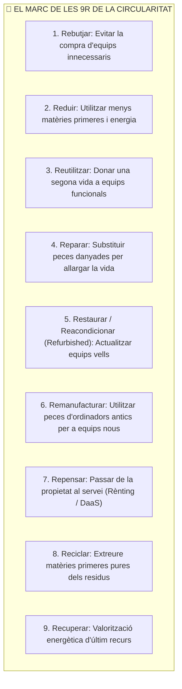
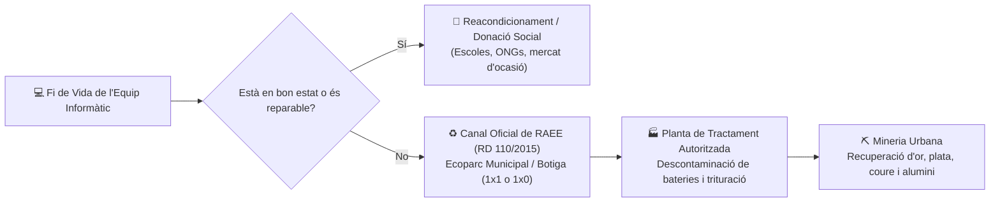

# UT03 — Economia Circular, Ecodisseny i Gestió de Residus RAEE

Davant l'esgotament de les reserves minerals del planeta i la proliferació d'abocadors electrònics, el model industrial del segle XXI ha de transitar obligatòriament d'un sistema lineal d'«extreure, fabricar, usar i llençar» cap a un model d'**Economia Circular**.

---

## 📌 1. L'Economia Circular i la Jerarquia de les 9R

L'objectiu de l'economia circular és mantindre el valor econòmic dels materials i components electrònics dins del sistema durant el màxim de temps possible:

<div style="background: linear-gradient(135deg, #0f172a 0%, #1e293b 100%); border-radius: 12px; padding: 20px; margin: 25px 0; box-shadow: 0 10px 25px -5px rgba(0, 0, 0, 0.3); border: 1px solid #334155;">
  <div style="text-align: center; margin-bottom: 15px;">
    <span style="background: #10b981; color: #0f172a; font-weight: 700; font-size: 0.75rem; text-transform: uppercase; letter-spacing: 0.05em; padding: 4px 10px; border-radius: 9999px;">Infografia Tècnica</span>
    <h3 style="color: #f8fafc; margin: 10px 0 5px 0; font-size: 1.25rem;">L'Economia Circular en Sistemes Microinformàtics i Gestió RAEE</h3>
    <p style="color: #94a3b8; font-size: 0.85rem; margin: 0;">Jerarquia de les 9R, Ecodisseny de maquinari (RoHS) i potencial de la Mineria Urbana</p>
  </div>
  <svg viewBox="0 0 860 280" width="100%" height="100%" xmlns="http://www.w3.org/2000/svg" style="display: block; font-family: system-ui, -apple-system, sans-serif;">
    <defs>
      <linearGradient id="circ9rGrad" x1="0%" y1="0%" x2="100%" y2="100%">
        <stop offset="0%" stop-color="#10b981" stop-opacity="0.25"/>
        <stop offset="100%" stop-color="#047857" stop-opacity="0.1"/>
      </linearGradient>
      <linearGradient id="circEcoGrad" x1="0%" y1="0%" x2="100%" y2="100%">
        <stop offset="0%" stop-color="#3b82f6" stop-opacity="0.25"/>
        <stop offset="100%" stop-color="#1e40af" stop-opacity="0.1"/>
      </linearGradient>
      <linearGradient id="circRaeeGrad" x1="0%" y1="0%" x2="100%" y2="100%">
        <stop offset="0%" stop-color="#f59e0b" stop-opacity="0.25"/>
        <stop offset="100%" stop-color="#b45309" stop-opacity="0.1"/>
      </linearGradient>
    </defs>

    <!-- Bloc 1: Jerarquia de les 9R -->
    <rect x="20" y="25" width="250" height="200" rx="8" fill="url(#circ9rGrad)" stroke="#10b981" stroke-width="1.5"/>
    <text x="145" y="52" fill="#10b981" font-size="12" font-weight="bold" text-anchor="middle">🔄 JERARQUIA DE LES 9R</text>
    <text x="145" y="70" fill="#a7f3d0" font-size="10" text-anchor="middle">Allargament de la Vida Útil</text>
    <line x1="35" y1="85" x2="255" y2="85" stroke="#334155"/>
    <text x="35" y="108" fill="#cbd5e1" font-size="10.5">• <tspan fill="#34d399" font-weight="bold">1. Rebutjar / Reduir:</tspan> Menys compres</text>
    <text x="35" y="128" fill="#cbd5e1" font-size="10.5">• <tspan fill="#34d399" font-weight="bold">2. Reutilitzar:</tspan> Donació / Segona mà</text>
    <text x="35" y="148" fill="#cbd5e1" font-size="10.5">• <tspan fill="#38bdf8" font-weight="bold">3. Reparar:</tspan> Canvi de discs / RAM</text>
    <text x="35" y="168" fill="#cbd5e1" font-size="10.5">• <tspan fill="#cbd5e1">4. Reacondicionar (Refurbished)</tspan></text>
    <text x="35" y="188" fill="#cbd5e1" font-size="10.5">• <tspan fill="#f59e0b" font-weight="bold">5. Reciclar:</tspan> Últim recurs material</text>
    <text x="145" y="215" fill="#10b981" font-size="9.5" text-anchor="middle" font-weight="bold">Reparar estalvia 15x més que reciclar</text>

    <!-- Fletxa 1 a 2 -->
    <path d="M 275 110 L 305 110" stroke="#10b981" stroke-width="2"/>
    <text x="290" y="100" fill="#10b981" font-size="8" text-anchor="middle">Disseny</text>
    <path d="M 305 130 L 275 130" stroke="#38bdf8" stroke-width="2"/>
    <text x="290" y="145" fill="#38bdf8" font-size="8" text-anchor="middle">Norma</text>

    <!-- Bloc 2: Ecodisseny ISO 14006 i RoHS -->
    <rect x="310" y="25" width="250" height="200" rx="8" fill="url(#circEcoGrad)" stroke="#38bdf8" stroke-width="1.5"/>
    <text x="435" y="52" fill="#38bdf8" font-size="12" font-weight="bold" text-anchor="middle">🌿 ECODISSENY (ISO 14006)</text>
    <text x="435" y="70" fill="#93c5fd" font-size="10" text-anchor="middle">Directiva RoHS 2011/65/UE</text>
    <line x1="325" y1="85" x2="545" y2="85" stroke="#334155"/>
    <text x="325" y="108" fill="#cbd5e1" font-size="10.5">• <tspan fill="#38bdf8" font-weight="bold">Modularitat:</tspan> Cargols universals</text>
    <text x="325" y="128" fill="#cbd5e1" font-size="10.5">• <tspan fill="#cbd5e1">Plàstics reciclats PCR &gt; 50%</tspan></text>
    <text x="325" y="148" fill="#cbd5e1" font-size="10.5">• <tspan fill="#ef4444" font-weight="bold">Sense Plom (Lead-Free):</tspan> Soldadures</text>
    <text x="325" y="168" fill="#cbd5e1" font-size="10.5">• <tspan fill="#cbd5e1">Sense mercuri, cadmi ni PBB</tspan></text>
    <text x="325" y="188" fill="#cbd5e1" font-size="10.5">• <tspan fill="#34d399" font-weight="bold">Fàcil separació de bateria</tspan></text>
    <text x="435" y="215" fill="#38bdf8" font-size="9.5" text-anchor="middle" font-weight="bold">Disseny pensat per a ser desmuntat</text>

    <!-- Fletxa 2 a 3 -->
    <path d="M 565 110 L 595 110" stroke="#38bdf8" stroke-width="2"/>
    <text x="580" y="100" fill="#38bdf8" font-size="8" text-anchor="middle">Fi Vida</text>
    <path d="M 595 130 L 565 130" stroke="#f59e0b" stroke-width="2"/>
    <text x="580" y="145" fill="#f59e0b" font-size="8" text-anchor="middle">Metalls</text>

    <!-- Bloc 3: Mineria Urbana i RAEE -->
    <rect x="600" y="25" width="240" height="200" rx="8" fill="url(#circRaeeGrad)" stroke="#f59e0b" stroke-width="1.5"/>
    <text x="720" y="52" fill="#f59e0b" font-size="12" font-weight="bold" text-anchor="middle">⛏️ MINERIA URBANA (RAEE)</text>
    <text x="720" y="70" fill="#fde68a" font-size="10" text-anchor="middle">Reial Decret 110/2015</text>
    <line x1="615" y1="85" x2="825" y2="85" stroke="#334155"/>
    <text x="615" y="108" fill="#cbd5e1" font-size="10.5">• <tspan fill="#f59e0b" font-weight="bold">1 tona plaques mare:</tspan> ~200 g Or</text>
    <text x="615" y="128" fill="#cbd5e1" font-size="10.5">• <tspan fill="#cbd5e1">1 tona roca natural: només ~5 g Or!</tspan></text>
    <text x="615" y="148" fill="#cbd5e1" font-size="10.5">• <tspan fill="#34d399" font-weight="bold">Principi 1 per 1:</tspan> Recollida botiga</text>
    <text x="615" y="168" fill="#cbd5e1" font-size="10.5">• <tspan fill="#cbd5e1">Principi 1 per 0 (&lt;25 cm sense compra)</tspan></text>
    <text x="615" y="188" fill="#cbd5e1" font-size="10.5">• <tspan fill="#ef4444" font-weight="bold">Peligro aqüífers</tspan> si va a abocador</text>
    <text x="720" y="215" fill="#f59e0b" font-size="9.5" text-anchor="middle" font-weight="bold">Recuperació d'or, plata i coure</text>

    <!-- Peu informatiu -->
    <rect x="20" y="235" width="820" height="35" rx="6" fill="#1e293b" stroke="#334155"/>
    <text x="430" y="257" fill="#cbd5e1" font-size="10.5" text-anchor="middle">Canal Oficial: <tspan fill="#f59e0b" font-weight="bold">Lliura sempre els equips donats de baixa als Ecoparcs municipals o sistemes integrats de gestió (SIG).</tspan></text>
  </svg>
</div>



> [!TIP]
> **Prioritat ambiental:** Com més amunt estem en l'escala de les R, major és l'estalvi ecològic! **Reparar o reutilitzar un ordinador és entre 10 i 20 vegades més ecològic que reciclar-lo**, ja que reciclar requereix fondre els metalls gastant una enorme quantitat d'energia.

---

## 📌 2. Principis d'Ecodisseny en Maquinari (ISO 14006)

L'**Ecodisseny** consisteix a integrar criteris ambientals en la fase de disseny i desenvolupament d'un equip informàtic abans de fabricar-lo:

1. **Modularitat i Fàcil Desmuntatge:** Utilització de xassís amb cargols estàndard (Philips o Torx) en lloc de cola o reblons cecs. Permet que qualsevol tècnic puga canviar un disc dur, un mòdul de memòria RAM o la pantalla en pocs minuts.
2. **Ús de Materials Reciclats:** Xassís d'alumini reciclat amb baixa petjada de carboni i carcasses amb almenys un $50\%$ de plàstic reciclat postconsum (PCR).
3. **Eliminació de Substàncies Tòxiques (Directiva RoHS 2011/65/UE):** Prohibeix la presència de metalls pesants com el plom (prohibint les soldadures tradicionals d'estany-plom), mercuri en llums de pantalla, cadmi i retardants de flama bromats (PBB i PBDE).

---

## 📌 3. Gestió de Residus d'Aparells Elèctrics i Electrònics (RAEE)

Els **RAEE (*Residus d'Aparells Elèctrics i Electrònics*)** representen el flux de deixalles que més ràpidament creix a tot el món (més de $60\text{ milions de tones}$ anuals):



### El Marc Legal a Espanya (Reial Decret 110/2015):
- **Obligació del distribuïdor (Principi 1 per 1):** Quan un client compra un ordinador o impressora nova, la botiga té l'obligació legal de recollir gratuïtament l'equip antic equivalent.
- **Principi 1 per 0:** Les grans superfícies comercials d'electrònica han de disposar de contenidors perquè qualsevol ciutadà puga dipositar xicotets aparells electrònics (menors de $25\text{ cm}$) sense necessitat de comprar res.
- **Perillositat en abocadors incontrolats:** Si un ordinador es llença al fem comú, les bateries d'ió-liti poden provocar incendis químics a les compactadores, i el plom i mercuri dels components es filtren cap als aqüífers subterranis enverinant l'aigua potable.

---

## 📝 Quadern d'Activitats Pràctiques i Reptes de Laboratori

### 🔵 Bloc A: Fonaments i Càlculs de Circularitat

1. **Reparar vs Reciclar en termes termodinàmics:** Per quina raó científica la jerarquia de les 9R situa la reparació i la reutilització molt per sobre del reciclatge? Quanta energia elèctrica i tèrmica s'estalvia en evitar fondre l'alumini o coure d'un xassís en comparació amb canviar un simple fusible o condensador avariat?
2. **Substàncies perilloses de la Directiva RoHS (2011/65/UE):** Quins són els sis elements químics que aquesta directiva prohibeix expressament en la fabricació d'equips informàtics venuts a la Unió Europea? Com es va haver d'adaptar la indústria de soldadura de plaques base en passar de l'estany-plom a l'estany-plata-coure (*SAC*)?
3. **Càlcul de rendiment de Mineria Urbana:** Una campanya de recollida de material obsolet en un polígon industrial recupera $1.500\text{ kg}$ de plaques base (PCB) antigues.
   - Si les dades científiques de mineria urbana indiquen una concentració de $200\text{ g d'or per tona}$ de plaques:
     $$\text{Or recuperable} = 1{,}5\text{ tones} \times 200\text{ g/tona} = ?\text{ grams d'or}$$
   - Si el gram d'or pur cotitza a $65\text{ €/g}$, quin és el valor econòmic brut d'aquest metall recuperat?
4. **Marc legal de RAEE a Espanya (RD 110/2015):** Explica la diferència pràctica entre el principi de recollida «1 per 1» i el principi «1 per 0» per a una botiga de components informàtics de barri i per a un hipermercat d'electrònica.
5. **Perills crítics de les bateries d'ió-liti:** Per quina raó mai no s'ha de barrejar una bateria de portàtil o tauleta unflada amb la ferralla comuna o amb plàstics reciclables? Què és el fenomen d'embalament tèrmic (*thermal runaway*)?
6. **Ecodisseny segons la norma ISO 14006:** Quines pautes d'ecodisseny s'han d'aplicar a la carcassa plàstica d'un monitor per a facilitar el seu reciclatge mecànic (identificació de polímers amb codi ISO 11469 com `>ABS<` o `>PC<`, absència de pintures metal·litzades i unió sense coles adhesives)?
7. **Responsabilitat Ampliada del Productor (RAP):** En què consisteix el principi de qui contamina paga aplicat als fabricants d'ordinadors? Què és un Sistema Col·lectiu de Responsabilitat Ampliada del Productor (SCRAP com Ecotic o Ecoasimelec)?
8. **Plàstics PCR (*Post-Consumer Recycled*):** Quina diferència hi ha entre utilitzar plàstic reciclat procedent de deixalles industrials internes (*PIR*) i plàstic reciclat postconsum (*PCR*) procedent de contenidors urbans? Quins reptes de puresa presenta el segon?
9. **Eliminació segura de dades prèvia a la circularitat:** Abans de donar un ordinador a una ONG o enviar-lo a reacondicionar, quin tractament tècnic s'ha de donar al disc dur per a complir el RGPD (esborrat segur multipassat amb `shred`/`dd` o desmagnetització *degaussing*)?
10. **Obsolescència i tancament de cicle:** Si un fabricant deixa d'oferir actualitzacions de microprogramari (*firmware*) per a un encaminador (*router*) de 5 anys deixant-lo vulnerable, com pot la comunitat de programari lliure (per exemple mitjançant *OpenWrt*) salvar l'equip de convertir-se prematurament en un residu RAEE?

---

### 🟢 Bloc B: Reptes de Recerca, Anàlisi i Diagnòstic de Sostenibilitat

#### 🛠️ Repte 1: Desballestament i Segregació de Fraccions d'un PC Obsolet
Amb un equip informàtic donat de baixa al taller i l'equip de protecció individual (guants anticall i ulleres de protecció):
1. Desmunta completament l'equip utilitzant eines manuals i segrega els components en 5 contenidors identificats:
   - **Xassís fèrric:** Carcassa d'acer galvanitzat (comprova amb un imant).
   - **Dissipadors:** Alumini pur o coure dels blocs de refrigeració.
   - **Cables i connectors:** Coure recobert de PVC.
   - **Placa base i targetes d'expansió:** Plaques PCB amb components electrònics.
   - **Residu perillós segregat:** Pila de botó CR2032 i font d'alimentació (condensadors de càrrega).
2. Pesa cadascuna de les fraccions amb una bàscula de taller i calcula el percentatge en pes de cada material respecte al pes total de la torre.

#### 🛠️ Repte 2: Esborrat Segur de Dades en Discs abans de la Reutilització
Abans de donar una segona vida a un disc dur donat de baixa, assegura l'eliminació certificada de qualsevol dada confidencial mitjançant el terminal de GNU/Linux:
```bash
# Identificar la unitat de disc de prova (ATENCIÓ: verifica la lletra de disc!)
lsblk

# Sobreescriptura de seguretat amb zeros mitjançant comanda dd
sudo dd if=/dev/zero of=/dev/sdX bs=4M status=progress conv=fdatasync

# Opcionalment, sobreescriptura amb patrons aleatoris mitjançant shred
sudo shred -v -n 1 /dev/sdX
```
Verifica amb la comanda `sudo hexdump -C /dev/sdX | head -20` que el disc només conté zeros i cap dada residual és recuperable.

#### 🛠️ Repte 3: Investigació sobre Sistemes Col·lectius RAEE a la Comunitat Valenciana
Investiga el funcionament dels Sistemes Col·lectius de Responsabilitat Ampliada del Productor (SCRAP) autoritzats:
1. Accedeix a la web d'Ecoasimelec (`ecoasimelec.es`) o d'Ecotic (`ecotic.net`).
2. Consulta on s'ubiquen els contenidors de recollida de RAEE més propers al teu centre educatiu o domicili (Ecoparcs fixos i Ecoparcs mòbils del teu consorci de residus).
3. Redacta una breu guia de 8 passos sobre com ha de procedir una empresa instal·ladora de xarxes per a lliurar de forma legal 200 kg de cablejat vell i 10 switches avariats obtenint el justificant de transferència de residus perillosos.

#### 🛠️ Repte 4: Diagnòstic de Reparabilitat de Fonts d'Alimentació
Analitza una font d'alimentació ATX defectuosa:
1. Comprova visualment si presenta condensadors electrolítics unflats o amb líquid dielèctric marró vessat al capdamunt.
2. Comprova amb un multímetre en mode continuïtat si el fusible de protecció de vidre d'entrada de $230\text{ V}$ està fos.
3. *Avaluació econòmica:* Si canviar dos condensadors de $1000\mu\text{F}$ costa $0{,}60\text{ €}$ en peces i 15 minuts de mà d'obra de soldador, compara aquesta reparació amb el cost de llençar la font sencera i comprar-ne una de nova per $45\text{ €}$.

#### 🛠️ Repte 5: Redacció d'un Protocol de Circularitat per al Centre
Redacta el protocol oficial d'economia circular de l'aula de microinformàtica que incloga:
1. Procediment de revisió i neteja d'ordinadors que es donen de baixa al final de cada curs.
2. Banc de peces de recanvi operatives del taller (mòduls RAM DDR4 provats amb *MemTest86*, discs SSD comprovats amb dades SMART saludables).
3. Circuit de donació social a associacions veïnals o alumnat amb bretxa digital per a equips reparats.
4. Lliurament a l'Ecoparc municipal exclusivament d'aquelles peces totalment irrecuperables.

---

### 🔴 Bloc C: Rúbrica d'Avaluació Competencial per Nivells

| Criteri d'Avaluació | Insuficient (1 - 4) | Suficient (5 - 6) | Notable (7 - 8) | Excel·lent (9 - 10) |
| :--- | :--- | :--- | :--- | :--- |
| **Jerarquia de Circularitat (9R)** | Creu que el reciclatge és la primera solució sense considerar la reparació ni la reutilització. | Reconeix la jerarquia de les 9R però no sap quantificar l'estalvi energètic associat. | Aplica la jerarquia argumentant per què reparar és prioritari davant la destrucció i reciclatge. | Dissenya cadenes completes de valorització, allargament de vida i models de servei (*DaaS*). |
| **Normativa de Residus (RoHS i RD 110/2015)** | Desconeix la directiva RoHS o llença residus perillosos com bateries al contenidor convencional. | Coneix els principis 1x1 i 1x0 però comet errades en la classificació de residus perillosos. | Domina el marc legal del RD 110/2015 i aplica la segregació de residus RAEE perillosos. | Audita el compliment de la directiva RoHS en fitxes tècniques i gestiona justificants legals de RAEE. |
| **Pràctica de Desballestament i Segregació** | Desmunta equips de forma destructiva o no sap segregar metalls, plàstics i bateries. | Segrega les peces principals amb alguna confusió en aliatges o components electrònics. | Desmunta amb tècnica segura, pesant i classificant cada fracció en contenidors adequats. | Executa procediments de mineria urbana i desmuntatge professional amb zero dany i màxima recuperació. |
| **Seguretat de Dades i Preparació per a la Reutilització** | Lliura equips a tercers sense esborrar dades personals o privades del disc dur. | Esborra dades formatant de forma convencional sense aplicar tècniques de sobreescriptura segura. | Aplica comandes bash d'esborrat segur (`dd`/`shred`) verificant la destrucció completa de dades. | Construeix protocols corporatius d'eliminació de dades certificats d'acord amb els estàndards del RGPD. |

