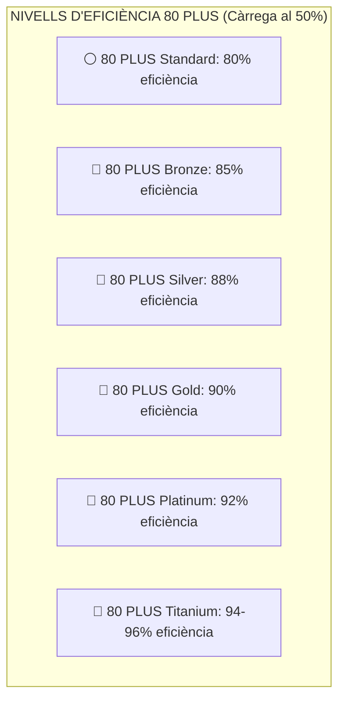
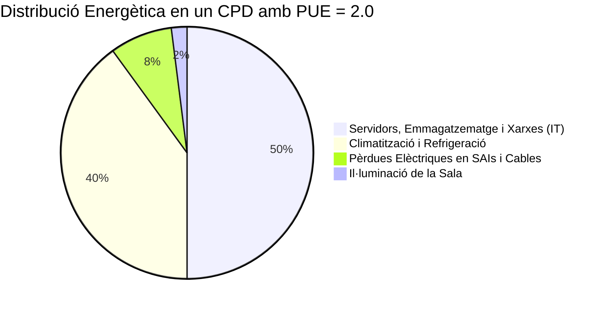

# UT04 — Eficiència Energètica, Green IT i Descarbonització

El concepte de **Green IT (*Tecnologies Verdes*)** agrupa totes aquelles pràctiques, arquitectures i decisions tecnològiques enfocades a minimitzar el consum elèctric dels equips informàtics, reduir la seua petjada de carboni i maximitzar el rendiment per watt consumit.

---

## 📌 1. Certificacions d'Eficiència Energètica: L'Estàndard 80 PLUS

En un ordinador o servidor, la **Font d'Alimentació (PSU)** converteix el corrent altern de la xarxa pública ($230\text{ V}$ CA) en corrent continu ($+12\text{ V}, +5\text{ V}, +3{,}3\text{ V}$ CC). Una font barata de mala qualitat té una eficiència del $60\%$, malbaratant el $40\%$ restant de l'energia en forma de calor que a més cal refredar amb ventiladors:

$$\boxed{\text{Potència Absorbida de la Xarxa}(\text{W}) = \frac{\text{Consum Real dels Components}(\text{W})}{\text{Eficiència}}}$$

### 📐 Exemple Comparatiu de Consum i Cost Anual:
Imagina un servidor de taller que requereix $400\text{ W}$ de potència continuada ($24\text{ h / 365 dies}$):
- **Amb font genèrica sense certificar (eficiència $65\%$):**  
  Consum de la paret $= 400 / 0{,}65 = 615\text{ W} \to 5387\text{ kWh/any}$.  
  A $0{,}20\text{ €/kWh} = \mathbf{1077{,}40\text{ €/any}}$.
- **Amb font 80 PLUS Gold (eficiència $90\%$):**  
  Consum de la paret $= 400 / 0{,}90 = 444\text{ W} \to 3889\text{ kWh/any}$.  
  A $0{,}20\text{ €/kWh} = \mathbf{777{,}80\text{ €/any}}$.
- **Estalvi directe:** **$299{,}60\text{ €/any}$ d'estalvi econòmic** i gairebé **$1\text{ tona de }\text{CO}_2$ menys** emesa a l'atmosfera cada any!

---

## 📌 2. L'Eficàcia Energètica en Centres de Dades: Mètrica PUE

La mètrica universal creada pel consorci *The Green Grid* per a avaluar l'eficiència energètica d'un Centre de Processament de Dades és el **PUE (*Power Usage Effectiveness*)**:

$$\boxed{\text{PUE} = \frac{\text{Consum Energètic Total del CPD}}{\text{Consum Exclusiu dels Equips Informàtics (IT)}}}$$

- **$\text{PUE} = 2{,}0$ (Molt ineficient):** Per cada watt que consumeixen els servidors per a processar dades, cal gastar un altre watt sencer per a refredar la sala i en pèrdues de bateries.
- **$\text{PUE} = 1{,}15 - 1{,}20$ (Excel·lent / Green IT):** S'aconsegueix aïllant passadissos freds i calents, utilitzant **refrigeració líquida directa a la CPU (*Direct-to-Chip*)** i aprofitant l'aire exterior fred a l'hivern (*Free Cooling*).
- **El PUE ideal teòric és $1{,}0$** (zero malbaratament auxiliar).

---

## 📌 3. Green Computing: Gestió de la CPU i Consolidació de Servidors

### 1. Estats de Repòs de la CPU (ACPI C-States i P-States):
Els processadors moderns incorporen instruccions per a reduir dinàmicament la seua freqüència de rellotge i el seu voltatge de funcionament quan no hi ha càrrega de treball:
- **P-States (Performance):** Canvis de freqüència segons la demanda d'ús (Intel SpeedStep / AMD Cool'n'Quiet).
- **C-States (Sleep):** Desconnexió de nuclis i memòries cau internes quan l'ordinador està inactiu (de C0 treballant al màxim fins a C8/C10 consumint microwatts).

### 2. Consolidació mitjançant Virtualització:
En l'arquitectura antiga, una empresa tenia 10 servidors físics individuals (un per a correu, un per a web, un per a fitxers, etc.) funcionant a penes al $10\%$ de càrrega de processador, gastant $300\text{ W}$ cadascun les 24 hores ($3000\text{ W}$ total).  
Mitjançant **hipervisors de virtualització (com Proxmox VE o VMware ESXi)**, es consoliden els 10 servidors com a màquines virtuals dins d'un únic equip potent al $65\%$ de càrrega, reduint el consum a $450\text{ W}$ (**estalvi directe del $85\%$ d'electricitat**).
