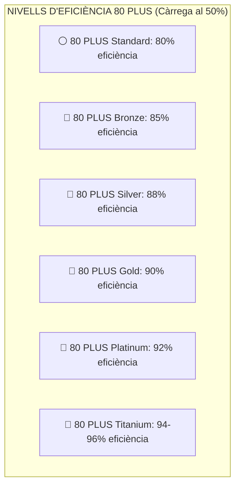
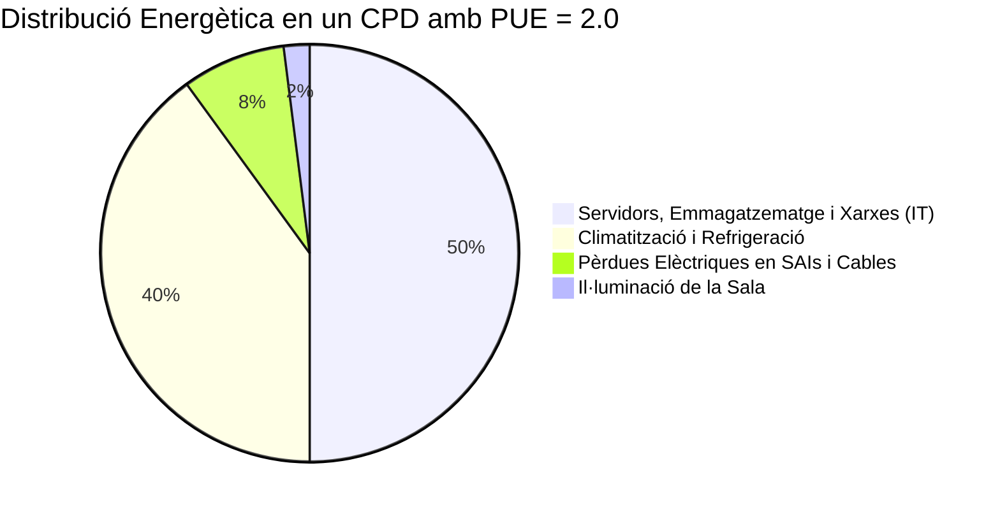

# UT04 — Eficiència Energètica, Green IT i Descarbonització

El concepte de **Green IT (*Tecnologies Verdes*)** agrupa totes aquelles pràctiques, arquitectures i decisions tecnològiques enfocades a minimitzar el consum elèctric dels equips informàtics, reduir la seua petjada de carboni i maximitzar el rendiment per watt consumit.

---

## 📌 1. Certificacions d'Eficiència Energètica: L'Estàndard 80 PLUS

En un ordinador o servidor, la **Font d'Alimentació (PSU)** converteix el corrent altern de la xarxa pública ($230\text{ V}$ CA) en corrent continu ($+12\text{ V}, +5\text{ V}, +3{,}3\text{ V}$ CC). Una font barata de mala qualitat té una eficiència del $60\%$, malbaratant el $40\%$ restant de l'energia en forma de calor que a més cal refredar amb ventiladors:

$$\boxed{\text{Potència Absorbida de la Xarxa}(\text{W}) = \frac{\text{Consum Real dels Components}(\text{W})}{\text{Eficiència}}}$$

<div style="background: linear-gradient(135deg, #0f172a 0%, #1e293b 100%); border-radius: 12px; padding: 20px; margin: 25px 0; box-shadow: 0 10px 25px -5px rgba(0, 0, 0, 0.3); border: 1px solid #334155;">
  <div style="text-align: center; margin-bottom: 15px;">
    <span style="background: #10b981; color: #0f172a; font-weight: 700; font-size: 0.75rem; text-transform: uppercase; letter-spacing: 0.05em; padding: 4px 10px; border-radius: 9999px;">Infografia Tècnica</span>
    <h3 style="color: #f8fafc; margin: 10px 0 5px 0; font-size: 1.25rem;">Eficiència Energètica en CPDs (PUE), Certificació 80 PLUS i Green IT</h3>
    <p style="color: #94a3b8; font-size: 0.85rem; margin: 0;">Mètriques PUE en centres de dades, corbes de rendiment per watt i estalvi per consolidació virtual</p>
  </div>
  <svg viewBox="0 0 860 280" width="100%" height="100%" xmlns="http://www.w3.org/2000/svg" style="display: block; font-family: system-ui, -apple-system, sans-serif;">
    <defs>
      <linearGradient id="pueGrad" x1="0%" y1="0%" x2="100%" y2="100%">
        <stop offset="0%" stop-color="#3b82f6" stop-opacity="0.25"/>
        <stop offset="100%" stop-color="#1e40af" stop-opacity="0.1"/>
      </linearGradient>
      <linearGradient id="plusGrad" x1="0%" y1="0%" x2="100%" y2="100%">
        <stop offset="0%" stop-color="#f59e0b" stop-opacity="0.25"/>
        <stop offset="100%" stop-color="#b45309" stop-opacity="0.1"/>
      </linearGradient>
      <linearGradient id="greenVirtGrad" x1="0%" y1="0%" x2="100%" y2="100%">
        <stop offset="0%" stop-color="#10b981" stop-opacity="0.25"/>
        <stop offset="100%" stop-color="#047857" stop-opacity="0.1"/>
      </linearGradient>
    </defs>

    <!-- Bloc 1: Mètrica PUE -->
    <rect x="20" y="25" width="250" height="200" rx="8" fill="url(#pueGrad)" stroke="#38bdf8" stroke-width="1.5"/>
    <text x="145" y="52" fill="#38bdf8" font-size="12" font-weight="bold" text-anchor="middle">❄️ MÈTRICA PUE EN CPDS</text>
    <text x="145" y="70" fill="#94a3b8" font-size="10" text-anchor="middle">Power Usage Effectiveness</text>
    <line x1="35" y1="85" x2="255" y2="85" stroke="#334155"/>
    <text x="35" y="108" fill="#cbd5e1" font-size="10.5">• <tspan fill="#38bdf8" font-weight="bold">Fórmula:</tspan> Total CPD / Càrrega IT</text>
    <text x="35" y="128" fill="#cbd5e1" font-size="10.5">• <tspan fill="#ef4444" font-weight="bold">PUE = 2,0:</tspan> 50% IT + 40% Aire + 10% SAI</text>
    <text x="35" y="148" fill="#cbd5e1" font-size="10.5">• <tspan fill="#34d399" font-weight="bold">PUE = 1,15 (Green IT):</tspan> Free Cooling</text>
    <text x="35" y="168" fill="#cbd5e1" font-size="10.5">• <tspan fill="#cbd5e1">Passadís fred i calent aïllats</tspan></text>
    <text x="145" y="205" fill="#38bdf8" font-size="10" text-anchor="middle" font-weight="bold">Ideal teòric: PUE = 1,0</text>

    <!-- Fletxa 1 a 2 -->
    <path d="M 275 110 L 305 110" stroke="#38bdf8" stroke-width="2"/>
    <text x="290" y="100" fill="#38bdf8" font-size="8" text-anchor="middle">Energia</text>
    <path d="M 305 130 L 275 130" stroke="#f59e0b" stroke-width="2"/>
    <text x="290" y="145" fill="#f59e0b" font-size="8" text-anchor="middle">Fonts</text>

    <!-- Bloc 2: Escala 80 PLUS -->
    <rect x="310" y="25" width="250" height="200" rx="8" fill="url(#plusGrad)" stroke="#f59e0b" stroke-width="1.5"/>
    <text x="435" y="52" fill="#f59e0b" font-size="12" font-weight="bold" text-anchor="middle">⚡ CERTIFICACIÓ 80 PLUS</text>
    <text x="435" y="70" fill="#fde68a" font-size="10" text-anchor="middle">Eficiència en Fonts (PSU)</text>
    <line x1="325" y1="85" x2="545" y2="85" stroke="#334155"/>
    <text x="325" y="108" fill="#cbd5e1" font-size="10.5">• <tspan fill="#94a3b8">Standard:</tspan> 80% eficiència</text>
    <text x="325" y="128" fill="#cbd5e1" font-size="10.5">• <tspan fill="#f59e0b">Bronze / Silver:</tspan> 85% - 88%</text>
    <text x="325" y="148" fill="#cbd5e1" font-size="10.5">• <tspan fill="#f59e0b" font-weight="bold">Gold (Recomanat):</tspan> 90%</text>
    <text x="325" y="168" fill="#cbd5e1" font-size="10.5">• <tspan fill="#38bdf8" font-weight="bold">Platinum / Titanium:</tspan> 92% - 96%</text>
    <text x="435" y="205" fill="#f59e0b" font-size="10" text-anchor="middle" font-weight="bold">Menys calor dissipada en va</text>

    <!-- Fletxa 2 a 3 -->
    <path d="M 565 110 L 595 110" stroke="#f59e0b" stroke-width="2"/>
    <text x="580" y="100" fill="#f59e0b" font-size="8" text-anchor="middle">CPU</text>
    <path d="M 595 130 L 565 130" stroke="#34d399" stroke-width="2"/>
    <text x="580" y="145" fill="#34d399" font-size="8" text-anchor="middle">Càrrega</text>

    <!-- Bloc 3: Green Computing i Consolidació -->
    <rect x="600" y="25" width="240" height="200" rx="8" fill="url(#greenVirtGrad)" stroke="#34d399" stroke-width="1.5"/>
    <text x="720" y="52" fill="#34d399" font-size="12" font-weight="bold" text-anchor="middle">🖥️ CONSOLIDACIÓ VIRTUAL</text>
    <text x="720" y="70" fill="#a7f3d0" font-size="10" text-anchor="middle">Hipervisors Proxmox / ESXi</text>
    <line x1="615" y1="85" x2="825" y2="85" stroke="#334155"/>
    <text x="615" y="108" fill="#cbd5e1" font-size="10.5">• <tspan fill="#ef4444" font-weight="bold">Abans:</tspan> 10 servidors x 300 W</text>
    <text x="615" y="125" fill="#94a3b8" font-size="10">= 3.000 W al 10% de càrrega</text>
    <text x="615" y="148" fill="#cbd5e1" font-size="10.5">• <tspan fill="#34d399" font-weight="bold">Ara:</tspan> 1 equip amfitrió x 450 W</text>
    <text x="615" y="165" fill="#94a3b8" font-size="10">= 450 W al 65% de càrrega</text>
    <text x="615" y="188" fill="#cbd5e1" font-size="10.5">• <tspan fill="#34d399" font-weight="bold">C-States / P-States:</tspan> Escalat CPU</text>
    <text x="720" y="215" fill="#34d399" font-size="9.5" text-anchor="middle" font-weight="bold">Estalvi directe del 85% d'electricitat</text>

    <!-- Peu informatiu -->
    <rect x="20" y="235" width="820" height="35" rx="6" fill="#1e293b" stroke="#334155"/>
    <text x="430" y="257" fill="#cbd5e1" font-size="10.5" text-anchor="middle">Efecte Multiplicador Negawtt: <tspan fill="#f59e0b" font-weight="bold">Cada watt estalviat a la CPU redueix automàticament mig watt addicional en refrigeració del CPD.</tspan></text>
  </svg>
</div>



### 📐 Exemple Comparatiu de Consum i Cost Anual:
Imagina un servidor de taller que requereix $400\text{ W}$ de potència continuada ($24\text{ h / 365 dies}$):
- **Amb font genèrica sense certificar (eficiència $65\%$):**  
  Consum de la paret $= 400 / 0{,}65 = 615\text{ W} \to 5387\text{ kWh/any}$.  
  A $0{,}20\text{ €/kWh} = \mathbf{1077{,}40\text{ €/any}}$.
- **Amb font 80 PLUS Gold (eficiència $90\%$):**  
  Consum de la paret $= 400 / 0{,}90 = 444\text{ W} \to 3889\text{ kWh/any}$.  
  A $0{,}20\text{ €/kWh} = \mathbf{777{,}80\text{ €/any}}$.
- **Estalvi directe:** **$299{,}60\text{ €/any}$ d'estalvi econòmic** i gairebé **$1\text{ tona de }\text{CO}_2$ menys** emesa a l'atmosfera cada any!

---

## 📌 2. L'Eficàcia Energètica en Centres de Dades: Mètrica PUE

La mètrica universal creada pel consorci *The Green Grid* per a avaluar l'eficiència energètica d'un Centre de Processament de Dades és el **PUE (*Power Usage Effectiveness*)**:

$$\boxed{\text{PUE} = \frac{\text{Consum Energètic Total del CPD}}{\text{Consum Exclusiu dels Equips Informàtics (IT)}}}$$



- **$\text{PUE} = 2{,}0$ (Molt ineficient):** Per cada watt que consumeixen els servidors per a processar dades, cal gastar un altre watt sencer per a refredar la sala i en pèrdues de bateries.
- **$\text{PUE} = 1{,}15 - 1{,}20$ (Excel·lent / Green IT):** S'aconsegueix aïllant passadissos freds i calents, utilitzant **refrigeració líquida directa a la CPU (*Direct-to-Chip*)** i aprofitant l'aire exterior fred a l'hivern (*Free Cooling*).
- **El PUE ideal teòric és $1{,}0$** (zero malbaratament auxiliar).

---

## 📌 3. Green Computing: Gestió de la CPU i Consolidació de Servidors

### 1. Estats de Repòs de la CPU (ACPI C-States i P-States):
Els processadors moderns incorporen instruccions per a reduir dinàmicament la seua freqüència de rellotge i el seu voltatge de funcionament quan no hi ha càrrega de treball:
- **P-States (Performance):** Canvis de freqüència segons la demanda d'ús (Intel SpeedStep / AMD Cool'n'Quiet).
- **C-States (Sleep):** Desconnexió de nuclis i memòries cau internes quan l'ordinador està inactiu (de C0 treballant al màxim fins a C8/C10 consumint microwatts).

### 2. Consolidació mitjançant Virtualització:
En l'arquitectura antiga, una empresa tenia 10 servidors físics individuals (un per a correu, un per a web, un per a fitxers, etc.) funcionant a penes al $10\%$ de càrrega de processador, gastant $300\text{ W}$ cadascun les 24 hores ($3000\text{ W}$ total).  
Mitjançant **hipervisors de virtualització (com Proxmox VE o VMware ESXi)**, es consoliden els 10 servidors com a màquines virtuals dins d'un únic equip potent al $65\%$ de càrrega, reduint el consum a $450\text{ W}$ (**estalvi directe del $85\%$ d'electricitat**).

---

## 📝 Quadern d'Activitats Pràctiques i Reptes de Laboratori

### 🔵 Bloc A: Fonaments i Càlculs Energètics

1. **Càlcul comparatiu de fonts 80 PLUS:** Un servidor d'infraestructura requereix una potència contínua de components interns de $500\text{ W}$ ($24\text{ h / 365 dies} = 8.760\text{ hores}$).
   - **Opció A (Font estàndard):** Eficiència del $70\%$.
     $$\text{Potència xarxa} = \frac{500\text{ W}}{0{,}70} = ?\text{ W} \quad \longrightarrow \quad \text{Consum anual (kWh)} = ?$$
   - **Opció B (Font 80 PLUS Platinum):** Eficiència del $92\%$.
     $$\text{Potència xarxa} = \frac{500\text{ W}}{0{,}92} = ?\text{ W} \quad \longrightarrow \quad \text{Consum anual (kWh)} = ?$$
   - Si el cost de l'energia és de $0{,}22\text{ €/kWh}$, quin és l'estalvi econòmic anual en euros? Quant de temps es triga a amortitzar la diferència de preu de $60\text{ €}$ entre ambdues fonts?
2. **Càlcul i diagnòstic de la mètrica PUE:** Un centre de dades corporatiu té un consum elèctric global de $180\text{ kW}$ registrat al comptador general de l'edifici. Si el conjunt dels servidors, commutadors i sistemes d'emmagatzematge consumeix exactament $120\text{ kW}$:
   $$\text{PUE} = \frac{180\text{ kW}}{120\text{ kW}} = ?$$
   - Com es qualifica aquest centre segons els estàndards Green IT (eficient, mitjà o ineficient)? Quina potència en kW s'està malbaratant en sistemes auxiliars?
3. **Mètrica WUE (*Water Usage Effectiveness*):** A més del consum elèctric, els CPDs moderns avaluen el seu consum d'aigua per refrigeració amb la mètrica WUE expressada en $\text{litres/kWh}$. Per què les torres de refrigeració evaporativa poden tindre un PUE elèctric molt bo ($1{,}15$) però un WUE ecològicament inacceptable en climes mediterranis?
4. **Arquitectura tèrmica de passadís fred i calent:** Com evita el tancament hermètic del passadís fred (*Cold Aisle Containment*) que l'aire fred expulsat pel terra tècnic es barrege prematurament amb l'aire calent expulsat per la part posterior dels servidors? Quants graus Celsius permet elevar el termòstat de consigna de la sala?
5. **Estats ACPI de la CPU:** Explica la diferència entre un estat **C-State** (com C6 Deep Power Down) i un estat **P-State** (com P1 o P2) d'un processador Intel o AMD. Què succeeix amb el rellotge i el voltatge en cadascun?
6. **Tecnologia *Direct-to-Chip* i Refrigeració per Immersió:** Per què la refrigeració líquida directa a la CPU permet dissipar fins a 1.000 W per sòcol de processador mentre que la refrigeració tradicional per aire col·lapsa als 350-400 W? En què consisteix la refrigeració per immersió bifàsica en fluid dielèctric?
7. **Pèrdues en Sistemes d'Alimentació Ininterrompuda (SAI/UPS):** Per quina raó un SAI de doble conversió en línia (*Online*) té una pèrdua d'eficiència típica del 6-10% fins i tot quan la xarxa elèctrica és estable? Què és el mode ECO intel·ligent d'un SAI modern?
8. **Efecte Negawatt en microinformàtica:** Per què s'afirma que «estalviar 1 watt a l'ordinador és millor que generar 1 watt amb plaques solars»? Què representa el concepte de *Negawatt* encunyat per Amory Lovins?
9. **Governadors de freqüència a Linux:** Quines diferències hi ha entre el governador `powersave`, el governador `ondemand` i el governador `schedutil` del nucli Linux? Quin d'ells equilibra millor rendiment i consum energètic?
10. **L'impacte de la pols en la resistència tèrmica:** Per què una capa d'1 mm de pols sobre les aletes d'un dissipador d'alumini actua com un aïllant tèrmic que obliga els ventiladors a girar a màximes revolucions augmentant tant el soroll com el consum elèctric?

---

### 🟢 Bloc B: Reptes Pràctics de Laboratori i Comandes de Terminal

#### 🛠️ Repte 1: Configuració del Governador de CPU a GNU/Linux
Verifica i canvia el governador d'escalat de freqüència de la CPU per a optimitzar el consum energètic en estacions de treball:
```bash
# 1. Comprovar els governadors disponibles al sistema
cat /sys/devices/system/cpu/cpu0/cpufreq/scaling_available_governors

# 2. Comprovar el governador actiu actualment
cat /sys/devices/system/cpu/cpu0/cpufreq/scaling_governor

# 3. Canviar tots els nuclis al governador d'estalvi energètic dinàmic
echo "powersave" | sudo tee /sys/devices/system/cpu/cpu*/cpufreq/scaling_governor

# 4. Comprovar la freqüència actual en MHz de cada nucli
grep "cpu MHz" /proc/cpuinfo
```

#### 🛠️ Repte 2: Auditoria i Perfils Energètics amb `tuned-adm`
En distribucions basades en Debian, Ubuntu o RHEL, utilitza el dimoni d'ajust de rendiment per a aplicar perfils de baix consum:
```bash
# Instal·lar el servei tuned
sudo apt install tuned -y
sudo systemctl enable --now tuned

# Llistar els perfils energètics disponibles
tuned-adm list

# Activar el perfil recomanat per a estalvi màxim d'energia
sudo tuned-adm profile powersave

# Verificar el perfil actiu
tuned-adm active
```

#### 🛠️ Repte 3: Configuració de Wake-on-LAN (WoL) per a Apagada Nocturna
Per a poder apagar automàticament les estacions de treball a les 20:00 h sense impedir que els tècnics puguen engegar-les remotament per a actualitzacions nocturnes:
```bash
# 1. Instal·lar l'eina de configuració de targetes de xarxa
sudo apt install ethtool -y

# 2. Comprovar el suport de WoL a la interfície de xarxa (ex: eth0 o enp3s0)
sudo ethtool enp3s0 | grep "Wake-on"

# 3. Activar el paquet màgic de Wake-on-LAN (flag g)
sudo ethtool -s enp3s0 wol g
```
*Verificació:* Comprova que la línia `Wake-on: g` està activa. Dissenya una tasca al cron que execute `/sbin/shutdown -h now` de dilluns a divendres a les 21:00 h.

#### 🛠️ Repte 4: Càlcul de PUE d'un Clúster de Laboratori
Al taller disposem d'un armari rack amb:
- 4 servidors de 1U consumint $180\text{ W}$ cadascun.
- 2 commutadors de xarxa gestionats de 24 ports consumint $45\text{ W}$ cadascun.
- 1 equip d'aire condicionat de suport al rack consumint $600\text{ W}$.
- 1 SAI de doble conversió amb una pèrdua interna de $80\text{ W}$.
1. Calcula la **Càrrega IT pura**:
   $$\text{Càrrega IT} = (4 \times 180\text{ W}) + (2 \times 45\text{ W}) = ?\text{ W}$$
2. Calcula la **Potència Total consumida de la xarxa**:
   $$\text{Potència Total} = \text{Càrrega IT} + 600\text{ W (Aire)} + 80\text{ W (SAI)} = ?\text{ W}$$
3. Calcula el valor de **PUE** resultant i redacta dues millores per a reduir el consum de climatització.

#### 🛠️ Repte 5: Neteja Física i Monitorització Tèrmica d'un Dissipador
Amb un ordinador del taller que presenta sobreescalfament:
1. Instal·la les eines de lectura de sensors tèrmics:
   ```bash
   sudo apt install lm-sensors -y
   sudo sensors-detect --auto
   sensors
   ```
2. Anota la temperatura de la CPU en repòs i sota estrès abans de la intervenció.
3. Desmunta el ventilador i dissipador, retira la pasta tèrmica resseca amb alcohol isopropílic, neteja la pols de les aletes d'alumini amb aire comprimit i aplica una capa fina de nova pasta tèrmica d'alta conductivitat ($>8\text{ W/mK}$).
4. Munta de nou l'equip i comprova amb la comanda `sensors` la reducció de temperatura en graus Celsius i la reducció de velocitat (RPM) del ventilador.

---

### 🔴 Bloc C: Rúbrica d'Avaluació Competencial per Nivells

| Criteri d'Avaluació | Insuficient (1 - 4) | Suficient (5 - 6) | Notable (7 - 8) | Excel·lent (9 - 10) |
| :--- | :--- | :--- | :--- | :--- |
| **Càlcul d'Eficiència Energètica (80 PLUS i PUE)** | Incapaç de calcular el consum d'una font o desconeix la definició de PUE. | Aplica les fórmules amb assistència però comet errors en el càlcul d'estalvi econòmic. | Calcula amb precisió consums, PUE i amortitzacions econòmiques entre diferents certificacions. | Analitza auditories PUE complexes, proposa estratègies de Free Cooling i quantifica estalvis. |
| **Gestió Tècnica de CPU i Governadors a Linux** | Desconeix els governadors d'escalat de CPU i manté la màquina a màxim voltatge continu. | Comprova el governador actiu però no sap canviar-lo de forma persistent per comanda. | Configura governadors `powersave` o `tuned-adm` i verifica la baixada de freqüències en MHz. | Automatitza perfils dinàmics segons l'estat de la bateria o càrrega, optimitzant C-States. |
| **Optimització Tèrmica i Manteniment Físic** | Desmunta dissipadors sense aplicar pasta tèrmica o dobla les aletes del radiador. | Neteja la pols superficialment sense monitoritzar les temperatures abans i després. | Realitza neteja tèrmica professional, canvi de pasta i mesura la caiguda de graus amb `sensors`. | Justifica la relació entre resistència tèrmica, acústica i consum de ventiladors en el taller. |
| **Arquitectura de Virtualització i Consolidació** | Proposa mantindre múltiples màquines físiques infrautilitzades sense consolidar. | Comprèn els beneficis de la virtualització bàsica però no sap dimensionar la càrrega. | Dimensiona servidors amfitrions per a consolidar serveis reduint dràsticament el consum en watts. | Dissenya projectes complets de consolidació amb mètriques d'estalvi energètic i retorn d'inversió. |

