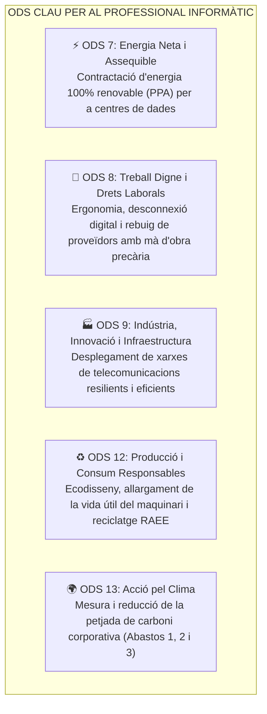
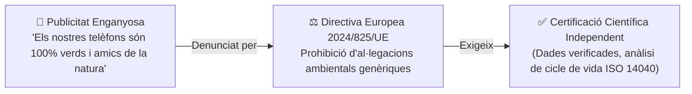
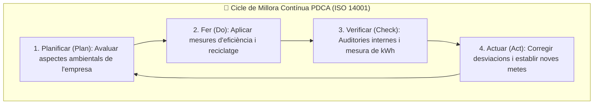

# UT05 — Sostenibilitat Corporativa, ODS i Governança ESG

La sostenibilitat ha deixat de ser una simple opció voluntària de màrqueting per a convertir-se en un **requeriment legal, estratègic i financer** per a qualsevol empresa. Els tècnics informàtics participen activament en la selecció ètica de proveïdors, la reducció d'emissions i la protecció dels drets digitals i laborals.

---

## 📌 1. Els Objectius de Desenvolupament Sostenible (ODS) i el Sector TIC

L'**Agenda 2030** de les Nacions Unides defineix 17 Objectius de Desenvolupament Sostenible (ODS). En el sector tecnològic i dels serveis microinformàtics destaquen cinc fites clau:

---

## 📌 2. Els Criteris ESG / ASG en la Gestió Empresarial

Els criteris **ESG** (*Environmental, Social and Governance* / *ASG en valencià*) són el conjunt de mètriques no financeres utilitzades per inversors, clients i administracions públiques per a avaluar la responsabilitat d'una organització:

| Pilar ESG | Focus d'Actuació | Aplicació Pràctica en Sistemes Informàtics |
| :---: | :--- | :--- |
| **E** (*Environmental* / Ambiental) | Impacte directe sobre la natura, el clima i els recursos finits. | Eficiència energètica de servidors (80 PLUS), refrigeració sostenible de CPDs, gestió de residus de tòner i plaques base. |
| **S** (*Social* / Social) | Relacions amb persones: empleats, clients i comunitat. | Protecció estricta de la privadesa (RGPD), ergonomia en llocs de treball d'ofimàtica, accessibilitat web universal (W3C/WCAG). |
| **G** (*Governance* / Governança) | Ètica interna, lideratge i transparència institucional. | Ciberseguretat contra el robatori de dades, transparència en contractacions públiques, canals ètics interns de denúncia (*Whistleblowing*). |

---

## 📌 3. El Perill del Blanqueig Ecològic (*Greenwashing*)

El **Greenwashing (*Blanqueig Verd*)** és la pràctica enganyosa mitjançant la qual una empresa inverteix més recursos en campanyes publicitàries per a projectar una imatge ecològica que no pas en accions reals per a reduir el seu impacte destructiu:

### Com detectar el Greenwashing en productes informàtics?
- Ús de conceptes vagues i no definits («ordinador ecològic», «portàtil verd») sense cap certificat oficial que ho avale.
- Destacar un xicotet atribut positiu (com usar un $10\%$ de cartó reciclat a la caixa d'embalatge) mentre el dispositiu per dins té la bateria soldada i és impossible de reparar.
- Compensacions d'emissions de carboni opaques sense auditories públiques.

---

## 📌 4. Sistemes de Gestió Ambiental: ISO 14001 i EMAS

Per a garantir que la sostenibilitat està arrelada en el funcionament quotidià d'una organització TIC, s'implanten marcs de gestió normalitzats:

- **ISO 14001:** Norma internacional certificable que estableix com implantar un **Sistema de Gestió Ambiental (SGA)** per a optimitzar consums i reduir riscos legals.
- **Reglament EMAS (*Eco-Management and Audit Scheme*):** El sistema comunitari de la Unió Europea. És més exigent que la ISO 14001 perquè exigeix una participació activa dels treballadors i l'obligació de publicar anualment una **Declaració Ambiental pública** validada per un verificador acreditat.
