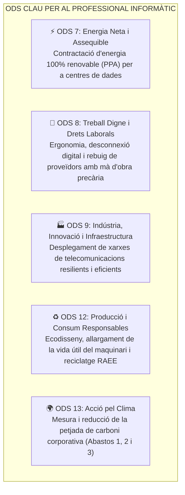
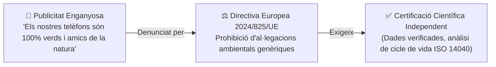
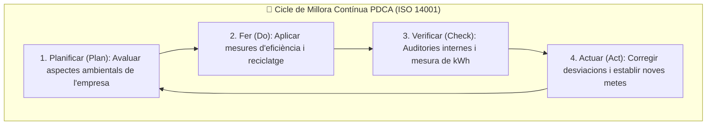

# UT05 — Sostenibilitat Corporativa, ODS i Governança ESG

La sostenibilitat ha deixat de ser una simple opció voluntària de màrqueting per a convertir-se en un **requeriment legal, estratègic i financer** per a qualsevol empresa. Els tècnics informàtics participen activament en la selecció ètica de proveïdors, la reducció d'emissions i la protecció dels drets digitals i laborals.

---

## 📌 1. Els Objectius de Desenvolupament Sostenible (ODS) i el Sector TIC

L'**Agenda 2030** de les Nacions Unides defineix 17 Objectius de Desenvolupament Sostenible (ODS). En el sector tecnològic i dels serveis microinformàtics destaquen cinc fites clau:

  

    Infografia Estratègica
    <h3 style="color: #f8fafc; margin: 10px 0 5px 0; font-size: 1.25rem;">Governança ESG, Agenda 2030 (ODS) i Sistemes ISO 14001</h3>
    
Integració dels pilars Ambiental, Social i Governança amb el cicle de millora contínua PDCA

  

  <svg viewBox="0 0 860 280" width="100%" height="100%" xmlns="http://www.w3.org/2000/svg" style="display: block; font-family: system-ui, -apple-system, sans-serif;">
    <defs>
      <linearGradient id="esgEnvGrad" x1="0%" y1="0%" x2="100%" y2="100%">
        <stop offset="0%" stop-color="#10b981" stop-opacity="0.25"/>
        <stop offset="100%" stop-color="#047857" stop-opacity="0.1"/>
      </linearGradient>
      <linearGradient id="esgSocGrad" x1="0%" y1="0%" x2="100%" y2="100%">
        <stop offset="0%" stop-color="#3b82f6" stop-opacity="0.25"/>
        <stop offset="100%" stop-color="#1e40af" stop-opacity="0.1"/>
      </linearGradient>
      <linearGradient id="esgGovGrad" x1="0%" y1="0%" x2="100%" y2="100%">
        <stop offset="0%" stop-color="#8b5cf6" stop-opacity="0.25"/>
        <stop offset="100%" stop-color="#6d28d9" stop-opacity="0.1"/>
      </linearGradient>
    </defs>

    <!-- Bloc 1: Pilar E (Environmental) -->
    <rect x="20" y="25" width="250" height="200" rx="8" fill="url(#esgEnvGrad)" stroke="#10b981" stroke-width="1.5"/>
    <text x="145" y="52" fill="#10b981" font-size="12" font-weight="bold" text-anchor="middle">🌱 E: AMBIENTAL (Environmental)</text>
    <text x="145" y="70" fill="#a7f3d0" font-size="10" text-anchor="middle">Petjada sobre el Planeta</text>
    <line x1="35" y1="85" x2="255" y2="85" stroke="#334155"/>
    <text x="35" y="108" fill="#cbd5e1" font-size="10.5">• <tspan fill="#34d399" font-weight="bold">Eficiència elèctrica:</tspan> Fonts 80 PLUS</text>
    <text x="35" y="128" fill="#cbd5e1" font-size="10.5">• <tspan fill="#34d399" font-weight="bold">Petjada de carboni:</tspan> Abastos 1, 2 i 3</text>
    <text x="35" y="148" fill="#cbd5e1" font-size="10.5">• <tspan fill="#cbd5e1">Gestió legal de residus RAEE</tspan></text>
    <text x="35" y="168" fill="#cbd5e1" font-size="10.5">• <tspan fill="#cbd5e1">ODS 7 (Energia) i ODS 13 (Clima)</tspan></text>
    <text x="145" y="205" fill="#10b981" font-size="9.5" text-anchor="middle" font-weight="bold">Auditoria de consums kWh</text>

    <!-- Fletxa 1 a 2 -->
    <path d="M 275 110 L 305 110" stroke="#10b981" stroke-width="2"/>
    <text x="290" y="100" fill="#10b981" font-size="8" text-anchor="middle">Drets</text>
    <path d="M 305 130 L 275 130" stroke="#38bdf8" stroke-width="2"/>
    <text x="290" y="145" fill="#38bdf8" font-size="8" text-anchor="middle">Ètica</text>

    <!-- Bloc 2: Pilar S (Social) -->
    <rect x="310" y="25" width="250" height="200" rx="8" fill="url(#esgSocGrad)" stroke="#38bdf8" stroke-width="1.5"/>
    <text x="435" y="52" fill="#38bdf8" font-size="12" font-weight="bold" text-anchor="middle">👥 S: SOCIAL (Social)</text>
    <text x="435" y="70" fill="#93c5fd" font-size="10" text-anchor="middle">Persones i Comunitat</text>
    <line x1="325" y1="85" x2="545" y2="85" stroke="#334155"/>
    <text x="325" y="108" fill="#cbd5e1" font-size="10.5">• <tspan fill="#38bdf8" font-weight="bold">Privadesa i RGPD:</tspan> Dades d'usuaris</text>
    <text x="325" y="128" fill="#cbd5e1" font-size="10.5">• <tspan fill="#38bdf8" font-weight="bold">Ergonomia:</tspan> Prevenció de riscos TIC</text>
    <text x="325" y="148" fill="#cbd5e1" font-size="10.5">• <tspan fill="#cbd5e1">Accessibilitat web: WCAG 2.1 AA</tspan></text>
    <text x="325" y="168" fill="#cbd5e1" font-size="10.5">• <tspan fill="#cbd5e1">Cadena sense treball infantil (3TG)</tspan></text>
    <text x="435" y="205" fill="#38bdf8" font-size="9.5" text-anchor="middle" font-weight="bold">ODS 8: Treball digne i justícia</text>

    <!-- Fletxa 2 a 3 -->
    <path d="M 565 110 L 595 110" stroke="#38bdf8" stroke-width="2"/>
    <text x="580" y="100" fill="#38bdf8" font-size="8" text-anchor="middle">Regles</text>
    <path d="M 595 130 L 565 130" stroke="#c084fc" stroke-width="2"/>
    <text x="580" y="145" fill="#c084fc" font-size="8" text-anchor="middle">Control</text>

    <!-- Bloc 3: Pilar G (Governance) -->
    <rect x="600" y="25" width="240" height="200" rx="8" fill="url(#esgGovGrad)" stroke="#c084fc" stroke-width="1.5"/>
    <text x="720" y="52" fill="#c084fc" font-size="12" font-weight="bold" text-anchor="middle">🏛️ G: GOVERNANÇA (Governance)</text>
    <text x="720" y="70" fill="#e9d5ff" font-size="10" text-anchor="middle">Transparència i Legalitat</text>
    <line x1="615" y1="85" x2="825" y2="85" stroke="#334155"/>
    <text x="615" y="108" fill="#cbd5e1" font-size="10.5">• <tspan fill="#c084fc" font-weight="bold">Ciberseguretat:</tspan> Esquema ENS / ISO 27001</text>
    <text x="615" y="128" fill="#cbd5e1" font-size="10.5">• <tspan fill="#cbd5e1">Transparència en contractacions</tspan></text>
    <text x="615" y="148" fill="#cbd5e1" font-size="10.5">• <tspan fill="#c084fc" font-weight="bold">Canals de denúncia</tspan> interns</text>
    <text x="615" y="168" fill="#cbd5e1" font-size="10.5">• <tspan fill="#f59e0b" font-weight="bold">Anti-Greenwashing:</tspan> Dades científiques</text>
    <text x="720" y="205" fill="#c084fc" font-size="9.5" text-anchor="middle" font-weight="bold">Certificació ISO 14001 / EMAS</text>

    <!-- Peu informatiu -->
    <rect x="20" y="235" width="820" height="35" rx="6" fill="#1e293b" stroke="#334155"/>
    <text x="430" y="257" fill="#cbd5e1" font-size="10.5" text-anchor="middle">Sostenibilitat Real: <tspan fill="#f59e0b" font-weight="bold">La Directiva 2024/825/UE prohibeix l'ús d'al·legacions ecològiques sense dades científiques verificades.</tspan></text>
  </svg>

---

## 📌 2. Els Criteris ESG / ASG en la Gestió Empresarial

Els criteris **ESG** (*Environmental, Social and Governance* / *ASG en valencià*) són el conjunt de mètriques no financeres utilitzades per inversors, clients i administracions públiques per a avaluar la responsabilitat d'una organització:

| Pilar ESG | Focus d'Actuació | Aplicació Pràctica en Sistemes Informàtics |
| :---: | :--- | :--- |
| **E** (*Environmental* / Ambiental) | Impacte directe sobre la natura, el clima i els recursos finits. | Eficiència energètica de servidors (80 PLUS), refrigeració sostenible de CPDs, gestió de residus de tòner i plaques base. |
| **S** (*Social* / Social) | Relacions amb persones: empleats, clients i comunitat. | Protecció estricta de la privadesa (RGPD), ergonomia en llocs de treball d'ofimàtica, accessibilitat web universal (W3C/WCAG). |
| **G** (*Governance* / Governança) | Ètica interna, lideratge i transparència institucional. | Ciberseguretat contra el robatori de dades, transparència en contractacions públiques, canals ètics interns de denúncia (*Whistleblowing*). |

---

## 📌 3. El Perill del Blanqueig Ecològic (*Greenwashing*)

El **Greenwashing (*Blanqueig Verd*)** és la pràctica enganyosa mitjançant la qual una empresa inverteix més recursos en campanyes publicitàries per a projectar una imatge ecològica que no pas en accions reals per a reduir el seu impacte destructiu:

### Com detectar el Greenwashing en productes informàtics?
- Ús de conceptes vagues i no definits («ordinador ecològic», «portàtil verd») sense cap certificat oficial que ho avale.
- Destacar un xicotet atribut positiu (com usar un $10\%$ de cartó reciclat a la caixa d'embalatge) mentre el dispositiu per dins té la bateria soldada i és impossible de reparar.
- Compensacions d'emissions de carboni opaques sense auditories públiques.

---

## 📌 4. Sistemes de Gestió Ambiental: ISO 14001 i EMAS

Per a garantir que la sostenibilitat està arrelada en el funcionament quotidià d'una organització TIC, s'implanten marcs de gestió normalitzats:

- **ISO 14001:** Norma internacional certificable que estableix com implantar un **Sistema de Gestió Ambiental (SGA)** per a optimitzar consums i reduir riscos legals.
- **Reglament EMAS (*Eco-Management and Audit Scheme*):** El sistema comunitari de la Unió Europea. És més exigent que la ISO 14001 perquè exigeix una participació activa dels treballadors i l'obligació de publicar anualment una **Declaració Ambiental pública** validada per un verificador acreditat.

---

## 📝 Quadern d'Activitats Pràctiques i Reptes de Laboratori

### 🔵 Bloc A: Fonaments i Diagnòstic Tècnic

1. **Diferència entre RSC i ESG:** Per quina raó els mercats financers i les administracions públiques han passat de la tradicional Responsabilitat Social Corporativa (RSC) als criteris **ESG/ASG**? Què aporta el concepte de mètriques quantitatives mesurables i auditables?
2. **Impacte de les TIC en els ODS:** Tria tres Objectius de Desenvolupament Sostenible de l'Agenda 2030 (per exemple ODS 7, ODS 12 i ODS 13) i descriu una acció tècnica concreta que un tècnic informàtic d'SMX puga executar en una empresa per a contribuir-hi.
3. **Marc legal contra el Greenwashing:** Quines sancions i prohibicions estableix la **Directiva Europea 2024/825/UE** per a les empreses que utilitzen afirmacions com «ordinador neutre en carboni» o «ecològic» basant-se únicament en la compra de crèdits de carboni sense reduir les seues emissions reals?
4. **El cicle de Deming (PDCA) en la ISO 14001:** Explica cadascuna de les 4 fases del cicle de millora contínua (Planificar, Fer, Verificar, Actuar) aplicat a la gestió del consum energètic i residus de tòner en un departament de sistemes.
5. **Diferències entre ISO 14001 i Reglament EMAS:** Per què el reglament europeu EMAS es considera el màxim nivell d'excel·lència ambiental a la Unió Europea? Quin requisit de transparència pública imposa que no exigeix la norma privada ISO 14001?
6. **Clàusules ambientals en contractació pública:** Quan un ajuntament o una conselleria publica una licitació per a renovar 500 ordinadors d'escoles, quins criteris de sostenibilitat sol exigir (certificacions EPEAT Gold, Energy Star 8.0, fonts 80 PLUS i garantia de disponibilitat de recanvis durant 5 anys)?
7. **Ergonomia com a pilar Social (S):** Quins riscos laborals específics pateixen els tècnics de sistemes que treballen davant de pantalles de visualització de dades (PVD) segons el Reial Decret 488/1997? Quines mesures preventives de col·locació del monitor, llum i cadira s'han d'aplicar?
8. **Privadesa RGPD com a dret fonamental:** Dins de quin pilar ESG s'enquadra el compliment estricte de la privadesa de dades personals? Quines conseqüències reputacionals i econòmiques té per a una empresa patir una bretxa de seguretat per no xifrar còpies de seguretat?
9. **Canals de denúncia (*Whistleblowing*) i pilar de Governança (G):** Què exigeix la Llei 2/2023 de protecció de les persones informants sobre corrupció o infraccions greus? Com han de garantir els tècnics informàtics la confidencialitat absoluta del canal telemàtic de denúncies?
10. **Estàndards de memòria GRI (*Global Reporting Initiative*):** Què són els estàndards GRI utilitzats per a elaborar informes de sostenibilitat corporativa i com reflecteixen el consum energètic de xarxes de telecomunicacions i servidors?

---

### 🟢 Bloc B: Reptes de Recerca, Anàlisi i Diagnòstic de Sostenibilitat

#### 🛠️ Repte 1: Detecció d'Al·legacions Enganyoses (*Greenwashing Audit*)
Cerca a la publicitat o en la pàgina web d'un producte tecnològic real (un telèfon, impressora o perifèric) afirmacions ambientals:
1. Localitza almenys dues al·legacions ecològiques promocionades (ex: «100% ecològic», «fabricat pensant en la natura», «carbon neutral»).
2. Analitza si l'empresa aporta l'enllaç directe a un estudi d'Anàlisi de Cicle de Vida (ACV segons ISO 14040/14044) verificat per una entitat independent (com TÜV, AENOR o SGS).
3. Avalua si l'al·legació compleix o infringeix la Directiva Europea 2024/825/UE i redacta un informe d'auditoria de 15 línies amb el teu veredicte tècnic.

#### 🛠️ Repte 2: Redacció d'una Política Ambiental ISO 14001 per a un Taller TIC
Imagina que ets el responsable tècnic d'un servei d'assistència tècnica informàtica (SAT) de 10 treballadors:
1. Redacta la **Política Ambiental Corporativa** de l'empresa d'acord amb els requisits de l'apartat 5.2 de la norma ISO 14001:
   - Compromís formal de compliment de la legislació vigent (RAEE, RoHS, eficiència energètica).
   - Compromís de prevenció de la contaminació i millora contínua.
   - Marc de referència per a establir objectius ambientals mesurables.
2. Defineix dos objectius quantitatius concrets per a l'any vinent:
   - *Objectiu 1:* Reduir el consum elèctric del taller en un $15\%$.
   - *Objectiu 2:* Garantir el reciclatge o reutilització del $100\%$ de les bateries d'ió-liti retirades.

#### 🛠️ Repte 3: Qüestionari d'Avaluació ESG per a Homologació de Proveïdors
Dissenya un qüestionari d'homologació de proveïdors de material microinformàtic que continga 6 preguntes clau:
- 2 preguntes del pilar **Ambiental** (ex: petjada de carboni del transport, certificació de fonts d'alimentació).
- 2 preguntes del pilar **Social** (ex: auditories contra el treball infantil a les mines d'or/coltan, pla d'igualtat de l'empresa).
- 2 preguntes del pilar **Governança** (ex: certificació en Esquema Nacional de Seguretat o ISO 27001, política anticorrupció).
Defineix com es puntuarà cadascuna per a rebutjar proveïdors que no complisquen els mínims ètics.

#### 🛠️ Repte 4: Anàlisi d'una Declaració Ambiental Pública EMAS Real
Accedeix al registre oficial europeu d'organitzacions EMAS o consulta la declaració ambiental validada d'una universitat pública o centre sanitari:
1. Comprova quins indicadors bàsics (*Core Indicators*) reflecteix l'informe anual:
   - Eficiència energètica (MWh/any).
   - Eficiència en l'ús de materials (tones de paper i residus informàtics).
   - Emissions de gasos d'efecte hivernacle ($\text{tCO}_2\text{e}$).
2. Comprova el segell de validació del verificador ambiental independent acreditat per ENAC.
3. Compara el nivell de detall i transparència d'aquest document amb una típica campanya publicitària comercial.

#### 🛠️ Repte 5: Disseny d'un Lloc de Treball Informàtic Ergonòmic
Realitza l'auditoria ergonòmica del teu lloc d'aprenentatge a l'aula d'informàtica seguint la guia tècnica de l'INSST (Institut Nacional de Seguretat i Salut en el Treball):
1. **Mesura de distàncies:**
   - La vora superior de la pantalla està a l'alçada dels teus ulls o lleugerament per sota?
   - La pantalla se situa a una distància d'entre 40 i 70 cm dels ulls?
   - Els colzes formen un angle recte de $90^\circ$ mentre treballes amb el teclat i ratolí?
2. **Il·luminació i reflexos:**
   - La pantalla està orientada perpendicularment a les finestres per evitar enlluernaments directes o reflexos molestos?
3. Redacta una llista de 3 accions correctives per a millorar la salut postural del lloc de taller auditat.

---

### 🔴 Bloc C: Rúbrica d'Avaluació Competencial per Nivells

| Criteri d'Avaluació | Insuficient (1 - 4) | Suficient (5 - 6) | Notable (7 - 8) | Excel·lent (9 - 10) |
| :--- | :--- | :--- | :--- | :--- |
| **Criteris ESG i Governança Corporativa** | Confon sostenibilitat exclusivament amb reciclatge de paper ignorant els pilars Social i Governança. | Reconeix els tres pilars ESG però no sap com s'apliquen tècnicament a serveis informàtics. | Classifica i avalua correctament mesures ambientals, socials i ètiques en empreses tecnològiques. | Domina marcs ESG internacionals, memòries GRI i requisits de licitació pública verda. |
| **Detecció de Greenwashing i Normativa UE** | Accepta qualsevol lema publicitari com a verídic sense verificar dades científiques. | Identifica el greenwashing evident però desconeix el marc legal de la Directiva 2024/825/UE. | Audita afirmacions publicitàries identificant l'absència de certificacions i dades de cicle de vida. | Redacta informes legals i tècnics d'auditoria anti-greenwashing amb rigor normatiu europeu. |
| **Sistemes de Gestió Ambiental (ISO 14001 / EMAS)** | Desconeix el cicle PDCA o la diferència entre normes certificables i recomanacions voluntàries. | Explica el cicle de millora contínua bàsic però no sap redactar una política ambiental. | Redacta polítiques ambientals i procediments operatius conformes a l'apartat 5 de la ISO 14001. | Dissenya indicadors de seguiment ambiental, prepara auditories internes i compara marcs EMAS. |
| **Ergonomia i Drets Digitals Laborals** | Ignora els riscos ergonòmics de les pantalles de visualització o la seguretat de dades en l'empresa. | Reconeix pautes ergonòmiques bàsiques però no sap aplicar la normativa de l'INSST. | Audita llocs de treball microinformàtics, mesurant distàncies i angles d'acord amb la legislació. | Dissenya llocs de treball integrals sans, accessibles i conformes a la normativa de prevenció de riscos. |

