# UD1: Introducción a las Bases de Datos y Almacenamiento de la Información

Bienvenido/a a la **UD1: Introducción a las Bases de Datos y Almacenamiento de la Información** del módulo profesional de **Bases de Datos** (1º DAW / DAM / ASIX · Bases de Datos).

En esta unidad encontrarás los contenidos teóricos, ejemplos prácticos, ejercicios resueltos y actividades de evaluación curricular desarrollados por el profesor **Manuel Alonso Argente**.

---

### 📑 Índice de Apartados y Actividades de la Unidad

- [**📋 1.0 Propuesta Didáctica: Introducción a las BBDD. Almacenamiento de la Información**](./ut0100.html)
- [**1.1 Introducción. Tipos de ficheros y acceso a datos**](./ut0101.html)
- [**1.2 Introducción a las BBDD**](./ut0102.html)
- [**1.3 Sistemas gestores de base de datos SGBD**](./ut0103.html)
- [**1.4 Bases de datos Centralizadas y Distribuidas**](./ut0104.html)
- [**1.5 Fragmentación**](./ut0105.html)
- [**1.6 Protección de datos y normativa LOPD**](./ut0106.html)
- [**1.7 Big Data e Inteligencia de negocios**](./ut0107.html)

**Actividades Prácticas y Fichas de Trabajo:**

- [**✏️ ACT101 101**](./act_act101.html)
- [**✏️ ACT102 102**](./act_act102.html)
- [**✏️ ACT103 103**](./act_act103.html)
- [**✏️ ACT104 104**](./act_act104.html)
- [**✏️ ACT105 105**](./act_act105.html)
- [**✏️ ACT106 106**](./act_act106.html)
- [**✏️ ACT107 107**](./act_act107.html)
- [**✏️ ACT108 108**](./act_act108.html)
- [**✏️ ACT109 109**](./act_act109.html)
- [**✏️ ACT110 110**](./act_act110.html)

---

# 📖 Vista Completa de la Unidad

## 1.0 Propuesta Didáctica — Introducción a las BBDD. Almacenamiento de la Información

# **Introducción a las BBDD. Almacenamiento de la Información**

## **Propuesta didáctica**

En esta unidad vamos a trabajar el RA1: **Reconoce los elementos de las bases de datos analizando sus funciones y valorando la utilidad de los sistemas gestores**.

## **Criterios de evaluación**

### **Respecto al RA1:**

| Código | Descripción | Peso (%) | Herramientas Evaluación |
| --- | --- | --- | --- |
| **CE1a** | Se han analizado los sistemas lógicos de almacenamiento y sus características | 10% | ACT101 (5%) -- EXA101 (95%) |
| **CE1b** | Se han identificado los distintos tipos de bases de datos según el modelo de datos utilizado | 15% | ACT102 (5%) -- EXA101 (95%) |
| **CE1c** | Se han identificado los distintos tipos de bases de datos en función de la ubicación de la información | 15% | ACT103 (5%) -- EXA101 (95%) |
| **CE1d** | Se ha evaluado la utilidad de un sistema gestor de bases de datos | 10% | ACT104 (5%) -- EXA101 (95%) |
| **CE1e** | Se ha reconocido la función de cada uno de los elementos de un sistema gestor de bases de datos | 10% | ACT105 (5%) -- EXA101 (95%) |
| **CE1f** | Se han clasificado los sistemas gestores de bases de datos | 10% | ACT106 (5%) -- EXA101 (95%) |
| **CE1g** | Se ha reconocido la utilidad de las bases de datos distribuidas | 10% | ACT107 (5%) -- EXA101 (95%) |
| **CE1h** | Se han analizado las políticas de fragmentación de la información | 5% | ACT108 (5%) -- EXA101 (95%) |
| **CE1i** | Se ha identificado la legislación vigente sobre protección de datos | 5% | ACT109 (5%) -- EXA101 (95%) |
| **CE1j** | Se han reconocido los conceptos de Big Data y de la inteligencia de negocios. | 10% | ACT110 (5%) -- EXA101 (95%) |

## **Contenidos**

### **Almacenamiento de la información:**

- Ficheros (planos, indexados, acceso directo, entre otros).

- Bases de datos. Conceptos, usos y tipos según el modelo de datos, la ubicación de la información.

- Sistemas gestores de base de datos: Funciones, componentes y tipos.

- Bases de datos centralizadas y bases de datos distribuidas. Fragmentación.

- LOPD. Principios de la protección de datos. Derechos de las personas. Ficheros de titularidad pública y privada. Agencia Española de Protección de Datos. Infracciones y sanciones.

- Big data: introducción, análisis de datos, inteligencia de negocios.

> **📌 Cuestionario inicial**
> 

> 1. ¿Qué es una base de datos (BD)?

> 1. ¿Y qué relación existe entre una BD y un sistema gestor de base de datos (SGBD)?

> 1. ¿Puedes citar tres SGBD?

> 1. ¿Para qué sirve el diccionario de datos de una BD?

> 1. ¿Qué relación hay entre la integridad y la redundancia de los datos?

> 1. ¿Sabes que significan las siglas ACID?

> 1. ¿Podemos almacenar todos los datos personales de los usuarios de nuestras aplicaciones?

## **Programación de Aula (10 sesiones)**

Esta unidad es la primera, con lo que se imparte en la primera evaluación, con una duración estimada de 10 sesiones lectivas, durante los días que se indican en el calendario (los días de classe son martes, miercoles y viernes, con dos horas, una hora y dos horas respectivamente):

### **Calendario**

#### **Septiembre 2026**

| Lunes | Martes | Miércoles | Jueves | Viernes | Sábado | Domingo |
| --- | --- | --- | --- | --- | --- | --- |
|  | 1 | 2 | 3 | 4 | **5 🛑** | **6 🛑** |
| 7 | 8 | **9 🎒** | 10 | **11 📚** | **12 🛑** | **13 🛑** |
| 14 | **15 📚** | **16 📚** | 17 | **18 📚** | **19 🛑** | **20 🛑** |
| 21 | **22📚** | **23 📚** | 24 | 25 | **26 🛑** | **27 🛑** |
| 28 | 29 | 30 |  |  |  |  |

### **Sesiones**

| Sesión | Contenidos | Actividades | Criterios trabajados |
| --- | --- | --- | --- |
| 1 | 01 Tipos de ficheros y acceso a datos | ACT101 | CE1.a |
| 2 | 02 Introducción a las bases de datos | ACT102 -- ACT103 | CE1.b - CE1.c |
| 3 | 03 Sistemas gestores de base de datos (SGBD) | ACT104 -- ACT105 -- ACT106 | CE1.d - CE1.e - CE1.f |
| 4 | 04 Arquitectura de bases de dades | ACT107 | CE1.g |
| 5 | 05 Fragmentación |  | CE1.h |
| 6 | 05 Fragmentación | ACT108 | CE1.h |
| 7 | 06 Protección de datos y normativa LOPD | ACT109 | CE1.i |
| 8 | 07 Big Data e Inteligencia de negocios | ACT110 | CE1.j |
| 9 | Actividades | ACT101 - ACT102 - ACT103 - ACT104 - ACT105 - ACT106 - ACT107 - ACT108 - ACT109 - ACT110 | CE1.a - CE1.b - CE1.c - CE1.d - CE1.e - CE1.f - CE1.g - CE1.h - CE1.i - CE1.j |
| 10 | Actividades | EXA101 | CE1.a - CE1.b - CE1.c - CE1.d - CE1.e - CE1.f - CE1.g - CE1.h - CE1.i - CE1.j |

### **Seguimiento**

| Sesión | Contenidos | Actividades | Descripción | Fecha |
| --- | --- | --- | --- | --- |
| 1 | 01 Tipos de ficheros y acceso a datos 02 Introducción a las bases de datos 03 Sistemas gestores de base de datos (SGBD) |  | Se realiza presentación del módulo, se presenta la unidad de programación con la propuesta didáctica y se empieza con el punto 1.1 y el punto 1.2 | 11/09/2026 |
| 2 | 01 Tipos de ficheros y acceso a datos 02 Introducción a las bases de datos 03 Sistemas gestores de base de datos (SGBD) |  | Se termina con el punto 1.2 y el punto 1.3. Para la próxima sesión se realizaran las actividades relacionadas con estos apartados. | 11/09/2026 |
| 3 |  | ACT101 - ACT102 - ACT103 | Activitats | 15/09/2026 |
| 4 | 04 Arquitectura de bases de dades - 05 Fragmentación | ACT104 - ACT105 - ACT106 | Activitats | 15/09/2026 |
| 5 |  | ACT104 - ACT105 - ACT106 | Activitats | 16/09/2026 |
| 6 | 06 Protección de datos y normativa LOPD |  | Vemos en clase el punto 1.6 de la protección de datos y la normativa | 18/09/2026 |
| 7 | 07 Big Data e Inteligencia de negocios | Actividades Unidad | Se realizan actividades de la unidad | 18/09/2026 |
| 8 |  | Actividades Unidad | Se realizan actividades de la unidad | 22/09/2026 |
| 9 |  | Actividades Unidad | Se realizan actividades de la unidad | 22/09/2026 |
| 10 | Examen Unidad |  | Se realiza el examen de la unidad | 29/09/2026 |
| 11 | Examen Unidad |  | Se realiza el examen de la unidad | 29/09/2026 |

---

## 📅 Programación de Aula y Temporalización

Para la evaluación del módulo de Base de Datos se ponderarán los resultados de aprendizaje respecto a los porcentajes indicados en el apartado anterior.

Para la evaluación de cada RA, emplearemos diferentes Instrumentos de Evaluación (IE), como pueden ser:

Actividades de enseñanza/aprendizaje, normalmente realizadas en el aula, acompañadas de una rúbrica. Distinguiremos las actividades de clase ( AC), las cuales se calificarán normalmente sobre una escala de 3 puntos, de las actividades de refuerzo ( AR), también sobre 3 puntos para consolidar uno o varios CE no conseguidos, así como actividades de profundización ( AP) que aportarán puntos extra al RA.
Prácticas ( PR) o trabajo de investigación ( TI), con una carga temporal variable, entre una semana o toda una unidad didáctica. Normalmente calificados sobre 10 puntos.
Proyectos ( PY), bien de desarrollo individual o en parejas, sobre un determinado RA. Normalmente calificados sobre 30 puntos.
Pruebas objetivas ( PO). En algunos RA, y no de forma generalizada, se realizará una prueba objetiva (ya sea escrita o en ordenador). Normalmente calificados sobre 30 puntos.
Para calcular la calificación de cada resultado de aprendizaje, se realizará la media ponderada simple de los diferentes instrumentos de evaluación empleados en dicho RA. Para comprobar que se han cubierto todos los criterios de evaluación, puedes consultar la página de validación.

Todas las calificaciones, tanto de los instrumentos de evaluación como de los propios RA, se podrá consultar en todo momento en la plataforma Aules del curso.

# UNITAT 1

## Introducció a les BBDD. Emmagatzematge de la informació.

**Sessions**: 6

| OBJECTIUS GENERALS | COMPETÈNCIES | RESULTATS D'APRENENTATGE |
| --- | --- | --- |
| e), f) i r) | d) i p) | RA1 |

### Introducció

En aquesta unitat l’alumnat s’introduirà en el món de les bases de dades com a pilar fonamental en la gestió i organització de la informació en sistemes informàtics. Es treballaran els conceptes bàsics d’emmagatzematge, els models de dades més habituals, i es coneixeran els Sistemes Gestors de Bases de Dades (SGBD) i les seues funcionalitats. A més, s’abordaran conceptes avançats com ara les bases de dades distribuïdes, les polítiques de fragmentació, la legislació sobre protecció de dades i es farà una introducció al Big Data i la intel·ligència de negocis (Business Intelligence).

## OBJECTIUS DIDÀCTICS

- Comprendre els sistemes d’emmagatzematge de dades i les seues característiques bàsiques.

- Identificar els diferents models de bases de dades (jeràrquic, relacional, orientat a objectes, etc.).

- Distingir les bases de dades segons la ubicació de la informació (locals, en xarxa o al núvol).

- Valorar la importància i utilitat dels SGBD en entorns reals.

- Reconèixer els components principals d’un SGBD i les seues funcions específiques.

- Classificar diferents tipus de SGBD, tant comercials com de codi obert.

- Entendre la funcionalitat i els avantatges de les bases de dades distribuïdes.

- Analitzar com es fragmenta i distribueix la informació.

- Conèixer i interpretar la legislació vigent sobre protecció de dades.

- Reconèixer els conceptes fonamentals de Big Data i Business Intelligence.

## CONTINGUT

- Fitxers (plans, indexats, accés directe, etc.)

- Bases de dades: conceptes, usos i classificació.

- SGBD: funcions, components i tipus.

- Bases de dades centralitzades vs distribuïdes. Fragmentació.

- LOPD: principis, drets, fitxers públics/privats, sancions.

- Big Data i Business Intelligence.

## DESENVOLUPAMENT DE LA UNITAT DE PROGRAMACIÓ

### Sessió 1

**Activitats**

| COD.ACT | ACT | TIPUS | ORG | CA |
| --- | --- | --- | --- | --- |
| UP01.1.01 | Mort al desordre. | Motivació | Grup-classe | CA1.a, CA1.b, CA1.c |
| - | Debat sobre emmagatzematge físic/lògic | Debat | Grup |  |
| - | Cerimònia inicial Scrum | Metodologia | Grup |  |

**Contingut**

| COD.T | Contingut | Metodologia | CA |
| --- | --- | --- | --- |
| T01.01 | Tipus de fitxers i accés a dades | Classe magistral | CA1.a |

### Sessió 2

**Contingut**

| COD.T | Contingut | Metodologia | CA |
| --- | --- | --- | --- |
| T01.02 | Introducció a les bases de dades | Flipped Classroom | CA1.b, CA1.c |

**Activitats**

| COD.ACT | ACT | TIPUS | ORG | CA |
| --- | --- | --- | --- | --- |
| UP01.2.03 | Tipus de bases de dades | Consolidació | Per equips | CA1.b, CA1.c |

### Sessió 3

**Contingut**

| COD.T | Contingut | Metodologia | CA |
| --- | --- | --- | --- |
| T01.03 | Sistemes Gestors de Bases de Dades | Flipped Classroom | CA1.d, CA1.e, CA1.f |

**Activitats**

| COD.ACT | ACT | TIPUS | ORG | CA |
| --- | --- | --- | --- | --- |
| UP01.2.04 | Diferències entre SGBD | Consolidació | Per equips | CA1.d, CA1.e, CA1.f |

### Sessió 4

**Contingut**

| COD.T | Contingut | Metodologia | CA |
| --- | --- | --- | --- |
| T01.04 | Arquitectura de bases de dades | Classe magistral | CA1.g, CA1.h |

**Activitats**

| COD.ACT | ACT | TIPUS | ORG | CA |
| --- | --- | --- | --- | --- |
| UP01.2.05 | Distribuïdes vs Centralitzades | Consolidació | Per equips | CA1.g, CA1.h |

### Sessió 5

**Contingut**

| COD.T | Contingut | Metodologia | CA |
| --- | --- | --- | --- |
| T01.05 | Protecció de dades i normativa | Classe magistral | CA1.i |
| T01.06 | Introducció al Big Data | Classe magistral | CA1.j |

**Activitats**

| COD.ACT | ACT | TIPUS | ORG | CA |
| --- | --- | --- | --- | --- |
| UP01.2.06 | LOPD i RGPD: Infraccions i sancions | Consolidació | Per equips | CA1.i |
| UP01.2.07 | Big Data i Intel·ligència de negocis | Consolidació | Per equips | CA1.j |
| UP01.4.10 | Repassar Jugant | Síntesi | Grup i Individual | Tots |

### Sessió 6

**Activitats d'avaluació**

| COD.ACT | ACT | TIPUS | ORG | CA |
| --- | --- | --- | --- | --- |
| UP01.5.11 | Examen teòric tipus test | Avaluació | Individual | Tots |
| UP01.5.12 | Retrospectiva Scrum | Avaluació | Grupal i Individual | CAT1.a, b, c |

## ACTIVITATS D'AMPLIACIÓ I REFORÇ

| COD.ACT | ACT | TIPUS | ORG | CA |
| --- | --- | --- | --- | --- |
| UP01.3.08 | Instal·lació de MySQL Workbench | Ampliació | Individual | CA1.d |
| UP01.3.09 | Tipus d'arxius i BBDD relacionals | Reforç | Individual | CA1.b, c, d, e, f |

## RECURSOS MATERIALS I DIDÀCTICS

- Coneixements previs de l’alumnat.

- Pissarra.

- Tauler Kanban JIRA (online).

- Moodle.

- Internet, bibliografia.

- Ordinador.

- Kahoot.

CC++Unordered listOrdered list

```sql
select * 
from tabla 
where filtro
```

```sql
#include <iostream>

int main(void) {
  std::cout << "Hello world!" << std::endl;
  return 0;
}
```

- Sed sagittis eleifend rutrum

- Donec vitae suscipit est

- Nulla tempor lobortis orci

1. Sed sagittis eleifend rutrum

1. Donec vitae suscipit est

1. Nulla tempor lobortis orci

---

## 1.1 Introducción. Tipos de ficheros y acceso a datos

# **Introducción. Tipos de ficheros y acceso a datos**

Estamos en la era de la información, tenemos más información que espacio donde poder guardarla. Además, esta información se necesita cada vez más concreta y de forma inmediata.
¿Cómo podemos hacer esto si la información está en un archivador fisico junto a la máquina de café?
Es lo que vamos a ver en esta unidad de trabajo, conocer los diferentes formatos, formas y arquitecturas disponibles para poder almacenar la información y desprenderla de forma inmediata e integra.

Antes de la aparición de las bases de datos, el procesamiento automatizado de la información se hacía mediante ficheros. Las aplicaciones estaban orientadas al proceso. Los ficheros se diseñaron a medida para cada sistema de información sin un formato común.
Este planteamiento no contemplaba la gestión de la información común para todos los sistemas de información. Una organización podría tener varias aplicaciones gestionando la misma información inicialmente pero cada una la evolucionaba de forma independiente e inconexa.
Surgieron los siguientes problemas: Redundancia de datos. Mal uso del espacio de almacenamiento. Aumento del tiempo de procesado. Incoherencia de la información a causa de la redundancia. Aislamiento de la información.
En definitiva, hubo una gran falta de flexibilidad originada en la dependencia total de la estructura física de los datos.

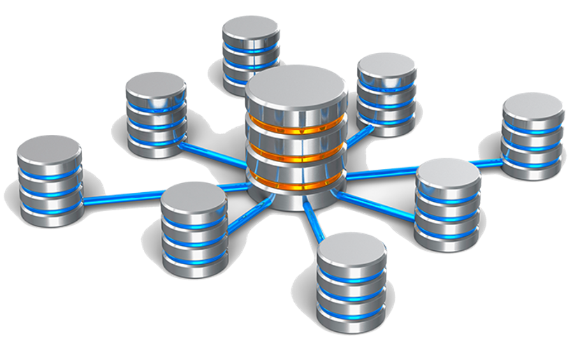

## **Ficheros de Información**

### **¿Qué es un fichero?**

Conjunto de información relacionada, tratada como un todo y organizada de forma estructurada. Es una secuencia de dígitos binarios que organiza información relacionada con un mismo aspecto.
Los ficheros están formados por registros lógicos que contienen datos relativos a un mismo elemento u objeto Y los registros están divididos en campos que contienen cada una de las informaciones elementales que forman un registro.
Los datos están almacenados de tal forma que se puedan añadir, suprimir, actualizar o consultar individualmente en cualquier momento.
Como los ficheros son tan voluminosos se trabaja con gups de registros físicos llamados bloques.

### **Tipos de ficheros**

Los Ficheros se clasifican según:

1. **Organización**: Nos indica cómo se gestionan, almacenan y acceden los datos dentro de los ficheros. Diferentes tipos de organización permiten diferentes tipos de acceso, eficiencia en la búsqueda, y manipulación de los datos.

1. **Uso**: Nos indica cómo se deben utilizar o tratar los ficheros dentro de un sistema o aplicación. Son etiquetados según el propósito que cumplen.

1. **Contenido**: Es útil para identificar la naturaleza de la información que contiene el fichero y qué tipo de software o aplicación es necesario para abrirlo o procesarlo.

#### **Según Organización**

Según la función que vaya a ejercer los ficheros, éstos pueden ser clasificados de diversas maneras.

1. **Ficheros secuenciales**: Los datos se guardan de manera consecutiva, siguiendo un orden fijo. El acceso a los datos es secuencial, lo que significa que para llegar a un dato específico, se debe pasar por los datos anteriores.

1. **Ficheros directos o aleatorios**: Permiten el acceso directo a cualquier posición dentro del fichero. Los datos se pueden recuperar o escribir en cualquier punto del fichero sin necesidad de seguir un orden secuencial.

1. **Ficheros indexados**: Estos ficheros tienen un índice que permite acceder directamente a un registro o dato específico dentro del fichero, sin tener que leerlo secuencialmente.


#### Según Uso.

Según la función que vaya a ejercer los ficheros, éstos pueden ser clasificados de diversas maneras.

1. 

**Ficheros permanentes**: contienen información necesarias para el funcionamiento de una aplicación. Tendrán un período de permanencia en el sistema amplio.

  - **Ficheros maestros**:  Contienen el estado actual de los datos que pueden modificarse desde la aplicación. Es la parte central de la aplicación, su núcleo.

  - **Ficheros constantes**: Son aquellos que incluyen datos fijos para la aplicación. No suelen ser modificados y se accede a ellos para realización de consultas.

  - **Ficheros históricos**: Contienen datos que fueron considerados como actuales en un periodo o situación anterior. Se utilizan para la reconstrucción de situaciones.

1. 

**Ficheros temporales**: Se utilizan para almacenar información útil para una parte de la aplicación, no para toda ella. Son generados a partir de datos de ficheros permanentes. Tienen un corto periodo de existencia. Estos se subdividen en:

  - **Ficheros intermedios**: Almacenan resultados de una aplicación que serán utilizados por otra.

  - **Ficheros de maniobras**: Almacenan datos de una aplicación que no pueden ser mantenidos en memoria principal por falta de espacio.

  - **Ficheros de resultados**: Almacenan datos que serán transferidos a un dispositivo de salida.

#### **Según Contenido**

Según el contenido que puedan guardar.

1. **Ficheros de texto**: Contienen datos en formato de texto plano, sin formataciones especiales. Se pueden abrir y editar con un editor de texto sencillo.

1. **Ficheros binarios**: Contienen datos en formato binario, a menudo no legibles directamente por humanos. Se utilizan para almacenar información compleja como imágenes, vídeos, o programas.

### **Soportes de la información**

Los ficheros se almacenan en soportes de información manejados por dispositivos periféricos del ordenador, que permiten leer y grabar datos en el soporte. Los soportes más utilizados para almacenar los ficheros son las cintas magnéticas y los discos.

- **Soportes de Acceso Directo a los datos (discos)**. Son los más empleados y el acceso a los datos puede hacerse de manera directa, pudiendo colocarnos en la posición que nos interesa y leer a partir de ella.

- **Soportes de Acceso Secuencial (cintas magnéticas)**. Se suelen usar en copias de seguridad y si deseamos leer un dato que está en la mitad de la cinta, tendremos que leer todo lo que hay hasta llegar a esta posición.

### **Medidores de acceso**

Los métodos de acceso a ficheros, como el acceso secuencial, directo e indexado, tienen diferentes características que los hacen más o menos adecuados dependiendo del uso previsto..

- **Acceso secuencial**: Ideal para procesar ficheros completos de manera lineal; eficiente pero lento para acceder a registros específicos.

- **Acceso directo**: Permite acceso inmediato a cualquier registro, es muy eficiente para operaciones específicas, pero puede ser más complejo de gestionar.

- **Ficheros indexados**: Combina acceso rápido con flexibilidad en el uso de múltiples criterios de acceso, pero requiere más espacio y es más complejo de mantener.

#### **Acceso Secuencial**

En el acceso secuencial, los datos se leen o escriben en un orden determinado, desde el principio hasta el final del fichero. Para acceder a un registro específico, se debe leer todo lo que hay antes de este punto.

##### **Ventajas**

- **Simplicidad**: Es fácil de implementar y de comprender, ya que los datos se procesan en orden.

- **Buena eficiencia para procesar todo el fichero**: Si hay que procesar todo el fichero, el acceso secuencial es eficiente porque no hay saltos entre registros.

- **Ocupación reducida de espacio**: No se requieren índices ni otras estructuras de datos adicionales, lo que reduce el tamaño del fichero.

##### **Desventajas**

- **Acceso lento a datos específicos**: Para acceder a un registro concreto, se debe leer todo el fichero o una gran parte de él, lo que puede ser ineficiente.

- **Difícil de modificar**: Si se debe insertar o eliminar datos, puede requerir reescribir todo el fichero o gran parte de él.

#### **Acceso Directo**

El acceso directo permite acceder a cualquier registro del fichero de manera inmediata, utilizando su posición específica. Es adecuado para ficheros donde los registros tienen un tamaño fijo.

##### **Ventajas**

- **Acceso rápido a registros**: Se puede acceder directamente a cualquier registro del fichero sin tener que leer los anteriores.

- **Mejor para operaciones de lectura/escritura específicas**: Es eficiente cuando sólo se necesita acceder a registros específicos o cuando hay que actualizar registros con frecuencia.

- **Flexibilidad**: Permite tanto la lectura como la escritura en cualquier parte del fichero.

##### **Desventajas**

- **Complejidad de implementación**: Es más complicado de implementar que el acceso secuencial, especialmente cuando los registros tienen tamaños variables.

- **Potencial desaprovechamiento de espacio**: Si los registros tienen tamaños variables, puede ser difícil gestionar el espacio de manera eficiente.

- **Más difícil de mantener**: Los cambios en la estructura del fichero pueden requerir una reestructuración compleja del mismo.

#### **Acceso Indexado**

Los ficheros indexados utilizan un índice para mantener las posiciones de los registros dentro del fichero. Esto permite un acceso rápido a los registros mediante la búsqueda en el índice, sin necesidad de leer todo el fichero.

##### **Ventajas**

- **Acceso rápido y eficiente**: Permite acceder a registros específicos muy rápidamente gracias al índice, haciéndolo ideal para grandes volúmenes de datos.

- **Actualización fácil**: Añadir, modificar o eliminar registros se puede hacer de manera más eficiente que en ficheros secuenciales, ya que sólo se necesitan actualizar los índices.

- **Flexibilidad en el acceso**: Permite acceder a registros por diferentes criterios gracias a la posibilidad de tener múltiples índices.

##### **Desventajas**

- **Mayor ocupación de espacio**: Los índices ocupan espacio adicional al disco, lo que aumenta el tamaño total del fichero.

- **Complejidad de mantenimiento**: Gestionar y actualizar índices puede ser complejo, especialmente cuando el fichero es muy grande o cuando hay múltiples índices.

- **Rendimiento variable**: En algunos casos, especialmente con muchos índices o con operaciones masivas, el rendimiento puede disminuir.

### **Inconvenientes de los sistemas de fichero convencionales**

- Mantenimiento muy Costoso y Poco Ágil.

- No Garantizar la Integridad de los Datos.

- Cualquier cambio en la definición del fichero hay que hacerla en el código de todos los programas que lo usan.

- Información Redundante.

- Para agilizar los procesos se repiten los mismos datos en diversos archivos.

- Diferentes valores para un mismo dato.

- Una modificación implica cambio en todos los ficheros.

- Más espacio de almacenamiento.

---

## 1.2 Introducción a las BBDD

# **Introducción a las BBDD**

La evolución lógica de los problemas derivados del uso de los ficheros fue estandarizar el acceso a la información, de manera que un diseño físico específico servía para todas las aplicaciones de una organización.
Este nuevo enfoque se centró en los datos más que en el proceso; es decir, el almacenamiento de los datos se estructuraba independientemente de las aplicaciones que las iban a utilizar. También se eliminó la redundancia y se favoreció la transferencia de información entre aplicaciones. Apareció el concepto de base de datos.

## **Conceptos**

- **Base de datos**: Es una colección de datos relacionados lógicamente entre sí, con una definición y descripción comunes y que están estructurados de una determinada manera. Es un conjunto estructurado de datos que representa entidades y sus interrelaciones, almacenados con la mínima redundancia y posibilitando el acceso a ellos eficientemente por parte de diversas aplicaciones y usuarios.

- También almacena una descripción de estos datos. Se denomina metadato, se almacena en el diccionario de datos o catálogo y es el que permite que exista independencia de datos lógico‐físico.

Una base de datos constará de los siguientes elementos:

- **Entidades**: Objeto real o abstracto con características diferenciadoras de otros, del que se almacena información en la base de datos.

- **Atributos**: Son los datos que se almacenan de la entidad. Cualquier propiedad o característica de una entidad puede ser atributo.

- **Registros**: Donde se almacena la información de cada entidad. Es un conjunto de atributos que contienen los datos que pertenecen a una misma repetición de entidad.

- **Campos**: Donde se almacenan los atributos de cada registro.

## **Uso**.

### **¿Quién las utiliza?**

Existen cuatro tipos de personas que pueden hacer uso de una base de datos: el administrador, los diseñadores de la base de datos, los programadores de aplicaciones y los usuarios finales.

- **Administrador**: Es la persona encargada de la creación o implementación física y las políticas de seguridad y accesos de la base de datos.

- **Diseñador**: Son las personas encargadas de diseñar cómo será la base de datos. Llevarán a cabo la identificación de los datos, las relaciones entre ellos, sus restricciones, etc.

- **Programadores de aplicaciones**: Ofrecerán la posibilidad de realizar consultas de datos, inserción, actualización o eliminación de los mismos por medio de las aplicaciones.

- **Usuario Final**: Son los clientes finales de la base de datos.

### **¿Para qué se utilizan?**


## **Ubicación de la información**

Las bases de datos pueden tener un tamaño muy reducido o bien, ser muy voluminosas y complejas. Una BBDD puede necesitar servidores en lugares diferentes, y viceversa, pequeñas bbdd pueden existir como archivos en el disco duro de un único equipo.

- **Discos SATA**: Interfaz de transferencia de datos.

- **Discos SCSI**: Interfaces preparadas para discos duros de gran capacidad de almacenamiento y velocidad de rotación.

- **RAID**: Se basa en el montaje en conjunto de 2 o más discos duros, formando un bloque de trabajo, para obtener capacidad, mejoras en velocidad o seguridad de almacenamiento.

- **Sistemas NAS**: Permite compartir la capacidad de almacenamiento de un Servidor con ordenadores personales o servidores clientes a través de una red.

- **Sistemas SAN**: Se trata de una red concebida para conectar servidores, matrices (arrays) de discos y librerías de soporte.

## **Modelos de BBDD**

Esta es una de las formas de clasificación de las BBDD, que nos indica su organización lógica de la información. Las más utilizadas en estos momentos son:

- 

**Modelo Jerárquico**: Organizan los datos en una estructura en árbol, donde cada nodo tiene un padre y puede tener varios hijos. Es un modelo de datos más antiguo, pero todavía utilizado en ciertos sistemas.

  - **Ventajas**: Rápido acceso a datos en sistemas donde las relaciones son naturales en forma de árbol.

  - **Desventajas**: Dificultad para manejar relaciones complejas que no encajan en una estructura jerárquica. Escalabilidad limitada.

- 

**Modelo en Red**: Son una evolución de las bases de datos jerárquicas donde un nodo puede tener múltiples padres, formando una red de interconexiones más flexible.

  - **Ventajas**: Más flexibilidad que las bases de datos jerárquicas.

  - **Desventajas**: Más complejas de gestionar que las bases de datos relacionales. Más difíciles de modelar y mantener.

- 

**Modelo Relacional**: Almacenan los datos en tablas que se pueden enlazar entre sí mediante claves primarias y foraneas. Utilizan el lenguaje SQL para la gestión de datos.

  - **Ventajas**: Soportan transacciones ACID (Atomicidad, Consistencia, Aislamiento, Durabilidad). Son muy estandarizadas y ampliamente utilizadas.

  - **Desventajas**: Puede ser menos eficiente para datos no estructurados o semi-estructurados. Escalabilidad vertical limitada.

- 

**Modelo NoSQL**: Incluyen una variedad de modelos de datos diferentes a los relacionales, como documentos, claves-valor, columna ancha y gráficos. Están diseñadas para gestionar grandes volúmenes de datos no estructurados o semi-estructurados.

  - **Ventajas**: Muy escalables horizontalmente. Flexibles para datos no estructurados o semi-estructurados.

  - **Desventajas**: A menudo no soportan transacciones ACID completas. Menos estandarización e interoperabilidad.

## **Tipos de BBDD**

Las bases de datos se pueden agrupar por parte del contenido, de uso, de variabilidad y de localización, entre otros.

  BBDD

  
  
    **Contenido**
    Información Actual
    Directorios
    Documentales
  

  
  
    **Uso**
    Individual
    Compartida
    Acceso Público
    Propietarios
  

  
  
    **Variabilidad**
    Estática
    Dinámica
  

  
  
    **Localización**
    Centralizada
    Distribuida

---

## 1.3 Sistemas gestores de base de datos SGBD

# S**istemas gestores de base de datos SGBD**

## **¿Qué son?**

Conjunto coordinado de programas, procedimientos, lenguajes, etc., que suministra, tanto a los usuarios no informáticos, como a los analistas programadores, o al administrador, los medios necesarios para describir y manipular los datos contenidos en la base de datos, manteniendo su integridad, confidencialidad y seguridad.

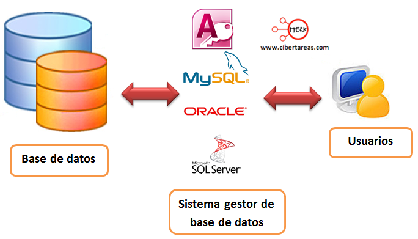

Las ventajas del uso de SGBD son:

- Proporcionan al usuario una visión abstracta de los datos, ocultando parte de la complejidad.

- Ofrecen Independencia física, la visión que tiene el usuario y la manipulación de los datos es independiente de cómo estén almacenados físicamente.

- Disminuyen la redundancia y la inconsistencia de datos.

- Aseguran la integridad de los datos.

- Facilitan el acceso a los datos, aportando rapidez y evitando la pérdida de datos.

- Aumentan la seguridad y privacidad de los datos.

- Mejoran la eficiencia.

- Permiten compartir datos y accesos concurrentes.

- Facilitan el intercambio de datos entre diferentes sistemas.

- Incorporan mecanismos de copias de seguridad y recuperación.

## **Funciones**

Un SGBD desarrolla 3 funciones fundamentales como son la descripción, la manipulación y la utilización de datos.

1. **Función de descripción o definición**: Permite al diseñador de la base de datos crear las estructuras apropiadas para integrar adecuadamente los datos. Esta función es la que permite definir las tres estructuras de la base de datos: Estructura interna, Estructura conceptual y Estructura externa.

1. **Función de manipulación**: Permite a los usuarios buscar, añadir, suprimir o modificar los datos. Se llevará a cabo por medio de un lenguaje de manipulación de datos (DML) que facilita los instrumentos necesarios para la realización de estas tareas..

1. **Función de control**: Permite al administrador de la base de datos establecer mecanismos de protección de las diferentes visiones de los datos asociados a cada usuario, proporcionando elementos de creación y modificación de estos usuarios.

## **Componentes**

1. 

**Lenguajes de la BBDD**: Cualquier SGBD ofrece la posibilidad de utilizar lenguajes e interfaces adecuadas para sus diferentes tipos de usuarios. A través de los lenguajes se pueden especificar los datos que componen la BBDD, su estructura, relaciones, reglas de integridad, control de acceso, características físicas y vistas externas de los usuarios.
Los lenguajes del SGBD son:

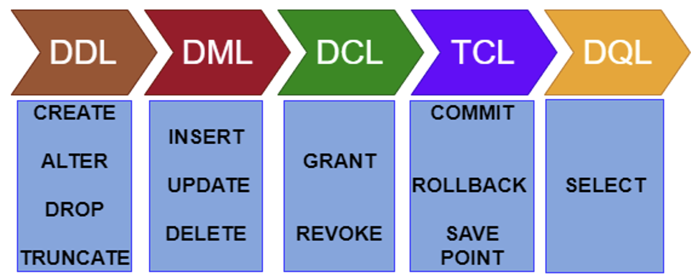

  

     
  1. Lenguaje de Definición de los Datos (DDL).
     
  1. Lenguaje de Manejo de Datos (DML).
     
  1. Lenguaje de Control de Datos (DCL).
     
  1. Lenguaje de Control de Transacciones (TCL).
     
  1. Lenguaje de Consultas de Datos (DQL).
   

1. 

**El diccionario de datos**: Descripción de los datos almacenados. Se trata de información útil para los programadores de aplicaciones. Es el lugar donde se deposita la información sobre la totalidad de los datos que forman la BBDD. Contiene las características lógicas de las estructuras que almacenan los datos, su nombre, descripción, contenido y organización. En una BBDD relacional aportará información sobre:
  

     
  1. Estructura lógica y física de la BBDD.
     
  1. Definición de tablas, vistas, indexis, disparadores, procedimientos, funciones, etc.
     
  1. Cantidad de espacio asignado y utilizado por los elementos de la BBDD.
     
  1. Descripción de las restricciones de integridad.
     
  1. Información sobre los permisos asociados a cada perfil de usuario.
     
  1. Auditoría de acceso a los datos, utilización, etc.
   

1. 

**El gestor de la BBDD**: Es la parte de software encargada de garantizar lo correcto, seguro, íntegro y eficiente acceso y almacenamiento de los datos. Este componente es el encargado de proporcionar una interfaz entre los datos almacenados y los programas de aplicación que los manejan. Es un intermediario entre el usuario y los datos. Es el encargado de garantizar la privacidad, seguridad e integridad de los datos, controlando los accesos concurrentes e interactuando con el sistema operativo.

1. 

**Usuarios de la BBDD**: En los SGBD existen diferentes perfiles de usuario, cada uno de ellos con una serie de permisos sobre los objetos de la BBDD.
  

     
  1. El administrador o Database Administrator (DBA), persona o conjunto encargadas de la función de administración de la BBDD. Tiene el control centralizado de la BBDD y es el responsable de su buen funcionamiento. Es el encargado de autorizar el acceso a la BBDD, de coordinar y vigilar su utilización y de adquirir los recursos software y hardware que sean necesarios.
     
  1. Los usuarios, que serán diferentes a la BBDD y con diferentes necesidades sobre los datos, así como diferentes accesos y privilegios. Los más comunes son: Diseñadores, Operadores y personal de mantenimiento, Analistas y programadores de aplicaciones y Usuarios finales.
   

1. 

**Objetivos de BBDD**: Son un conjunto de aplicaciones que permiten a los administradores la gestión de la base de datos, de los usuarios y permisos, generadores de formularios, informes, interfaces gráficas, generadores de aplicaciones, etc.

## **Arquitectura**

La arquitectura 'ANSI/X3/SPARC' es un estándar de diseño abstracto para SGBD, propuesto por primera vez en 1975 para el procesador SPARC ('Scalable Processor Architecture') de 'Sun Microsystems' y 'Fujitsu' que fue normalizado por 'ANSI'. La mayoría de SGBD comerciales están basados en esta arquitectura 'ANSI/X3/*SPARC' de tres niveles :

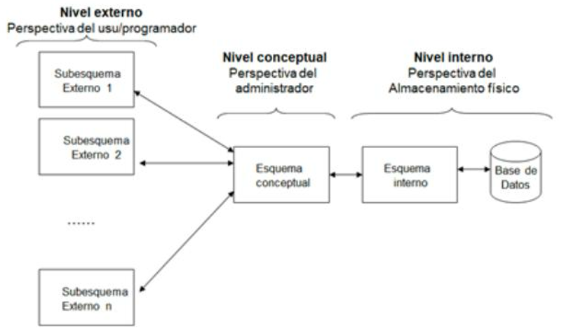

- **Nivel interno o físico**: Es el más próximo a la máquina. Es una representación a bajo nivel de la base de datos, en la que se define la forma en que los datos se almacenan físicamente en la máquina.

- **Nivel conceptual o lógico**: Es una representación abstracta del contenido total de la base de datos. Contiene la definición de todos los datos existentes junto con las restricciones de seguridad y los controles de integridad.

- **Nivel externo o de visión de usuario**: Es la representación de los datos, tal y como los ve el usuario. Cada usuario tendrá una visión diferente de la base de datos, dependiendo del conjunto de datos que esté autorizado a ver, y de las herramientas que utilice.

## **Tipos**

Al igual que las BBDD, los SGBD se pueden clasificar por diferentes criterios:

- **Modelo lógico en el que se basa**: Relacional, Red, Jerárquico, etc.

- **Número de usuarios**: Monousuario o Multiusuario.

- **Localización**: Centralizado o Distribuido.

- **Coste comercial**: Ligado al número de usuarios, monousuarios entre 0€ y 3000€, o multiusuarios entre 10.000€ a 100.000€ o el mes completo por más de 100.000€.

- **Según el propósito**: General para cualquier tipo de BBDD o Específico donde el rendimiento se fondamental.

### **SGBD Comerciales**

## SISTEMAS GESTORES DE BASES DE DATOS COMERCIALES

| SGBD | DESCRIPCIÓN |
| --- | --- |
| **ORACLE** | Reconocido como uno de los mejores a nivel mundial. Es multiplataforma, de confianza y seguro. Es Cliente/Servidor. Basado en el modelo de datos Relacional. De gran potencia, aunque con un precio elevado hace que sólo se vea en empresas muy grandes y multinacionales. Ofrece una versión gratuita Oracle Database 10g Express Edition. |
| **MYSQL** | Sistema muy extendido que se ofrece bajo dos tipos de licencia, comercial o libre. Para aquellas empresas que deseen incorporarlo en productos privativos, deben comprar una licencia específica. Es Relacional, Multihilo, multiusuario y Multiplataforma. Su gran velocidad lo hace ideal para consulta de bases de datos y plataformas web. |
| **DB2** | Multiplataforma, el motor de base de datos relacional integra XML de manera nativa, lo que IBM ha llamado pureXML, que permite almacenar documentos completos para realizar operaciones y búsquedas de manera jerárquica dentro del mismo, e integrarlo con búsquedas relacionales. |
| **INFORMIX** | Otra opción de IBM para el mundo empresarial que necesita un DBMS sencillo y de confianza. Es un gestor de base de datos relacional basado en SQL. Multiplataforma. Consume menos recursos que Oracle, con utilidades muy avanzadas respecto a conectividad y funciones relacionadas con tecnologías de Internet/Intranet, XML, etc.. |
| **Microsoft SQL SERVER** | Sistema Gestor de Base de datos producido por Microsoft. Es relacional, sólo funciona bajo Microsoft Windows, utiliza arquitectura Client/Servidor. Constituye la alternativa a otros potentes SGBD como son Oracle, PostgreSQL o MySQL. |
| **SYBASE** | Un DBMS con bastantes años en el mercado, tiene 3 versiones para ajustarse a las necesidades reales de cada empresa. Es un sistema relacional, altamente escalable, de alto rendimiento, con soporte a grandes volúmenes de datos, transacciones y usuarios, y de bajo coste. |

### **SGBD Libres**

## SISTEMAS GESTORES DE BASES DE DATOS LIBRES

| SGBD | DESCRIPCIÓN |
| --- | --- |
| **MYSQL** | Es un sistema de gestión de base de datos relacional, multihilo y multiusuario con más de seis millones de instalaciones. Distribuido bajo dos tipos de licencias, comercial y libre. Multiplataforma, posee varios motores de almacenamiento, accesible a través de múltiples lenguajes de programación y muy ligado a aplicaciones web. |
| **PostgreSQL** | Sistema Relacional Orientado a Objetos. Considerado como la base de datos de código abierto más avanzada del mundo. Desarrollado por una comunidad de desarrolladores que trabajan de manera desinteresada, altruista, libre y/o secundados por organizaciones comerciales. Es multiplataforma y accesible desde múltiples lenguajes de programación. |
| **SQLite** | Sistema relacional, basado en una biblioteca escrita en C que interactúa directamente con los programas, reduce los tiempos de acceso siendo más rápido que MySQL o PostGreSQL, es multiplataforma y con soporte para diversos lenguajes de programación. |
| **MariaDB** | Sistema de gestión de bases de datos relacional (RDBMS) de código abierto y altamente compatible con MySQL. Fue desarrollado como una bifurcación (fork) de MySQL por su creador original, Michael "Monty" Widenius, y otros desarrolladores, debido a preocupaciones sobre el futuro de MySQL después de que Oracle adquiriera Sun Microsystems en 2010. |
| **FireBird** | Sistema Gestor de Base de datos relacional, multiplataforma, con bajo consumo de recursos, excelente gestión de la concurrencia, alto rendimiento y potente soporte para diferentes lenguajes. |
| **MongoDB | SGBD NoSQL documental que almacena datos en documentos JSON-like, flexible y escalable. Es ideal para aplicaciones que requieren un esquema de datos dinámico. |
| **Apache Cassandra** | SGBD NoSQL de código abierto, distribuido y altamente escalable, diseñado para gestionar grandes cantidades de datos distribuidos a través de muchos servidores. Utilizado para aplicaciones que requieren alta disponibilidad sin puntos únicos de fallo. |

---

## 1.4 Bases de datos Centralizadas y Distribuidas

# **Bases de datos Centralizadas y Distribuidas**

## **BBDD Centralizadas**

Es aquella estructura en la que el SGBD está implantado en una sola plataforma u ordenador desde donde se gestiona directamente, de modo centralizado, la totalidad de los recursos. Es la arquitectura de los centros de procesamiento de datos tradicionales. Se basa en tecnologías sencillas, muy experimentadas y de gran robusteza.
Las principales características de las BBDD centralizadas son:

- Se almacena completamente en una ubicación central.

- No posee múltiples elementos de procesamiento ni mecanismos de intercomunicación.

- Los componentes de las BBDD centralizadas son: los datos, el software de gestión de BBDD y los dispositivos de almacenamiento secundario asociados.

- Son sistemas en los que su seguridad puede verse comprometida más fácilmente.

## Ventajas e inconvenientes de las bases de datos centralizadas.

| Ventajas | Inconvenientes |
| --- | --- |
| Se evita la redundancia debido a la posibilidad de inconsistencias y al desaprovechamiento de espacio. | Un mainframe en comparación de un sistema distribuido no tiene mayor poder de cómputo. |
| Se evita la inconsistencia. Ya que si un hecho específico se representa por una sola entrada, la no‐concordancia de datos no puede ocurrir. | Cuando un sistema de bases de datos centralizado falla, se pierde toda disponibilidad de procesamiento y sobre todo de información confiada al sistema. |
| La seguridad se centraliza. | En caso de un desastre o catástrofe, la recuperación es difícil de sincronizar. |
| Puede conservarse la integridad. | Las cargas de trabajo no se pueden difundir entre varias computadoras, ya que los trabajos siempre se ejecutarán en la misma máquina. |
| El procesamiento de los datos ofrece un mejor rendimiento. | Los departamentos de sistemas retienen el control de toda la organización. |
| Mantenimiento más barato. Mejor uso de los recursos y menores recursos humanos. | Los sistemas centralizados requieren un mantenimiento central de datos. |

## **BBDD Distribuidas**

- **Base de datos distribuida(BDD)**: Es un conjunto de múltiples bases de datos lógicamente relacionadas las cuales se encuentran distribuidas entre diferentes nodos interconectados por una red de comunicaciones.

- **Sistema de bases de datos distribuida(SBDD)**: Es un sistema en el que múltiples sitios de BBDD están ligados por un sistema de comunicaciones, de tal forma que, un usuario en cualquier lugar puede acceder los datos en cualquier parte de la red exactamente como si los datos estuvieran almacenados en su sitio propio..

- **Sistema gestor de bases de datos distribuida(SGBDD)**: Es aquel que se encarga del manejo de la BBDD y proporciona un mecanismo de acceso que hace que la distribución sea transparente a los usuarios. El término transparente significa que la aplicación trabajaría, desde un punto de vista lógico, como si un solo SGBD ejecutado en una sola máquina, administrara estos datos.

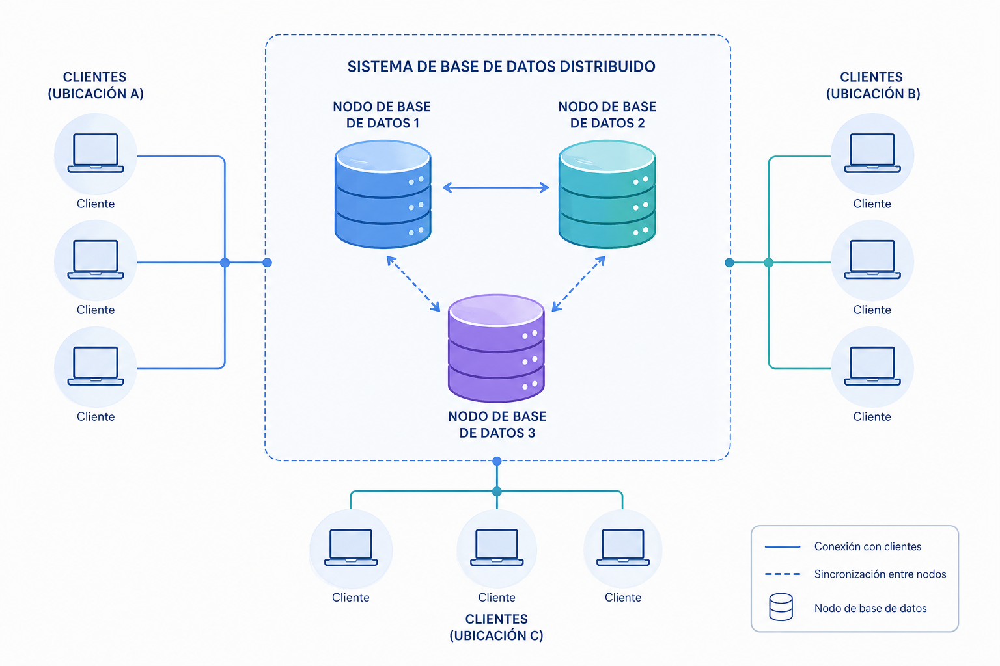

## Ventajas e inconvenientes de las bases de datos distribuidas.

| Ventajas | Inconvenientes |
| --- | --- |
| El acceso y procesamiento de los datos es más rápido ya que varios nodos comparten carga de trabajo. | La probabilidad de violaciones de seguridad es creciente si no se toman las precauciones debidas. |
| Desde una ubicación puede accederse a información alojada en diferentes lugares. | Existe una complejidad añadida que es necesaria para garantizar la coordinación apropiada entre los nodos. |
| Los costes son inferiores a los de las bases centralizadas. | La inversión inicial es menor, pero el mantenimiento y control puede resultar costoso. |
| Existe una cierta tolerancia a fallos. Mediante la replicación, si un nodo deja de funcionar el sistema completo no deja de funcionar. | Dado que los datos pueden estar replicados, el control de concurrencia y los mecanismos de recuperación son mucho más complejos que en un sistema centralizado. |
| El enfoque distribuido se adapta más naturalmente a la estructura de las organizaciones. Permiten la incorporación de nodos de manera flexible y fácil. | El intercambio de mensajes y el cómputo adicional necesario para conseguir la coordinación entre los diferentes nodos constituyen una forma de sobrecarga que no surge en los centralizados. |
| Aunque los nodos están interconectados, tienen independencia local. | Dada la complejidad del procesamiento entre nodos es difícil asegurar la corrección de los algoritmos, el funcionamiento correcto durante un fallo o la recuperación. |

---

## 1.5 Fragmentación

# **Fragmentación**

La fragmentación de BBDD es una técnica utilizada en sistemas distribuidos para dividir una BBDD grande en partes más pequeñas, llamadas fragmentos, que se pueden almacenar y gestionar de manera distribuida en diferentes ubicaciones físicas o lógicas. Esto mejora el rendimiento, la escalabilidad y la disponibilidad de la base de datos, ya que cada fragmento puede ser accedido y procesamiento de manera independiente.
Cuando se lleva a cabo una fragmentación, existen tres reglas fundamentales:

- 

**Completitud (completitud)**: Cada elemento de la BBDD original debe aparecer en al menos uno de los fragmentos. Esto significa que, después de la fragmentación, no se debe perder ningún dato. Si se fragmenta una tabla de clientes, todos los registros (o partes de ellos) deben estar presentes en algún fragmento.

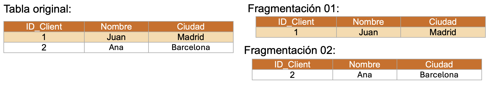

Aquí se cumple la completitud porque no se ha perdido ningún dato; todos están en algún fragmento.

- 

**Reconstruction (Reconstrucción)**: Debe ser posible reconstruir la base de datos original combinando los fragmentos. Esto significa que, a partir de los fragmentos, se debe poder recuperar la base de datos en su forma original sin pérdida de información. Si la tabla de clientes se fragmenta, se debería poder unir los fragmentos para recrear la tabla original.

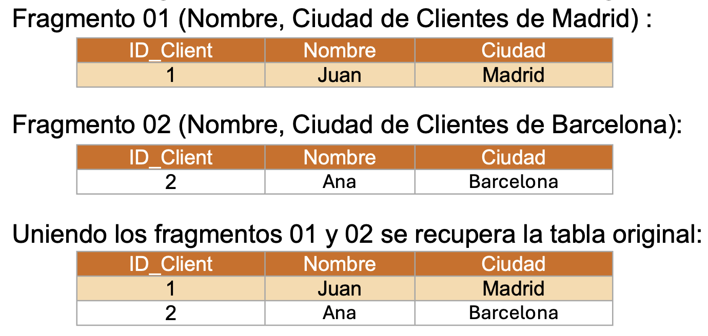

- 

**Disjointness (Disyunción)**: Cada fragmento debe ser disjunto, es decir, un registro de datos no debe aparecer en más de un fragmento, salvo que se esté utilizando una fragmentación redundante o replicada. Esto evita la duplicación innecesaria de datos entre fragmentos. En una tabla fragmentada horizontalmente, un registro de un cliente en Madrid debe aparecer sólo en un fragmento y no repetirse en otros fragmentos.

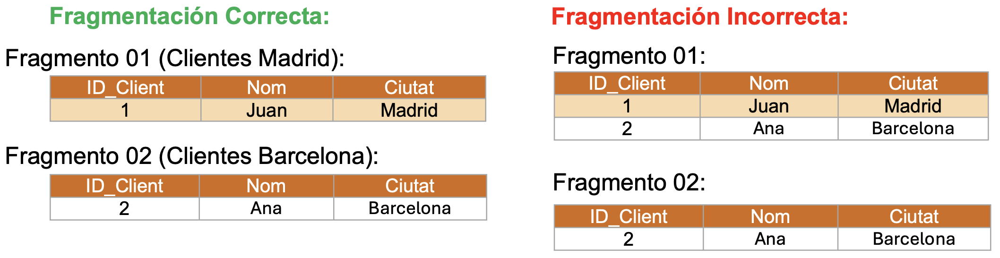

## **Tipos de Fragmentación**

### **Fragmentación Horizontal**

Divide una tabla en filas, distribuyendo diferentes subconjuntos de filas en diferentes fragmentos.
En una fragmentación horizontal, podríamos dividir la tabla Clientes en dos fragmentos basados en la ciudad:

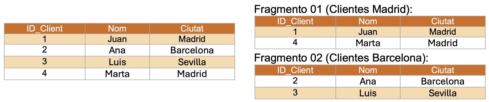

- **Ventajas**: Mejora el rendimiento al permitir consultas más rápidas en subconjuntos específicos de la tabla.

- **Desventajas**: Puede ser difícil de gestionar si las consultas requieren combinar fragmentos de diferentes ubicaciones.

### **Fragmentación Vertical**

Divide una tabla en columnas, distribuyendo diferentes subconjuntos de columnas en diferentes fragmentos.

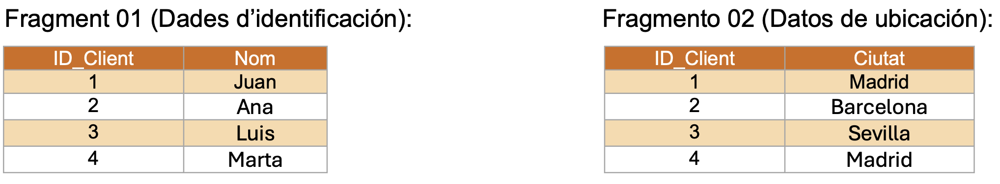

- **Ventajas**: Reduce la cantidad de datos transferidos en consultas que sólo necesitan ciertos atributos.

- **Desventajas**: Requiere juntar fragmentos en consultas que necesitan datos de diversas columnas.

### **Fragmentación Mixta (Combinada)**

Combina la fragmentación horizontal y vertical para adaptar mejor la estructura de la base de datos a las necesidades específicas.

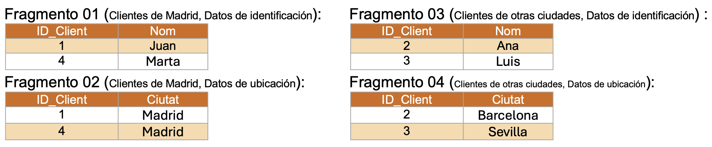

- **Ventajas**: Ofrece flexibilidad y eficiencia al combinar los beneficios de las fragmentaciones horizontal y vertical.

- **Desventajas**: Puede ser más compleja de implementar y gestionar.

---

## 1.6 Protección de datos y normativa LOPD

# **Protección de datos y normativa LOPD**

La protección de datos personales se ha convertido en un tema crucial en la era digital debido al aumento de la recopilación y procesamiento de información personal por parte de empresas y organizaciones.
En el estado español está vigente la Ley Orgánica de Protección de Datos Personales y Garantía de los Derechos Digitales (LOPDGDD) del 5 de mayo de 2018 que complementa y desarrolla el Reglamento General de Protección de Datos (RGPD) del 25 de mayo de 2018 a nivel europeo.


## **Reglamento General de Protección de Datos (RGPD)**

Regula el tratamiento que realizan personas, empresas u organizaciones de los datos personales relacionados con personas en la Unión Europea (UE).
Este Reglamento se aplica a las empresas cuando:

- La empresa trata datos personales y tiene su sede en la UE, independientemente de donde se traten de hecho los datos.

- La empresa tiene su sede fuera de la UE pero trata datos personales relativos a ofertas de bienes o servicios a ciudadanos en la UE, o supervisa el comportamiento de ciudadanos en la UE.

- Las empresas que no tienen sede dentro de la UE y que tratan datos de ciudadanos de la UE deben nombrar un representante en la UE.

Los datos personales son cualquier información relacionada con una persona identificada o identificable, también denominada "el interesado".

**Ejemplos de datos personales**:

- nombre y apellidos

- dirección

- número de documento de identidad/pasaporte

- ingresos

- perfil cultural

- dirección de protocolo internet (IP)

- datos en poder de hospitales o médicos (que identifican únicamente a una persona con fines sanitarios).

**No se pueden tratar datos personales sobre**:

- origen racial o étnico

- orientación sexual

- opiniones políticas

- convicciones religiosas o filosóficas

- afiliación sindical

- datos genéticos, biométricos o sanitarios, excepto en casos específicos (cuando se da un consentimiento explícito o cuando el tratamiento es necesario por razones de interés público esencial)

- condenas e infracciones penales, salvo que lo autorice el Derecho nacional o de la UE.

**Sus principios son**:

- **Licitud, lealtad y transparencia**: Los datos deben ser procesados de manera legal, justa y transparente.

- **Limitación de la finalidad**: Los datos deben recogerse con finalidades específicas, explícitos y legítimos.

- **Minimización de datos**: Sólo tienen que procesarse los datos que sean adecuados, pertinentes y limitados.

- **Exactitud**: Los datos deben ser exactos y, si es necesario, actualizados.

- **Limitación del plazo de conservación**: Los datos deben conservarse durante el tiempo necesario para los fines del tratamiento.

- **Integridad y confidencialidad**: Los datos deben ser procesados de manera que se garantice una seguridad adecuada.

- **Responsabilidad proactiva**: Los responsables del tratamiento deben ser capaces de demostrar el cumplimiento.

**Y vela por los derechos de los individuos sobre los datos**:

- **Derecho de acceso**: Los individuos tienen el derecho de acceder a sus datos personales y obtener información sobre cómo se están utilizando.

- **Derecho de rectificación**: Los individuos pueden solicitar la corrección de datos inexactos o incompletos.

- **Derecho de supresión (derecho al olvido)**: Los individuos pueden solicitar la eliminación de sus datos personales en ciertos casos.

- **Derecho a la limitación del tratamiento**: Los individuos pueden solicitar la restricción del procesamiento de sus datos en ciertos casos.

- **Derecho a la portabilidad de los datos**: Los individuos pueden recibir sus datos en un formato estructurado y transferirlos a otro responsable.

- **Derecho de oposición**: Los individuos pueden oponerse al procesamiento de sus datos por motivos específicos.

- **Derecho a no ser objeto de decisiones individuales automatizadas**: Los individuos tienen derecho a no ser sujetos a decisiones basadas únicamente en el procesamiento automatizado.

El RGPD no especifica qué medidas de seguridad concretas hay que aplicar en cada caso, sino que éstas deben determinarse por el responsable o por el encargado según diversas variables: el estado de la técnica, los riesgos que existan para los derechos y libertades de los interesados, la naturaleza, el alcance, el contexto y los fines del tratamiento y los costes de aplicar las medidas.


La **AEPD** ha señalado que se pueden seguir aplicando las mismas medidas de seguridad que establece la normativa hasta ahora vigente **si del análisis de riesgos se concluye que estas medidas son idóneas para ofrecer un nivel de seguridad adecuado** (en caso contrario, será necesario completar estas medidas o prescindir de alguna de ellas).

### **Medidas de seguridad según el RGPD**

El **RGPD** no especifica qué medidas de seguridad concretas hay que aplicar en cada caso, sino que éstas deben determinarse por el responsable o por el encargado según diversas variables:

- El estado de la técnica,

- Los riesgos que existan para los derechos y libertades de los interesados,

- La naturaleza, el alcance, el contexto y los fines del tratamiento,

- Y los costes de aplicar las medidas.

## **Niveles de Seguridad de los datos en LOPD**

Las medidas de protección de datos establecidas por la LOPDGDD se estructuran en diferentes niveles según el grado de sensibilidad de los datos que se tratan y el riesgo asociado a su tratamiento. Estas medidas se pueden clasificar en tres niveles principales: básico, medio y alto.

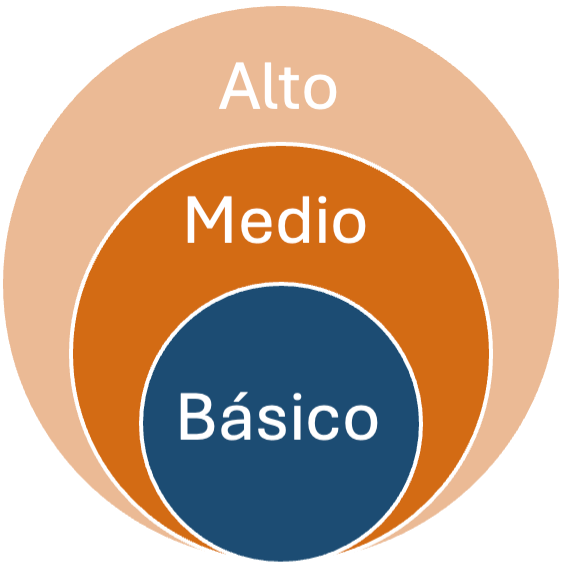

### **Nivel Básico**

Este nivel se aplica al tratamiento de datos personales considerados de menor riesgo o sensibilidad, pero que aún requieren medidas de protección para garantizar su seguridad y confidencialidad.

**Ejemplos de datos**:

- Datos identificativos básicos como el nombre, dirección, teléfono, etc.

- Información comercial o laboral no sensible.

**Medidas de protección asociadas**:

- Control de acceso: Asegurar que sólo el personal autorizado tenga acceso a los datos.

- Identificación y autenticación: Los usuarios deben identificarse y autenticarse antes de acceder a los datos.

- Gestión de soportes: Procedimientos para la gestión correcta de soportes (discos duros, USBs) que contengan datos personales, incluyendo su destrucción segura.

- Copias de seguridad: Realización de copias de seguridad periódicas para evitar la pérdida de datos.

### **Nivel Medio**

Este nivel se aplica cuando se trata datos con un riesgo moderado o cuando su pérdida o acceso no autorizado podría afectar a los derechos de las personas.

**Ejemplos de datos**:

- Datos financieros, bancarios o de solvencia patrimonial.

- Información que permite identificar a una persona, pero que no se considera especialmente sensible.

**Medidas de protección asociadas**:

- Todas las medidas del nivel básico, más:

- Gestión más estricta de acceso: Asignación de usuarios y perfiles con permisos específicos para acceder a determinados datos.

- Control de acceso físico: Restricciones físicas para el acceso a los locales donde se encuentran los sistemas de información.

- Registro de accesos: Registro de las actividades de acceso a los sistemas que tratan los datos, para poder identificar cualquier acceso indebido o sospechoso.

- Auditorías de seguridad: Realización periódica de auditorías para garantizar que se cumplen las medidas de protección de datos.

### **Nivel Alto**

Este nivel es necesario cuando se trata con datos de carácter muy sensible, cuya pérdida, modificación o acceso no autorizado podría tener graves consecuencias para los derechos y libertades de las personas.

**Ejemplos de datos**:

- Datos de salud, ideología, afiliación sindical, creencias religiosas, origen étnico, orientación sexual.

- Datos relativos a sanciones o infracciones penales o administrativas.

**Medidas de protección asociadas**:

- Todas las medidas de los niveles básico y medio, más:

- Cifrado de datos: Encriptación obligatoria de datos durante el almacenamiento y la transmisión para prevenir el acceso no autorizado.

- Auditorías frecuentes: Auditorías de seguridad más rigurosas y frecuentes para garantizar el cumplimiento de las medidas establecidas.

- Seguridad avanzada: Implementación de tecnologías de seguridad adicionales, como sistemas de detección de intrusiones (IDS) o medidas de control de acceso biométrico.

- Procedimientos estrictos de copia de seguridad: Protocolos rigurosos para la realización y almacenamiento de copias de seguridad, asegurando su integridad y disponibilidad en caso de incidentes.

---

## 1.7 Big Data e Inteligencia de negocios

# **Big Data e Inteligencia de negocios**

## **¿Qué es?**

Big Data se refiere a la recopilación, el almacenamiento, la gestión y el análisis de grandes volúmenes de datos que son demasiado complejos y extensos para ser tratados con las herramientas tradicionales de gestión de bases de datos.
Todo volumen de datos deberá tener en cuenta los aspectos de las 5v:

- **Volumen**: Hace referencia a la cantidad masiva de datos generados y recogidos.

- **Velocidad**: La rapidez con que se generan, procesan y analizan los datos.

- **Variedad**: La diversidad de los tipos de datos recopilados.

- **Veracidad**: La fiabilidad, calidad y cuidadosa de los datos.

- **Valor**: La capacidad de los datos para proporcionar información útil y accionable.

En la actualidad algunos estudios incorporan 2 v más, hablando de las 7v:

- **Viabilidad**: Es necesario saber la capacidad que tiene una empresa para realizar un uso eficaz de los datos, cuestionarse qué y cuántos datos se necesitan para predecir los resultados más interesantes para la empresa.

- **Visualización**: Necesitamos poder representar los datos, ya sea de manera visual mediante gráficos o codificados en indicadores (KPI) para hacer que sean legibles y accesibles.

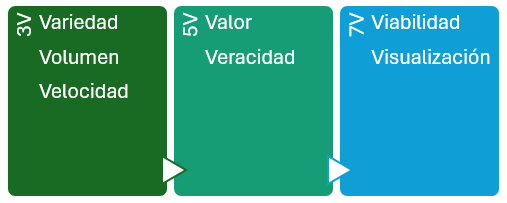

## **Introducción**

El análisis de datos consiste en el uso de técnicas analíticas avanzadas realizadas en el conjunto de big data muy grandes y diversos.
Las fases en un análisis de datos serían:

- **Recogida de Datos.**

- **Fuentes de datos.**

- **Almacenamiento de Datos.**

- **Sistemas de ficheros distribuidos.**

- **Procesamiento de Datos.**

- **Técnicas de Análisis de Datos.**

- **Visualización de Datos.**

### **Importancia del Big Data**

- **Toma de decisiones basada en datos**: Las empresas y organizaciones pueden utilizar Big Data para tomar decisiones informadas basadas en análisis detallados.

- **Innovación y mejora de productos**: Los datos pueden revelar información sobre las necesidades y preferencias de los clientes, guiando la innovación de productos y servicios.

- **Optimización operativa**: Los datos pueden ayudar a identificar ineficiencias y mejorar los procesos operativos.

- **Personalización de la experiencia del cliente**: Mediante el análisis de datos, se puede ofrecer una experiencia más personalizada a los clientes, mejorando su satisfacción y fidelización.

### **Tecnologías asociadas al Big Data**

- **Sistemas de bases de datos NoSQL**: Diseñados para gestionar grandes volúmenes de datos no estructurados y semi-estructurados. MongoDB, Cassandra y Couchbase.

- **Procesamiento distribuido**: Permiten el procesamiento distribuido de grandes conjuntos de datos a través de clústeres de computadores, como Hadoop.

- **Plataformas de procesamiento en tiempo real**: Apache Spark es un ejemplo de plataforma que permite procesar datos en tiempo real, ofreciendo una alternativa a MapReduce para ciertos casos de uso.

- **Herramientas de análisis y visualización**: Herramientas como Tableau, Power BI, y D3.js ayudan a visualizar e interpretar grandes volúmenes de datos de manera comprensible.

### **Aplicaciones del Big Data**

- **Salud**: Análisis de datos de pacientes para la investigación médica, predicción de brotes de enfermedades y personalización de tratamientos.

- **Finanzas**: Detección de fraudes, análisis de riesgos y toma de decisiones de inversión basada en grandes volúmenes de datos del mercado.

- **Comercio y marketing**: Análisis de comportamientos de los consumidores, personalización de campañas de marketing y optimización de estrategias de venta.

- **Ciencia e investigación**: Análisis de datos masivos para descubrimientos científicos, investigaciones académicas y avances tecnológicos.

## **Inteligencia de negocios**

La Inteligencia de negocios, o Business intelligence, es un conjunto de técnicas y herramientas utilizadas para transformar datos en información útil para la toma de decisiones.
Para formar una Inteligencia de negocio es necesario contar con estos componentes:

- **ETL (Extract, Transform, Load)**: Procesos para extraer datos, transformarlos y cargarlos en sistemas de almacenamiento.

- **Data Warehousing**: Almacenes de datos diseñados para almacenar información histórica y facilitar el análisis.

- **Reporting**: Generación de informes basados en datos para la evaluación de rendimiento y otras métricas.

- **Dashboards**: Paneles de control interactivos que proporcionan una visión general de los datos empresariales.

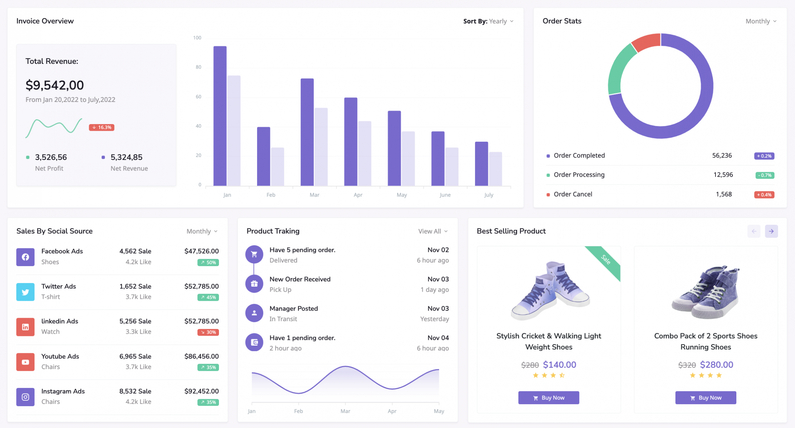

Con todo esto, la inteligencia de negocios aporta:

- Mejora de la toma de decisiones: Acceso a datos relevantes y análisis precisos para decisiones basadas en evidencia.

- Mayor eficiencia operativa: Optimización de procesos y recursos basados en el análisis de datos.

- Ventaja competitiva: Permite identificar oportunidades de negocio y mejorar el posicionamiento en el mercado.

- Personalización del servicio: Permite a las empresas personalizar ofertas basadas en el comportamiento del cliente.

### **Aplicaciones**

- **Análisis de clientes**: Comprender comportamientos y preferencias de los clientes.

- **Optimización de procesos**: Mejorar la eficiencia operativa mediante el análisis de datos.

- **Planificación estratégica**: Soportar decisiones estratégicas basadas en datos.

- **Monitorización de rendimiento**: Evaluar el rendimiento de diferentes áreas de la empresa mediante KPIs (Indicadores Clave de Rendimiento).

### **Ciencia de datos**

La ciencia de datos incluye una serie de métodos para analizar tanto pequeños conjuntos de datos como cantidades enormes. Aunque no exista una proceso claramente definidos, podemos identificar los siguientes pasos:

- **Establecer el objetivo** de la investigación: todas las partes interesadas entienden el qué, el cómo y el porqué del proyecto y se crea un project charter o acta de constitución del proyecto.

- **Recuperación de datos**: búsqueda de los datos, ya sean internos o externos a la empresa. El resultado son datos en bruto que seguramente habrá que limpiar (eliminar o corregir datos incompletos o erróneos, como por ejemplo, edades en negativo, fechas mal formateadas, etc...) y transformar antes de poder utilizarlos.

- **Preparación de los datos**: necesitamos transformar los datos para que sean utilizables por los modelos, detectando y corrigiendo los diferentes tipos de errores, combinando datos de diversas fuentes. Un paso muy frecuente consiste en normalizar los datos, proceso consistente en transformar los datos categóricos en numéricos.

- **Exploración de datos**, para obtener un conocimiento profundo de los datos, buscando patrones, correlaciones o desviaciones, normalmente, mediante técnicas visuales y descriptivas.

- Modelado: creación de modelos, en ocasiones basados en IA, para obtener la información o realizar las predicciones indicadas en el acta de constitución del proyecto.

- **Presentación y automatización**: Con la presentación de los resultados obtenidos (por ejemplo, mediante herramientas como PowerBI o Tableau) y su comprobación, es probable que se entre en un ciclo iterativo que provoque volver al paso 2 con datos nuevos y requiera automatizar todos el proceso.

---

## ✏️ Actividades y Prácticas de la Unidad


---

### Actividad Práctica ACT101 — 101

# Actividad 101

> **📌 Entrega**
> 

> - La entrega será un **fichero pdf** que contenga la respuesta a las preguntas de la actividad.

> - El nombre del fichero debe ser `101_NombreApellidos.pdf`.

> - Se deberá entregar en la tarea correspondiente de Aules en tiempo y forma.

> **📌 Se valorará**
> 

> Se valorará:

> - La claridad de la respuesta.

> - La correcta maquetación del documento.

> - Respuesta correcta o aproximación a la misma.

> Esta actividad servirá para calificar:

> - RA1: Reconoce los elementos de las bases de datos analizando sus funciones y valorando la utilidad de los sistemas gestores.

>   - CE1. a)  Se han analizado los sistemas lógicos de almacenamiento y sus características. (5%)

## **Ejercicio 1**

**¿Qué sabes sobre el almacenamiento en una BBDD?**

1. ¿Qué desafíos enfrentan los sistemas de almacenamiento distribuido en comparación con los sistemas tradicionales?

1. ¿Qué ventajas ofrece el almacenamiento en la nube frente al almacenamiento local?

## **Ejercicio 2**

Nos han enviado un par de archivos de una aplicación legacy y aparentemente algunos datos están mal almacenados.

- El fichero fabricantes.csv contiene los datos de fabricantes, en concreto el código del fabricante y su nombre.

- El fichero productos.csv contiene datos de los productos: código, nombre del producto, precio en euros y una referencia a un código del fabricante del fichero anterior.

Se pide:

- Enumera los errores detectados e indica cómo solucionarlos.

- Indica el tipo de acceso que se realiza sobre los ficheros y los posibles errores que nos podríamos encontrar si una aplicación gestionase sus datos mediante estos dos ficheros.

- Además de un documento con los apartados anteriores, adjunta una copia de los archivos con los problemas solucionados.

---

### Actividad Práctica ACT102 — 102

# Actividad 102

> **📌 Entrega**
> 

> - La entrega será un **fichero pdf** que contenga la respuesta a las preguntas de la actividad.

> - El nombre del fichero debe ser `102_NombreApellidos.pdf`.

> - Se deberá entregar en la tarea correspondiente de Aules en tiempo y forma.

> **📌 Se valorará**
> 

> Se valorará:

> - La claridad de la respuesta.

> - La correcta maquetación del documento.

> - Respuesta correcta o aproximación a la misma.

> Esta actividad servirá para calificar:

> - RA1: Reconoce los elementos de las bases de datos analizando sus funciones y valorando la utilidad de los sistemas gestores.

>   - CE1. b)  Se han identificado los distintos tipos de bases de datos según el modelo de datos utilizado. (5%)

## **Ejercicio 1**

1. 

Indica concepto y breve descripción del funcionamiento, 3 características principales, 3 ventajas, 3 inconvenientes y una imagen de ejemplo sobre los primeros 3 modelos:

  - Relacionales

  - En red

  - Jerárquicos

1. 

¿En qué casos se debe utilizar cada uno de los tres modelos anteriores?

## **Ejercicio 2**

**¿Qué modelo utilizarías?**

Indica qué modelo elegirías en cada caso y explica por qué.

```sql
a) Un árbol genealógico.
b) Una red social donde una persona puede tener miles de amigos.
c) Una tienda online con clientes, pedidos y productos.
d) Una aplicación que almacena millones de publicaciones en formato JSON.
```

---

### Actividad Práctica ACT103 — 103

# Actividad 103

> **📌 Entrega**
> 

> - La entrega será un **fichero pdf** que contenga la respuesta a las preguntas de la actividad.

> - El nombre del fichero debe ser `103_NombreApellidos.pdf`.

> - Se deberá entregar en la tarea correspondiente de Aules en tiempo y forma.

> **📌 Se valorará**
> 

> Se valorará:

> - La claridad de la respuesta.

> - La correcta maquetación del documento.

> - Respuesta correcta o aproximación a la misma.

> Esta actividad servirá para calificar:

> - RA1: Reconoce los elementos de las bases de datos analizando sus funciones y valorando la utilidad de los sistemas gestores.

>   - CE1. c)  Se han identificado los distintos tipos de bases de datos en función de la ubicación de la información. (5%)

## **Ejercicio 1**

1. 

Además de guardar las bases de datos en discos físicos también se pueden almacenar en la nube. Busca información sobre los diferentes tipos de servicio que hay en la nube (IaaS, PaaS, SaaS)

1. 

Busca al menos dos proveedores de Cloud para poder almacenar bases de datos en la nube. Indica el nombre, el tipo de proveedor, si es de pago y cuánto costaría al mes/año o si es gratuito, la capacidad de almacenamiento, donde estaría alojada la BD, qué tipo de software utiliza y la información que pueda ser útil.

## **Ejercicio 2**

**Clasifica**

Indica cómo clasificarías las siguientes bases de datos.

| Caso | Contenido | Uso | Variabilidad | Localización |
| --- | --- | --- | --- | --- |
| Agenda personal del teléfono |  |  |  |  |
| Catálogo de una biblioteca |  |  |  |  |
| Wikipedia |  |  |  |  |
| Google Maps |  |  |  |  |
| Sistema de gestión de un banco |  |  |  |  |
| Archivo histórico municipal |  |  |  |  |

## **Ejercicio 3**

**Elige la clasificación correcta**

Lee cada situación e indica qué clasificación le corresponde.

**Caso 1**

Un museo digital almacena fotografías, vídeos y documentos históricos que apenas se modifican.

- Contenido:

- Uso:

- Variabilidad:

- Localización:

**Caso 2**

Una empresa con sedes en cinco países comparte continuamente la información de clientes.

- Contenido:

- Uso:

- Variabilidad:

- Localización:

**Caso 3**

Una pequeña tienda utiliza un programa instalado en un único ordenador para controlar sus ventas.

- Contenido:

- Uso:

- Variabilidad:

- Localización:

---

### Actividad Práctica ACT104 — 104

# Actividad 104

> **📌 Entrega**
> 

> - La entrega será un **fichero pdf** que contenga la respuesta a las preguntas de la actividad.

> - El nombre del fichero debe ser `104_NombreApellidos.pdf`.

> - Se deberá entregar en la tarea correspondiente de Aules en tiempo y forma.

> **📌 Se valorará**
> 

> Se valorará:

> - La claridad de la respuesta.

> - La correcta maquetación del documento.

> - Respuesta correcta o aproximación a la misma.

> Esta actividad servirá para calificar:

> - RA1: Reconoce los elementos de las bases de datos analizando sus funciones y valorando la utilidad de los sistemas gestores.

>   - CE1. d)  Se ha evaluado la utilidad de un sistema gestor de bases de datos. (5%)

## **Ejercicio 1**

1. 

¿Qué entiendes por Base de Datos?

1. 

¿Qué significan las siglas SGBD? ¿Para qué crees que sirve?

1. 

¿Cuál es la función de un SGBD?

1. 

¿Qué tipos de programas/aplicaciones para bases de datos conoces? ¿Has trabajado en alguno?

---

### Actividad Práctica ACT105 — 105

# Actividad 105

> **📌 Entrega**
> 

> - La entrega será un **fichero pdf** que contenga la respuesta a las preguntas de la actividad.

> - El nombre del fichero debe ser `105_NombreApellidos.pdf`.

> - Se deberá entregar en la tarea correspondiente de Aules en tiempo y forma.

> **📌 Se valorará**
> 

> Se valorará:

> - La claridad de la respuesta.

> - La correcta maquetación del documento.

> - Respuesta correcta o aproximación a la misma.

> Esta actividad servirá para calificar:

> - RA1: Reconoce los elementos de las bases de datos analizando sus funciones y valorando la utilidad de los sistemas gestores.

>   - CE1. e)  Se ha reconocido la función de cada uno de los elementos de un sistema gestor de bases de datos. (5%)

## **Ejercicio 1**

1. 

¿Qué es un atributo? Intenta poner un ejemplo.

1. 

¿Qué es un dato? Intenta poner un ejemplo.

1. 

¿Qué es una entidad? Intenta poner un ejemplo.

1. 

¿Piensas que es lo mismo un atributo que un dato? ¿Por qué?

1. 

¿Qué es una entidad? (Y no la bancaria).

1. 

¿Podrías poner un ejemplo de una base de datos en tu vida cotidiana?

1. 

¿Qué significan las siglas SGBD? ¿Para qué crees que sirve?
Analiza la comprensión de la función y utilidad de un SGBD.

1. 

BBDD relacionales vs no relacionales - Realiza un pequeño resumen con características y funciones de cada uno.

---

### Actividad Práctica ACT106 — 106

# Actividad 106

> **📌 Entrega**
> 

> - La entrega será un **fichero pdf** que contenga la respuesta a las preguntas de la actividad.

> - El nombre del fichero debe ser `106_NombreApellidos.pdf`.

> - Se deberá entregar en la tarea correspondiente de Aules en tiempo y forma.

> **📌 Se valorará**
> 

> Se valorará:

> - La claridad de la respuesta.

> - La correcta maquetación del documento.

> - Respuesta correcta o aproximación a la misma.

> Esta actividad servirá para calificar:

> - RA1: Reconoce los elementos de las bases de datos analizando sus funciones y valorando la utilidad de los sistemas gestores.

>   - CE1. f)  Se han clasificado los sistemas gestores de bases de datos. (5%)

## **Ejercicio 1**

1. Completa el cuadro donde se analicen diferentes tipos de Sistemas Gestores de Bases de Datos (SGBD) como relacionales, NoSQL, orientados a objetos, distribuidos, y basados en la nube. Para cada tipo, identifica al menos 2 ejemplos y compara características clave.

| Tipo de SGBD | Ejemplo 1 | Ejemplo 2 | Modelo de Datos | Manejo de Transacciones (ACID/BASE) | Escalabilidad | Consistencia | Casos de Uso | Licencia |
| --- | --- | --- | --- | --- | --- | --- | --- | --- |
| Relacional |  |  |  |  |  |  |  |  |
| NoSQL - Documentos |  |  |  |  |  |  |  |  |
| NoSQL - Columnar |  |  |  |  |  |  |  |  |
| Orientado a Objetos |  |  |  |  |  |  |  |  |
| Distribuido |  |  |  |  |  |  |  |  |
| En la nube |  |  |  |  |  |  |  |  |

---

### Actividad Práctica ACT107 — 107

# Actividad 107

> **📌 Entrega**
> 

> - La entrega será un **fichero pdf** que contenga la respuesta a las preguntas de la actividad.

> - El nombre del fichero debe ser `107_NombreApellidos.pdf`.

> - Se deberá entregar en la tarea correspondiente de Aules en tiempo y forma.

> **📌 Se valorará**
> 

> Se valorará:

> - La claridad de la respuesta.

> - La correcta maquetación del documento.

> - Respuesta correcta o aproximación a la misma.

> Esta actividad servirá para calificar:

> - RA1: Reconoce los elementos de las bases de datos analizando sus funciones y valorando la utilidad de los sistemas gestores.

>   - CE1. g)  Se ha reconocido la utilidad de las bases de datos distribuidas. (5%)

## **Ejercicio 1**

**Identifica la mejor opción**

Lee las siguientes situaciones e indica si utilizarías una **base de datos centralizada** o una **base de datos distribuida**. Justifica tu respuesta.

| Situación | Centralizada | Distribuida | Justificación |
| --- | --- | --- | --- |
| Una biblioteca municipal con un único edificio. |  |  |  |
| Una cadena de supermercados con tiendas en toda España. |  |  |  |
| Una red social con millones de usuarios. |  |  |  |
| Un instituto con un único servidor. |  |  |  |
| Una empresa internacional con oficinas en varios continentes. |  |  |  |

## **Ejercicio 2**

**Ventajas e inconvenientes**

Completa la siguiente tabla comparando ambos tipos de bases de datos.

| Aspecto | Base de datos centralizada | Base de datos distribuida |
| --- | --- | --- |
| Disponibilidad |  |  |
| Velocidad de acceso |  |  |
| Coste de implantación |  |  |
| Facilidad de administración |  |  |
| Escalabilidad |  |  |
| Tolerancia a fallos |  |  |

## **Ejercicio 3**

**Relaciona**

Relaciona cada característica con el tipo de base de datos correspondiente (Bases de Datos Centralizadas o Base de Datos Distribuda).

| Característica | Tipo |
| --- | --- |
| Mayor disponibilidad del servicio. |  |
| Administración más sencilla. |  |
| Menor coste de implantación. |  |
| Mayor escalabilidad. |  |
| Menor latencia para usuarios de diferentes países. |  |
| Menor complejidad de mantenimiento. |  |

---

### Actividad Práctica ACT108 — 108

# Actividad 108

> **📌 Entrega**
> 

> - La entrega será un **fichero pdf** que contenga la respuesta a las preguntas de la actividad.

> - El nombre del fichero debe ser `108_NombreApellidos.pdf`.

> - Se deberá entregar en la tarea correspondiente de Aules en tiempo y forma.

> **📌 Se valorará**
> 

> Se valorará:

> - La claridad de la respuesta.

> - La correcta maquetación del documento.

> - Respuesta correcta o aproximación a la misma.

> Esta actividad servirá para calificar:

> - RA1: Reconoce los elementos de las bases de datos analizando sus funciones y valorando la utilidad de los sistemas gestores.

>   - CE1. h)  Se han analizado las políticas de fragmentación de la información. (5%)

## **Ejercicio 1**

Revisa los conceptos clave de **fragmentación de bases de datos**:

- Fragmentación horizontal.

- Fragmentación vertical.

- Fragmentación mixta.

Asegúrate de comprender:

- Cuándo se utiliza cada tipo.

- Qué ventajas aporta.

- En qué situaciones resulta más adecuada.

**Caso práctico**

Imagina que eres el administrador de bases de datos de una empresa de comercio electrónico internacional.

La empresa gestiona grandes volúmenes de información relacionados con:

- Clientes: Nombre, Dirección, Localidad, Teléfono, id_prod. (Información de los clientes)

- Productos: ID_producto, nombre, categoría, etc. (Detalles de los productos que ofrece la tienda)

- Pedidos: ID_pedido, cliente, productos_comprados, fecha, total de la compra, etc. (Datos de las transacciones de los clientes)

- Sucursales: pais, direccion,etc. (Información sobre las diferentes sucursales físicas de la empresa en distintos países)

Debido al crecimiento de la empresa, es necesario distribuir la base de datos entre varios servidores ubicados en diferentes zonas geográficas.

Realiza el siguiente ejercicio en tablas. Puedes utilizar las tablas del propio documento de textos. Invéntate al menos dos registros (dos filas) de cada tabla. Puedes añadir tu nombre en la de clientes y la de tu compañero que tengas a tu derecha o izquierda (o inventártelo).

### **Paso 1. Fragmentación horizontal**

La tabla **Clientes** contiene los siguientes campos: ID_Cliente, Nombre, Dirección, País, Teléfono, Email, cod_prod.

Aplica una **fragmentación horizontal** dividiendo la información según la localidad.

Debes crear tres fragmentos:

- Clientes de **Catadau**.

- Clientes de **Llombai**.

- Clientes de **Alfarp**.

**Tabla de clientes**

| ID_Cliente | Nombre | Dirección | Localidad | Teléfono | Email | cod_prod |
| --- | --- | --- | --- | --- | --- | --- |
| 1 | Carlos Martínez | C/ Valencia, 12 | Catadau | 612345678 | carlos.martinez@email.com | 101 |
| 2 | Laura Gómez | Av. del País Valencià, 8 | Catadau | 623456789 | laura.gomez@email.com | 102 |
| 3 | Luis Andrés | C/ Nou d’Octubre, 15 | Llombai | 634567890 | luis.andres@email.com | 103 |
| 4 | Andrea Ruiz | C/ Sant Roc, 21 | Llombai | 645678901 | andrea.ruiz@email.com | 104 |
| 5 | Pablo Navarro | C/ Major, 5 | Alfarp | 656789012 | pablo.navarro@email.com | 105 |
| 6 | Marta Ferrer | C/ Jaume I, 17 | Alfarp | 667890123 | marta.ferrer@email.com | 106 |

### **Paso 2. Fragmentación vertical**

La tabla **Productos** contiene: ID_Producto, Nombre, Descripción, Precio, Categoría, Stock.

Aplica una **fragmentación vertical** creando dos fragmentos.

**Fragmento 1**

Debe contener:

- ID_Producto

- Nombre

- Precio

**Fragmento 2**

Debe contener:

- ID_Producto

- Descripción

- Categoría

- Stock

**Tabla de productos**

| ID_Producto | Nombre | Descripción | Precio | Categoría | Stock |
| --- | --- | --- | --- | --- | --- |
| 101 | Portátil Lenovo IdeaPad | Ordenador portátil de 15,6 pulgadas, 16 GB de RAM y 512 GB SSD | 699,99 € | Informática | 25 |
| 102 | Monitor LG UltraGear | Monitor de 27 pulgadas con resolución Full HD y frecuencia de 144 Hz | 219,90 € | Informática | 40 |
| 103 | Teclado Logitech K120 | Teclado USB con distribución española | 14,95 € | Periféricos | 120 |
| 104 | Ratón inalámbrico HP | Ratón óptico inalámbrico con receptor USB | 19,99 € | Periféricos | 85 |
| 105 | Disco SSD Samsung | Unidad SSD de 1 TB con interfaz SATA III | 89,50 € | Almacenamiento | 60 |
| 106 | Impresora Epson EcoTank | Impresora multifunción de inyección de tinta con depósito recargable | 249,00 € | Impresión | 18 |

### **Paso 3. Fragmentación mixta**

La tabla **Pedidos** contiene: ID_Pedido, ID_Cliente, Fecha, Total, Método de Pago, Productos.

Aplica una **fragmentación mixta**.

1. Fragmenta horizontalmente según el **año del pedido**.

1. 

Dentro de cada fragmento aplica una **fragmentación vertical**, separando:

1. 

Datos de pago.

1. Productos comprados.

**Tabla de pedidos**

| ID_Pedido | ID_Cliente | Fecha | Total | Método de pago | Productos |
| --- | --- | --- | --- | --- | --- |
| 1001 | 1 | 2023-03-14 | 719,98 € | Tarjeta | Portátil Lenovo IdeaPad, Ratón inalámbrico HP |
| 1002 | 3 | 2023-11-23 | 249,00 € | Transferencia | Impresora Epson EcoTank |
| 1003 | 2 | 2024-02-08 | 234,85 € | PayPal | Monitor LG UltraGear, Teclado Logitech K120 |
| 1004 | 5 | 2024-05-12 | 109,49 € | Tarjeta | Disco SSD Samsung, Ratón inalámbrico HP |
| 1005 | 4 | 2024-09-19 | 949,99 € | Transferencia | Portátil Lenovo IdeaPad, Impresora Epson EcoTank |
| 1006 | 6 | 2025-01-17 | 124,44 € | Bizum | Disco SSD Samsung, Teclado Logitech K120, Ratón inalámbrico HP |

---

### Actividad Práctica ACT109 — 109

# Actividad 109

> **📌 Entrega**
> 

> - La entrega será un **fichero pdf** que contenga la respuesta a las preguntas de la actividad.

> - El nombre del fichero debe ser `109_NombreApellidos.pdf`.

> - Se deberá entregar en la tarea correspondiente de Aules en tiempo y forma.

> **📌 Se valorará**
> 

> Se valorará:

> - La claridad de la respuesta.

> - La correcta maquetación del documento.

> - Respuesta correcta o aproximación a la misma.

> Esta actividad servirá para calificar:

> - RA1: Reconoce los elementos de las bases de datos analizando sus funciones y valorando la utilidad de los sistemas gestores.

>   - CE1. i)  Se ha identificado la legislación vigente sobre protección de datos. (5%)

## **Ejercicio 1**

1. 

Con la instauración de la nueva legislación europea sobre protección de datos en el año 2018, GDPR, existen varios derechos como usuarios que debemos de recordar. Indica al menos 4 derechos y explícalos.

  - ¿Qué adquirimos como usuarios con esta nueva ley?

1. 

Un usuario solicita a una red social que borre todos sus datos y elimine su perfil.

  - ¿Qué pasos debe seguir la empresa según la normativa GDPR?

  - ¿Qué implica el derecho al olvido en este caso?

1. 

Una empresa sufre un ataque informático y los datos personales de sus clientes son robados.

  - ¿Qué obligaciones tiene la empresa según el GDPR después de sufrir una violación de datos?

  - ¿Cómo debe notificar a los usuarios?

---

### Actividad Práctica ACT110 — 110

# Actividad 110

> **📌 Entrega**
> 

> - La entrega será un **fichero pdf** que contenga la respuesta a las preguntas de la actividad.

> - El nombre del fichero debe ser `110_NombreApellidos.pdf`.

> - Se deberá entregar en la tarea correspondiente de Aules en tiempo y forma.

> **📌 Se valorará**
> 

> Se valorará:

> - La claridad de la respuesta.

> - La correcta maquetación del documento.

> - Respuesta correcta o aproximación a la misma.

> Esta actividad servirá para calificar:

> - RA1: Reconoce los elementos de las bases de datos analizando sus funciones y valorando la utilidad de los sistemas gestores.

>   - CE1. j)  Se han reconocido los conceptos de Big Data y de la inteligencia de negocios. (5%)

## **Ejercicio 1**

1. 

¿Qué es Big Data y cómo ayuda a las empresas?

1. 

¿Qué es la Inteligencia de Negocios y cómo facilita la toma de decisiones?

1. 

¿Qué tipo de datos crees que recopilan las redes sociales (Facebook, Instagram, TikTok)?

1. 

¿Cuáles crees que pueden ser los riesgos de manejar grandes cantidades de datos personales?

1. 

Google Trend es un motor de búsqueda de tendencias. Entra en Google Trend y realiza dos búsquedas sobre cualquier tema que te interesa (da igual que sea de informática, juegos, música, influencers, etc). Busca la tendencia y realiza capturas de la exploración, busca y compara en qué país ha sido más buscado, qué hora y qué tema está relacionado con lo que has buscado. Realiza este ejercicio con dos ejemplos.
