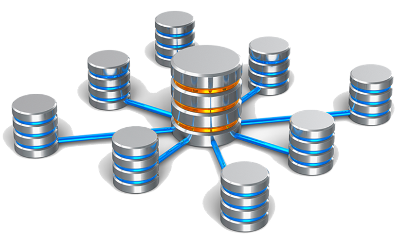

# **Introducció. Tipus de fitxers i accés a dades**

  

    🏆 <strong>Progrés d'aquesta secció:</strong> 0 de 4 superats (0%)
    ⭐ <strong>0 punts</strong>
  

  

    

  

Estem en l'era de la informació, tenim més informació que espai on poder guardar-la. A més, aquesta informació es necessita cada vegada més concreta i de forma immediata.
Com podem fer açò si la informació està en un archivador fisic al costat de la màquina de café?
És el que veurem en aquesta unitat de treball, conèixer els diferents formats, formes i arquitectures disponibles per a poder emmagatzemar la informació i desprenderla de forma immediata i integra.

Abans de l'aparició de les bases de dades, el processament automatitzat de la informació es feia mitjançant fitxers. Les aplicacions estaven orientades al procés. Els fitxers es diseñaron a mesura per a cada sistema d'informació sense un format comú.
Aquest plantejament no contemplava la gestió de la informació comú per a tots els sistemes d'informació. Una organització podria tindre diverses aplicacions gestionant la mateixa informació inicialment però cada una l'evolucionava de forma independent i inconexa.
Surgieron els següents problemes: Redundància de dades. Malament ús de l'espai d'emmagatzematge. Aumento del temps de processat. Incoherencia de la informació a causa de la redundància. Aïllament de la informació.
En definitiva, hubo una gran falta de flexibilitat originada en la dependència total de l'estructura física de les dades.

## **Fitxers de Informació**

### **Què és un fitxer?**

Conjunt d'informació relacionada, tratada com un tot i organitzada de forma estructurada. És una seqüència de dígitos binaris que organitza informació relacionada amb un mateix aspecte.
Els fitxers estan formats per registres lògics que contenen dades relatius a un mateix element o objecte I els registres estan dividits en camps que contenen cada una de les informacions elementals que formen un registre.
Les dades estan emmagatzemats de tal forma que es puguen afegir, suprimir, actualitzar o consultar individualment en qualsevol moment.
Com els fitxers són tan voluminosos es treballa amb gups de registres físics anomenats blocs.

### **Tipus de fitxers**

Els Fitxers es classifiquen segons:

1. **Organització**: Ens indica com es gestionen, emmagatzemen i accedeixen les dades dins dels fitxers. Diferents tipus d'organització permeten diferents tipus d'accés, eficiència en la cerca, i manipulació de les dades.

1. **Ús**: Ens indica com s'han d'utilitzar o tractar els fitxers dins d'un sistema o aplicació. Són etiquetats segons el propòsit que compleixen.

1. **Contingut**: És útil per a identificar la naturalesa de la informació que conté el fitxer i què tipus de programari o aplicació és necessari per a abrir-lo o procesar-lo.

#### **Segons Organització**

Segons la funció que vaja a ejercer els fitxers, éstos poden ser clasificats de diverses maneres.

1. **Fitxers secuencials**: Les dades es guarden de manera consecutiva, seguint un ordre fix. L'accés a les dades és seqüencial, el que significa que per a arribar a un dada específic, s'ha de passar per les dades anteriors.

1. **Fitxers directos o aleatorios**: Permeten l'accés directe a qualsevol posició dins del fitxer. Les dades es poden recuperar o escriure en qualsevol punt del fitxer sense necessitat de seguir un ordre seqüencial.

1. **Fitxers indexats**: Aquests fitxers tenen un índex que permet accedir directament a un registre o dada específic dins del fitxer, sense tindre que leer-lo secuencialment.

#### Segons Ús.

Segons la funció que vaja a ejercer els fitxers, éstos poden ser clasificats de diverses maneres.

1. 

**Fitxers permanentes**: contenen informació necessàries per al funcionament d'una aplicació. Tindran un período de permanencia en el sistema ampli.

  - **Fitxers maestros**:  Contenen l'estat actual de les dades que poden modificar-se des de l'aplicació. És la part central de l'aplicació, el seu nucli.

  - **Fitxers constants**: Són aquells que inclouen dades fixos per a l'aplicació. No solen ser modificats i es accedeix a ells per a realització de consultes.

  - **Fitxers histórics**: Contenen dades que van ser considerats com actuals en un periodo o situació anterior. S'utilitzen per a la reconstrucció de situacions.

1. 

**Fitxers temporals**: S'utilitzen per a emmagatzemar informació útil per a una part de l'aplicació, no per a tota ella. Són generats a partir de dades de fitxers permanentes. Tenen un corto periodo d'existència. Aquests es subdividen en:

  - **Fitxers intermedios**: Emmagatzemen resultats d'una aplicació que seran utilitzats per una altra.

  - **Fitxers de maniobras**: Emmagatzemen dades d'una aplicació que no poden ser mantenits en memòria principal per falta d'espai.

  - **Fitxers de resultats**: Emmagatzemen dades que seran transferits a un dispositiu d'eixida.

#### **Segons Contingut**

Segons el contingut que puguen guardar.

1. **Fitxers de text**: Contenen dades en format de text pla, sense formatacions especials. Es poden obrir i editar amb un editor de text senzill.

1. **Fitxers binaris**: Contenen dades en format binari, a menudo no llegibles directament per humans. S'utilitzen per a emmagatzemar informació complexa com imatges, vídeos, o programes.

### **Suports de la informació**

Els fitxers s'emmagatzemen en suports d'informació manejats per dispositius periférics de l'ordinador, que permeten llegir i grabar dades en el suport. Els suports més utilitzats per a emmagatzemar els fitxers són les cintas magnétiques i els discs.

- **Suports de Accés Directe a les dades (discs)**. Són els més empleats i l'accés a les dades pot hacerse de manera directa, podent colocarnos en la posició que ens interessa i llegir a partir d'ella.

- **Suports de Accés Seqüencial (cintas magnétiques)**. Es solen usar en còpies de seguretat i si deseamos llegir un dada que està en la mitad de la cinta, haurem de llegir tot el que hi ha fins a arribar a aquesta posició.

### **Medidors d'accés**

Els mètodes d'accés a fitxers, com l'accés seqüencial, directe i indexat, tenen diferents característiques que els fan més o menys adequats depenent de l'ús previsto..

- **Accés seqüencial**: Ideal per a processar fitxers complets de manera lineal; eficient però lent per a accedir a registres específics.

- **Accés directe**: Permet accés immediat a qualsevol registre, és molt eficient per a operacions específiques, però pot ser més complex de gestionar.

- **Fitxers indexats**: Combina accés ràpid amb flexibilitat en l'ús de múltiples criteris d'accés, però requereix més espai i és més complex de mantindre.

#### **Accés Seqüencial**

En l'accés seqüencial, les dades es llegixen o escriuen en un ordre determinat, des del principi fins al final del fitxer. Per a accedir a un registre específic, s'ha de llegir tot el que hi ha abans d'aquest punt.

##### **Avantatges**

- **Simplicitat**: És fàcil d'implementar i de comprendre, ja que les dades es procesan en ordre.

- **Bona eficiència per a processar tot el fitxer**: Si cal processar tot el fitxer, l'accés seqüencial és eficient perquè no hi ha salts entre registres.

- **Ocupació reducida d'espai**: No es requereixen índexs ni altres estructures de dades addicionals, el que redueix el mida del fitxer.

##### **Desavantatges**

- **Accés lent a dades específics**: Per a accedir a un registre concret, s'ha de llegir tot el fitxer o una gran part d'ell, el que pot ser ineficiente.

- **Difícil de modificar**: Si s'ha d'inserir o eliminar dades, pot requerir reescribir tot el fitxer o gran part d'ell.

#### **Accés Directe**

L'accés directe permet accedir a qualsevol registre del fitxer de manera immediata, utilitzant la seua posició específica. És adequat per a fitxers on els registres tenen un mida fix.

##### **Avantatges**

- **Accés ràpid a registres**: Es pot accedir directament a qualsevol registre del fitxer sense tindre que llegir els anteriors.

- **Millor per a operacions de lectura/escriptura específiques**: És eficient quan només es necessita accedir a registres específics o quan cal actualitzar registres amb freqüència.

- **Flexibilitat**: Permet tant la lectura com l'escriptura en qualsevol part del fitxer.

##### **Desavantatges**

- **Complexitat d'implementació**: És més complicat d'implementar que l'accés seqüencial, especialment quan els registres tenen mides variables.

- **Potencial desaprovechament d'espai**: Si els registres tenen mides variables, pot ser difícil gestionar l'espai de manera eficient.

- **Més difícil de mantindre**: Els canvis en l'estructura del fitxer poden requerir una reestructuració complexa del mateix.

#### **Accés Indexat**

Els fitxers indexats utilitzen un índex per a mantindre les posicions dels registres dins del fitxer. Açò permet un accés ràpid als registres mitjançant la cerca en l'índex, sense necessitat de llegir tot el fitxer.

##### **Avantatges**

- **Accés ràpid i eficient**: Permet accedir a registres específics molt ràpidament gràcies a l'índex, haciéndolo ideal per a grans volums de dades.

- **Actualització fàcil**: Afegir, modificar o eliminar registres es pot fer de manera més eficient que en fitxers secuencials, ja que només es necessiten actualitzar els índexs.

- **Flexibilitat en l'accés**: Permet accedir a registres per diferents criteris gràcies a la possibilitat de tindre múltiples índexs.

##### **Desavantatges**

- **Major ocupació d'espai**: Els índexs ocupen espai addicional al disc, el que aumenta el mida total del fitxer.

- **Complexitat de manteniment**: Gestionar i actualitzar índexs pot ser complex, especialment quan el fitxer és molt gran o quan hi ha múltiples índexs.

- **Rendiment variable**: En alguns casos, especialment amb molts índexs o amb operacions masivas, el rendiment pot disminuir.

### **Inconvenients dels sistemes de fitxer convencionals**

- Manteniment molt Costoso i Poc Ágil.

- No Garantir la Integritat de les dades.

- Qualsevol canvi en la definició del fitxer cal hacerla en el codi de tots els programes que l'usen.

- Informació Redundante.

- Per a agilitzar els processos es repeteixen els mateixos dades en diversos arxius.

- Diferents valors per a un mateix dada.

- Una modificació implica canvi en tots els fitxers.

- Més espai d'emmagatzematge.

---

## 🎮 Reptes Interactius d'Autoavaluació (+100 XP)

Comprova el teu domini sobre **1.1 Introducció. Tipus de fitxers i accés a dades** superant aquests 4 reptes gamificats (+25 punts cadascun):

  
🎯 <strong>Repte 1 (+25 pts):</strong> Quin és el principal avantatge d'un SGBD enfront dels sistemes tradicionals de fitxers?

  

    <button type="button" class="btn-mcq-opt" data-opt="A">A) Permet prescindir completament de la memòria RAM del servidor.</button>
    <button type="button" class="btn-mcq-opt" data-opt="B">B) Elimina la redundància descontrolada, garanteix la integritat i ofereix independència física i lògica de les dades.</button>
    <button type="button" class="btn-mcq-opt" data-opt="C">C) Impedeix que més d'un usuari accedisca a les dades al mateix temps.</button>
    <button type="button" class="btn-mcq-opt" data-opt="D">D) Emmagatzema totes les dades exclusivament en fitxers de text pla sense format.</button>
  

  

  
🎯 <strong>Repte 2 (+25 pts):</strong> En l'arquitectura ANSI-SPARC de tres nivells, quin nivell defineix les vistes parcials adaptades a cada grup d'usuaris?

  

    <button type="button" class="btn-mcq-opt" data-opt="A">A) Nivell intern o físic.</button>
    <button type="button" class="btn-mcq-opt" data-opt="B">B) Nivell conceptual o lògic global.</button>
    <button type="button" class="btn-mcq-opt" data-opt="C">C) Nivell extern (esquemes externs o vistes d'usuari).</button>
    <button type="button" class="btn-mcq-opt" data-opt="D">D) Nivell de xarxa física.</button>
  

  

  
✅ <strong>Repte 3 (Vertader o Fals · +25 pts):</strong> Segons el Reglament General de Protecció de Dades (RGPD) i la LOPDGDD, el tractament de dades personals requereix base legítima, minimització de dades i mesures de seguretat adequades.

  

    <button type="button" class="btn-vf" data-opt="V">Vertader (V)</button>
    <button type="button" class="btn-vf" data-opt="F">Fals (F)</button>
  

  

  
⌨️ <strong>Repte 4 (+25 pts):</strong> Quines són les sigles en valencià/castellà del programari encarregat de gestionar, administrar i controlar l'accés a una base de dades (Sistema Gestor de Bases de Dades)?

  

    <input type="text" class="quiz-input" placeholder="Escriu la resposta..." />
    <button type="button" class="btn-quiz-check">Comprovar</button>
  

  

### 📋 Llista de Comprovació i Rúbrica d'Assoliment

Marca cada criteri a mesura que completes l'estudi o la resolució pràctica d'aquesta pàgina (**1.1 Introducció. Tipus de fitxers i accés a dades**):

- [ ] He llegit detingudament la teoria o l'enunciat d'aquesta secció i he anotat els conceptes clau.
- [ ] He revisat els esquemes, taules o blocs de codi i he verificat que sé aplicar-los a l'entorn de treball.
- [ ] He resolt correctament els **4 reptes interactius** superiors obtenint els **100 punts XP**.
- [ ] He descarregat el comprovant oficial en PDF per a adjuntar-lo a la tasca d'**Aules**.

  <h3>📤 Comprovant de Lliurament per a Aules</h3>
  
Quan hages completat els reptes interactius i la llista d'autoavaluació d'aquesta pàgina, introdueix el teu nom i descarrega el teu certificat oficial en PDF per a adjuntar-lo a la tasca d'<strong>Aules</strong>.

  

    <label for="aules-student-name">👤 Nom i Cognoms de l'Alumne/a:</label>
    <input type="text" id="aules-student-name" class="aules-student-name" placeholder="Ex: Joan Garcia Pérez" />
  

  

    0/4 reptes completats (0%) · 0 punts · 0/4 criteris d'autoavaluació
  

  

    <button type="button" class="btn-aules-dl" data-module="BBDD" data-unit="UD01" data-activity="ut0101">📥 Descarregar Comprovant PDF</button>
    <button type="button" class="btn-aules-copy">📋 Copiar Resum al Porta-retalls</button>
  

  

